# Better Paseo

[English](README.md) | **简体中文**

一个 [Paseo](https://paseo.sh) 插件，重新绘制 Paseo 中所有 agent 的聊天时间线，不论背后是哪家服务（Claude Code、Codex、Oh My Pi 等）：工具调用、思考、回复、提问、待办和错误都画成紧凑、按类型区分、带语法高亮的行，配色跟随当前的 Paseo 主题；在 Web 生产构建上，整条时间线的渲染比 Paseo 自己画还快。

<picture>
  <source media="(prefers-color-scheme: dark)" srcset="images/hero-devices-dark.png">
  
</picture>

> Better Paseo fork 自 [ABorakati/beautiful-chat](https://github.com/ABorakati/beautiful-chat)，从 `42b61d8`（2026-09-23）接着开发。除 Eval、Ask、Task 和审批卡片外，Beautiful Chat 原有的卡片都还在；当前的 Paseo 不会把这几类内容交给插件（见[兼容性](#兼容性)）。本文介绍这个 fork 新增的功能和它的性能表现。

## 亮点

- **比不开插件还快。** Web 生产构建上，11 个回放场景里有 10 个主线程时间短于 Paseo 自己的时间线，少 14–38%，大 diff 持平；比 Beautiful Chat 少 12–91%。见下方[性能对比](#性能对比)。
- **内存占用接近不开插件。** Web 生产构建上，强制 GC 后的 JS 堆和不开插件相差 −1.4 到 +4.0MB，长回复少用 40.8MB；Beautiful Chat 在大 diff、100 轮历史和读 20 个文件上达到 213.6–242.6MB。见下方[内存对比](#内存对比)。
- **一个工具调用一行。** 调用默认折叠成 26pt 的一行，摘要按类型生成，点一下展开；完成、滚进历史、重新挂载后，展开状态都不会丢。
- **流式输出不跳动。** 回复按块增量解析，写到一半的代码围栏或表格不会先画成别的格式再跳回来；长回复流式时的布局偏移为 0。
- **不展开也能看内容。** 桌面上悬停折叠行或路径、手机上长按折叠行，就能在可滚动的面板里预览内容；图片可以打开全屏查看器。
- **跟随 Paseo。** 字体、字号和颜色默认跟随宿主；设置保存在 daemon 上，桌面、网页、iOS、Android 共用同一份。设置页支持英文和简体中文。

## 安装

```bash
paseo plugin install RoundRedDot/better-paseo
```

需要 Paseo `>=0.8.0`，开发与测量基于 Paseo 0.11.2。在 Paseo 0.8–0.10 上可以使用，但有部分兼容问题，见[兼容性](#兼容性)。在 **设置 → 插件 → Better Paseo** 中配置。Paseo 从 GitHub 安装插件，更新到新版本：

```bash
paseo plugin update better-paseo
```

---

## 性能对比

对比三种模式：**不开插件**（Paseo 0.11.2 自己画时间线）、**Beautiful Chat** `42b61d8` 和 **Better Paseo**。同一套宿主探针套在每一行外面，原生行和插件行的测量边界一致。测量于 2026-10-15，在 rrd-mac-studio（Apple M5 Max，18 核，64 GB，macOS 27.0.1）上进行，共 11 个脚本化场景。原始矩阵有 132 次 Web 和 120 次 iOS 运行；下方展示的 Web 数值每格取 3 次中位数，iOS 多数每格 2 次，100 轮历史和大段终端各 6 次。只有这一轮内部的结果可以互相比较。方法和原始报告见[基准文档](docs/bench/native-vs-fork/README.md)。

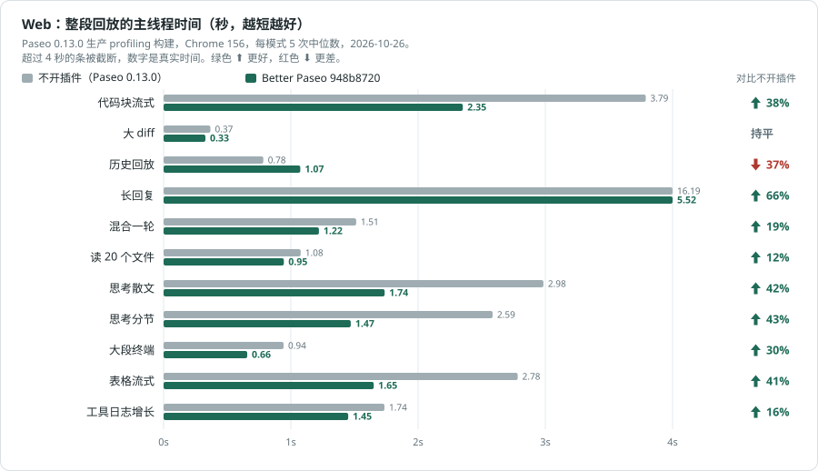

图中是整段回放的主线程 Task 时间。对比不开插件，Better Paseo 在 11 个场景中有 9 个更短；100 轮历史长 15%（0.854 秒对 0.745 秒），大 diff 因两边整段回放都不到 0.5 秒而记为持平（0.42 秒对 0.35 秒）。对比 Beautiful Chat，10 个场景更短，表格流式相差不到一成，记为持平（1.96 秒对 2.17 秒）。

主要渲染指标是整段回放的行渲染总量，即 allRows.sum 的累计值；越低越好。单次提交 p95 会受每次提交打包多少行影响，不能代表总工作量。

| 场景 | 不开插件 | Beautiful Chat | Better Paseo | 对比不开插件 | 对比 Beautiful Chat |
| --- | ---: | ---: | ---: | :--- | :--- |
| 代码块流式 | 1,284.0 | 1,304.1 | **280.5** | &ensp;78% | &ensp;78% |
| 大 diff | 33.6 | 562.9 | **21.0** | &ensp;38% | &ensp;96% |
| 100 轮历史 | 155.7 | 4,454.5 | **218.9** | &ensp;41% | &ensp;95% |
| 长回复 | 2,044.0 | 3,241.1 | **457.6** | &ensp;78% | &ensp;86% |
| 混合一轮 | 220.7 | 577.0 | **97.8** | &ensp;56% | &ensp;83% |
| 读 20 个文件 | 148.1 | 957.1 | **109.6** | &ensp;26% | &ensp;89% |
| 思考散文 | 550.5 | 1,031.4 | **154.0** | &ensp;72% | &ensp;85% |
| 思考分节 | 496.2 | 1,342.8 | **135.1** | &ensp;73% | &ensp;90% |
| 大段终端 | 38.5 | 266.9 | **19.5** | &ensp;49% | &ensp;93% |
| 表格流式 | 1,134.0 | 416.8 | **263.9** | &ensp;77% | &ensp;37% |
| 展开的工具 | 60.3 | 932.2 | **109.1** | &ensp;81% | &ensp;88% |

对比不开插件，Better Paseo 有 9 个场景的行渲染总量更低，100 轮历史（+41%）和展开的工具（+81%）更高。对比 Beautiful Chat，11 个场景的总量都更低。

流式过程中的累计布局偏移（越低越好）：

| 场景 | 不开插件 | Beautiful Chat | Better Paseo | 对比不开插件 | 对比 Beautiful Chat |
| --- | ---: | ---: | ---: | :--- | :--- |
| 长回复 | 0.181 | 0.648 | **0** | &ensp;100% | &ensp;100% |
| 代码块 | 0.043 | 0.127 | **0.012** | &ensp;73% | &ensp;91% |
| 表格 | 0.051 | 0.040 | **0.011** | &ensp;79% | &ensp;73% |
| 100 轮历史 | 0 | 0.208 | **0** | 持平 | &ensp;100% |

### iOS

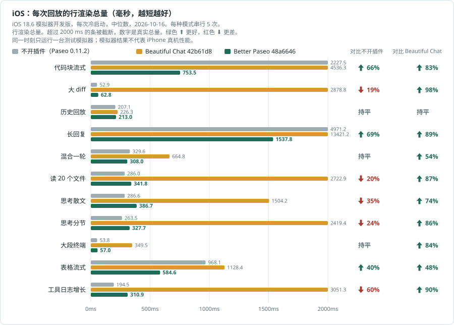

图和表都是每次回放的行渲染总量（allRows.sum，毫秒）。iOS 模拟器使用开发版，每次运行前冷启动。多数场景/模式每格 2 次；100 轮历史和大段终端每格 6 次。100 轮历史有一部分样本暴露于多模拟器并行负载：所有模式的总行渲染都高约 3%，因此接近阈值的小差异要谨慎看。基准文档记录了负载区间和样本范围。

不到一成算持平。对比不开插件，Better Paseo 有 5 个场景更低，2 个持平（大 diff、100 轮历史），4 个更高（读 20 个文件、两段思考和展开的工具）。对比 Beautiful Chat，11 个场景都更低。这里不把单次提交 p95 当作总量；它会随提交批次大小变化。

| 场景 | 不开插件 | Beautiful Chat | Better Paseo | 对比不开插件 | 对比 Beautiful Chat |
| --- | ---: | ---: | ---: | :--- | :--- |
| 代码块流式 | 2,264.5 | 4,503.2 | **709.6** | &ensp;69% | &ensp;84% |
| 大 diff | 58.2 | 5,562.7 | **46.2** | &ensp;21% | &ensp;99% |
| 100 轮历史 | 191.9 | 224.6 | **202.1** | 持平 | &ensp;10% |
| 长回复 | 5,076.6 | 13,397.1 | **1,510.0** | &ensp;70% | &ensp;89% |
| 混合一轮 | 282.9 | 624.8 | **247.2** | &ensp;13% | &ensp;60% |
| 读 20 个文件 | 276.1 | 2,622.2 | **305.8** | &ensp;11% | &ensp;88% |
| 思考散文 | 262.4 | 1,465.5 | **321.3** | &ensp;22% | &ensp;78% |
| 思考分节 | 244.5 | 2,438.8 | **283.5** | &ensp;16% | &ensp;88% |
| 大段终端 | 48.1 | 362.8 | **45.1** | 持平 | &ensp;88% |
| 表格流式 | 972.1 | 1,164.0 | **563.0** | &ensp;42% | &ensp;52% |
| 展开的工具 | 165.8 | 3,032.6 | **256.6** | &ensp;55% | &ensp;92% |

&ensp; 绿色表示行渲染更少，&ensp; 红色表示更多。相差不到一成记为持平；Web 另有整段 Task 回放两边都不到 0.5 秒时记为持平。iOS 只套用一成规则。

**测量方法。** 只用于测量的 Paseo 0.11.2 补丁（`759532509`，`docs/bench/native-vs-fork/tools/paseo-host-probe.patch`）给时间线的每一行套上同一个 `React.Profiler`。Web 使用带探针的生产导出（主 JS sha256 前缀 `9dd7eab4521434bc`），在无界面 Chrome 155.0.8059.40、1280×900 下运行；Playwright 在每次回放前后读取 Chrome DevTools Protocol 指标，读内存前先强制 GC。iOS 为 iOS 18.6 模拟器上的开发版 `sh.paseo.debug`，每次运行前冷启动。Better Paseo 为提交 `37bfb60`。各模式使用同一个私有 daemon 和默认插件设置，轮换顺序运行，每次都核对屏幕上加载的是哪个版本。Web：11 个场景 × 3 种模式 × 3 次，页面错误为 0。iOS 有一部分样本是三台模拟器同时运行的，基准文档列出了具体样本，以及这种负载让 100 轮历史整体上浮约 3% 的情况。方法、工具和原始数据见 [`docs/bench/native-vs-fork`](docs/bench/native-vs-fork/README.md)（`raw/web-2026-10-15b`、`raw/ios-2026-10-15b`）；与 Beautiful Chat 的每一处差异见 [`docs/fork-vs-upstream.md`](docs/fork-vs-upstream.md)。图表由 `node docs/perf/readme-charts.mjs` 根据这些数据生成；百分比按舍入前的中位数计算。

### 长会话加载：下轮必测

下轮性能对比新增脱敏合成夹具 `history-long-load`：810 条投影记录、一条 59,427 字符的回复，以及跨历史交叠的工具生命周期更新。它测的是已存在会话的加载，不是流式吞吐；上方已有图表尚未包含这项。

| 测试项 | 不开插件 | Beautiful Chat | Better Paseo |
| --- | --- | --- | --- |
| 冷启动打开长会话 | 待测 | 待测 | 待测 |
| 向上滚动加载更早记录 | 待测 | 待测 | 待测 |
| 滚离后重新挂载长回复 | 待测 | 待测 | 待测 |

[夹具、步骤和指标](docs/bench/long-history-load/README.md)已准备，下轮运行后再补结果；目前不宣称这些测试的性能收益。

### 时间省在哪里

- **没变的卡片不再重渲染。** Paseo 每来一个流式 chunk，都会给每一行传入新的 `theme` 和 `data` 对象。按语义比较的 `React.memo` 让没变化的卡片直接跳过渲染；只有最新一条提问跟着 agent 状态更新。100 轮历史回放里，整页渲染次数从 172,327 降到 1,319。
- **回复增量解析。** 用 `marked` 加 `remend` 按块解析；每条回复缓存已经定稿的块，只修补还在增长的那一块。离线、Web、iOS 上，流式过程中的格式翻转和高度回退都是 0。
- **代码只高亮一次，而且只在写完之后。** 没闭合的代码块不请求高亮；Shiki 跑在 daemon 上（`highlight.tokens`）。折叠的行不挂载展开体，读 20 个文件的高亮请求从 48 次降到 0。
- **大段输出分批画。** 代码和终端面板先画 400 行，再分批补上，并提供「显示全部」。iOS 上约 5,000 行的 diff，工具卡片 p50 从 2.2 秒降到 19.8ms。
- **没有装饰性循环动画。** 阴影、磨砂、光晕和呼吸动画都删了，只留运行中的圆点；在 Web 上它是 CSS 动画，不再每一帧都提交一次所在的行（混合一轮的行提交次数 1,518 → 196）。系统开启「减少动态效果」时圆点静止。
- **不再晚一拍长高。** 不逐字揭示的回复在拿到文本的同一次提交里就画出来，Paseo 的贴底滚动跟得上，回复不会事后把底部那一行往下推。
- **客户端包更小。** Paseo 每次重连都会重新发送整个客户端包。品牌图标和 Inter 字体改由 daemon 按需下发（`marks.bitmaps`、`fonts.embedded`），内嵌的 Iosevka 已移除，包内只保留 ASCII 字符，Hermes 按单字节保存源码。

---

## 内存对比

Web 生产构建，测于 2026-10-15。每格是强制 GC 后 3 次运行的中位数。表格统计 JS 堆，不代表整个应用或进程的总内存。差值是 Better Paseo 减去对照，按舍入前的中位数计算；负数表示更省。单位均为 MB。

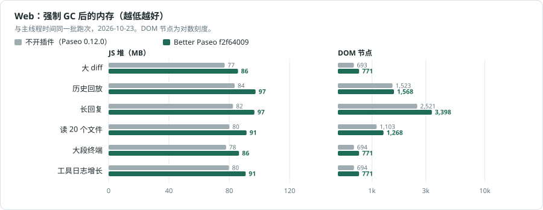

对比不开插件，长回复少用 41.1 MB；其他场景相差 −2.0 到 +5.8 MB，多数是多出几 MB，这是插件自身的常驻开销。对比 Beautiful Chat，大 diff、100 轮历史和读 20 个文件少用 103.6–124.5 MB，大段终端少用 13.2 MB，其他场景相差 −7.6 到 +0.8 MB。Beautiful Chat 默认展开运行中的工具；Better Paseo 默认保持折叠。

| 场景 | 不开插件 | Beautiful Chat | Better Paseo | 对比不开插件 | 对比 Beautiful Chat |
| --- | ---: | ---: | ---: | ---: | ---: |
| 代码块流式 | 115.9 | 115.4 | **113.9** | -2.0 | -1.5 |
| 大 diff | 108.5 | 216.6 | **113.0** | +4.5 | -103.6 |
| 100 轮历史 | 116.0 | 239.1 | **120.9** | +4.9 | -118.1 |
| 长回复 | 158.4 | 116.7 | **117.3** | -41.1 | +0.6 |
| 混合一轮 | 113.6 | 123.3 | **115.7** | +2.2 | -7.6 |
| 读 20 个文件 | 113.0 | 242.5 | **118.0** | +5.0 | -124.5 |
| 思考散文 | 110.6 | 114.2 | **113.9** | +3.3 | -0.3 |
| 思考分节 | 110.4 | 114.3 | **114.2** | +3.8 | -0.2 |
| 大段终端 | 110.3 | 127.4 | **114.2** | +3.9 | -13.2 |
| 表格流式 | 114.7 | 114.6 | **115.4** | +0.7 | +0.8 |
| 展开的工具 | 112.6 | 124.4 | **118.4** | +5.8 | -6.0 |

原始数据见 [Web 跑次](docs/bench/native-vs-fork/raw/web-2026-10-15b)。

---

## 功能

以下功能都建立在 Beautiful Chat 已有的能力之上：按类型区分的工具卡片、Shiki 高亮、读图、在文件管理器中显示，以及插件自己的查找栏。


### 工具行

大部分卡片读取的是 Paseo 交给每个插件的工具明细，所以不论调用来自哪个 agent 都能使用：读、写、编辑、Shell 和 Git 命令、搜索、抓取网页、子 agent、计划、MCP 调用（兼容 Claude 的 `mcp__server__tool`、Codex 的 `server.tool` 和 Oh My Pi 的 `server / tool` 三种写法），以及 Paseo 自己的工具。Paseo 以纯文本形式交来的调用，画成「标题 + 正文」的卡片。

Oh My Pi 的 `hub` 工具和它的 GitHub 设备调用按工具名识别，有专门的卡片；其他 agent 不会发出这些调用。在 Paseo 0.11 上，Oh My Pi 的 `eval`、`ask` 以纯文本调用形式交给插件，`task` 则作为子 agent 条目交来。`ask` 带有结构化 `questions` 数据时会显示问答记录；否则仍显示通用文本卡片。

- 每个调用默认是一条无边框的行，桌面 26pt、触控 28pt，摘要按类型生成：命令、路径和行号范围、编辑的 `+4 −2`、退出码和耗时。点一下展开卡片。
- 展开状态按调用（`agentId:callId`）记在组件之外，完成、滚进历史、重新挂载都不会丢。iOS 上展开时行头留在按下的位置，内容向下打开。
- 失败的调用只显示一行错误；打开「自动展开失败的调用」后，没有保存过展开状态的失败调用会自动展开。
- 每一行记住自己首次出现的时间，并行读取时先完成的那一行不会再换位置、改间距。
- 行首可显示图标、名称或两者都显示。长代码和终端输出先折叠到 12 行。
- 「块字号」可调整工具行、思考、待办和提示中的正文；代码、diff 和终端输出仍使用代码字号。
- Paseo 自己的工具带 Paseo 标识；agent 卡片和回复信息栏使用 agent 所属服务商的标识，不随所选模型改变。
- Oh My Pi 的 `hub` 工具每个操作都有对应卡片：进程、消息和任务快照。卡片只做展示，不带按钮，因为插件无法重启或取消任何东西。
- 不同 agent 发出的受支持提问调用，只要带结构化 `questions` 数据，就会显示分页问答记录，包括选项、已记录的回答和状态。「显示原始数据」可查看原始内容；这类卡片只展示记录，回答仍由 Paseo 处理。预览中的问题会自动换行，便于阅读。

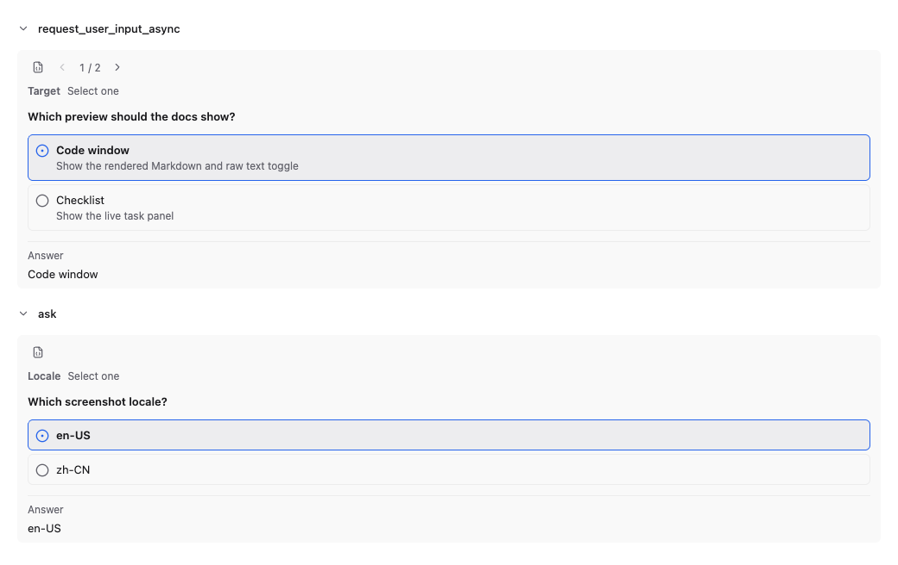

| Shell 与 Git | Read |
| --- | --- |
| 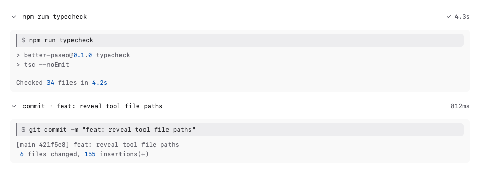 | 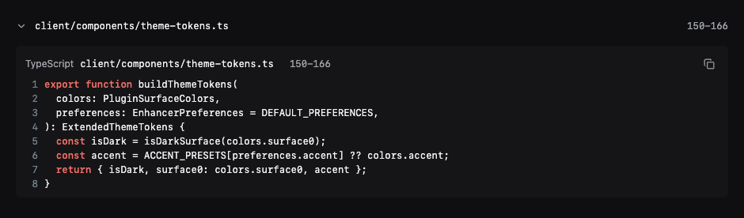 |
| **Edit** | **Hub**（Oh My Pi） |
| 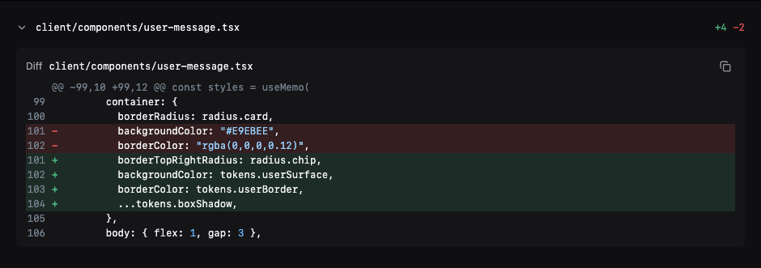 | 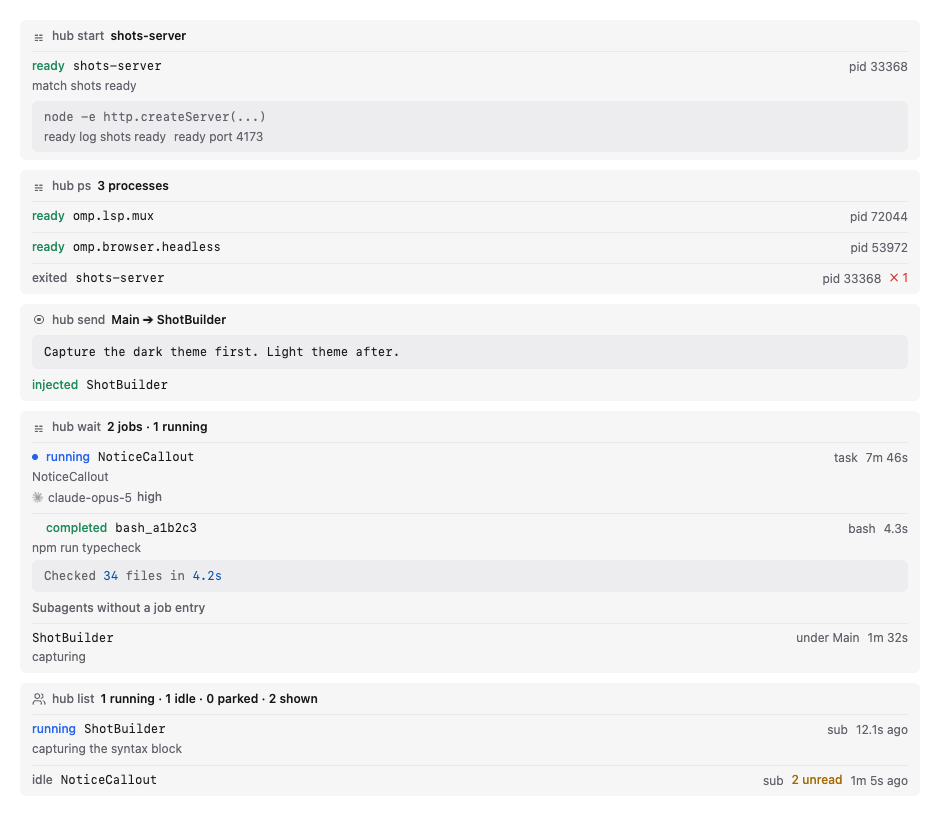 |

<details>
<summary>更多卡片：MCP、Paseo 工具、读图、代码块、<code>thinking</code> 工具</summary>

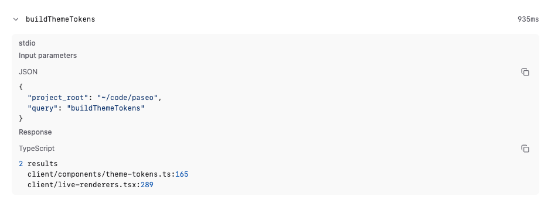
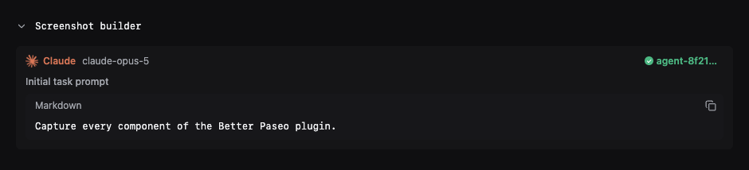

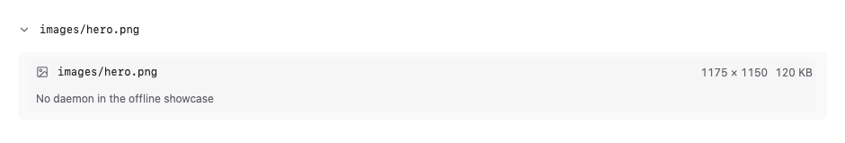
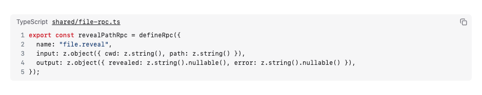

</details>

### 思考与待办

- 思考只按真实结构（`**标题**` 和各级标题）分段，不再按空行编号。默认折叠，流式时行内实时预览当前标题。
- 只有本机真的看到了思考的流式过程，才显示耗时；不做估算。
- 待办显示阶段名、每项状态、耗时，以及被阻塞的任务和原因。进度环显示已完成项，全部完成后会变为勾选标记。标题栏的窗口按钮会在浮窗中打开实时待办；使用时间线时浮窗保持打开，并始终跟随最新列表，长标题也可换行。

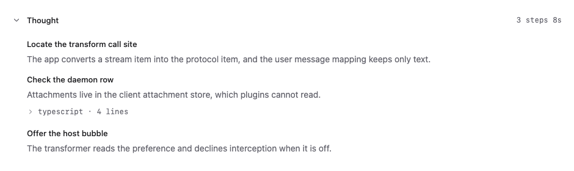
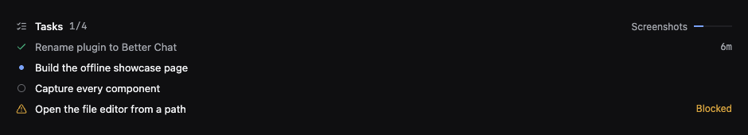


### 回复

- Markdown 由插件绘制：标题、列表、任务列表、引用、高亮代码块和本地图片。提供「文档」「紧凑」「终端」三种样式。
- 未标语言、标为 Markdown 或纯文本的代码块可在最大化预览窗口中打开，并在渲染后的 Markdown 和原始文本间切换、复制源码；原始文本视图使用「自动换行」设置。
- 表格有列线、表头底色和圆角外框；单元格比正文小一号、行距更紧，列宽按等宽数字和中文字宽估算。
- 每张表格左上角都有复制按钮。网页和桌面上，悬停（触屏上长按）会展开「复制为 Markdown」和「复制为图片」，后者复制表格画出来的样子；直接点按复制 Markdown 源码。iOS 和 Android 上点按复制 Markdown。
- 网页和桌面上双击单元格可选中其中的文字；iOS 和 Android 上对同一单元格连续点按两次即可选中。表格角落菜单始终提供「复制选中」，Paseo 支持向输入框添加文字时也会显示「添加到对话」。
- 每个已完成轮次会在最终回复下方显示独立信息栏，提供复制和时间；有数据时还会显示服务商标识、模型、思考等级和本轮实际耗时。点按模型名称可复制，并会显示提示；后续轮次运行时，已完成轮次的信息栏仍会保留。关闭「回复使用插件 Markdown」可恢复 Paseo 完整的信息栏和 Fork 操作。
- 一段回复里的多张本地图片都会画出来。
- 关闭「回复使用插件 Markdown」即可把回复交回 Paseo，由它绘制 mermaid 图表、宿主图片和文件链接。

| 表格复制菜单 | 选中单元格后的操作 |
| --- | --- |
|  |  |

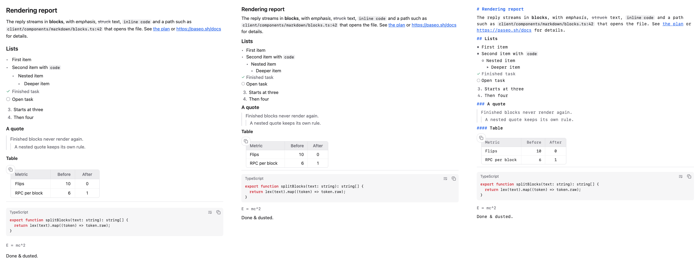
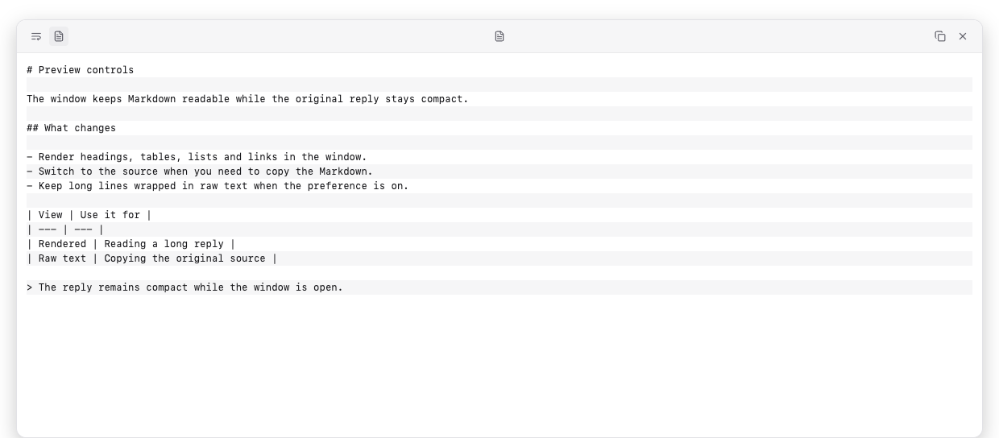

### 图片

- 读图时画出文件本身：从文件头读出的尺寸和大小、按内容撑满的缩略图，以及一个显示/隐藏开关，切换时行头停在按下的位置。
- 全屏查看器支持按钮、滚轮或双指以指针为中心缩放，拖动平移，双击复位，并可在文件管理器中显示。手机上长按这一行会直接打开查看器。
- 图片数据在第一次展开、预览或长按时从 daemon（`file.image`）读取。支持 PNG、JPEG、GIF、WebP、AVIF、BMP、ICO 和 SVG；超过 3MB 的文件只显示大小，不内联。
- 多个读图卡片引用同一张图片时，每个卡片都会显示它。


### 悬停预览

桌面上把鼠标停在折叠的工具行、思考行、图片或路径上，等待设定的延迟（0–10 秒）后弹出可滚动的预览。面板可换行、显示行号和奇偶行底色，也可移动、调整大小或最大化；待办标题栏可以把实时清单打开为浮窗，Markdown 代码块也有自己的最大化预览。若预览正跟随流式输出末尾，内容增长时会平滑跟随。手机上长按折叠的行即可打开同样的预览，不会盖住顶部栏和输入框。

### 路径、复制与选中

- 路径相对工作区显示，过长时在中间省略、保留文件名；worktree 的主仓库以名称显示。复制时总是得到绝对路径。
- 复制统一走宿主的 `copyText`，在 iOS 和 Android 上同样可用：桌面悬停、触控长按，或 `⋯` 菜单。纯文本代码块可换行，并带复制按钮。iOS 上长按回复正文可以放置光标、拖动选区。
- 网页和桌面上，在卡片里选中文字会出现「复制」和「添加到对话」；后者把选中内容作为引用放进输入框，选自代码时放成代码块。页面滚动时工具栏会收起；当前没有可见输入框时，「添加到对话」会改为复制选中内容。


### 提问气泡

默认由 Paseo 绘制提问，保留粘贴的图片和回退菜单。打开「增强提问气泡」后，符合条件的提问会改用插件气泡：复制按钮常驻，并显示本轮 token 用量。插件能取得受支持的图片源时也会绘制图片；含无法呈现附件的提问仍交给 Paseo。回退菜单在当前 Paseo 支持时保留。


### 错误与系统消息

- agent 报错时画成一张提示卡片，显示错误信息。
- Oh My Pi 会把任务结果、转发的消息和提醒包在 `<system-notice>`、`<irc>` 等标签里，作为消息文本发出，Paseo 把它们当成回复。打开「回复使用插件 Markdown」时，插件把这些画成系统卡片（标题，加上 agent、状态、耗时等小标签，以及其余正文），而不是原样显示 XML。

权限请求不会被重画：仍由 Paseo 绘制，同意和拒绝也由 Paseo 负责。

---

## 设置

**设置 → 插件 → Better Paseo。** 一段用时间线组件绘制的示例对话会实时跟随每一项修改：桌面宽窗口下显示在选项旁边，其他情况显示在选项上方；其中 Read 行的悬停预览常驻展开。在网页和桌面上，预览标题栏的「桌面端 / 移动端」切换可以按 iOS 样式、手机宽度绘制同一段对话，并使用你选的行内代码颜色。父选项关闭时，子选项变灰；「恢复全部默认设置」需要再点一次确认。

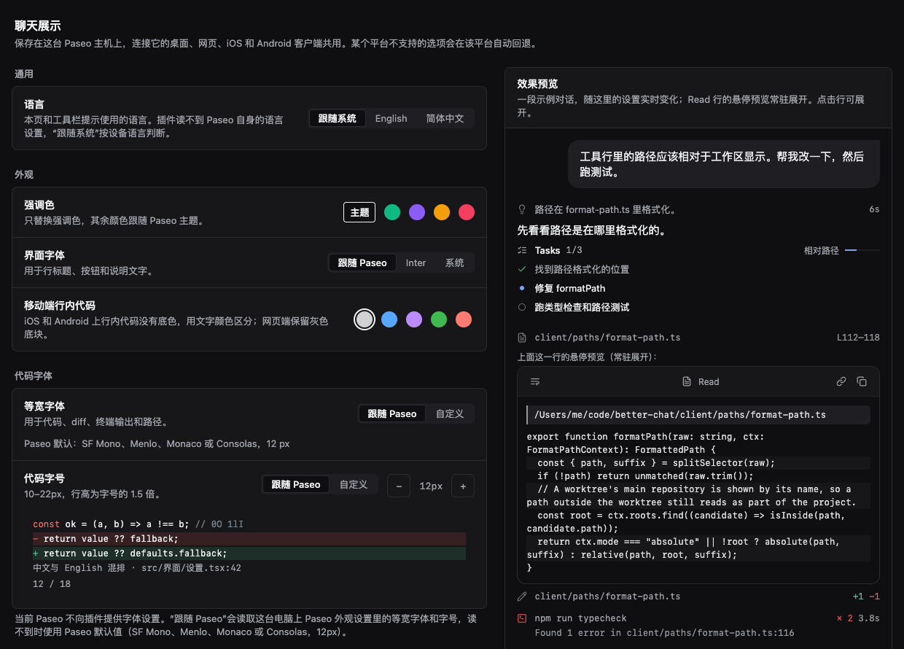
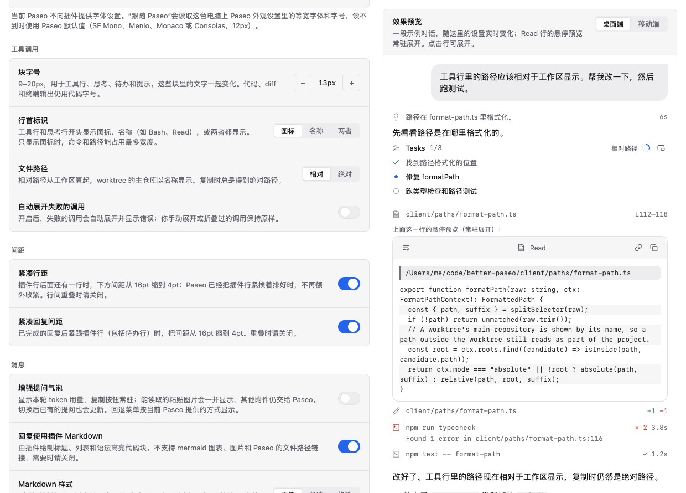

| 分组 | 设置 | 默认 | 作用 |
| --- | --- | --- | --- |
| 通用 | 语言 | 跟随系统 | 设置页和工具栏提示使用英文或简体中文。插件读不到 Paseo 自身的语言设置。 |
| 外观 | 强调色 | 主题 | 跟随 Paseo 主题，或选翠绿、紫罗兰、琥珀、玫瑰。只替换强调色。 |
| 外观 | 移动端行内代码 | 深灰 | iOS 和 Android 上行内代码的文字颜色：深灰、蓝、紫、绿、珊瑚红。网页端保留灰色底块。 |
| 外观 | 界面字体 | 跟随 Paseo | Paseo 的界面字体、Inter（仅网页，由 daemon 下发）或系统字体。 |
| 代码字体 | 等宽字体 | 跟随 Paseo | 可选跟随 Paseo 或自定义。跟随 Paseo 的顺序是：宿主向插件提供字体设置时用宿主的设置；否则在网页和桌面上读取 Paseo 外观设置里的等宽字体和字号；再否则用 Paseo 默认等宽字体。iOS 和 Android 上「自定义」只列出系统自带的字体。 |
| 代码字体 | 自定义等宽字体 | 空 | 仅「等宽字体」选「自定义」时生效。网页端可填字体族名称（最多 200 字符，不存在时沿等宽字体栈回退）；iOS 和 Android 只能选择平台提供的字体。 |
| 代码字体 | 代码字号 | 跟随 Paseo | 或 10–22px，行高为字号的 1.5 倍。作用于代码、diff、终端和路径。 |
| 工具调用 | 块字号 | 13px | 9–20px，用于工具行、思考、待办和提示。这些块里的文字一起变化。代码、diff 和终端输出仍用代码字号。 |
| 工具调用 | 行首标识 | 图标 | 工具行和思考行开头显示图标、名称（如 Bash、Read）或两者。 |
| 工具调用 | 自动展开失败的调用 | 关 | 开启后，失败的调用会自动展开并显示错误；你手动展开或折叠过的调用保持原样。 |
| 工具调用 | 文件路径 | 相对 | 相对工作区或绝对路径。复制时总是绝对路径。 |
| 间距 | 紧凑行距 | 开 | 插件行后面还有一行时，下方间距从 16pt 缩到 4pt；Paseo 已经把插件行紧挨着排好时，不再额外收紧。行间重叠时请关闭。 |
| 间距 | 紧凑回复间距 | 开 | 已完成的回复后紧跟插件行（包括待办行）时，把间距从 16pt 缩到 4pt。重叠时请关闭。 |
| 消息 | 增强提问气泡 | 关 | 显示本轮 token 用量，复制按钮常驻；能读取的粘贴图片会一并显示，其他附件仍交给 Paseo。切换后已有的提问也会更新。回退菜单按当前 Paseo 提供的方式显示。 |
| 消息 | 回复使用插件 Markdown | 开 | 关闭后回复交给 Paseo，恢复宿主完整信息栏，并可用 mermaid、宿主图片和 Paseo 的文件链接。 |
| 消息 | Markdown 样式 | 文档 | 文档、紧凑或终端（正文使用代码字体）。 |
| 消息 | 选中文字工具栏 | 开 | 网页和桌面：选中文字后显示「复制」和「添加到对话」；滚动时工具栏收起。 |
| 悬停预览 | 悬停预览 | 开 | 桌面悬停折叠行或路径时预览内容；手机长按折叠行可预览。 |
| 悬停预览 | 延迟 | 1 秒 | 桌面上预览弹出前的等待时间，0–10 秒，保存精度为 0.1 秒。 |
| 悬停预览 | 自动换行 | 开 | 预览面板和最大化代码预览的原始文本会自动换行；关闭后可横向滚动。 |
| 悬停预览 | 显示行号 | 关 | 在文件、diff 和命令输出左侧显示行号；diff 显示的是文件中的行号。 |
| 悬停预览 | 奇偶行底色 | 开 | 在预览中隔行添加底色。 |

**设置存在哪里。** 偏好通过 SDK 的主机级设置保存在 daemon 上（`shared/preferences-settings.ts` 里的 `presentation` 记录），所以**连接同一个 daemon 的所有客户端共用一份设置**：在桌面上改，iOS 上也会生效，反之亦然。某个平台画不出来的值会按原样保存，只在绘制时降级（自定义字体在 iOS 和 Android 上变成系统等宽字体，Inter 变成系统字体）。网页端的 `localStorage` 只用作快速启动的缓存。设置到达之前，卡片先用缓存或默认值绘制，到达后切换一次。

**设置立即生效。** 本地偏好状态更新后，已经显示的插件条目也会立即重绘。daemon 会保存设置并同步给其他连接的客户端，无需重新加载聊天。「自动展开失败的调用」会沿用已保存的逐项展开状态；没有记录时才采用设置作为初始状态。

---

## 查找文字

Paseo 自带的聊天查找（Ctrl/Cmd+F）定位不到插件绘制的行，因为转换后的行带的是另一个 id。所以 Better Paseo 在桌面和网页上接管 Ctrl/Cmd+F，在聊天上方打开自己的查找栏。它搜索已经渲染的所有内容，包括工具卡片和结构化问答记录：Enter 下一个，Shift+Enter 上一个，Escape 关闭。它只能搜到已加载的消息，往上滚动即可包含更早的历史。

如果想对回复使用 Paseo 原生查找（它也能搜到未加载的历史），关闭「回复使用插件 Markdown」（以及已开启的「增强提问气泡」）。这样回复和提问由 Paseo 自己绘制，Ctrl/Cmd+F 打开的就是 Paseo 的查找。工具、思考和待办卡片仍由插件绘制。

## 打开文件

读、写、编辑结果和代码块里的文件名都是链接。在桌面上，它调用 daemon 端的 `file.reveal`，按 agent 的工作目录解析路径，并在文件管理器中显示：Windows 用 `explorer.exe /select,`，macOS 用 `open -R`，其他系统用 `xdg-open <目录>`。在触控设备上，同样的点按改为复制绝对路径，因为手机打不开 daemon 那台机器的文件管理器。

## 常见问题

| 现象 | 处理 |
| --- | --- |
| 行与行重叠，或回复盖住了下一行 | 关闭「紧凑行距」或「紧凑回复间距」。 |
| 回复里需要 mermaid 图、宿主图片或 Paseo 的文件链接 | 关闭「回复使用插件 Markdown」。 |
| 手机上选中表格单元格后没有「添加到对话」 | Paseo 暂不支持向输入框添加文字；「复制选中」始终可用。 |
| 含附件的提问需要由 Paseo 绘制 | 关闭「增强提问气泡」。插件无法呈现的附件会自动交给 Paseo。 |
| Ctrl/Cmd+F 搜不到较早的消息 | 先往上滚动加载，或按上文把回复交回 Paseo。 |
| 旧的一轮对话没有 token 数字 | 用量不保存在时间线条目上，只有本客户端实时看到的轮次才显示。 |
| Grok 的 Copy 工具栏和轮次详情不显示耗时 | 上游工具问题：Grok 的 ACP 历史回放未保留可靠的逐条时间戳，回放记录可能时间相同或仅相差 1 毫秒，导致误显示为 `0秒`。在上游提供可靠计时前，Better Paseo 隐藏 `grok` 服务商的耗时；通过其他服务商使用的 Grok 模型不受影响。 |
| 推送了修复，但界面没变化 | 运行 `paseo plugin update better-paseo`；Paseo 运行的是 GitHub 上的版本。 |

## 兼容性

Better Paseo 以 Paseo 0.11 及以后的版本为目标。在 Paseo 0.8–0.10 上可以安装并绘制时间线，但有以下已知问题：

- 在这些版本上，Oh My Pi 的 `eval` 和 `ask` 调用以原工具名到达插件，而不是经过 Paseo 0.11 的纯文本转换。`eval` 仍显示为通用卡片；`ask` 只有在输入含结构化 `questions` 数组时才显示问答记录，否则也显示为通用卡片。
- 部分功能取决于宿主能力，详见[等待 Paseo 支持的改动](#等待-paseo-支持的改动)；宿主能力探测已在 0.11.2 上验证。

## 等待 Paseo 支持的改动

Better Paseo 在已发布的 Paseo 上就能用，并会探测较新的宿主能力，没有时自动回退。下面几项宿主改动已在 Paseo 的 fork 里验证，尚未发布：

- 插件工具行与原生工具行的间距对齐（约 46pt 收到 30pt，原生是 32pt）。在此之前由「紧凑行距」在适用处把间距从 16pt 缩到 4pt。
- Paseo 向插件提供字体设置，修改外观后插件实时跟上。在此之前，网页和桌面读取 Paseo 保存在本地的外观设置。
- Paseo 向插件提供向输入框添加文字的能力，以便触屏表格选区同时显示「添加到对话」和「复制选中」。在此之前，表格角落菜单仍可复制选中的单元格。
- 插件包在 Hermes 上执行前，先把 `class` 语法降级。
- 当前轮提问吸顶、展开卡片的标题吸顶；插件一侧已经接好。

把多个调用合并成「Read 12 files」一行需要宿主的分组 API；在开发版模拟器上展开 5,000 行的代码块仍需约 30 秒，彻底解决需要宿主的虚拟滚动。

开发过程中遇到的 SDK 限制、证据和对应的绕行方式见 [`docs/plugin-sdk-limitations.md`](docs/plugin-sdk-limitations.md)（英文）。

## 开发

```bash
npm install
npm run typecheck
npm test
npm run check:hermes
paseo plugin reload better-paseo
```

`npm run check:hermes` 会在 Hermes（iOS 和 Android 应用使用的 JS 引擎）里编译并运行客户端包；在网页上能跑的代码，到了 Hermes 仍可能失败，并导致整个插件无法加载。它检查的规则、项目结构，以及如何重新生成截图和图表，见 [`docs/development.md`](docs/development.md)（英文）。

## 许可证

MIT
