# Better Paseo

[English](README.md) | **简体中文**

一个 [Paseo](https://paseo.sh) 插件，重新绘制 Paseo 中所有 agent 的聊天时间线，不论背后是哪家服务（Claude Code、Codex、Oh My Pi 等）：工具调用、思考、回复、提问、待办和错误都画成紧凑、按类型区分、带语法高亮的行，配色跟随当前的 Paseo 主题。它还加了一个 **Tasks** 看板，把这台主机上的所有 agent 按状态分列铺开。界面按手上的设备来画：手机上是可以双指缩放字号的详情抽屉和左右滑动的单列看板，iPad 上是浮动面板、侧边面板，以及带详情侧栏或底部弹层的看板。下方实测对比时间线和 Paseo 原生时间线的开销。

https://github.com/user-attachments/assets/2b16b0a5-8567-4f3e-8fbd-4a594c74d2da

<sub>GitHub App 里看不到播放器？[打开时间线视频](https://github.com/RoundRedDot/better-paseo/releases/download/promo-v13/better-paseo-promo-v13-timeline-web.mp4)。</sub>

https://github.com/user-attachments/assets/3ddf3024-c67a-4690-a3a9-d01348b034df

<sub>GitHub App 里看不到播放器？[打开Tasks视频](https://github.com/RoundRedDot/better-paseo/releases/download/promo-v13/better-paseo-promo-v13-tasks-web.mp4)。</sub>


<picture><source media="(prefers-color-scheme: dark)" srcset="images/tasks-board-zh-dark.png"></picture>
<picture><source media="(prefers-color-scheme: dark)" srcset="images/timeline-zh-dark.png"></picture>

> Better Paseo fork 自 [ABorakati/beautiful-chat](https://github.com/ABorakati/beautiful-chat)，从 `42b61d8`（2026-09-23）接着开发。除 Eval、Ask、Task 和审批卡片外，Beautiful Chat 原有的卡片都还在；当前的 Paseo 不会把这几类内容交给插件（见[兼容性](#兼容性)）。本文介绍这个 fork 新增的功能和它的性能表现。

## 亮点

- **为手机和 iPad 设计。** 手机上点按一行，它会在底部抽屉里打开，双指可以调字号；iPad 上则是浮动面板或侧边面板。Tasks 看板在手机上一次显示一列，在平板上是多列泳道，配详情侧栏、浮动面板或底部弹层。见[手机与 iPad](#手机与-ipad)。

- **性能实测。** 对照 Paseo 0.12.0，本轮 Web 与 iOS 共串行回放 220 次（每格 5 次）；长回复的 Web 主线程时间减少 80%。详见[性能对比](#性能对比)。

- **一个工具调用一行。** 调用默认折叠成 26pt 的一行，摘要按类型生成；完成、滚进历史、重新挂载后，展开状态都不会丢。
- **每个工具都有自己的图标。** Shell 行画出所运行的程序（101 个图标覆盖 209 个程序，从 `python` 到 `kubectl`），MCP 行画出所调用的服务（75 个服务，从 Linear 到飞书），其余调用按类型画。见[工具图标](#工具图标)。
- **区块详情。** 工具、思考、待办和代码块都能在面板里阅读，在标题栏前后切换本轮的各个区块，流式输出时跟随末尾。见[区块详情](#区块详情)。
- **逐块呈现流式回复。** Markdown 缓存已完成的块，持续修补增长中的代码和表格。
- **Tasks 看板。** 按状态（待输入、运行中、待查看、已完成、已归档）铺开主机上的所有 agent，标签颜色和项目图标与 Paseo 一致，卡片上就能停止、标为已读、归档、处理权限请求；详情里有本轮计时和 token、首条消息、最后回复消息、子任务和用量。见 [Tasks 看板](#tasks-看板)。
- **跟随 Paseo。** 字体、字号、颜色和语言默认跟随宿主；设置保存在 daemon 上，桌面、网页、iOS、Android 共用同一份。
- **重连负担小。** 客户端以压缩后的形式下发，Tasks 看板只在开启时加载，Paseo 每次重连都要重发的插件清单从 1,977 KB 降到 722 KB（2026-10-23 改动合入时在 Paseo 0.12 daemon 上测得）。

- **内存实测。** 所有 Web 场景中，Better Paseo 强制 GC 后的 JavaScript 堆比不开插件多 5.1–14.2 MB。见[内存对比](#内存对比)。

## 安装

```bash
paseo plugin install RoundRedDot/better-paseo
```

需要 Paseo `>=0.8.0`，开发与测量基于 Paseo 0.12.0。在 Paseo 0.8–0.10 上可以使用，但有部分兼容问题，见[兼容性](#兼容性)。在 **设置 → 插件 → Better Paseo**（页面标题为 **设置**）中配置。Paseo 从 GitHub 安装插件，并在安装时构建客户端；更新到新版本：

```bash
paseo plugin update better-paseo        # 列出更新并询问
paseo plugin update better-paseo --yes  # 不询问，直接更新
```

---

## 手机与 iPad

Paseo 在桌面、网页、iOS 和 Android 上运行的是同一个插件。Better Paseo 不是把桌面布局缩小，而是让每个界面按设备和可用空间选自己的形态。

**手指还是指针。** 插件看的是设备本身，而不是平台名称，因为 Electron 和手机 Safari 都自称 "web"。网页上，能悬停的精确指针算指针，粗指针算触控，带触屏的笔记本两者都算。iOS 和 Android 上一律按触控处理；触控板或鼠标第一次悬停在某一行上时（例如接了妙控键盘的 iPad），插件在这次会话里同时按指针处理。

| | 手机 | iPad 与 Android 平板 | 桌面与网页 |
| --- | --- | --- | --- |
| 工具行 | 28pt，点按区域 44pt | 26pt，点按区域 44pt | 26pt |
| 点按一行 | 打开它的[详情](#区块详情)；点行首图标在原地展开 | 同手机；接触控板时点击在原地展开 | 在原地展开；详情从悬停预览或行菜单打开 |
| 长按或右键 | 行菜单：复制、查看图片、打开详情、展开 | 同手机 | 右键打开行菜单 |
| 区块详情 | 底部抽屉，可双指调字号 | 最宽 760pt 的浮动面板，宽屏上是侧边面板 | 浮动或侧边面板；窄窗口里是抽屉 |
| Tasks 看板 | 一次一列，左右滑动或点带计数的列标签切换；点按卡片打开详情弹层 | 多列并排，每张卡片的按钮常驻；详情按看板宽度放在侧栏、浮动面板或底部弹层 | 同平板，按钮在悬停时出现，另有右键菜单、双击和快捷键 |
| 悬停预览 | 关闭区块详情时长按预览 | 同手机 | 悬停任意折叠行或路径 |

### 在手机上

- **适合拇指的行。** 在 Paseo 的紧凑布局里，工具行高 28pt，摘要按更窄的栏宽截断；每一行的点按区域扩到 44pt。点按打开这一行的详情，点行首图标在原地展开；展开时行头留在按下的位置，内容向下打开。
- **可以双指缩放的抽屉。** 区块详情从底部升起，高度贴合内容（最多屏幕的 58%），从把手可以拉到全高。在正文上双指捏合即可调字号，范围是时间线正文字号的 -4pt 到 +10pt；正文和代码一起变，手指下的那一行保持不动，捏合时会显示「字号」标记和「复原」。字号保存在 daemon 上，连接同一主机的所有手机都按这个字号显示。在标题栏上左右滑动可切换到上一个或下一个区块。
- **能横屏的地方。** Paseo 的 iOS 和 Android 应用让手机保持竖屏（Paseo 0.12 的应用配置里是 `orientation: "portrait"`）。在横过来的手机浏览器里，或任何宽至少 600pt、高不足 500pt 的窗口中，详情改成 400pt 宽的侧边面板，旁边的时间线仍然可读。
- **用手指选中。** iOS 上长按回复正文可以放置光标、拖动选区。表格里，连续点按两次选中一个单元格，按住某个单元格再横向、纵向拖动可以选中一片；松手后弹出复制菜单。
- **图片。** 全屏查看器以手指为中心缩放（0.25 到 8 倍），放大后可拖动平移，双击复位，上下拖动关闭。文件按钮显示为「复制路径」，复制文件的绝对路径，因为文件在 daemon 那台机器上。
- **单手看 Tasks。** 看板一次显示一列，顶部是带各列计数的标签（待输入、运行中、待查看、已完成，开启已归档泳道时还有已归档）；左右滑动或点按切换。各列是原生分页，所以除了第一列，横向滑动只会换列，不会打开 Paseo 的 agent 列表。卡片末尾是一排按钮，最右是「打开」，提问请求显示「打开处理」。点按卡片打开详情弹层，可以在同一列的卡片间前后切换，底部固定着「打开」或「打开处理」和「停止」或「归档」，权限请求还会有「拒绝」或「允许」；停止前先弹系统对话框确认。顶部保留搜索、已归档泳道和「筛选」；筛选弹层里有空分组和子任务开关、agent、标签、已完成时间窗口和排序，最后是带搜索框的 workspace 列表，「重置」和「显示 N 个任务」固定在底部。

| 时间线 | 区块详情抽屉，正在双指缩放 | Tasks 看板 |
| --- | --- | --- |
| <picture><source media="(prefers-color-scheme: dark)" srcset="images/mobile-timeline-dark.png">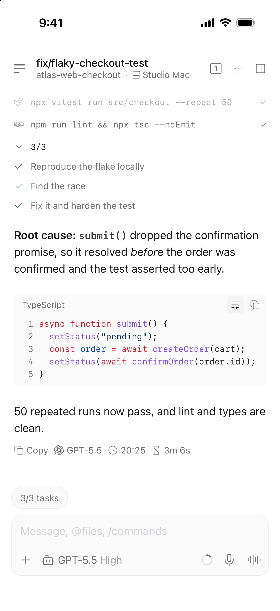</picture> | <picture><source media="(prefers-color-scheme: dark)" srcset="images/mobile-details-drawer-dark.png">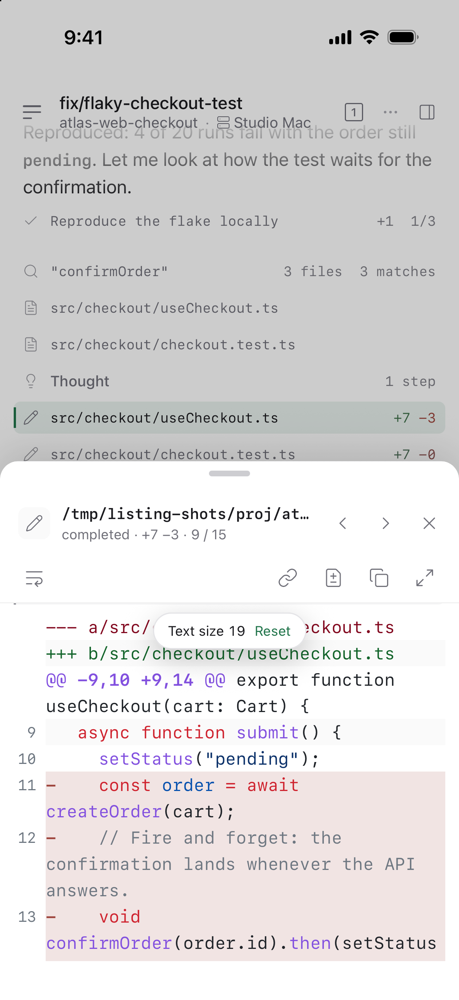</picture> | <picture><source media="(prefers-color-scheme: dark)" srcset="images/mobile-tasks-dark.png">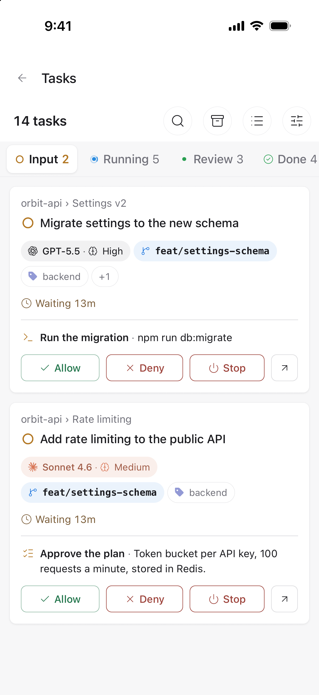</picture> |
| **运行中卡片的详情** | **等待中卡片的详情** | **筛选** |
| <picture><source media="(prefers-color-scheme: dark)" srcset="images/mobile-tasks-sheet-dark.png">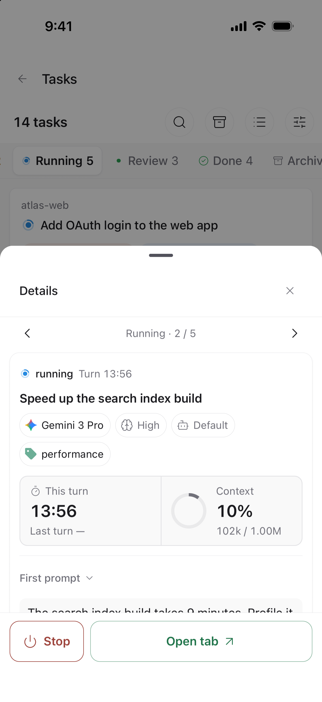</picture> | <picture><source media="(prefers-color-scheme: dark)" srcset="images/mobile-tasks-sheet-input-dark.png">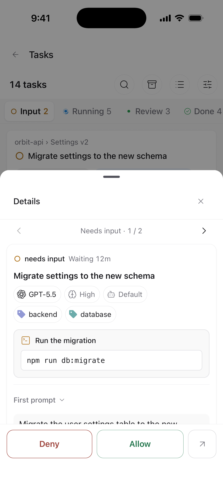</picture> | <picture><source media="(prefers-color-scheme: dark)" srcset="images/mobile-tasks-filters-dark.png">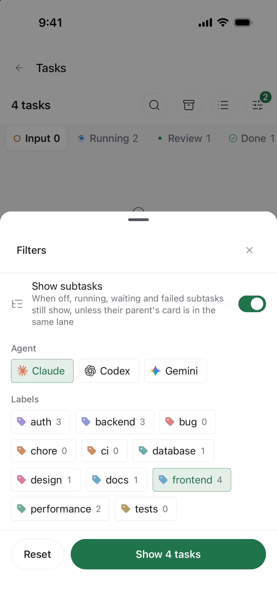</picture> |

### 在 iPad 上

- **用面板代替抽屉。** 宽度达到 600pt 时，详情以浮动面板打开，居中盖在聊天上方，最宽 760pt；达到 960pt 且聊天区在旁边还能留出至少 400pt 时，改为右侧的侧边面板，宽度为窗口的 36%（420–640pt）。在模拟器上，11 英寸 iPad 竖屏是浮动面板、横屏是侧边面板，13 英寸 iPad 竖屏就已是侧边面板；按同样的阈值，分屏后窗口窄于 600pt 时退回抽屉。Paseo 在 iOS 和 Android 上只给插件全屏模态层，所以点面板外面会关闭它（见[插件做不到的事](#插件做不到的事)）。
- **先按手指的尺寸，再按指针的尺寸。** 用手指操作时，详情标题栏高 52pt、按钮 36pt，工具栏高 44pt。触控板悬停过某一行之后，它们缩到桌面的 44pt 和 36pt，点击在原地展开行，行的悬停操作也会出现；长按依然可用。
- **保留泳道的看板。** 平板上的 Tasks 看板沿用桌面布局。没有悬停可以唤出按钮，所以每张卡片在计时下方常驻一排按钮：「停止」、「标为已读」或「归档」，最右是「打开」；父任务可打开的子任务卡片还会在旁边显示「打开父任务」；停止前弹系统对话框确认。点按选中卡片查看详情。详情放在哪里取决于看板宽度：1,020pt 起排在泳道旁的侧栏（13 英寸 iPad 横屏），784pt 起浮在泳道上方，不足 760pt（11 或 13 英寸 iPad 竖屏、打开着 Paseo 侧边栏）时是一个底部弹层，泳道仍可操作。弹层默认半高，可以拉到全高，宽 640pt 以上时分两栏。看板窄于 760pt 时，顶部保留搜索和已归档泳道开关，以及「筛选」；筛选弹层里有空分组、过滤、已完成时间窗口、排序、子任务开关和泳道宽度；泳道保持自己的宽度、左右滚动，除了卡片，列标题和卡片间的空隙也能拖动滚动。

| 11 英寸竖屏：浮动面板 | 11 英寸横屏：侧边面板 |
| --- | --- |
| <picture><source media="(prefers-color-scheme: dark)" srcset="images/ipad-details-floating-dark.png">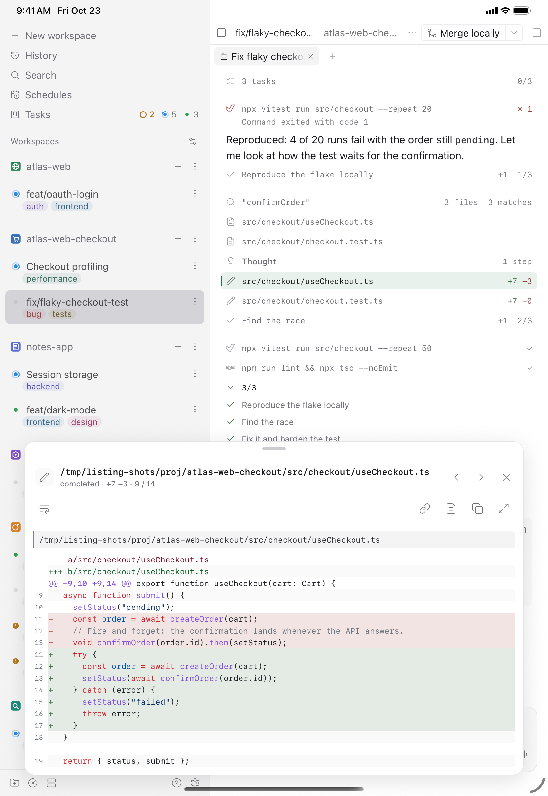</picture> | <picture><source media="(prefers-color-scheme: dark)" srcset="images/ipad-details-side-dark.png">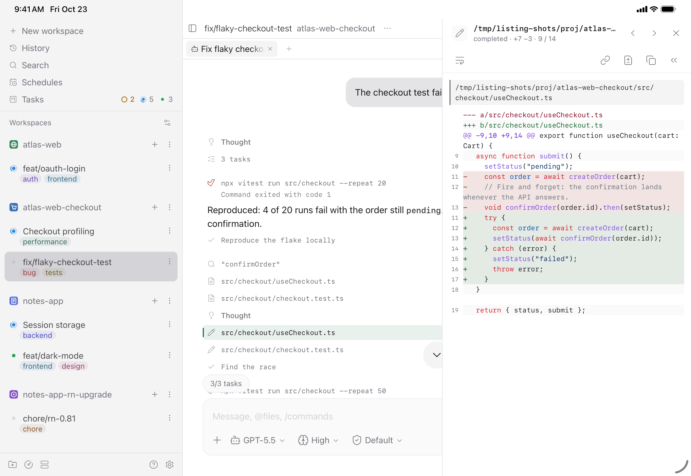</picture> |

| 13 英寸横屏：Tasks 与详情侧栏 | 13 英寸竖屏：Tasks 与详情弹层 |
| --- | --- |
| <picture><source media="(prefers-color-scheme: dark)" srcset="images/ipad-tasks-dark.png">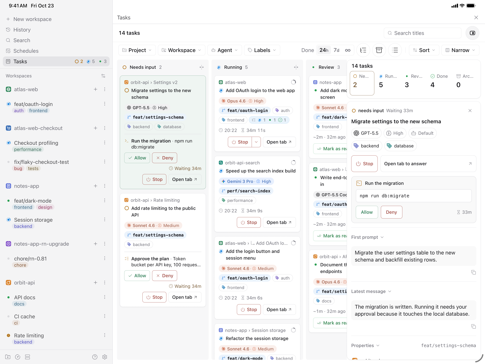</picture> | <picture><source media="(prefers-color-scheme: dark)" srcset="images/ipad-tasks-sheet-dark.png">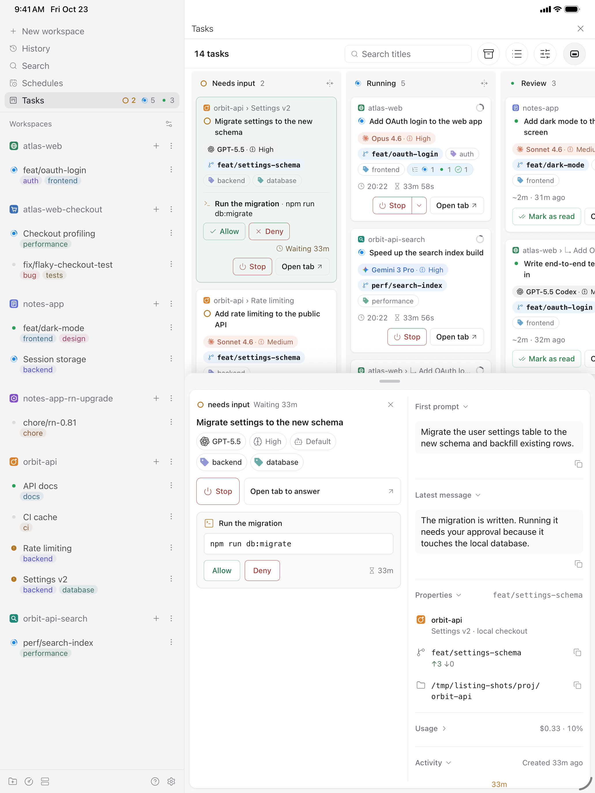</picture> |

快捷键、桌面悬停预览、按住 Command 添加表格选区，以及看板上的双击和右键菜单，只在网页和桌面上有；接了键盘的 iPad 也没有。

---

## 性能对比

### Web

2026-10-23 在 Mac Studio（Apple M5 Max、18 核、64 GB、macOS 27.0.1）上对照 Paseo 0.12.0 测量；Paseo 使用 react-native-enriched-markdown 绘制回复。Better Paseo 测试版本为 f2f64009，通过插件安装流程构建，并核实了实际加载的压缩 bundle。Web 和 iOS 各测 11 个场景 × 2 种配置（不开插件、Better Paseo）× 5 次：每个平台 110 次，共 220 次；串行执行，并按场景轮换配置顺序。bench daemon 使用干净的 home，测量期间只有 1 个 workspace 和 1 个活跃 agent；每次跑完时的 1 分钟负载为 13–29，中位数 16。Web 使用 Chrome 155.0.8059.85、1280×900。Tasks 看板和 Block details 均按默认设置开启。之后的 UI 提交 466b149d、7f857477（图片查看器）及 7c781aa2、7e8d412f、925f4871（Tasks 卡片）不会改变这些时间线场景。后续时间线提交 9607e789（"perf(details): defer inactive timeline details work"）和 d4f68108（"perf(details): mount row markers only after selection"）单独对照 11 个场景，没有场景变慢；历史回放端到端基本持平：Web 为 0.896 对 0.887 秒，iOS 为 2.78 对 2.77 秒。下表仍是 f2f64009 的 220 次回放结果，不代表这些后续提交的测量值。


整段回放主线程 Task 时间（秒）对比不开插件：9 项更低、1 项持平、1 项更高。差异不到 10% 记为持平；如果两边整段回放都不到 0.5 秒，也记为持平。长回复的 Task 时间是不开插件 15.617 秒、Better Paseo 3.153 秒，减少 80%。

| 场景 | 不开插件 | Better Paseo | 对比不开插件 |
| --- | ---: | ---: | :--- |
| 代码块流式 | 3.714 | **1.401** | &ensp;62% |
| 大 diff | 0.272 | **0.250** | 持平 |
| 历史回放 | 0.701 | **0.975** | &ensp;39% |
| 长回复 | 15.617 | **3.153** | &ensp;80% |
| 混合一轮 | 1.009 | **0.785** | &ensp;22% |
| 读 20 个文件 | 0.778 | **0.640** | &ensp;18% |
| 思考散文 | 1.584 | **1.007** | &ensp;36% |
| 思考分节 | 1.419 | **0.888** | &ensp;37% |
| 大段终端 | 0.613 | **0.423** | &ensp;31% |
| 表格流式 | 2.242 | **1.012** | &ensp;55% |
| 工具日志增长 | 1.075 | **0.906** | &ensp;16% |

同一批跑次的时间线行渲染总量（宿主 Profiler allRows.sum，毫秒），对比不开插件：9 项更低、0 项持平、2 项更高。

| 场景 | 不开插件 | Better Paseo | 对比不开插件 |
| --- | ---: | ---: | :--- |
| 代码块流式 | 1,491.6 | **123.2** | &ensp;92% |
| 大 diff | 17.8 | **13.1** | &ensp;26% |
| 历史回放 | 164.8 | **260.6** | &ensp;58% |
| 长回复 | 9,733.0 | **238.1** | &ensp;98% |
| 混合一轮 | 117.6 | **50.4** | &ensp;57% |
| 读 20 个文件 | 79.3 | **56.5** | &ensp;29% |
| 思考散文 | 325.8 | **71.9** | &ensp;78% |
| 思考分节 | 294.4 | **68.5** | &ensp;77% |
| 大段终端 | 18.4 | **11.4** | &ensp;38% |
| 表格流式 | 832.7 | **78.1** | &ensp;91% |
| 工具日志增长 | 32.4 | **52.0** | &ensp;60% |

### 流式布局偏移

同一批 Web 跑次的累计布局偏移（CLS，越低越好），保留六位小数。0.5 秒规则不适用。基线很小时百分比会显得很大，应同时看绝对值；低于 0.002 的读数通常不易看出来。对比不开插件：3 项更低、3 项持平、5 项更高。

| 场景 | 不开插件 | Better Paseo | 对比不开插件 |
| --- | ---: | ---: | :--- |
| 代码块流式 | 0.001333 | **0.030847** | &ensp;2214% |
| 大 diff | 0.000015 | **0.000015** | 持平 |
| 历史回放 | 0.107329 | **0.008503** | &ensp;92% |
| 长回复 | 0.054866 | **0.000015** | &ensp;100% |
| 混合一轮 | 0.002791 | **0.026655** | &ensp;855% |
| 读 20 个文件 | 0.000015 | **0.000793** | &ensp;5335% |
| 思考散文 | 0.000015 | **0.000778** | &ensp;5235% |
| 思考分节 | 0.000015 | **0.000778** | &ensp;5235% |
| 大段终端 | 0.000015 | **0.000015** | 持平 |
| 表格流式 | 0.046049 | **0.016243** | &ensp;65% |
| 工具日志增长 | 0.000015 | **0.000015** | 持平 |

### iOS

Paseo 0.12.0 Release 构建，iPhone 17 Pro / iOS 26.5 模拟器；每次样本都冷启动，行探针使用 React profiling renderer。Paseo 0.12 在原生线程上排版 Markdown，因此 iOS 的主要指标是整段回放期间整个 App 进程的 CPU 时间。这些模拟器测量不代表真机性能。


整个 App 进程的 CPU 时间对比不开插件：3 项更低、7 项持平、1 项更高。长回复中宿主耗时 30.64 秒，Better Paseo 为 8.16 秒（减少 73%）。帧探针记录的掉帧数中位数分别为宿主 1,253 帧、Better Paseo 12 帧；最长帧分别为 388 ms 和 78 ms。

| 场景 | 不开插件 | Better Paseo | 对比不开插件 |
| --- | ---: | ---: | :--- |
| 代码块流式 | 3.54 | **3.27** | 持平 |
| 大 diff | 0.40 | **0.43** | 持平 |
| 历史回放 | 1.96 | **2.19** | &ensp;12% |
| 长回复 | 30.64 | **8.16** | &ensp;73% |
| 混合一轮 | 1.47 | **1.37** | 持平 |
| 读 20 个文件 | 1.24 | **1.34** | 持平 |
| 思考散文 | 2.46 | **2.31** | 持平 |
| 思考分节 | 2.17 | **1.99** | 持平 |
| 大段终端 | 0.83 | **0.68** | &ensp;18% |
| 表格流式 | 2.19 | **2.17** | 持平 |
| 工具日志增长 | 1.86 | **1.67** | &ensp;10% |

JavaScript 时间线行渲染总量（宿主 Profiler allRows.sum，毫秒）对比不开插件：3 项更低、0 项持平、8 项更高。Paseo 在原生线程上排版 Markdown，所以这项 JavaScript 探针不能代表整个 App 的 CPU 开销。

| 场景 | 不开插件 | Better Paseo | 对比不开插件 |
| --- | ---: | ---: | :--- |
| 代码块流式 | 584.8 | **317.0** | &ensp;46% |
| 大 diff | 9.8 | **41.9** | &ensp;329% |
| 历史回放 | 47.2 | **115.4** | &ensp;145% |
| 长回复 | 19,925.6 | **704.1** | &ensp;96% |
| 混合一轮 | 82.5 | **131.4** | &ensp;59% |
| 读 20 个文件 | 97.1 | **152.7** | &ensp;57% |
| 思考散文 | 127.6 | **174.2** | &ensp;37% |
| 思考分节 | 115.0 | **158.7** | &ensp;38% |
| 大段终端 | 10.1 | **39.4** | &ensp;290% |
| 表格流式 | 289.6 | **186.8** | &ensp;35% |
| 工具日志增长 | 71.1 | **124.3** | &ensp;75% |

绿色 ⬆ 表示更低，红色 ⬇ 表示更高。百分比按未舍入的中位数计算。`history-100` 是 fixture 名称，不代表 100 个实际 provider turn，此处称“历史回放”。`tool-expanded-streaming` 不执行展开操作，此处称“工具日志增长”。

**方法与边界。** Web 主线程时间是 CDP 记录的整段回放 TaskDuration；行渲染表为宿主 React Profiler 对各时间线行计时的总和。iOS App CPU 覆盖整个进程及原生线程，iOS 行渲染时间只覆盖 JavaScript。表中每格都是 5 次跑次的中位数，百分比按未舍入中位数计算。差异不到 10% 记为持平；Web 整段回放两边都不到 0.5 秒时也记为持平。CLS 不适用 0.5 秒门槛；基线接近零时百分比会放大，应看六位小数的绝对值。与 Beautiful Chat 42b61d8 的对比是在 Paseo 0.11.2 上测得，未在 0.12 重测。Tasks 和 Block details 按默认设置开启。单独的 A/B 显示，Tasks 使 Web 历史回放主线程时间从 0.885 秒升至 0.941 秒（+6%），对应样本的 JS 堆增加约 1.3–2.1 MB；iOS 历史回放 App CPU 变化约 2%。关闭 Block details 后，三个 iOS 场景的 JavaScript 行渲染时间减少 12–17%，App CPU 只变化约 2–4%。历史回放开销的一个已知来源是：宿主每次 agent 更新时，即使 `features` 没有变化，也会换成一个新的数组，导致整个 agent 视图和行渲染回调重新渲染；无论 Tasks 看板开或关都一样。已向上游报告（[getpaseo/paseo#7773](https://github.com/getpaseo/paseo/issues/7773)），修复见 [#7774](https://github.com/getpaseo/paseo/pull/7774)。

### 时间省在哪里

- **跳过没有变化的行。** 按语义比较 theme 和 data，让没有变化的卡片跳过渲染。
- **增量解析回复。** 缓存已完成的 Markdown 块，只修补仍在增长的部分；长回复拆成块供原生宿主虚拟化，复制仍使用完整源码。
- **按需绘制工具正文。** 折叠的行不挂载正文；代码完成后再请求 daemon 高亮，大段代码和终端输出分批显示，并保留“显示全部”。
- **减少持续动画开销。** 网页运行圆点使用 CSS 动画，减少动态效果时静止；移除装饰性的阴影、磨砂和呼吸动画。
- **缩小重连交付。** App 每次重连，Paseo 都会把所有插件的客户端包重新发一遍；走中继时，手机还要用 JavaScript 解密。安装时插件会压缩客户端，Tasks 看板、它的侧边栏入口和设置标签拆成一个 304 KB 的独立分块，看板开启时每次启动 App 取一次，关闭时从不下载：Paseo 0.12 daemon 上的插件清单从 1,977 KB 降到 722 KB。品牌图标和 Inter 字体按需下发，客户端源码保持 ASCII，供 Hermes 按单字节保存。

---

## 内存对比

2026-10-23 的 Web 生产 profiling 跑次；每个数值是同一批回放中强制 GC 后 5 次读数的中位数。这是 JavaScript 堆，不是整个进程或应用的内存。差值为 Better Paseo 减不开插件，单位 MB；不适用 10% 持平规则。所有列出的场景里，Better Paseo 的堆多 5.1–14.2 MB。


| 场景 | 不开插件 | Better Paseo | 差值 |
| --- | ---: | ---: | ---: |
| 代码块流式 | 83.1 | **88.2** | +5.1 |
| 大 diff | 76.9 | **85.8** | +8.9 |
| 历史回放 | 83.6 | **97.4** | +13.8 |
| 长回复 | 82.5 | **96.7** | +14.2 |
| 混合一轮 | 79.6 | **89.4** | +9.8 |
| 读 20 个文件 | 80.1 | **91.5** | +11.4 |
| 思考散文 | 78.5 | **86.5** | +8.1 |
| 思考分节 | 78.0 | **86.4** | +8.4 |
| 大段终端 | 77.9 | **86.5** | +8.6 |
| 表格流式 | 79.1 | **88.3** | +9.2 |
| 工具日志增长 | 79.8 | **90.9** | +11.0 |

本轮 Web 原始样本留在本地、被 git 忽略的 docs/bench/2026-10-23-paseo-012-f2f64009 归档中，不进入 git。

---

## 时间线

截图于 2026-10-23 拍摄，代码为 `f2f64009`。截图清单里记录的是本 README 分支的 `118f5903`，其 `client`、`server`、`shared` 与 `f2f64009` 完全一致。卡片和设置截图来自离线 Web showcase；桌面标题图来自网页版 Paseo 0.12.0；手机和 iPad 截图来自 iOS 26.5 模拟器（iPhone 17 Pro、11 英寸和 13 英寸 iPad）上的 Paseo 0.12 Release 构建。所有数据都是示例 fixture。全部截图默认浅色，并随阅读器主题自动切换深色。性能版本及条件见上文。[截图清单](docs/images/screenshots.json)。

以下功能都建立在 Beautiful Chat 已有的能力之上：按类型区分的工具卡片、Shiki 高亮、读图、打开文件，以及插件自己的查找栏。

<picture><source media="(prefers-color-scheme: dark)" srcset="images/thread-dark.png"></picture>

### 工具行

大部分卡片读取的是 Paseo 交给每个插件的工具明细，所以不论调用来自哪个 agent 都能使用：读、写、编辑、Shell 和 Git 命令、搜索、抓取网页、子 agent、计划、MCP 调用（兼容 Claude 的 `mcp__server__tool`、Codex 的 `server.tool` 和 Oh My Pi 的 `server / tool` 三种写法），以及 Paseo 自己的工具。Paseo 以纯文本形式交来的调用，画成「标题 + 正文」的卡片。

Oh My Pi 的 `hub` 工具和它的 GitHub 设备调用按工具名识别，有专门的卡片；其他 agent 不会发出这些调用。在 Paseo 0.11 及以后，Oh My Pi 的 `eval`、`ask` 以纯文本调用形式交给插件，`task` 则作为子 agent 条目交来。`ask` 带有结构化 `questions` 数据时会显示问答记录；否则仍显示通用文本卡片。

- 每个调用默认是一条无边框的行，摘要按类型生成：命令、路径和行号范围、编辑的 `+4 −2`、退出码和耗时。行高 26pt，在 Paseo 的手机紧凑布局里是 28pt，并随「块字号」变化。用指针时点击在原地展开卡片；触控设备上点按改为打开它的[详情](#区块详情)，点行首的图标才在原地展开。
- 展开状态按调用（`agentId:callId`）记在组件之外，完成、滚进历史、重新挂载都不会丢。iOS 和 Android 上展开时行头留在按下的位置，内容向下打开。
- 失败的调用只显示一行错误；打开「自动展开失败的调用」后，没有保存过展开状态的失败调用会自动展开。
- 每一行记住自己首次出现的时间，并行读取时先完成的那一行不会再换位置、改间距。
- 行首可显示图标、名称或两者都显示。长代码和终端输出先折叠到 12 行。
- 「块字号」可调整工具行、思考、待办和提示中的正文；代码、diff 和终端输出仍使用代码字号。
- Paseo 自己的工具带 Paseo 标识；agent 卡片和回复信息栏使用 agent 所属服务商的标识，不随所选模型改变。
- Oh My Pi 的 `hub` 工具每个操作都有对应卡片：进程、消息和任务快照。卡片只做展示，不带按钮，因为插件无法重启或取消任何东西。
- 不同 agent 发出的受支持提问调用，只要带结构化 `questions` 数据，就会显示分页问答记录，包括选项、已记录的回答和状态。「显示原始数据」可查看原始内容；这类卡片只展示记录，回答仍由 Paseo 处理。预览中的问题会自动换行，便于阅读。
- 前一轮的后台子 agent 还在汇报时，Paseo 0.12 可能把后面的工具行再画一份；插件会隐藏这些重复的行（见[插件绕开的 Paseo 问题](#插件绕开的-paseo-问题)）。

<picture><source media="(prefers-color-scheme: dark)" srcset="docs/images/questions-dark.png"></picture>

| Shell 与 Git | Read |
| --- | --- |
| <picture><source media="(prefers-color-scheme: dark)" srcset="docs/images/tool-bash-dark.png"></picture> | <picture><source media="(prefers-color-scheme: dark)" srcset="docs/images/tool-read-dark.png"></picture> |
| **Edit** | **Hub**（Oh My Pi） |
| <picture><source media="(prefers-color-scheme: dark)" srcset="docs/images/tool-edit-dark.png"></picture> | <picture><source media="(prefers-color-scheme: dark)" srcset="docs/images/hub-dark.png"></picture> |

<details>
<summary>更多卡片：MCP、Paseo 工具、读图、代码块、<code>thinking</code> 工具</summary>

<picture><source media="(prefers-color-scheme: dark)" srcset="docs/images/tool-mcp-dark.png"></picture>
<picture><source media="(prefers-color-scheme: dark)" srcset="docs/images/paseo-dark.png"></picture>
<picture><source media="(prefers-color-scheme: dark)" srcset="docs/images/tool-thinking-dark.png"></picture>
<picture><source media="(prefers-color-scheme: dark)" srcset="docs/images/tool-image-dark.png"></picture>
<picture><source media="(prefers-color-scheme: dark)" srcset="docs/images/syntax-dark.png"></picture>

</details>

### 工具图标

<picture><source media="(prefers-color-scheme: dark)" srcset="docs/images/tool-icons-zh-dark.png"></picture>

<sub>2026-10-25 在离线 Web showcase 中以 2 倍分辨率拍摄，代码为 `2490d376`。图里每个图标都由插件自己的查表逻辑解析，插件不认识的名字会让截图直接失败。</sub>

工具行开头的图标说明这次调用在操作什么，而不只是哪个工具发起的：

- **Shell 命令画出所运行的程序**：101 个图标覆盖 209 个程序，从 `python`、`cargo` 到 `kubectl`、`xcrun simctl`、`ffmpeg`。插件会跳过 Shell 的准备步骤和包装（`cd app &&`、`sudo`、`env`、`FOO=1`），去掉版本后缀和 `.exe`（`python3.12` 即 `python`，`pip3` 即 `pip`）；`npx` 这类启动器如果拉起的程序有图标，就画那个程序（`npx playwright test` 画 Playwright）。从 Shell 启动的编程 agent（`claude`、`codex`、`gemini` 等）画的是和它们 agent 行相同的服务商标识。不认识的程序保留终端图标。
- **MCP 调用画出所调用的服务**：75 个服务，按服务名忽略大小写和分隔符匹配，所以 Claude 的连接器（`claude_ai_Google_Calendar`）、本地服务（`linear-server`、`mcp-server-git`）以及 Codex、Oh My Pi 的写法都能认出来。Atlassian 的服务里，`confluence_*` 工具画 Confluence，其余画 Jira。不认识的服务保留插头图标。
- **其余调用按工具类型画**：Shell、读取、编辑与写入、搜索、抓取网页、Git、GitHub、子 agent、MCP、计划、思考、提问、Oh My Pi 的 hub、Paseo、纯文本，其他一律画扳手。
- 品牌标识是线条图标，用行内图标的颜色绘制，线宽与 Paseo 自己的 Lucide 图标一致（1.5），一轮里混着多种工具也像同一套图标。每个标识在某一行第一次用到时才由 daemon 下发，所以这些标识的图片数据不会进入 Paseo 每次重连都要重发的客户端包。
- 设置里的「行首标识」可以选择只显示图标、只显示工具名，或两者都显示。

<details>
<summary>全部 209 个 Shell 程序及其图标</summary>

| 分组 | 图标 | 程序 |
| --- | --- | --- |
| 语言与运行时 | Python 标识 | `python` `pip` `uv` `uvx` `poetry` `pytest` `ipython` `conda` `pipx` `ruff` `mypy` |
|  | Node.js 标识 | `node` |
|  | Deno 标识 | `deno` |
|  | Bun 标识 | `bun` `bunx` |
|  | TypeScript 标识 | `tsc` `tsx` `ts-node` |
|  | Lucide `Coffee` | `java` `javac` `jar` `mvn` `mvnw` `gradle` `gradlew` |
|  | Kotlin 标识 | `kotlin` `kotlinc` |
|  | Go 标识 | `go` `gofmt` |
|  | Rust 标识 | `cargo` `rustc` `rustup` |
|  | Lucide `Gem` | `ruby` `gem` `bundle` `bundler` `rake` `rails` `irb` |
|  | PHP 标识 | `php` `composer` |
|  | Swift 标识 | `swift` `swiftc` |
|  | C++ 标识 | `gcc` `g++` `clang` `clang++` `cmake` |
|  | C# 标识 | `dotnet` |
|  | Flutter 标识 | `flutter` `dart` |
|  | PowerShell 标识 | `pwsh` `powershell` |
| 包管理与构建 | npm 标识 | `npm` `npx` |
|  | pnpm 标识 | `pnpm` `pnpx` |
|  | Yarn 标识 | `yarn` |
|  | Lucide `Beer` | `brew` |
|  | Lucide `Hammer` | `make` |
|  | Vite 标识 | `vite` |
|  | webpack 标识 | `webpack` `webpack-cli` |
|  | Turborepo 标识 | `turbo` |
| 前端与框架 | ESLint 标识 | `eslint` |
|  | Prettier 标识 | `prettier` |
|  | Next.js 标识 | `next` |
|  | Nuxt 标识 | `nuxt` `nuxi` |
|  | Angular 标识 | `ng` |
|  | Astro 标识 | `astro` |
|  | Svelte 标识 | `sv` `svelte-kit` |
|  | Vue 标识 | `vue` |
|  | Tailwind CSS 标识 | `tailwindcss` |
|  | React Native 标识 | `react-native` |
|  | Expo 标识 | `expo` `eas` |
|  | Lucide `Atom` | `electron` `electron-builder` `electron-forge` |
|  | Django 标识 | `django-admin` |
|  | Laravel 标识 | `laravel` |
|  | Jupyter 标识 | `jupyter` `jupyter-lab` `jupyter-notebook` |
| 测试与浏览器 | Vitest 标识 | `vitest` |
|  | Lucide `FlaskConical` | `jest` `mocha` |
|  | Playwright 标识 | `playwright` |
|  | Puppeteer 标识 | `puppeteer` |
|  | Cypress 标识 | `cypress` |
|  | Storybook 标识 | `storybook` |
|  | Chrome 标识 | `google-chrome` `google-chrome-stable` `chrome` `chromium` `chromium-browser` |
|  | Postman 标识 | `postman` `newman` |
| Apple 与 Android | Apple 标识 | `xcodebuild` `xcrun` `pod` |
|  | Lucide `Smartphone` | `simctl` `serve-sim` `ios-deploy` |
|  | Android 标识 | `adb` `emulator` `avdmanager` `sdkmanager` |
| 云与部署 | AWS 标识 | `aws` |
|  | Google Cloud 标识 | `gcloud` `gsutil` |
|  | Azure 标识 | `az` |
|  | Vercel 标识 | `vercel` |
|  | Cloudflare 标识 | `wrangler` |
|  | Supabase 标识 | `supabase` |
|  | Firebase 标识 | `firebase` |
|  | Netlify 标识 | `netlify` `ntl` |
|  | Heroku 标识 | `heroku` |
|  | Stripe 标识 | `stripe` |
| 容器与基础设施 | Docker 标识 | `docker` `docker-compose` |
|  | Lucide `Container` | `podman` `podman-compose` |
|  | Lucide `ShipWheel` | `kubectl` `helm` `minikube` `kind` `k9s` |
|  | Terraform 标识 | `terraform` |
|  | Ansible 标识 | `ansible` `ansible-playbook` `ansible-galaxy` `ansible-vault` `ansible-inventory` |
|  | Nginx 标识 | `nginx` |
|  | Lucide `Server` | `ssh` `scp` `sftp` `rsync` `mosh` |
| 数据库与消息 | PostgreSQL 标识 | `psql` `pg_dump` `pg_restore` |
|  | MySQL 标识 | `mysql` `mysqldump` |
|  | MongoDB 标识 | `mongosh` `mongo` |
|  | Lucide `Feather` | `sqlite` |
|  | Redis 标识 | `redis-cli` `redis-server` |
|  | Kafka 标识 | `kcat` `kafkacat` `kafka-topics.sh` `kafka-console-consumer.sh` `kafka-console-producer.sh` |
|  | Prisma 标识 | `prisma` |
| CI 与监控 | Jenkins 标识 | `jenkins` `jenkins-cli` |
|  | CircleCI 标识 | `circleci` |
|  | SonarQube 标识 | `sonar-scanner` |
|  | Grafana 标识 | `grafana` `grafana-cli` |
|  | Prometheus 标识 | `prometheus` `promtool` |
|  | Lucide `Dog` | `datadog-ci` |
|  | Jira 标识 | `jira` |
| 代码托管、agent 与编辑器 | GitHub 标识 | `gh` |
|  | GitLab 标识 | `glab` |
|  | Paseo 标识 | `paseo` |
|  | Claude 服务商标识 | `claude` |
|  | Codex 服务商标识 | `codex` |
|  | Gemini 服务商标识 | `gemini` |
|  | OpenCode 服务商标识 | `opencode` |
|  | Cursor 服务商标识 | `cursor-agent` |
|  | Copilot 服务商标识 | `copilot` |
|  | Ollama 服务商标识 | `ollama` |
|  | Oh My Pi 服务商标识 | `omp` |
|  | VS Code 标识 | `code` |
|  | Vim 标识 | `vim` `vi` `gvim` |
| 常用工具 | Lucide `Globe` | `curl` `wget` `http` `xh` |
|  | Lucide `Search` | `rg` `grep` `find` `fd` `ag` |
|  | Lucide `Braces` | `jq` `yq` |
|  | Lucide `FileDiff` | `diff` `colordiff` `difft` |
|  | Lucide `Archive` | `tar` `zip` `unzip` `gzip` `gunzip` `7z` `xz` |
|  | Lucide `Clapperboard` | `ffmpeg` `ffprobe` |
|  | Lucide `ExternalLink` | `open` `xdg-open` |

</details>

<details>
<summary>全部 75 个 MCP 服务及其图标</summary>

匹配前，服务名会转成小写并去掉字母和数字以外的字符，所以 `Google_Calendar`、`google-calendar` 和 `googlecalendar` 是同一个名字。服务名包含表中的词即算匹配；带 `*` 的词只匹配开头，Git 和 Time 只匹配完整的名字，因此 `github`、`timeline` 不会误中。

| 分组 | 服务 | 图标 | 匹配的服务名 |
| --- | --- | --- | --- |
| 代码托管与 CI | GitHub | GitHub 标识 | `github` |
|  | GitLab | GitLab 标识 | `gitlab` |
|  | Git | Lucide `GitBranch` | `git`, `mcp-server-git`, `git-mcp` |
|  | Gitee | Gitee 标识 | `gitee` |
|  | Bitbucket | Bitbucket 标识 | `bitbucket` |
|  | Jenkins | Jenkins 标识 | `jenkins` |
|  | CircleCI | CircleCI 标识 | `circleci` |
|  | SonarQube | SonarQube 标识 | `sonar` |
|  | Ansible | Ansible 标识 | `ansible` |
| 项目与文档 | Linear | Linear 标识 | `linear` |
|  | Jira | Jira 标识 | `jira`, `atlassian` |
|  | Confluence | Confluence 标识 | `confluence`；Atlassian 服务里 `confluence_*` 开头的工具 |
|  | Notion | Notion 标识 | `notion` |
|  | Trello | Trello 标识 | `trello` |
|  | Asana | Asana 标识 | `asana` |
|  | Airtable | Airtable 标识 | `airtable` |
|  | Figma | Figma 标识 | `figma` |
|  | Sentry | Sentry 标识 | `sentry` |
| 沟通与邮件 | Slack | Slack 标识 | `slack` |
|  | 飞书 / Lark | Feishu 标识 | `feishu`, `lark` |
|  | 钉钉 | DingTalk 标识 | `dingtalk`, `dingding` |
|  | 企业微信 | WeCom 标识 | `wecom`, `wework`, `wechatwork`, `qywx` |
|  | Microsoft Teams | Teams 标识 | `teams` |
|  | Discord | Discord 标识 | `discord` |
|  | Telegram | Telegram 标识 | `telegram` |
|  | Gmail | Gmail 标识 | `gmail` |
|  | Zapier | Zapier 标识 | `zapier` |
| Google | Google Calendar | Google Calendar 标识 | `googlecalendar`, `gcal` |
|  | Google Drive | Google Drive 标识 | `googledrive`, `gdrive` |
|  | Google Maps | Google Maps 标识 | `googlemaps`, `gmaps` |
|  | YouTube | YouTube 标识 | `youtube` |
| 浏览器与设备 | Chrome | Chrome 标识 | `chrome` |
|  | Playwright | Playwright 标识 | `playwright` |
|  | Puppeteer | Puppeteer 标识 | `puppeteer` |
|  | Browserbase, browser-use | Lucide `AppWindow` | `browserbase`, `browseruse`, `browsermcp`, `browsertools` |
|  | iOS 模拟器 | Lucide `Smartphone` | `iossimulator`, `simulator`, `simctl`, `servesim`, `mobile*` |
|  | Xcode | Apple 标识 | `xcode` |
|  | Android | Android 标识 | `android`, `adb` |
|  | Computer use | Lucide `MousePointer2` | `computeruse`, `cuadriver` |
|  | Desktop Commander | Lucide `SquareTerminal` | `desktopcommander` |
| 云与数据 | AWS | AWS 标识 | `aws`, `bedrock` |
|  | Docker | Docker 标识 | `docker` |
|  | Kubernetes | Lucide `ShipWheel` | `kubernetes`, `k8s`, `kubectl` |
|  | Terraform | Terraform 标识 | `terraform` |
|  | Vercel | Vercel 标识 | `vercel` |
|  | Cloudflare | Cloudflare 标识 | `cloudflare` |
|  | Supabase | Supabase 标识 | `supabase` |
|  | Firebase | Firebase 标识 | `firebase` |
|  | Netlify | Netlify 标识 | `netlify` |
|  | Heroku | Heroku 标识 | `heroku` |
|  | Stripe | Stripe 标识 | `stripe` |
|  | PostgreSQL | PostgreSQL 标识 | `postgres` |
|  | MySQL | MySQL 标识 | `mysql` |
|  | MongoDB | MongoDB 标识 | `mongo` |
|  | SQLite | Lucide `Feather` | `sqlite` |
|  | Redis | Redis 标识 | `redis` |
|  | Kafka | Kafka 标识 | `kafka` |
|  | Elastic | Elastic 标识 | `elastic`, `kibana` |
| 监控与调试 | Grafana | Grafana 标识 | `grafana` |
|  | Prometheus | Prometheus 标识 | `prometheus` |
|  | Datadog | Lucide `Dog` | `datadog` |
|  | Postman | Postman 标识 | `postman` |
| 搜索与工具 | Brave Search | Brave 标识 | `brave` |
|  | Perplexity | Perplexity 标识 | `perplexity` |
|  | Tavily, Serper, SearXNG, Kagi, Exa | Lucide `Search` | `tavily`, `serper`, `searxng`, `kagi`, `exa*` |
|  | Fetch, Firecrawl | Lucide `Globe` | `fetch`, `firecrawl` |
|  | Context7 | Lucide `LibraryBig` | `context7` |
|  | Memory | Lucide `BrainCircuit` | `memory` |
|  | Sequential Thinking | Lucide `Lightbulb` | `sequentialthinking` |
|  | Time | Lucide `Clock` | `time`, `mcp-server-time`, `time-mcp` |
|  | Filesystem | Lucide `FolderOpen` | `filesystem` |
|  | EverArt | Lucide `Palette` | `everart` |
|  | Everything | Lucide `Blocks` | `everything` |
|  | OpenAI | OpenAI 标识 | `openai` |
|  | Paseo | Paseo 标识 | `paseo*` |

</details>

<details>
<summary>16 种工具类型</summary>

| 类型 | 图标 |
| --- | --- |
| Shell（`bash`、`shell`） | Lucide `SquareTerminal`，或程序自己的图标 |
| 读取 | Lucide `FileText` |
| 编辑、写入 | Lucide `Pencil` |
| 搜索 | Lucide `Search` |
| 抓取网页 | Lucide `Globe` |
| Git、worktree 准备 | Lucide `GitBranch` |
| GitHub | GitHub 标识 |
| 子 agent | Lucide `Bot`；agent 行画所属服务商的标识 |
| MCP | Lucide `Plug`，或服务自己的图标 |
| 计划 | Lucide `ListChecks` |
| 思考 | Lucide `Lightbulb` |
| 提问 | Lucide `MessageCircleQuestion` |
| Hub（Oh My Pi） | Lucide `Radio` |
| Paseo | Paseo 标识 |
| 纯文本 | Lucide `MessageSquare` |
| 其他 | Lucide `Wrench` |

</details>

### 思考与待办

- 思考只按真实结构（`**标题**` 和各级标题）分段，不再按空行编号。默认折叠，流式时行内实时预览当前标题。
- 只有本机真的看到了思考的流式过程，才显示耗时；不做估算。
- 待办显示阶段名、每项状态、耗时，以及被阻塞的任务和原因。进度环显示已完成项，全部完成后会变为勾选标记。标题栏的窗口按钮会在浮窗中打开实时待办；使用时间线时浮窗保持打开，并始终跟随最新列表，长标题也可换行。

<picture><source media="(prefers-color-scheme: dark)" srcset="docs/images/reasoning-dark.png"></picture>
<picture><source media="(prefers-color-scheme: dark)" srcset="docs/images/tasks-dark.png"></picture>
<picture><source media="(prefers-color-scheme: dark)" srcset="docs/images/checklist-window-dark.png"></picture>

### 回复

- Markdown 由插件绘制：标题、列表、任务列表、引用、高亮代码块和本地图片。提供「文档」「紧凑」「终端」三种样式。
- 未标语言、标为 Markdown 或纯文本的代码块可在最大化预览窗口中打开，并在渲染后的 Markdown 和原始文本间切换、复制源码；原始文本视图使用「自动换行」设置。
- 表格有列线、表头底色和圆角外框；单元格比正文小一号、行距更紧，列宽按等宽数字和中文字宽估算。
- 每张表格左上角都有复制按钮。网页和桌面上，悬停（触屏上长按）会展开「复制为 Markdown」和「复制为图片」，后者复制表格画出来的样子；直接点按复制 Markdown 源码。iOS 和 Android 上点按复制 Markdown。
- 网页和桌面上双击单元格可选中其中的文字；iOS 和 Android 上对同一单元格连续点按两次即可选中。要选中一片单元格，按住某个单元格再横向、纵向拖动；用鼠标时，从一个单元格直接拖进另一个也可以。网页和桌面上，按住 Command（Windows 和 Linux 上是 Ctrl）再点按或拖过单元格，可以再加一片选区而不丢掉已有的；这时每片选区都沿用最后画的那片的列。松手后弹出菜单：选中一个单元格复制它的文字，选中多个则按表格顺序复制只含所选行列的 Markdown 表格，并带上这几列的表头。表格角落菜单始终提供「复制选中」，Paseo 允许插件向输入框写入文字时还会显示「添加到对话」。
- 每个已完成轮次会在最终回复下方显示独立信息栏，提供复制和时间；有数据时还会显示服务商标识、模型、思考等级和本轮实际耗时。悬停或长按信息栏可打开「轮次详情」表格：agent、模型、思考等级、开始和结束时间、耗时，以及输入、缓存和输出 token。点按模型名称可复制，并会显示提示；后续轮次运行时，已完成轮次的信息栏仍会保留。关闭「回复使用插件 Markdown」可恢复 Paseo 完整的信息栏和 Fork 操作。
- 一段回复里的多张本地图片都会画出来。
- 关闭「回复使用插件 Markdown」即可把回复交回 Paseo，由它绘制 mermaid 图表、宿主图片和文件链接。

| 表格复制菜单 | 选中单元格后的操作 |
| --- | --- |
| <picture><source media="(prefers-color-scheme: dark)" srcset="docs/images/table-copy-menu-dark.png"></picture> | <picture><source media="(prefers-color-scheme: dark)" srcset="docs/images/table-selection-dark.png"></picture> |

<picture><source media="(prefers-color-scheme: dark)" srcset="docs/images/markdown-styles-dark.png"></picture>
<picture><source media="(prefers-color-scheme: dark)" srcset="docs/images/markdown-preview-window-dark.png"></picture>

### 图片

- 读图时画出文件本身：从文件头读出的尺寸和大小、按内容撑满的缩略图，以及一个显示/隐藏开关，切换时行头停在按下的位置。
- 全屏查看器支持按钮、滚轮或双指以指针为中心缩放（0.25 到 8 倍），拖动平移，双击复位；上下拖动、点背景、按 Esc 或 Android 返回键关闭。查看器的文件按钮在桌面上用默认应用打开图片，打开的是 daemon 那台机器上的文件（「Open in default app」，见[打开文件](#打开文件)）；在触控设备上改为「复制路径」，复制文件的绝对路径，因为文件在 daemon 那台机器上。读图卡片和回复里的图片打开的是同一个查看器，行为一致。桌面和网页上悬停工具栏按钮会显示名称，名称跟随插件设置的语言。
- 触控设备上点按图片行会打开查看器。在 iOS 和 Android 上，长按读图卡片的标题行也会打开它。
- 图片数据在第一次展开、预览或长按时从 daemon（`file.image`）读取。支持 PNG、JPEG、GIF、WebP、AVIF、BMP、ICO 和 SVG；超过 3MB 的文件只显示大小，不内联。
- 多个读图卡片引用同一张图片时，每个卡片都会显示它。

<picture><source media="(prefers-color-scheme: dark)" srcset="docs/images/shared-image-cards-dark.png"></picture>

### 悬停预览

桌面和网页上把鼠标停在折叠的工具行、思考行、图片或路径上，等待设定的延迟（0–10 秒）后弹出可滚动的预览。面板可换行、显示行号和奇偶行底色，也可移动、调整大小或最大化；待办标题栏可以把实时清单打开为浮窗，Markdown 代码块也有自己的最大化预览。若预览正跟随流式输出末尾，内容增长时会平滑跟随。打开区块详情时，预览标题栏多出「在面板中打开」。关闭区块详情后，在手机或平板上长按折叠的行，会在 Paseo 顶部栏和输入框之间打开同样的预览，可以拖动、调整大小，里面的文字也能选中。

### 路径、复制与选中

- 路径相对工作区显示，过长时在中间省略、保留文件名；worktree 的主仓库以名称显示。复制时总是得到绝对路径。
- 复制统一走宿主的 `copyText`，在 iOS 和 Android 上同样可用：桌面悬停、触控设备上的行菜单（长按），或 `⋯` 菜单。纯文本代码块可换行，并带复制按钮。
- 网页和桌面上，在卡片里选中文字会出现「复制」和「添加到对话」；后者把选中内容作为引用放进输入框，选自代码时放成代码块。页面滚动时工具栏会收起；当前没有可见输入框时，「添加到对话」会改为复制选中内容。

<picture><source media="(prefers-color-scheme: dark)" srcset="docs/images/selection-actions-dark.png"></picture>

### 提问气泡

默认由 Paseo 绘制提问，保留粘贴的图片和回退菜单。打开「增强提问气泡」后，符合条件的提问会改用插件气泡：复制按钮常驻；对最新一条提问，在本客户端看着这一轮运行时，还会显示本轮 token 用量。插件能取得受支持的图片源时也会绘制图片；含无法呈现附件的提问仍交给 Paseo。已发布的 Paseo 不把回退菜单交给插件，所以插件气泡上没有回退（见[插件做不到的事](#插件做不到的事)）。

<picture><source media="(prefers-color-scheme: dark)" srcset="docs/images/user-dark.png"></picture>

### 错误与系统消息

- agent 报错时画成一张提示卡片，显示错误信息。
- Oh My Pi 会把任务结果、转发的消息和提醒包在 `<system-notice>`、`<irc>` 等标签里，作为消息文本发出，Paseo 把它们当成回复。打开「回复使用插件 Markdown」时，插件把这些画成系统卡片（标题，加上 agent、状态、耗时等小标签，以及其余正文），而不是原样显示 XML。

Paseo 仍会绘制原生权限提示，并负责允许和拒绝操作。agent 操作卡片还可以只读显示子 agent 的待处理权限或结构化问题；请在对应 agent 的聊天里回答。

### 语言

「语言」设为「跟随 Paseo」时，插件使用 Paseo 里设置的语言；Paseo 跟随系统时，使用设备的语言。插件绘制英文和简体中文，范围包括设置页、Tasks 看板，以及时间线上插件自己的文字：提示、复制菜单和提示消息、详情面板、思考行的动词和步数、回复信息栏和轮次详情、问答记录、状态词和图片查看器按钮名。其他无障碍标签和 agent 写出的内容保持原样。

---

## 区块详情

区块详情从它所在的行打开：触控设备上点按；桌面和网页上，选悬停预览里的「在面板中打开」，或行菜单（右键）里的「打开详情」。工具行、思考行、活动行、待办行和代码块都能打开详情；图片行打开的是图片查看器。再点一次已打开的那一行，会关闭面板。

形态跟随窗口变化，窗口在新尺寸上停一会儿才切换，切换时保留当前区块、滚动位置和换行设置：

| 窗口 | 形态 |
| --- | --- |
| 宽度不足 600pt | 带遮罩的底部抽屉，全宽 |
| 宽至少 600pt、高不足 500pt（横过来的手机浏览器；Paseo 应用让手机保持竖屏） | 侧边面板，400pt 宽 |
| 600–960pt，或更宽但放不下侧边面板 | 居中盖在聊天上方的浮动面板，最宽 760pt |
| 960pt 起，且聊天区在旁边还能留出至少 400pt | 右侧的侧边面板，宽度为窗口的 36%（420–640pt） |

每个切换点都留有 16pt 的余量，窗口在临界宽度附近调整时不会来回跳。网页上的浮动面板和侧边面板不是模态的：后面的行仍可操作，侧边面板的左边缘可以拖动调宽。iOS 和 Android 上每种形态都是模态层；浮动面板和侧边面板点外面即关闭，Android 的返回键可以关闭任何一种。

- **标题栏。** 行的图标、最多四行的标题、区块状态、耗时和它在本轮中的位置，以及上一个、下一个和关闭。触控设备上在标题栏上左右滑动可切换区块；滑到已加载的最早区块再往回滑，会请求更早的行。时间线会把当前打开的行滚到可见位置并做标记。
- **工具栏。** 换行、内容自带的控件（合并行或提问的翻页、渲染或原文）、该工具的复制操作和全屏。放不下的复制项收进「更多」，第一个复制项始终可见。流式输出中的区块会跟随末尾，向上滚动后出现「回到最新 · N 行新输出」按钮。
- **抽屉。** 高度贴合内容，最多屏幕的 58%，运行中的区块会把它撑到这个上限。点把手在贴合高度和全高之间切换；可以拖动把手或标题栏，正文滚到顶部后继续下拉也能拖动。从贴合高度往下拖即关闭，从全高快速下滑也会关闭。
- **双指调字号（iOS 和 Android，仅抽屉）。** 在正文上双指捏合，可把字号调到时间线正文字号的 -4pt 到 +10pt；正文和代码按同样的步长变化，标题栏和工具栏不变。手指下的那一行保持在手指下，捏合时以及松手后两秒内会显示「字号」标记和「复原」。松手时字号保存到 daemon，连接它的所有手机都按同一字号显示；设置页上没有这一项，「恢复全部默认设置」会把它清零。正文很长时，文字在松手后一次性重新排版，而不是边捏边排。
- **正文字号。** 抽屉里区块的正文按时间线正文字号显示；时间线行、预览和其他形态仍使用「块字号」。
- **行菜单。** 长按或右键打开行菜单：先是该工具的复制项，然后是查看图片、打开详情和在时间线中展开或收起。
- **快捷键（网页和桌面）。** ← 和 → 切换区块，`[` 和 `]` 在合并行内翻页，W 换行，R 渲染，F 全屏，没有选中文字时 Cmd/Ctrl+C 复制主要内容，Esc 关闭。
- 关闭「区块详情面板」即可在触控设备上恢复点按展开和长按预览。

---

## Tasks 看板

**Tasks** 在侧边栏顶部那一组（右侧显示「待输入 · 运行中 · 待查看」计数），也在 Command Center 里。打开后是这台主机上所有 agent 的看板，归列规则和侧边栏 workspace 状态一致：**待输入**（等得最久的在上）、**运行中**（跑得最久的在上）、**待查看**（跑完未读或失败）、**已完成**（默认最近 24 小时，每次加载 50 条）和 **已归档**（同一时间窗口内已归档的 agent，以及已归档 workspace 里的 agent）。父任务自己这一轮结束后，只要还有子任务在运行或等待，它就留在运行中，计时按子任务的工作算；失败的父任务留在待查看。

看板默认开启。设置页两个标签最上面都有它的开关，「任务看板」标签里开关下方是看板的实时预览。关闭后侧边栏和 Command Center 都没有入口，不订阅 agent，也不下载看板的代码。具体选项见[任务看板设置](#任务看板设置)。

### 卡片

- 卡片从上到下：带 Paseo 项目图标（项目的图片，或项目颜色上的首字母）的「项目 › workspace」，子任务还有指向父任务的链接，父任务已归档时带标记；状态图标和标题，运行中的一轮右上角有上下文占用环；然后是一行 pill：一个 agent pill（服务商标识、模型和思考等级）、分支（领先数绿色、落后数橙色，有未提交改动时显示一个圆点）、文件夹或路径、以 Paseo 标签颜色的标签图标开头的标签，以及关联 PR。点按模型、分支、文件夹和路径即可复制。底栏是计时（运行中的一轮先显示开始时间，再显示已运行多久）和卡片的按钮。显示哪些字段由「卡片信息密度」决定。
- 标签颜色按 Paseo 的标签定义，项目图标就是 Paseo 侧边栏里的图标。在 Paseo 0.12 上，这两样由插件服务端直接向 daemon 读取，见[插件做不到的事](#插件做不到的事)。
- 状态图标就是 Paseo 侧边栏的图标。失败的卡片带红色底色。已结束那一轮的计时取自该轮记录下的结束时间，过后再打开旧 agent 的 tab 也不会把它拉长；Claude 因出错（会话额度用尽、密钥无效）而结束的一轮算作失败。
- **打开**会跳到 agent 所在的 tab；提问请求显示「打开处理」。桌面和网页上，指针停在卡片上时它和其他按钮一起出现，双击卡片也能打开；平板上按钮在计时下方常驻一排；手机上「打开」在操作栏最右。子任务卡片在可打开父任务时，还会在旁边显示「打开父任务」；卡片上方仍有父任务链接。父任务卡片上有子任务 pill，按状态显示数量；点开后在卡片里列出各个子任务，点某个子任务的行会定位到它自己的卡片并闪一下。
- **停止**带电源图标，排在按钮最前。开启「停止前二次确认」时，网页上要再按一次，iOS 和 Android 上弹系统对话框确认。父任务可以只停自己，也可以连同运行中的子任务一起停止。桌面上等待中的卡片把「停止」放进菜单和详情，底栏留给请求本身：tool、plan、mode 类权限请求可以直接在卡片上允许或拒绝；结构化问题请求会在卡片摘要中显示问题文本，并打开对应 tab 供用户回答。
- **标为已读**出现在待查看的卡片上（跑完或失败），占据「停止」的位置，用未读的绿色。它会清除 Paseo 里这个 agent 的提醒，把卡片移到已完成，直到下一次输入；之后若有一轮或子 agent 失败，卡片会回来。
- **归档**出现在已完成的卡片上，效果和 Paseo 自己的归档一样。已归档任务在原来「打开」的位置显示「取消归档」，因为 Paseo 无法为插件保留已归档 agent 的 tab；取消归档后「打开」就回来了。
- 桌面和网页上，右键卡片打开菜单：打开 tab；复制会话 ID、标题、workspace 或项目名；以及卡片当前可用的停止、标为已读、归档或取消归档。
- 服务商自己派出的子 agent（Claude Code 的 Agent 工具）有只读的虚线卡片：运行中时在运行中，失败后在待查看，带父任务的项目和标签。它们没有停止、标为已读和归档；「打开」打开父任务的 tab，Paseo 在那里列出它们。父任务最近一次输入之后有子 agent 失败，已结束的父任务也会移到待查看。
- 卡片在列之间滑动而不是跳动，改过滤条件时也一样；泳道折叠、展开或改变宽度时有过渡，各列的计数滚动到新数值。系统开启「减弱动态效果」时，这些动画都会关闭。

### 过滤、排序与快捷键

- 可以按项目、workspace、agent 和标签过滤。项目和 workspace 菜单带搜索框，每个项目名下显示它的文件夹，选一个项目就选中它的全部 workspace。搜索框匹配标题，以及项目、workspace 和分支名称。同一种过滤选了多项时，合成一个以该过滤图标开头的标签（如「已选择 2 个项目和 1 个 workspace」）。过滤条件让某列少了卡片时，列底下会写明少了几张、是哪些过滤造成的。
- 过滤栏末尾依次是已完成时间窗口（24h、7d、∞），子任务、已归档泳道和空分组三个开关，排序和泳道宽度；指针停在控件上会显示说明。隐藏子任务时，子任务并入父任务的卡片，但运行中、待输入和失败的子任务仍保留自己的卡片，除非父任务的卡片就在同一列。可按 workspace、项目、分支、文件夹、标题、创建时间、更新时间、上下文或耗时排序，排序只作用于已加载的卡片。
- 桌面和网页上的快捷键：J/K 或 ↑/↓ 在一列内移动，H/L 或 ←/→ 跨列移动，Enter 打开当前卡片的 tab，/ 搜索，I 开关侧栏，Esc 逐层退出。

### 卡片详情

点一下卡片，就在详情里打开它。没有选中卡片时，侧栏显示过滤后各列的数量，总数旁边概括当前的过滤条件，下面按 agent、项目、workspace 和标签给看板分组并显示数量，点某一组即按它过滤。

详情顶部是状态、标题、模型、思考等级、模式和标签，以及操作：「打开」（提问类请求显示「打开处理」；桌面上在最前，触控设备上在最后）、「停止」，以及「归档」或「取消归档」。接着是这张卡片最需要关注的内容：运行中的这一轮（每秒走动的本轮计时、Claude Code 和 Codex 会话的累计 token 及缓存占比、上下文）、待处理的权限请求、失败的错误信息，或者上一轮的耗时、费用和 token 摘要。然后是下面几节，等待中和失败的卡片把「属性」放在最前：

- **首条消息**和 agent 的**最后回复消息**，按 Markdown 绘制，都可以复制；较长的先折叠到四行，点开再看全文。
- **子任务**：样式与 Paseo 0.12 的子 agent 行一致：agent 标识角上带状态（已完成子任务显示绿色对勾，已归档子任务显示归档标记），标题下面是模型、思考等级、模式和上下文，上方按状态显示数量。默认显示十条，点数量那一行展开其余的。
- **属性**：带图标的项目、workspace 及其类型；分支（领先、落后和未提交改动）；目录；PR；父任务。分支名和路径可在所在行复制；过长的路径折叠中间部分。已归档的父任务带标记，并提供「取消归档」。
- **用量**：上下文、token 构成图、累计费用和上一轮耗时。
- **活动**：创建、最后一条消息、本轮开始或等待，以及最后一次更新或失败。

### 按屏幕尺寸

| 看板 | 详情的位置 | 顶部 |
| --- | --- | --- |
| 手机（Paseo 的紧凑布局） | 盖在看板上的弹层，可切换到同一列的上一张、下一张，「打开」或「打开处理」和「停止」或「归档」，或权限按钮，固定在拇指够得到的底部 | 一次一列，顶部是带计数的列标签；搜索和已归档泳道开关；空分组开关和其他过滤条件在弹层里 |
| 1,020pt 起 | 泳道旁的侧栏；桌面和网页上可以拖动边缘实时调宽 | 完整的过滤栏 |
| 784–1,020pt | 浮在泳道上方的面板，点卡片或侧栏开关时出现，点泳道空白处或按 Esc 收起 | 完整的过滤栏 |
| 不足 760pt（折叠屏、打开了 Paseo 侧边栏的竖屏平板） | 非模态的底部弹层：默认半高，从把手拉到全高，向下拖、点泳道空白处、点关闭按钮或按 Esc 关闭；宽 640pt 起分两栏 | 收成一行：搜索和已归档泳道开关，以及一个放空分组开关、过滤、排序、子任务、已完成时间窗口和泳道宽度的弹层 |

每种形态在临界宽度外还会多保持 24pt，调整看板宽度时不会来回跳。平板或桌面上的看板放不下所有泳道时，泳道保持宽度、左右滚动。手机上卡片只画较少的字段（状态、标题、agent pill、计时和按钮始终显示；项目、workspace、分支、第一个标签和子任务按设置显示；上下文占用超过 80% 时才显示占用环；文件夹、路径、Git 状态、PR 和项目图标只在详情里显示），字号和点按区域都更大；「手机上使用精简卡片」还能再精简。

看板打开时 App 重连，看板会带着原来的卡片、所在列和过滤条件回来，而不是从头加载。

<picture><source media="(prefers-color-scheme: dark)" srcset="images/ipad-tasks-filters-dark.png">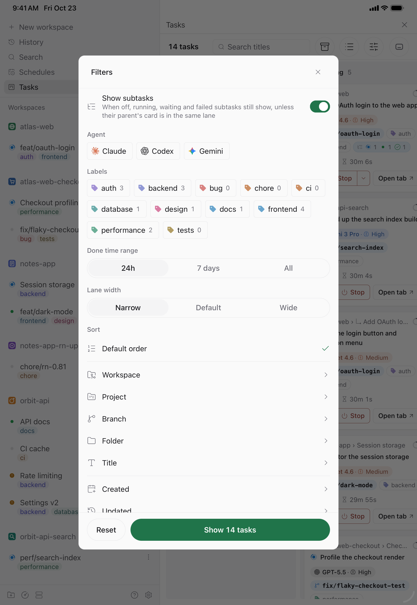</picture>

---

## 设置

**设置 → 插件 → Better Paseo**，页面 **设置**。页面分「聊天展示」和「任务看板」两个标签，两边顶部都有任务看板的开关。在聊天展示标签里，一段用时间线组件绘制的示例对话会实时跟随每一项修改：宽窗口下显示在选项旁边，其他情况显示在选项上方；其中 Read 行的悬停预览常驻展开。在网页和桌面上，预览标题栏的「桌面端 / 移动端」切换可以按 iOS 样式、手机宽度绘制同一段对话，并使用你选的行内代码颜色。父选项关闭时，子选项变灰；某个平台用不上的选项在该平台上隐藏；「恢复全部默认设置」需要再点一次确认。

<picture><source media="(prefers-color-scheme: dark)" srcset="docs/images/settings-zh-dark.png"></picture>
<picture><source media="(prefers-color-scheme: dark)" srcset="docs/images/settings-tools-zh-dark.png"></picture>

| 分组 | 设置 | 默认 | 作用 |
| --- | --- | --- | --- |
| 通用 | 语言 | 跟随 Paseo | 设置页、Tasks 看板和时间线上插件自己的文字使用英文或简体中文。跟随 Paseo 时使用 Paseo 的语言；Paseo 跟随系统时使用设备语言。 |
| 外观 | 强调色 | 主题 | 跟随 Paseo 主题，或选翠绿、紫罗兰、琥珀、玫瑰。只替换强调色。 |
| 外观 | 界面字体 | 跟随 Paseo | Paseo 的界面字体、Inter（仅网页，由 daemon 下发）或系统字体。 |
| 外观 | 移动端行内代码 | 深灰 | iOS 和 Android 上行内代码的文字颜色：深灰、蓝、紫、绿、珊瑚红。网页端保留灰色底块。 |
| 代码字体 | 等宽字体 | 跟随 Paseo | 可选跟随 Paseo 或自定义。跟随 Paseo 的顺序是：宿主向插件提供字体设置时用宿主的设置；否则在网页和桌面上读取 Paseo 外观设置里的等宽字体和字号；再否则用 Paseo 默认等宽字体。iOS 和 Android 上「自定义」只列出系统自带的字体。 |
| 代码字体 | 自定义等宽字体 | 空 | 仅「等宽字体」选「自定义」时生效。网页端可填字体族名称（最多 200 字符，不存在时沿等宽字体栈回退）；iOS 和 Android 只能选择平台提供的字体。 |
| 代码字体 | 代码字号 | 跟随 Paseo | 或 10–22px，行高为字号的 1.5 倍。作用于代码、diff、终端和路径。 |
| 工具调用 | 块字号 | 13px | 9–20px，用于工具行、思考、待办和提示。这些块里的文字一起变化。代码、diff 和终端输出仍用代码字号。 |
| 工具调用 | 行首标识 | 图标 | 工具行和思考行开头显示图标、名称（如 Bash、Read）或两者。 |
| 工具调用 | 文件路径 | 相对 | 相对工作区或绝对路径。复制时总是绝对路径。 |
| 工具调用 | 自动展开失败的调用 | 关 | 开启后，失败的调用会自动展开并显示错误；你手动展开或折叠过的调用保持原样。 |
| 间距 | 紧凑行距 | 开 | 插件行后面还有一行时，下方间距从 16pt 缩到 4pt；Paseo 已经把插件行紧挨着排好时，不再额外收紧。行间重叠时请关闭。 |
| 间距 | 紧凑回复间距 | 开 | 已完成的回复后紧跟插件行（包括待办行）时，把间距从 16pt 缩到 4pt。重叠时请关闭。 |
| 消息 | 增强提问气泡 | 关 | 复制按钮常驻，并显示最新一轮的 token 用量；能读取的粘贴图片会一并显示，其他附件仍交给 Paseo。切换后已有的提问也会更新。 |
| 消息 | 回复使用插件 Markdown | 开 | 关闭后回复交给 Paseo，恢复宿主完整信息栏，并可用 mermaid、宿主图片和 Paseo 的文件链接。 |
| 消息 | Markdown 样式 | 文档 | 文档、紧凑或终端（正文使用代码字体）。 |
| 消息 | 选中文字工具栏 | 开 | 网页和桌面：选中文字后显示「复制」和「添加到对话」；滚动时工具栏收起。 |
| 悬停预览 | 悬停预览 | 开 | 桌面悬停折叠行或路径时预览内容；关闭区块详情时，在触控设备上长按折叠行可预览。 |
| 悬停预览 | 区块详情面板（预览） | 开 | 触控设备上点按行在抽屉或面板中打开它的[详情](#区块详情)，长按显示行的操作；桌面上从悬停预览和右键菜单打开面板。关闭后点按在原地展开，长按打开预览。 |
| 悬停预览 | 延迟 | 1 秒 | 桌面上预览弹出前的等待时间，0–10 秒，保存精度为 0.1 秒。仅网页和桌面。 |
| 悬停预览 | 自动换行 | 开 | 预览面板和最大化代码预览的原始文本会自动换行；关闭后可横向滚动。 |
| 悬停预览 | 显示行号 | 开 | 在文件、diff 和命令输出左侧显示行号；diff 显示的是文件中的行号。 |
| 悬停预览 | 奇偶行底色 | 开 | 在预览中隔行添加底色。 |

抽屉的双指字号和这些设置存在一起，但表里没有对应的一行；在抽屉里捏合即可修改，「恢复全部默认设置」会清零。

**设置存在哪里。** 偏好通过 SDK 的主机级设置保存在 daemon 上（`shared/preferences-settings.ts` 里的 `presentation` 记录），所以**连接同一个 daemon 的所有客户端共用一份设置**：在桌面上改，iOS 上也会生效，反之亦然。某个平台画不出来的值会按原样保存，只在绘制时降级（自定义字体在 iOS 和 Android 上变成系统等宽字体，Inter 变成系统字体）。网页端的 `localStorage` 只用作快速启动的缓存。插件加载时就向 daemon 读取设置，所以最先画出的行通常已经用上；如果设置来得晚，网页上先用缓存值、iOS 和 Android 上先用默认值绘制，到达后切换一次。

**设置立即生效。** 本地偏好状态更新后，已经显示的插件条目也会立即重绘。daemon 会保存设置并同步给其他连接的客户端，无需重新加载聊天。「自动展开失败的调用」会沿用已保存的逐项展开状态；没有记录时才采用设置作为初始状态。

### 任务看板设置

「任务看板」标签用示例 agent 画出每一列泳道，随每个选项实时重绘；页面够宽时，「桌面端 / 移动端」切换可以按手机的样子绘制看板。设置记录是 `shared/tasks-settings.ts` 里的 `tasks`，保存和共享方式与上面的聊天设置相同。

| 分组 | 设置 | 默认 | 作用 |
| --- | --- | --- | --- |
| 任务看板 | 启用任务看板 | 开 | 在侧边栏和 Command Center 加入「任务」。关闭时没有入口，不订阅 agent，也不下载看板的代码。 |
| 任务看板 | 显示已归档泳道 | 开 | 在已完成之后多一列，列出已归档的任务和已归档 workspace 里的任务，时间窗口与已完成相同。看板工具栏上也有开关。关闭时不向 daemon 要已归档的 agent。 |
| 卡片 | 卡片信息密度 | 标准 | 精简、标准、完整会一次写入下面所有字段开关；手动改动任一开关后变为「自定义」。 |
| 卡片 | 显示字段 | 标准预设 | agent 品牌标识、模型、思考等级、项目、项目图标、workspace 名称、分支、Git 状态、文件夹、完整路径、标签、关联 PR、计时、上下文占用环和子任务摘要。标准不显示 Git 状态、完整路径和关联 PR；精简只保留模型、思考等级和计时。 |
| 卡片 | 标签数量 | 2 个 | 1、2、3 个或全部，其余收成 +N。 |
| 看板 | 已完成默认时间窗口 | 近 24 小时 | 近 24 小时、近 7 天或全部，作用于已完成和已归档。看板上的时间窗口控件只改当前这块看板。 |
| 看板 | 泳道宽度 | 默认 | 紧凑（260–280pt）、默认（300–340pt）或宽松（340–400pt），用于桌面、网页和平板，与看板上的泳道宽度菜单是同一个选项；看板放不下时泳道左右滚动。手机上每次只显示一条泳道，不显示这一项。 |
| 看板 | 显示子任务 | 开 | 关闭时子任务并入父任务的卡片；运行中、待输入和失败的子任务仍保留自己的卡片，除非父任务的卡片就在同一列。工具栏上的开关只改当前这块看板。 |
| 看板 | 显示没有活动任务的分组 | 开 | 过滤菜单和侧栏列出 Paseo 里所有的 agent、项目、workspace 和标签，没有活动任务的显示 0。工具栏上也有开关。 |
| 看板 | 停止前二次确认 | 开 | 网页上停止需要再按一次，iOS 和 Android 上弹系统对话框确认。 |
| 侧边栏 | 侧边栏入口计数 | 待输入 · 运行中 · 待查看 | 或只显示待输入，或不显示。 |
| 手机 | 手机上使用精简卡片 | 关 | 开启后，手机上无论选哪种密度都按精简卡片显示。 |
| 恢复 | 恢复任务看板默认设置 | — | 把任务看板的所有选项恢复为默认，看板开关保持不变；需要确认。 |

---

## 查找文字

Paseo 自带的聊天查找（Ctrl/Cmd+F）定位不到插件绘制的行。所以 Better Paseo 在桌面和网页上接管 Ctrl/Cmd+F，在聊天上方打开自己的查找栏。它搜索已经渲染的所有内容，包括工具卡片和结构化问答记录：Enter 下一个，Shift+Enter 上一个，Escape 关闭。它只能搜到已加载的消息，往上滚动即可包含更早的历史。

如果想对回复使用 Paseo 原生查找（它也能搜到未加载的历史），关闭「回复使用插件 Markdown」（以及已开启的「增强提问气泡」）。这样回复和提问由 Paseo 自己绘制，Ctrl/Cmd+F 打开的就是 Paseo 的查找。工具、思考和待办卡片仍由插件绘制。

## 打开文件

读、写、编辑结果和代码块里的文件名都是链接。在桌面上，按下后由 daemon 按 agent 的工作目录解析路径，在 daemon 那台机器上打开：

- **macOS：** 用 `open` 以默认应用打开文件、在访达中打开文件夹。应用、脚本、安装包，以及任何带可执行权限的文件只在访达中定位（`open -R`），按下不会运行它们。
- **Windows：** 在资源管理器中选中文件，或打开文件夹。
- **其他系统：** 用 `xdg-open` 打开文件所在目录，或文件夹本身。

在触控设备上，同样的点按改为复制绝对路径并给出提示，因为手机看不到 daemon 那台机器的屏幕。目前还无法在 Paseo 自己的文件面板中打开，见[插件做不到的事](#插件做不到的事)。

---

## 插件做不到的事

Better Paseo 只能画 Paseo 插件 SDK 允许插件画的东西。下面列出你可能期待、但在已发布的 Paseo 上做不到或只能绕开 SDK 做到的功能（2026-10-23 对照 `@getpaseo/plugin` 0.12.0 和 0.13.0-beta.1 核实），插件现在的替代做法，以及各自在等待的上游改动。上游状态也截至同一天。

### 时间线相关

| 做不到 | 现在的做法 | 等待 |
| --- | --- | --- |
| 点文件时在 Paseo 的文件面板中打开。插件拿不到跳转到文件的导航；0.13 允许插件添加文件查看器，但仍不能打开文件。 | 桌面上用默认应用打开，或在访达、资源管理器中显示；触控设备上复制路径（见[打开文件](#打开文件)）。 | [getpaseo/paseo#7318](https://github.com/getpaseo/paseo/pull/7318)，未合并 |
| 显示粘贴在提问里的图片。Paseo 交给插件的条目里没有这些图片。 | 「增强提问气泡」默认关闭，提问和图片由 Paseo 绘制；打开后，带有插件画不了的附件的提问仍交给 Paseo。 | [#6736](https://github.com/getpaseo/paseo/pull/6736)，草稿，未合并 |
| 在插件的提问气泡上提供 Paseo 的回退菜单，在插件的回复信息栏上提供 Fork 操作。插件只能整行替换，借不到宿主的菜单。 | 需要回退时关闭「增强提问气泡」，需要 Fork 时关闭「回复使用插件 Markdown」。 | [#6677](https://github.com/getpaseo/paseo/pull/6677)（回退）、[#7462](https://github.com/getpaseo/paseo/pull/7462)（Fork），未合并 |
| 让 Paseo 的 Ctrl/Cmd+F 定位到插件画的行。 | 插件自己的查找栏，搜索已加载的消息（见[查找文字](#查找文字)）。 | 尚无上游提案 |
| 让插件行与原生工具行间距一致。Paseo 在每个插件行下方留 16pt 间距。 | 「紧凑行距」和「紧凑回复间距」在安全的地方把大部分间距收回。 | [#6602](https://github.com/getpaseo/paseo/pull/6602)，未合并 |
| 实时跟随 Paseo 外观设置里的字体修改。Paseo 不向插件提供字体设置。 | 网页和桌面读取 Paseo 保存在这台电脑上的字体；iOS 和 Android 上「跟随 Paseo」即系统等宽字体、12px。 | 尚未向上游提交 |
| 在 iOS 和 Android 上为表格选区提供「添加到对话」。插件无法向 Paseo 的输入框写入文字。 | 「复制选中」。网页上插件自己把文字插入输入框。 | 尚未向上游提交 |
| 滚动时把当前提问或展开卡片的标题固定在顶部。 | 插件一侧已经接好，Paseo 提供后自动启用。 | 尚未向上游提交 |
| 把多个调用合并成「Read 12 files」一行。Paseo 的工具调用显示设为「摘要」时会把连续调用折在一起，但不收插件行。 | 每个调用仍占一行。 | [讨论 #7687](https://github.com/getpaseo/paseo/discussions/7687)，未关闭 |
| 快速滚动 5,000 行的代码块（开发版模拟器上打开约需 30 秒）。 | 长输出折叠到 12 行并分批绘制。 | 宿主没有对应 API |
| 显示插件安装之前那些轮次的 token 数字。Paseo 只在实时事件里带用量。 | 插件的服务端从运行起记录每一轮的开始、结束、错误和用量，此后的轮次在任何客户端上都有数字。 | [#7000](https://github.com/getpaseo/paseo/pull/7000)（轮次时间），未合并 |
| 在 iOS 和 Android 上，详情面板打开时仍能操作后面的时间线。插件在这两个平台上的浮层只能是全屏模态层。 | 浮动面板和侧边面板点外面即关闭；网页上它们不是模态的。 | 尚无上游提案 |

### Tasks 看板相关

看板上有几项功能目前没有插件 API。它们在已发布的 Paseo 0.12 上能用，是因为插件服务端绕开了 SDK：在 daemon 那台机器上调用 Paseo 的 CLI，或者借 Paseo 安装的客户端模块自己连接 daemon。这些都是过渡办法，Paseo 提供官方 API 后就改用官方 API。

| 功能 | 现在怎么做 | 等待 |
| --- | --- | --- |
| 标签颜色和项目图标 | 插件服务端向 daemon 读取标签定义和项目图标（`tasks.labels`、`tasks.project-icons`）。看板先问插件 API，所以在提供了这两个 API 的 Paseo 上会自动改用官方调用。两边都没有结果时，标签按名称取一个颜色，项目显示生成的首字母图标。 | [#7482](https://github.com/getpaseo/paseo/pull/7482)，未合并（[讨论 #7481](https://github.com/getpaseo/paseo/discussions/7481)） |
| 停止 | 调用 `paseo agent stop`；找不到 CLI 时隐藏。 | 尚无上游提案 |
| 取消归档 | 调用 `paseo agent reload`；找不到 CLI 时隐藏。 | 尚无上游提案 |
| 标为已读 | 通过服务端自己的 daemon 连接清除这个 agent 的提醒；连不上时隐藏。 | [#7647](https://github.com/getpaseo/paseo/pull/7647)（CLI 命令），未合并 |
| 服务商子 agent 的卡片 | 服务端向 daemon 读取会话里的子 agent 并跟随更新；没有这条连接时看板上不显示。 | 尚无上游提案 |

归档不需要绕：它用的就是插件 API。

| 做不到 | 现在的做法 | 等待 |
| --- | --- | --- |
| 打开已归档任务的 tab。插件打开的 tab 无法固定，Paseo 会丢掉已归档 agent 的 tab，改为显示同一 workspace 的另一个 tab。 | 已归档任务在原来「打开」的位置显示「取消归档」；取消归档后就能打开。因 workspace 归档而列入的任务仍显示「打开」。 | [#6382](https://github.com/getpaseo/paseo/pull/6382)，草稿，未合并 |

### 全局

| 做不到 | 现在的做法 | 等待 |
| --- | --- | --- |
| 手机断开连接时保留插件界面。连接一断，Paseo 会移除所有插件，重连后再把它们的客户端包全部重发一遍，所以打开着的看板会显示「This plugin surface is unavailable.」，直到重新连上。 | 看板回来时保留原来的卡片、所在列和过滤条件；客户端包经过压缩，看板按需加载，插件清单从 1,977 KB 降到 722 KB（改动合入时在 Paseo 0.12 daemon 上测得）。 | [#7088](https://github.com/getpaseo/paseo/issues/7088)（issue）、[#6731](https://github.com/getpaseo/paseo/pull/6731)、[#6732](https://github.com/getpaseo/paseo/pull/6732)，未合并 |
| 按设备分别保存设置。插件设置只能是整台主机共用的。 | 同一 daemon 的所有客户端共用一份设置，抽屉的双指字号也一样。 | 尚无上游提案 |

开发过程中遇到的 SDK 限制、证据和对应的绕行方式见面向开发者的 [`docs/plugin-sdk-limitations.md`](docs/plugin-sdk-limitations.md)（英文）。

### 插件绕开的 Paseo 问题

| 问题 | 插件的处理 | 修复 |
| --- | --- | --- |
| 前一轮的后台子 agent 让 Paseo 0.12 把后面的工具调用画两遍。 | 隐藏重复的行和它们留下的间距。 | [#7541](https://github.com/getpaseo/paseo/issues/7541) / [#7543](https://github.com/getpaseo/paseo/pull/7543)，未合并 |
| Claude 一轮碰到会话额度（或密钥无效）时按正常回复结束，agent 看起来已经完成。 | Tasks 看板把它放进待查看，标为失败并显示错误。 | [#7636](https://github.com/getpaseo/paseo/issues/7636) / [#7637](https://github.com/getpaseo/paseo/pull/7637)，未合并 |
| Grok 和 Cursor 的历史重新加载后没有逐条时间。 | 对这两个服务商隐藏不足 1 秒的耗时；实时运行的轮次照常显示。 | 服务商一侧 |

### 兼容性

Better Paseo 基于 Paseo 0.12.0 开发和测量，可在 Paseo 0.8 及以后安装。

- **Paseo 0.8–0.10。** 时间线可以正常绘制。在这些版本上，Oh My Pi 的 `eval` 和 `ask` 调用以原工具名到达插件，而不是经过 Paseo 0.11 的纯文本转换：`eval` 显示为通用卡片，`ask` 只有在输入含结构化 `questions` 数组时才显示问答记录。
- **Paseo 0.13 测试版。** 0.13 去掉了插件用来逐步显示流式文字的接口，所以实时回复和思考按到达的内容整段显示，不再平滑展开。[#7571](https://github.com/getpaseo/paseo/pull/7571)（未合并）会恢复它。

---

## 常见问题

| 现象 | 处理 |
| --- | --- |
| 行与行重叠，或回复盖住了下一行 | 关闭「紧凑行距」或「紧凑回复间距」。 |
| 回复里需要 mermaid 图、宿主图片或 Paseo 的文件链接 | 关闭「回复使用插件 Markdown」。 |
| 手机上选中表格单元格后没有「添加到对话」 | Paseo 暂不允许插件向输入框写入文字；「复制选中」始终可用。 |
| 含附件的提问需要由 Paseo 绘制 | 关闭「增强提问气泡」。插件无法呈现的附件会自动交给 Paseo。 |
| Ctrl/Cmd+F 搜不到较早的消息 | 先往上滚动加载，或按上文把回复交回 Paseo。 |
| 旧的一轮对话没有 token 数字 | 插件服务端从安装起记录每个已完成轮次的用量；安装之前的轮次、失败或取消的轮次，以及服务商没有上报数字的轮次没有记录。最新一轮还可以从 daemon 快照恢复用量。 |
| 抽屉里捏合调出的字号在另一台手机上太大或太小 | 这个字号由同一 daemon 的所有客户端共用；再捏合一次，或点标记上的「复原」。 |
| Grok 和 Cursor 回放出来的轮次在 Copy 工具栏和轮次详情里不显示耗时 | 上游工具问题：daemon 重新加载 Grok 或 Cursor 的历史时，记录没有逐条时间戳，回放记录的时间都是加载时刻或仅相差 1 毫秒，会误显示为 `0秒`。Better Paseo 对 `grok` 和 `cursor` 服务商隐藏不足 1 秒的耗时；实时运行的轮次照常显示耗时。按服务商判断，不按模型名称判断。 |
| 手机上显示「This plugin surface is unavailable.」 | App 断开了连接，重新连上后界面会回来（[#7088](https://github.com/getpaseo/paseo/issues/7088)）。 |
| 推送了修复，但界面没变化 | 运行 `paseo plugin update better-paseo`；Paseo 运行的是 GitHub 上的版本。 |

## 开发

```bash
npm install
npm run typecheck
npm test
npm run check:hermes
npm run build:client
paseo plugin reload better-paseo
```

`npm run check:hermes` 会在 Hermes（iOS 和 Android 应用使用的 JS 引擎）里编译并运行客户端包，源码版和带 Tasks 分块的压缩安装版各跑一次；在网页上能跑的代码，到了 Hermes 仍可能失败，并导致整个插件无法加载。`npm run build:client` 输出安装版各文件的大小。Hermes 检查的规则、项目结构，以及如何重新生成截图和图表，见 [`docs/development.md`](docs/development.md)（英文）。

## 许可证

MIT
