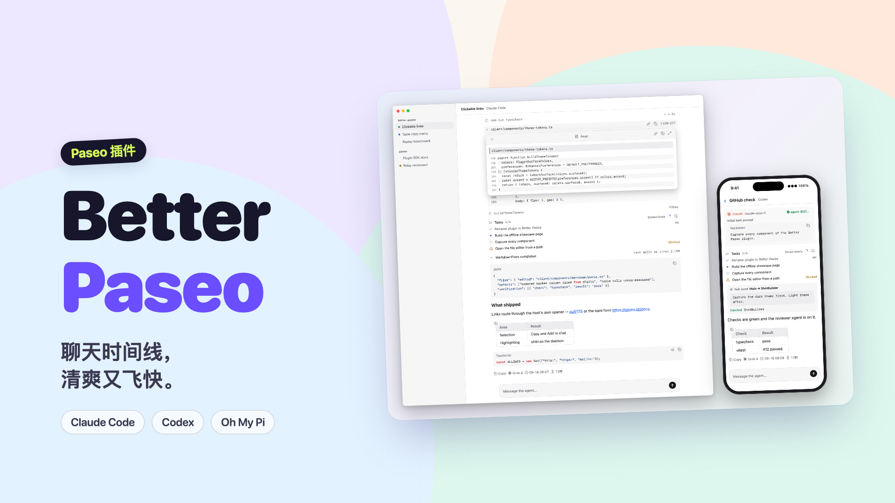
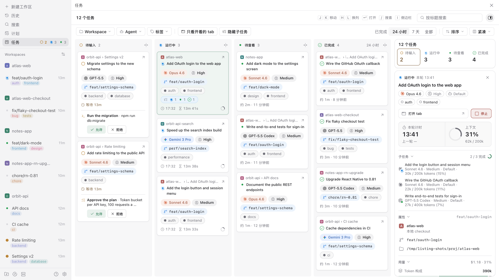
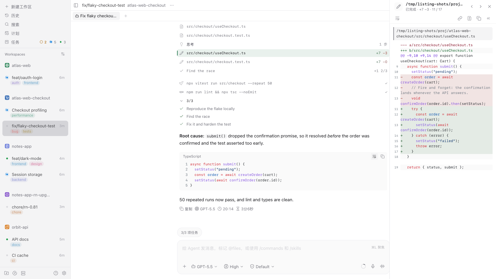
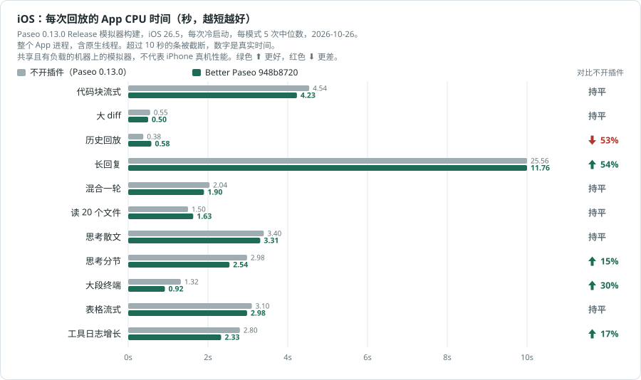

# Better Paseo

[English](README.md) | **简体中文**

一个 [Paseo](https://paseo.sh) 插件，重新绘制 Paseo 中所有 agent 的聊天时间线，不论背后是哪家服务（Claude Code、Codex、Oh My Pi 等）：工具调用、思考、回复、提问、待办和错误都画成紧凑、按类型区分、带语法高亮的行，配色跟随当前的 Paseo 主题。它还加了一个 **Tasks** 看板，把这台主机上的所有 agent 按状态铺成四列。下方实测对比时间线和 Paseo 原生时间线的开销。



<picture><source media="(prefers-color-scheme: dark)" srcset="images/tasks-board-zh-dark.png"></picture>
<picture><source media="(prefers-color-scheme: dark)" srcset="images/timeline-zh-dark.png"></picture>

https://github.com/user-attachments/assets/d1da47b9-1d1c-46ae-8aae-3f64b7f0d809

> Better Paseo fork 自 [ABorakati/beautiful-chat](https://github.com/ABorakati/beautiful-chat)，从 `42b61d8`（2026-09-23）接着开发。除 Eval、Ask、Task 和审批卡片外，Beautiful Chat 原有的卡片都还在；当前的 Paseo 不会把这几类内容交给插件（见[兼容性](#兼容性)）。本文介绍这个 fork 新增的功能和它的性能表现。

## 亮点

- **性能实测。** 对照 Paseo 0.12.0 完成 Web 与 iOS 共 198 次回放；长回复的主线程时间只有宿主的五分之一。详见[性能对比](#性能对比)。
- **内存实测。** 同轮记录强制 GC 后的 JS 堆和相对不开插件的 MB 差值；见[内存对比](#内存对比)。
- **一个工具调用一行。** 调用默认折叠成 26pt 的一行，摘要按类型生成；完成、滚进历史、重新挂载后，展开状态都不会丢。
- **区块详情。** 点按行，或在桌面悬停预览里选「在面板中打开」，就在手机的抽屉、平板的浮动面板或宽窗口右侧的侧边面板里阅读它，并可在标题栏前后切换本轮的各个区块。见[区块详情](#区块详情)。
- **逐块呈现流式回复。** Markdown 缓存已完成的块，持续修补增长中的代码和表格；本轮布局偏移见[性能对比](#性能对比)。
- **不展开也能看内容。** 桌面上悬停折叠行或路径，就能在可滚动的面板里预览内容；图片可以打开全屏查看器。
- **Tasks 看板。** 侧边栏一个入口，按状态（待输入、运行中、待查看、已完成）铺开所有 agent，带父子关联、模型和思考等级，卡片上就能停止任务、处理权限请求。点一下卡片，看板旁的侧栏会显示它的属性、用量、活动和子任务。见 [Tasks 看板](#tasks-看板)。
- **跟随 Paseo。** 字体、字号和颜色默认跟随宿主；设置保存在 daemon 上，桌面、网页、iOS、Android 共用同一份。设置页支持英文和简体中文。

## 安装

```bash
paseo plugin install RoundRedDot/better-paseo
```

需要 Paseo `>=0.8.0`，开发与测量基于 Paseo 0.12.0。在 Paseo 0.8–0.10 上可以使用，但有部分兼容问题，见[兼容性](#兼容性)。在 **设置 → 插件 → Better Paseo** 中配置。Paseo 从 GitHub 安装插件，更新到新版本：

```bash
paseo plugin update better-paseo
```

---

## 性能对比

### Paseo 0.12：198 次回放

2026-10-21 在 Mac Studio（Apple M5 Max、18 核、64 GB、macOS 27.0.1）上对照 Paseo 0.12.0 测量；0.12 用新的 Markdown 引擎（react-native-enriched-markdown）绘制回复。Better Paseo 为 `6a76c56`。Web / iOS 各 11 场景 × 2 种配置（不开插件、Better Paseo）× 3 次，共 **198 次回放**，按场景轮换配置顺序。测量期间机器为共享且有负载（1 分钟负载 21–104，中位约 50），因此以 CPU 时间为主要指标，帧数不列表。原始数据留在本地 `docs/bench/2026-10-21-paseo-012` 归档中，不进入 git。


整段回放主线程 Task 时间（秒）对比不开插件：9 项更低、1 项持平、1 项更高。不到 10%，或两边整段回放都不到 0.5 秒，记为持平。Paseo 0.12 最吃力的是长回复：主线程 15.8 秒对 3.1 秒，而且宿主的耗时增长快于回复长度（四分之一长度 2.1 秒，一半长度 5.5 秒）。

| 场景 | 不开插件 | Better Paseo | 对比不开插件 |
| --- | ---: | ---: | :--- |
| 代码块流式 | 3.430 | **1.359** | &ensp;60% |
| 大 diff | 0.275 | **0.238** | 持平 |
| 历史回放 | 0.715 | **0.860** | &ensp;20% |
| 长回复 | 15.759 | **3.122** | &ensp;80% |
| 混合一轮 | 1.029 | **0.772** | &ensp;25% |
| 读 20 个文件 | 0.735 | **0.589** | &ensp;20% |
| 思考散文 | 1.867 | **1.090** | &ensp;42% |
| 思考分节 | 1.575 | **0.927** | &ensp;41% |
| 大段终端 | 0.661 | **0.458** | &ensp;31% |
| 表格流式 | 2.185 | **1.089** | &ensp;50% |
| 工具日志增长 | 1.152 | **0.906** | &ensp;21% |

同一批跑次的行渲染总量（宿主 Profiler allRows.sum，毫秒），对比不开插件：9 项更低、0 项持平、2 项更高。

| 场景 | 不开插件 | Better Paseo | 对比不开插件 |
| --- | ---: | ---: | :--- |
| 代码块流式 | 1,325.6 | **113.4** | &ensp;91% |
| 大 diff | 15.7 | **11.2** | &ensp;29% |
| 历史回放 | 155.7 | **224.6** | &ensp;44% |
| 长回复 | 9,792.1 | **231.7** | &ensp;98% |
| 混合一轮 | 113.8 | **47.9** | &ensp;58% |
| 读 20 个文件 | 67.7 | **43.4** | &ensp;36% |
| 思考散文 | 362.2 | **65.7** | &ensp;82% |
| 思考分节 | 300.8 | **60.7** | &ensp;80% |
| 大段终端 | 17.6 | **12.7** | &ensp;28% |
| 表格流式 | 760.9 | **118.7** | &ensp;84% |
| 工具日志增长 | 33.7 | **47.2** | &ensp;40% |

### 流式布局偏移

同一批 Web 跑次的累计布局偏移（CLS，越低越好），保留六位小数。0.5 秒规则不适用；百分比会放大极小的绝对差，低于 0.002 的读数实际看不出来。

| 场景 | 不开插件 | Better Paseo | 对比不开插件 |
| --- | ---: | ---: | :--- |
| 代码块流式 | 0.001388 | **0.031453** | &ensp;2166% |
| 大 diff | 0.000015 | **0.000015** | 持平 |
| 历史回放 | 0.107329 | **0.000349** | &ensp;100% |
| 长回复 | 0.044279 | **0.000019** | &ensp;100% |
| 混合一轮 | 0.002791 | **0.026655** | &ensp;855% |
| 读 20 个文件 | 0.000015 | **0.000793** | &ensp;5335% |
| 思考散文 | 0.000015 | **0.000778** | &ensp;5235% |
| 思考分节 | 0.000015 | **0.001142** | &ensp;7733% |
| 大段终端 | 0.000015 | **0.000015** | 持平 |
| 表格流式 | 0.045737 | **0.010534** | &ensp;77% |
| 工具日志增长 | 0.000015 | **0.000015** | 持平 |

### iOS



Paseo 0.12.0 Release 构建，iPhone 17 Pro / iOS 26.5 模拟器，每次冷启动，行探针使用 React profiling 渲染器。Paseo 0.12 在原生线程上排版 Markdown，所以主要指标是整段回放期间整个 App 进程的 CPU 时间；只看 JS 行渲染会低估宿主。App CPU 时间（秒）对比不开插件：6 项更低、5 项持平、0 项更高。长回复里宿主还掉了约 1,260 帧（最长一帧 378 ms），Better Paseo 为 8 帧。

| 场景 | 不开插件 | Better Paseo | 对比不开插件 |
| --- | ---: | ---: | :--- |
| 代码块流式 | 3.71 | **3.27** | &ensp;12% |
| 大 diff | 0.43 | **0.44** | 持平 |
| 历史回放 | 1.74 | **1.89** | 持平 |
| 长回复 | 30.94 | **8.08** | &ensp;74% |
| 混合一轮 | 1.54 | **1.39** | 持平 |
| 读 20 个文件 | 1.29 | **1.30** | 持平 |
| 思考散文 | 2.60 | **2.31** | &ensp;11% |
| 思考分节 | 2.33 | **1.95** | &ensp;16% |
| 大段终端 | 0.91 | **0.66** | &ensp;27% |
| 表格流式 | 2.33 | **2.20** | 持平 |
| 工具日志增长 | 1.98 | **1.72** | &ensp;13% |

仅 JS 行渲染总量（毫秒）对比不开插件：2 项更低、3 项持平、6 项更高。插件行渲染更高而 App CPU 持平的场景，宿主把这部分时间花在了原生 Markdown 排版上。

| 场景 | 不开插件 | Better Paseo | 对比不开插件 |
| --- | ---: | ---: | :--- |
| 代码块流式 | 605.4 | **316.1** | &ensp;48% |
| 大 diff | 10.8 | **45.7** | &ensp;325% |
| 历史回放 | 46.7 | **136.2** | &ensp;192% |
| 长回复 | 19,959.3 | **722.5** | &ensp;96% |
| 混合一轮 | 86.5 | **138.4** | &ensp;60% |
| 读 20 个文件 | 101.8 | **155.9** | &ensp;53% |
| 思考散文 | 137.7 | **144.1** | 持平 |
| 思考分节 | 121.6 | **126.8** | 持平 |
| 大段终端 | 10.6 | **40.8** | &ensp;286% |
| 表格流式 | 302.6 | **291.3** | 持平 |
| 工具日志增长 | 75.2 | **115.6** | &ensp;54% |

绿色 ⬆ 表示更低，红色 ⬇ 表示更高。百分比按未舍入的中位数计算。`history-100` 是 fixture 名称，不代表 100 个实际 provider turn，此处称“历史回放”。`tool-expanded-streaming` 不执行展开操作，此处称“工具日志增长”。

**方法与边界。** Paseo 0.12.0 与相同的宿主行探针（每个时间线行外包一层 React Profiler）。Web 使用生产 profiling 导出，Chrome 155.0.8059.85、1280×900，CDP 测主线程时间，计时后强制 GC 再读 JS 堆和 DOM。iOS 使用原生代码开优化的 Release 模拟器构建。默认功能配置。每格 3 次且机器共享有负载，15% 左右以内的差异请谨慎解读。与 Beautiful Chat `42b61d8` 的对比是在 Paseo 0.11.2 上测的，0.12 上未重测。

### 时间省在哪里

- **跳过没有变化的行。** 按语义比较 theme 和 data，让没有变化的卡片跳过渲染。
- **增量解析回复。** 缓存已完成的 Markdown 块，只修补仍在增长的部分；长回复拆成块供原生宿主虚拟化，复制仍使用完整源码。
- **按需绘制工具正文。** 折叠的行不挂载正文；代码完成后再请求 daemon 高亮，大段代码和终端输出分批显示，并保留“显示全部”。
- **减少持续动画开销。** 网页运行圆点使用 CSS 动画，减少动态效果时静止；移除装饰性的阴影、磨砂和呼吸动画。
- **缩小重连交付。** 品牌图标和 Inter 字体按需下发，客户端源码保持 ASCII，供 Hermes 按单字节保存。


---

## 内存对比

2026-10-21，同一批 Web 生产 profiling 跑次，强制 GC 后 3 次读数的中位数。这是 JS 堆，不是整个进程或应用的内存。差值为 Better Paseo 减不开插件，单位 MB；不适用 10% 持平规则。所有场景里 Better Paseo 的 JS 堆都多 4–13 MB。


| 场景 | 不开插件 | Better Paseo | 差值 |
| --- | ---: | ---: | ---: |
| 代码块流式 | 85.5 | **89.4** | +3.9 |
| 大 diff | 80.5 | **87.5** | +7.0 |
| 历史回放 | 86.5 | **96.2** | +9.7 |
| 长回复 | 86.5 | **99.2** | +12.8 |
| 混合一轮 | 83.3 | **91.2** | +7.9 |
| 读 20 个文件 | 84.5 | **92.7** | +8.2 |
| 思考散文 | 81.7 | **88.2** | +6.5 |
| 思考分节 | 81.3 | **88.3** | +7.1 |
| 大段终端 | 81.0 | **88.2** | +7.2 |
| 表格流式 | 82.3 | **90.9** | +8.6 |
| 工具日志增长 | 84.0 | **93.1** | +9.1 |

本轮 Web 原始样本留在本地 `docs/bench` 归档中，不进入 git。

---

## 功能

截图于 2026-10-17 基于 `b9dfae6` 的离线 Web showcase 重拍。全部产品截图默认浅色，并随阅读器主题自动切换深色；手机外框为示意。性能版本及条件见上文。[截图清单](docs/images/screenshots.json)。

以下功能都建立在 Beautiful Chat 已有的能力之上：按类型区分的工具卡片、Shiki 高亮、读图、用默认应用打开文件，以及插件自己的查找栏。

<picture><source media="(prefers-color-scheme: dark)" srcset="images/thread-dark.png"></picture>

### 工具行

大部分卡片读取的是 Paseo 交给每个插件的工具明细，所以不论调用来自哪个 agent 都能使用：读、写、编辑、Shell 和 Git 命令、搜索、抓取网页、子 agent、计划、MCP 调用（兼容 Claude 的 `mcp__server__tool`、Codex 的 `server.tool` 和 Oh My Pi 的 `server / tool` 三种写法），以及 Paseo 自己的工具。Paseo 以纯文本形式交来的调用，画成「标题 + 正文」的卡片。

Oh My Pi 的 `hub` 工具和它的 GitHub 设备调用按工具名识别，有专门的卡片；其他 agent 不会发出这些调用。在 Paseo 0.11 上，Oh My Pi 的 `eval`、`ask` 以纯文本调用形式交给插件，`task` 则作为子 agent 条目交来。`ask` 带有结构化 `questions` 数据时会显示问答记录；否则仍显示通用文本卡片。

- 每个调用默认是一条无边框的行，桌面 26pt、触控 28pt，摘要按类型生成：命令、路径和行号范围、编辑的 `+4 −2`、退出码和耗时。鼠标点击在原地展开卡片。触控设备上点按改为打开它的[详情](#区块详情)，点行首的图标才在原地展开。
- 展开状态按调用（`agentId:callId`）记在组件之外，完成、滚进历史、重新挂载都不会丢。iOS 上展开时行头留在按下的位置，内容向下打开。
- 失败的调用只显示一行错误；打开「自动展开失败的调用」后，没有保存过展开状态的失败调用会自动展开。
- 每一行记住自己首次出现的时间，并行读取时先完成的那一行不会再换位置、改间距。
- 行首可显示图标、名称或两者都显示。长代码和终端输出先折叠到 12 行。
- 「块字号」可调整工具行、思考、待办和提示中的正文；代码、diff 和终端输出仍使用代码字号。
- Paseo 自己的工具带 Paseo 标识；agent 卡片和回复信息栏使用 agent 所属服务商的标识，不随所选模型改变。
- Oh My Pi 的 `hub` 工具每个操作都有对应卡片：进程、消息和任务快照。卡片只做展示，不带按钮，因为插件无法重启或取消任何东西。
- 不同 agent 发出的受支持提问调用，只要带结构化 `questions` 数据，就会显示分页问答记录，包括选项、已记录的回答和状态。「显示原始数据」可查看原始内容；这类卡片只展示记录，回答仍由 Paseo 处理。预览中的问题会自动换行，便于阅读。

<picture><source media="(prefers-color-scheme: dark)" srcset="docs/images/questions-dark.png"></picture>

| Shell 与 Git | Read |
| --- | --- |
| <picture><source media="(prefers-color-scheme: dark)" srcset="docs/images/tool-bash-dark.png"></picture> | <picture><source media="(prefers-color-scheme: dark)" srcset="docs/images/tool-read-dark.png"></picture> |
| **Edit** | **Hub**（Oh My Pi） |
| <picture><source media="(prefers-color-scheme: dark)" srcset="docs/images/tool-edit-dark.png"></picture> | <picture><source media="(prefers-color-scheme: dark)" srcset="docs/images/hub-dark.png"></picture> |

<details>
<summary>更多卡片：MCP、Paseo 工具、读图、代码块、<code>thinking</code> 工具</summary>

<picture><source media="(prefers-color-scheme: dark)" srcset="docs/images/tool-mcp-dark.png"></picture>
<picture><source media="(prefers-color-scheme: dark)" srcset="docs/images/paseo-dark.png"></picture>
<picture><source media="(prefers-color-scheme: dark)" srcset="docs/images/tool-thinking-dark.png"></picture>
<picture><source media="(prefers-color-scheme: dark)" srcset="docs/images/tool-image-dark.png"></picture>
<picture><source media="(prefers-color-scheme: dark)" srcset="docs/images/syntax-dark.png"></picture>

</details>

### 思考与待办

- 思考只按真实结构（`**标题**` 和各级标题）分段，不再按空行编号。默认折叠，流式时行内实时预览当前标题。
- 只有本机真的看到了思考的流式过程，才显示耗时；不做估算。
- 待办显示阶段名、每项状态、耗时，以及被阻塞的任务和原因。进度环显示已完成项，全部完成后会变为勾选标记。标题栏的窗口按钮会在浮窗中打开实时待办；使用时间线时浮窗保持打开，并始终跟随最新列表，长标题也可换行。

<picture><source media="(prefers-color-scheme: dark)" srcset="docs/images/reasoning-dark.png"></picture>
<picture><source media="(prefers-color-scheme: dark)" srcset="docs/images/tasks-dark.png"></picture>
<picture><source media="(prefers-color-scheme: dark)" srcset="docs/images/checklist-window-dark.png"></picture>

### 回复

- Markdown 由插件绘制：标题、列表、任务列表、引用、高亮代码块和本地图片。提供「文档」「紧凑」「终端」三种样式。
- 未标语言、标为 Markdown 或纯文本的代码块可在最大化预览窗口中打开，并在渲染后的 Markdown 和原始文本间切换、复制源码；原始文本视图使用「自动换行」设置。
- 表格有列线、表头底色和圆角外框；单元格比正文小一号、行距更紧，列宽按等宽数字和中文字宽估算。
- 每张表格左上角都有复制按钮。网页和桌面上，悬停（触屏上长按）会展开「复制为 Markdown」和「复制为图片」，后者复制表格画出来的样子；直接点按复制 Markdown 源码。iOS 和 Android 上点按复制 Markdown。
- 网页和桌面上双击单元格可选中其中的文字；iOS 和 Android 上对同一单元格连续点按两次即可选中。要选中一片单元格，按住某个单元格再往右或往下拖；用鼠标时，从一个单元格直接拖进另一个也可以。松手后弹出菜单：选中一个单元格复制它的文字，选中多个则复制只含这些行列的 Markdown 表格，并带上这几列的表头。表格角落菜单始终提供「复制选中」，Paseo 支持向输入框添加文字时也会显示「添加到对话」。
- 每个已完成轮次会在最终回复下方显示独立信息栏，提供复制和时间；有数据时还会显示服务商标识、模型、思考等级和本轮实际耗时。点按模型名称可复制，并会显示提示；后续轮次运行时，已完成轮次的信息栏仍会保留。关闭「回复使用插件 Markdown」可恢复 Paseo 完整的信息栏和 Fork 操作。
- 一段回复里的多张本地图片都会画出来。
- 关闭「回复使用插件 Markdown」即可把回复交回 Paseo，由它绘制 mermaid 图表、宿主图片和文件链接。

| 表格复制菜单 | 选中单元格后的操作 |
| --- | --- |
| <picture><source media="(prefers-color-scheme: dark)" srcset="docs/images/table-copy-menu-dark.png"></picture> | <picture><source media="(prefers-color-scheme: dark)" srcset="docs/images/table-selection-dark.png"></picture> |

<picture><source media="(prefers-color-scheme: dark)" srcset="docs/images/markdown-styles-dark.png"></picture>
<picture><source media="(prefers-color-scheme: dark)" srcset="docs/images/markdown-preview-window-dark.png"></picture>

### 图片

- 读图时画出文件本身：从文件头读出的尺寸和大小、按内容撑满的缩略图，以及一个显示/隐藏开关，切换时行头停在按下的位置。
- 全屏查看器支持按钮、滚轮或双指以指针为中心缩放，拖动平移，双击复位，并可用默认应用打开。手机上长按这一行会直接打开查看器。
- 图片数据在第一次展开、预览或长按时从 daemon（`file.image`）读取。支持 PNG、JPEG、GIF、WebP、AVIF、BMP、ICO 和 SVG；超过 3MB 的文件只显示大小，不内联。
- 多个读图卡片引用同一张图片时，每个卡片都会显示它。

<picture><source media="(prefers-color-scheme: dark)" srcset="docs/images/shared-image-cards-dark.png"></picture>

### 悬停预览

桌面上把鼠标停在折叠的工具行、思考行、图片或路径上，等待设定的延迟（0–10 秒）后弹出可滚动的预览。面板可换行、显示行号和奇偶行底色，也可移动、调整大小或最大化；待办标题栏可以把实时清单打开为浮窗，Markdown 代码块也有自己的最大化预览。若预览正跟随流式输出末尾，内容增长时会平滑跟随。打开区块详情时，预览标题栏多出「在面板中打开」。关闭区块详情后，手机上长按折叠的行即可打开同样的预览，不会盖住顶部栏和输入框。

### 区块详情

触控设备上，点按工具行、思考行、活动行、待办行或代码块，会打开这个区块的详情。使用鼠标时点击仍在原地展开，面板从悬停预览的「在面板中打开」或行菜单的「打开详情」进入。形态取决于聊天区有多宽：宽度不足 600pt 时是带遮罩的底部抽屉，再宽一些是居中的浮动面板（最宽 760pt），聊天区在旁边还能留出至少 400pt 时则是右侧的侧边面板。网页上的面板不是模态的，后面的行仍可点击；iOS 和 Android 上是一个弹层，Android 的返回键可以关闭。

- 标题栏显示行的图标、最多四行的标题、区块状态和它在本轮中的序号，以及上一个、下一个和关闭。在标题栏上左右滑动可切换区块；时间线会把当前打开的行滚到可见位置并做标记。
- 工具栏有换行、翻页和渲染切换、全屏，以及该工具的复制操作，放不下时收进「更多」。流式输出中的区块会跟随末尾，向上滚动后出现一个回到最新输出的按钮。
- 抽屉高度随内容变化；可以拖动把手或标题栏，正文滚到顶部后继续下拉也能拖动。
- 长按或右键打开行菜单：先是该工具的复制项，然后是查看图片、打开详情和在时间线中展开或收起。点按图片行仍然打开图片查看器。
- 网页上面板打开时的快捷键：← 和 → 切换区块，`[` 和 `]` 在合并行内翻页，W 换行，R 渲染，F 全屏，Cmd/Ctrl+C 复制主要内容，Esc 关闭。
- 关闭「区块详情面板」即可在触控设备上恢复点按展开和长按预览。

### 路径、复制与选中

- 路径相对工作区显示，过长时在中间省略、保留文件名；worktree 的主仓库以名称显示。复制时总是得到绝对路径。
- 复制统一走宿主的 `copyText`，在 iOS 和 Android 上同样可用：桌面悬停、触控长按，或 `⋯` 菜单。纯文本代码块可换行，并带复制按钮。iOS 上长按回复正文可以放置光标、拖动选区。
- 网页和桌面上，在卡片里选中文字会出现「复制」和「添加到对话」；后者把选中内容作为引用放进输入框，选自代码时放成代码块。页面滚动时工具栏会收起；当前没有可见输入框时，「添加到对话」会改为复制选中内容。

<picture><source media="(prefers-color-scheme: dark)" srcset="docs/images/selection-actions-dark.png"></picture>

### 提问气泡

默认由 Paseo 绘制提问，保留粘贴的图片和回退菜单。打开「增强提问气泡」后，符合条件的提问会改用插件气泡：复制按钮常驻，并显示本轮 token 用量。插件能取得受支持的图片源时也会绘制图片；含无法呈现附件的提问仍交给 Paseo。回退菜单在当前 Paseo 支持时保留。

<picture><source media="(prefers-color-scheme: dark)" srcset="docs/images/user-dark.png"></picture>

### 错误与系统消息

- agent 报错时画成一张提示卡片，显示错误信息。
- Oh My Pi 会把任务结果、转发的消息和提醒包在 `<system-notice>`、`<irc>` 等标签里，作为消息文本发出，Paseo 把它们当成回复。打开「回复使用插件 Markdown」时，插件把这些画成系统卡片（标题，加上 agent、状态、耗时等小标签，以及其余正文），而不是原样显示 XML。

权限请求不会被重画：仍由 Paseo 绘制，同意和拒绝也由 Paseo 负责。

### Tasks 看板

**Tasks** 在侧边栏顶部那一组（右侧显示「待输入 · 运行中 · 待查看」计数），也在 Command Center 里。打开后是这台主机上所有 agent 的四列看板，归列规则和侧边栏 workspace 状态一致：**待输入**（等得最久的在上）、**运行中**（跑得最久的在上）、**待查看**（跑完未读或失败）、**已完成**（默认最近 24 小时，每次加载 50 条）。还可以在设置里打开第五列 **已归档**，在已完成的时间窗口内列出已归档的任务和已归档工作区里的任务，已归档任务的详情里可以取消归档。

- 卡片按组排版：标题和「agent · 模型 · 思考等级」，然后是「项目 › workspace」和「分支 · 文件夹」，最后是标签和计时。状态图标就是 Paseo 侧边栏的官方图标。已结束那一轮的计时取自该轮记录下的结束时间，过后再打开旧 agent 的 tab 也不会把它拉长。
- 可以按 workspace、agent、标签、只看开着的 tab、隐藏子任务过滤，也可以按标题搜索。可按 workspace、项目、分支、文件夹、标题、创建时间、更新时间、上下文或耗时排序，排序只作用于已加载的卡片。排序旁的泳道宽度菜单可切换紧凑、默认、宽松三种宽度。桌面上支持键盘：J/K、H/L、Enter、/、I（开关侧栏）、Esc。
- 每张卡片右上角的箭头跳到 agent 所在的 tab。子任务卡片能定位回父任务。父任务卡片上有子任务标签，按状态显示数量；点开后在卡片里列出各个子任务，行首是 agent 标识、角上是状态，行尾是开始时间和运行时长。
- **停止**（桌面悬停出现，手机常驻）要再按一次确认，父任务可以连同运行中的子任务一起停止。tool、plan、mode 类权限请求可以直接在卡片上允许或拒绝，提问类跳到 tab 去回答。

**卡片详情。** 点一下卡片，就在详情侧栏里打开它；没有选中卡片时，侧栏按 agent、项目和标签给看板分组，点某一组即按它过滤。详情卡片先显示这张卡片最需要关注的内容（运行中的这一轮和计时、待处理的权限请求、失败的错误信息，或者摘要），然后是：

- **子任务**：样式与 Paseo 0.12 的子 agent 行一致（服务商标识，标题下面是模型、思考等级、模式和上下文），标题旁是和时间线待办一样的进度环。默认显示十条，点数量那一行展开其余的。
- **属性**：项目、workspace、分支（含领先和落后提交数）、文件夹或路径、PR、标签、父任务和模式。分支名和路径可在所在行复制；过长的路径折叠中间部分。
- **用量**：token 构成图、费用和上下文。
- **活动**：创建、本轮开始、等待和结束。

侧栏的位置取决于看板宽度：

- 看板够宽时，侧栏排在泳道旁边，拖动分隔线调整宽度。
- 窄一些的看板只在点了卡片或侧栏开关时，把侧栏浮在泳道上方；点泳道空白处收起。
- 宽度不足 760pt（折叠屏，或打开了宿主侧边栏的小平板）时，看板顶部收成一行，过滤、已完成时间窗口、排序和泳道宽度都放进一个弹层，泳道保持所选宽度、左右滚动；详情从底部升起，是一个非模态弹层：默认半高，点或拖动把手到全高，向下拖、点泳道空白处、点关闭按钮或按 Esc 关闭。弹层宽 640pt 以上时分两栏排版。
- 手机上一次显示一列，顶部是各列数量组成的切换条，左右滑动或点按切换。点卡片打开详情弹层，可切换到同一列的上一张、下一张，停止和权限按钮固定在拇指够得到的底部。

看板默认关闭：Better Paseo 设置页（设置 → 插件 → Better Paseo）最上面就是「任务看板」，开关旁边有看板的预览。具体选项见[任务看板设置](#任务看板设置)。

限制：插件 API 没有取消操作，停止是通过 Paseo 交给插件的 CLI 执行 `paseo agent stop`；找不到 CLI 时不显示停止按钮。「只看开着的 tab」依赖的标记，Paseo 只给子 agent 的 tab 设置。标签颜色和项目图标要等 [getpaseo/paseo#7482](https://github.com/getpaseo/paseo/pull/7482)，在那之前标签显示中性色点、项目显示首字母头像。provider 内部派出的 subagent（Claude Code 的 Task 工具、Codex 的子任务）不是 Paseo agent，不会出现在看板上。

---

## 设置

**设置 → 插件 → Better Paseo。** 页面分「聊天展示」和「任务看板」两个标签，两边顶部都有任务看板的开关。在聊天展示标签里，一段用时间线组件绘制的示例对话会实时跟随每一项修改：桌面宽窗口下显示在选项旁边，其他情况显示在选项上方；其中 Read 行的悬停预览常驻展开。在网页和桌面上，预览标题栏的「桌面端 / 移动端」切换可以按 iOS 样式、手机宽度绘制同一段对话，并使用你选的行内代码颜色。父选项关闭时，子选项变灰；「恢复全部默认设置」需要再点一次确认。

<picture><source media="(prefers-color-scheme: dark)" srcset="docs/images/settings-zh-dark.png"></picture>
<picture><source media="(prefers-color-scheme: dark)" srcset="docs/images/settings-tools-zh-dark.png"></picture>

| 分组 | 设置 | 默认 | 作用 |
| --- | --- | --- | --- |
| 通用 | 语言 | 跟随系统 | 设置页和工具栏提示使用英文或简体中文。插件读不到 Paseo 自身的语言设置。 |
| 外观 | 强调色 | 主题 | 跟随 Paseo 主题，或选翠绿、紫罗兰、琥珀、玫瑰。只替换强调色。 |
| 外观 | 移动端行内代码 | 深灰 | iOS 和 Android 上行内代码的文字颜色：深灰、蓝、紫、绿、珊瑚红。网页端保留灰色底块。 |
| 外观 | 界面字体 | 跟随 Paseo | Paseo 的界面字体、Inter（仅网页，由 daemon 下发）或系统字体。 |
| 代码字体 | 等宽字体 | 跟随 Paseo | 可选跟随 Paseo 或自定义。跟随 Paseo 的顺序是：宿主向插件提供字体设置时用宿主的设置；否则在网页和桌面上读取 Paseo 外观设置里的等宽字体和字号；再否则用 Paseo 默认等宽字体。iOS 和 Android 上「自定义」只列出系统自带的字体。 |
| 代码字体 | 自定义等宽字体 | 空 | 仅「等宽字体」选「自定义」时生效。网页端可填字体族名称（最多 200 字符，不存在时沿等宽字体栈回退）；iOS 和 Android 只能选择平台提供的字体。 |
| 代码字体 | 代码字号 | 跟随 Paseo | 或 10–22px，行高为字号的 1.5 倍。作用于代码、diff、终端和路径。 |
| 工具调用 | 块字号 | 13px | 9–20px，用于工具行、思考、待办和提示。这些块里的文字一起变化。代码、diff 和终端输出仍用代码字号。 |
| 工具调用 | 行首标识 | 图标 | 工具行和思考行开头显示图标、名称（如 Bash、Read）或两者。 |
| 工具调用 | 自动展开失败的调用 | 关 | 开启后，失败的调用会自动展开并显示错误；你手动展开或折叠过的调用保持原样。 |
| 工具调用 | 文件路径 | 相对 | 相对工作区或绝对路径。复制时总是绝对路径。 |
| 间距 | 紧凑行距 | 开 | 插件行后面还有一行时，下方间距从 16pt 缩到 4pt；Paseo 已经把插件行紧挨着排好时，不再额外收紧。行间重叠时请关闭。 |
| 间距 | 紧凑回复间距 | 开 | 已完成的回复后紧跟插件行（包括待办行）时，把间距从 16pt 缩到 4pt。重叠时请关闭。 |
| 消息 | 增强提问气泡 | 关 | 显示本轮 token 用量，复制按钮常驻；能读取的粘贴图片会一并显示，其他附件仍交给 Paseo。切换后已有的提问也会更新。回退菜单按当前 Paseo 提供的方式显示。 |
| 消息 | 回复使用插件 Markdown | 开 | 关闭后回复交给 Paseo，恢复宿主完整信息栏，并可用 mermaid、宿主图片和 Paseo 的文件链接。 |
| 消息 | Markdown 样式 | 文档 | 文档、紧凑或终端（正文使用代码字体）。 |
| 消息 | 选中文字工具栏 | 开 | 网页和桌面：选中文字后显示「复制」和「添加到对话」；滚动时工具栏收起。 |
| 悬停预览 | 悬停预览 | 开 | 桌面悬停折叠行或路径时预览内容；关闭区块详情时，手机长按折叠行可预览。 |
| 悬停预览 | 区块详情面板 | 开 | 触控设备上点按行在抽屉或面板中打开它的[详情](#区块详情)，长按显示行的操作；桌面上从悬停预览和右键菜单打开面板。关闭后点按在原地展开，长按打开预览。 |
| 悬停预览 | 延迟 | 1 秒 | 桌面上预览弹出前的等待时间，0–10 秒，保存精度为 0.1 秒。 |
| 悬停预览 | 自动换行 | 开 | 预览面板和最大化代码预览的原始文本会自动换行；关闭后可横向滚动。 |
| 悬停预览 | 显示行号 | 开 | 在文件、diff 和命令输出左侧显示行号；diff 显示的是文件中的行号。 |
| 悬停预览 | 奇偶行底色 | 开 | 在预览中隔行添加底色。 |

**设置存在哪里。** 偏好通过 SDK 的主机级设置保存在 daemon 上（`shared/preferences-settings.ts` 里的 `presentation` 记录），所以**连接同一个 daemon 的所有客户端共用一份设置**：在桌面上改，iOS 上也会生效，反之亦然。某个平台画不出来的值会按原样保存，只在绘制时降级（自定义字体在 iOS 和 Android 上变成系统等宽字体，Inter 变成系统字体）。网页端的 `localStorage` 只用作快速启动的缓存。设置到达之前，卡片先用缓存或默认值绘制，到达后切换一次。

**设置立即生效。** 本地偏好状态更新后，已经显示的插件条目也会立即重绘。daemon 会保存设置并同步给其他连接的客户端，无需重新加载聊天。「自动展开失败的调用」会沿用已保存的逐项展开状态；没有记录时才采用设置作为初始状态。

### 任务看板设置

「任务看板」标签用示例 agent 画出四列泳道，随每个选项实时重绘。设置记录是 `shared/tasks-settings.ts` 里的 `tasks`，保存和共享方式与上面的聊天设置相同。

| 分组 | 设置 | 默认 | 作用 |
| --- | --- | --- | --- |
| 任务看板 | 启用任务看板 | 关 | 在侧边栏和 Command Center 加入「任务」。关闭时没有入口，也不订阅 agent。 |
| 卡片 | 卡片信息密度 | 标准 | 精简、标准、完整会一次写入下面所有字段开关；手动改动任一开关后变为「自定义」。 |
| 卡片 | 显示字段 | 标准预设 | agent 品牌标识、模型、思考等级、项目、项目图标、workspace 名称、分支、Git 状态、文件夹、完整路径、标签、关联 PR、计时、上下文占用环和子任务摘要。标准不显示 Git 状态、完整路径和关联 PR；精简只保留模型、思考等级和计时。 |
| 卡片 | 标签数量 | 2 个 | 1、2、3 个或全部，其余收成 +N。 |
| 手机 | 手机上使用精简卡片 | 关 | 开启后，手机上无论选哪种密度都按精简卡片显示。 |
| 看板 | 已完成默认时间窗口 | 近 24 小时 | 近 24 小时、近 7 天或全部。 |
| 看板 | 泳道宽度 | 默认 | 紧凑、默认或宽松，用于桌面、网页和平板；看板放不下时泳道左右滚动。手机上每次只显示一条泳道，不显示这一项。 |
| 看板 | 默认隐藏子任务 | 关 | 运行中、待输入和失败的子任务仍显示在各自的泳道。 |
| 看板 | 显示已归档泳道 | 关 | 在已完成之后多一列，列出已归档的任务和已归档工作区里的任务，时间窗口与已完成相同。关闭时不向 daemon 要已归档的 agent。 |
| 看板 | 停止前二次确认 | 开 | 停止需要再按一次。 |
| 侧边栏 | 侧边栏入口计数 | 待输入 · 运行中 · 待查看 | 或只显示待输入，或不显示。 |
| 恢复 | 恢复任务看板默认设置 | — | 把任务看板的所有选项恢复为默认，看板开关保持不变；需要再点一次确认。 |

---

## 查找文字

Paseo 自带的聊天查找（Ctrl/Cmd+F）定位不到插件绘制的行，因为转换后的行带的是另一个 id。所以 Better Paseo 在桌面和网页上接管 Ctrl/Cmd+F，在聊天上方打开自己的查找栏。它搜索已经渲染的所有内容，包括工具卡片和结构化问答记录：Enter 下一个，Shift+Enter 上一个，Escape 关闭。它只能搜到已加载的消息，往上滚动即可包含更早的历史。

如果想对回复使用 Paseo 原生查找（它也能搜到未加载的历史），关闭「回复使用插件 Markdown」（以及已开启的「增强提问气泡」）。这样回复和提问由 Paseo 自己绘制，Ctrl/Cmd+F 打开的就是 Paseo 的查找。工具、思考和待办卡片仍由插件绘制。

## 打开文件

读、写、编辑结果和代码块里的文件名都是链接。在桌面上，它调用 daemon 端的 `file.reveal`，按 agent 的工作目录解析路径，在 daemon 那台机器上打开：macOS 用 `open` 以默认应用打开文件、在访达中打开文件夹；应用、脚本和可执行文件只用 `open -R` 定位，点按不会运行它们。Windows 用 `explorer.exe /select,` 选中文件，其他系统用 `xdg-open` 打开所在目录。在触控设备上，同样的点按改为复制绝对路径，因为手机看不到 daemon 那台机器的屏幕。

## 常见问题

| 现象 | 处理 |
| --- | --- |
| 行与行重叠，或回复盖住了下一行 | 关闭「紧凑行距」或「紧凑回复间距」。 |
| 回复里需要 mermaid 图、宿主图片或 Paseo 的文件链接 | 关闭「回复使用插件 Markdown」。 |
| 手机上选中表格单元格后没有「添加到对话」 | Paseo 暂不支持向输入框添加文字；「复制选中」始终可用。 |
| 含附件的提问需要由 Paseo 绘制 | 关闭「增强提问气泡」。插件无法呈现的附件会自动交给 Paseo。 |
| Ctrl/Cmd+F 搜不到较早的消息 | 先往上滚动加载，或按上文把回复交回 Paseo。 |
| 旧的一轮对话没有 token 数字 | 最新已完成轮次在提问时间匹配时，可以从 daemon 快照恢复用量；更早轮次保留本客户端实时捕获的用量。两处都没有记录的项目仍隐藏。 |
| Grok 和 Cursor 回放出来的轮次在 Copy 工具栏和轮次详情里不显示耗时 | 上游工具问题：daemon 重新加载 Grok 或 Cursor 的历史时，记录没有逐条时间戳，回放记录的时间都是加载时刻或仅相差 1 毫秒，会误显示为 `0秒`。Better Paseo 对 `grok` 和 `cursor` 服务商隐藏不足 1 秒的耗时；实时运行的轮次照常显示耗时。按服务商判断，不按模型名称判断。 |
| 推送了修复，但界面没变化 | 运行 `paseo plugin update better-paseo`；Paseo 运行的是 GitHub 上的版本。 |

## 兼容性

Better Paseo 以 Paseo 0.11 及以后的版本为目标。在 Paseo 0.8–0.10 上可以安装并绘制时间线，但有以下已知问题：

- 在这些版本上，Oh My Pi 的 `eval` 和 `ask` 调用以原工具名到达插件，而不是经过 Paseo 0.11 的纯文本转换。`eval` 仍显示为通用卡片；`ask` 只有在输入含结构化 `questions` 数组时才显示问答记录，否则也显示为通用卡片。
- 部分功能取决于宿主能力，详见[等待 Paseo 支持的改动](#等待-paseo-支持的改动)；宿主能力探测已在 0.11.2 上验证。

## 等待 Paseo 支持的改动

Better Paseo 在已发布的 Paseo 上就能用，并会探测较新的宿主能力，没有时自动回退。下面几项宿主改动已在 Paseo 的 fork 里验证，尚未发布：

- 插件工具行与原生工具行的间距对齐（约 46pt 收到 30pt，原生是 32pt）。在此之前由「紧凑行距」在适用处把间距从 16pt 缩到 4pt。
- Paseo 向插件提供字体设置，修改外观后插件实时跟上。在此之前，网页和桌面读取 Paseo 保存在本地的外观设置。
- Paseo 向插件提供向输入框添加文字的能力，以便触屏表格选区同时显示「添加到对话」和「复制选中」。在此之前，表格角落菜单仍可复制选中的单元格。
- 插件包在 Hermes 上执行前，先把 `class` 语法降级。
- 当前轮提问吸顶、展开卡片的标题吸顶；插件一侧已经接好。

把多个调用合并成「Read 12 files」一行需要宿主的分组 API；在开发版模拟器上展开 5,000 行的代码块仍需约 30 秒，彻底解决需要宿主的虚拟滚动。

开发过程中遇到的 SDK 限制、证据和对应的绕行方式见 [`docs/plugin-sdk-limitations.md`](docs/plugin-sdk-limitations.md)（英文）。

## 开发

```bash
npm install
npm run typecheck
npm test
npm run check:hermes
paseo plugin reload better-paseo
```

`npm run check:hermes` 会在 Hermes（iOS 和 Android 应用使用的 JS 引擎）里编译并运行客户端包；在网页上能跑的代码，到了 Hermes 仍可能失败，并导致整个插件无法加载。它检查的规则、项目结构，以及如何重新生成截图和图表，见 [`docs/development.md`](docs/development.md)（英文）。

## 许可证

MIT
