# Better Paseo

[English](README.md) | **简体中文**

一个 [Paseo](https://paseo.sh) 插件，重新绘制 Paseo 中所有 agent 的聊天时间线，不论背后是哪家服务（Claude Code、Codex、Oh My Pi 等）：工具调用、思考、回复、提问、待办和错误都画成紧凑、按类型区分、带语法高亮的行，配色跟随当前的 Paseo 主题。下方实测对比它和 Paseo 原生时间线的开销。

<picture>
  <source media="(prefers-color-scheme: dark)" srcset="images/hero-devices-dark.png">
  
</picture>

> Better Paseo fork 自 [ABorakati/beautiful-chat](https://github.com/ABorakati/beautiful-chat)，从 `42b61d8`（2026-09-23）接着开发。除 Eval、Ask、Task 和审批卡片外，Beautiful Chat 原有的卡片都还在；当前的 Paseo 不会把这几类内容交给插件（见[兼容性](#兼容性)）。本文介绍这个 fork 新增的功能和它的性能表现。

## 亮点

- **性能实测。** 最新 main `b9dfae6` 完成 630 次同轮采样，完整对比及 A/A 波动见[性能对比](#性能对比)。
- **内存实测。** 同轮记录强制 GC 后的 JS 堆和相对不开插件的 MB 差值；见[内存对比](#内存对比)。
- **一个工具调用一行。** 调用默认折叠成 26pt 的一行，摘要按类型生成，点一下展开；完成、滚进历史、重新挂载后，展开状态都不会丢。
- **逐块呈现流式回复。** Markdown 缓存已完成的块，持续修补增长中的代码和表格；本轮布局偏移见[性能对比](#性能对比)。
- **不展开也能看内容。** 桌面上悬停折叠行或路径、手机上长按折叠行，就能在可滚动的面板里预览内容；图片可以打开全屏查看器。
- **跟随 Paseo。** 字体、字号和颜色默认跟随宿主；设置保存在 daemon 上，桌面、网页、iOS、Android 共用同一份。设置页支持英文和简体中文。

## 安装

```bash
paseo plugin install RoundRedDot/better-paseo
```

需要 Paseo `>=0.8.0`，开发与测量基于 Paseo 0.11.2。在 Paseo 0.8–0.10 上可以使用，但有部分兼容问题，见[兼容性](#兼容性)。在 **设置 → 插件 → Better Paseo** 中配置。Paseo 从 GitHub 安装插件，更新到新版本：

```bash
paseo plugin update better-paseo
```

---

## 性能对比

### 最新 main：630 次同轮采样

2026-10-17 在 Mac Studio（Apple M5 Max、18 核、64 GB、macOS 27.0.1）固定最新 `main` **`b9dfae6`** 重跑。Web / iOS 各 11 场景 × 5 配置 × 5 次，共 **550 次回放**；另有 **80 次长历史测试**。五配置为不开插件、Beautiful Chat `42b61d8`、当前版、当前版 A/A 重复和前一版 `2fc6476`。最多 4 组隔离并行，按场景和轮次轮换分组与配置顺序；下方三模式表每格取 5 次主组的中位数。显示错误整组标 N/A，完整范围和失败记录见[本轮报告](docs/bench/2026-10-17-readme/README.md)。


整段回放主线程 Task 时间对比不开插件：9 项更低、2 项持平、0 项更高；对比 Beautiful Chat：10 项更低、1 项持平、0 项更高。相差不到 10%，或两边整段 Task 均低于 0.5 秒，记为持平。

下表为行渲染总量（宿主 Profiler `allRows.sum`，毫秒），对比不开插件：9 项更低、0 项持平、2 项更高；不是单次提交 p95。

| 场景 | 不开插件 | Beautiful Chat | Better Paseo | 对比不开插件 | 对比 Beautiful Chat |
| --- | ---: | ---: | ---: | :--- | :--- |
| 代码块流式 | 827.8 | 802.4 | **147.1** | &ensp;82% | &ensp;82% |
| 大 diff | 21.9 | 549.8 | **15.9** | &ensp;27% | &ensp;97% |
| 历史回放 | 164.2 | 4,562.6 | **218.3** | &ensp;33% | &ensp;95% |
| 长回复 | 1,133.3 | 2,093.6 | **236.6** | &ensp;79% | &ensp;89% |
| 混合一轮 | 121.3 | 326.3 | **53.2** | &ensp;56% | &ensp;84% |
| 读 20 个文件 | 92.2 | 786.6 | **52.1** | &ensp;43% | &ensp;93% |
| 思考散文 | 276.2 | 647.1 | **63.6** | &ensp;77% | &ensp;90% |
| 思考分节 | 281.8 | 989.0 | **60.5** | &ensp;79% | &ensp;94% |
| 大段终端 | 23.7 | 185.8 | **13.7** | &ensp;42% | &ensp;93% |
| 表格流式 | 686.2 | 232.0 | **156.0** | &ensp;77% | &ensp;33% |
| 工具日志增长（默认状态） | 37.4 | 559.2 | **51.1** | &ensp;37% | &ensp;91% |

各模式保留默认展开行为：Beautiful Chat 默认展开运行中的工具，Better Paseo 默认折叠。`tool-expanded-streaming` 不执行展开操作，此处称“工具日志增长（默认状态）”，不据此宣称展开工具体的性能。

### 流式布局偏移

同批 Web 的累计布局偏移（CLS，越低越好），保留 6 位小数；不套用 Task 的 0.5 秒规则。微小基数的百分比可能放大绝对差异。

| 场景 | 不开插件 | Beautiful Chat | Better Paseo | 对比不开插件 | 对比 Beautiful Chat |
| --- | ---: | ---: | ---: | :--- | :--- |
| 代码块流式 | 0.041921 | 0.127708 | **0.011655** | &ensp;72% | &ensp;91% |
| 大 diff | 0.000015 | 0.024003 | **0.000015** | 持平 | &ensp;100% |
| 历史回放 | 0.240602 | 0.088614 | **0.000015** | &ensp;100% | &ensp;100% |
| 长回复 | 0.183334 | 0.646989 | **0.000015** | &ensp;100% | &ensp;100% |
| 混合一轮 | 0.004936 | 0.092846 | **0.026648** | &ensp;440% | &ensp;71% |
| 读 20 个文件 | 0.001990 | 0.678542 | **0.000777** | &ensp;61% | &ensp;100% |
| 思考散文 | 0.000015 | 0.098084 | **0.000777** | &ensp;5230% | &ensp;99% |
| 思考分节 | 0.000015 | 0.147581 | **0.000777** | &ensp;5230% | &ensp;99% |
| 大段终端 | 0.000015 | 0.021574 | **0.000015** | 持平 | &ensp;100% |
| 表格流式 | 0.045675 | 0.039717 | **0.010534** | &ensp;77% | &ensp;73% |
| 工具日志增长（默认状态） | 0.000015 | 0.014097 | **0.000015** | 持平 | &ensp;100% |

### iOS


iPhone 16 Pro / iOS 18.6 开发版 Hermes 模拟器，每次冷启动；使用 4 台隔离测试模拟器，最多 4 组并行；Web 阶段全部完成后再测 iOS。行渲染总量单位为毫秒，不到 10% 记为持平。对比不开插件：1 项更低、3 项持平、1 项更高、6 项不可比较；对比 Beautiful Chat：5 项更低、0 项持平、0 项更高、6 项不可比较。不代表真机帧率或 Release 性能。

| 场景 | 不开插件 | Beautiful Chat | Better Paseo | 对比不开插件 | 对比 Beautiful Chat |
| --- | ---: | ---: | ---: | :--- | :--- |
| 代码块流式 | 2,321.7 | 4,802.1 | **754.4** | &ensp;68% | &ensp;84% |
| 大 diff | 46.9 | 3,151.1 | **N/A** | N/A | N/A |
| 历史回放 | 198.9 | 260.7 | **N/A** | N/A | N/A |
| 长回复 | 5,113.1 | 13,914.4 | **N/A** | N/A | N/A |
| 混合一轮 | 267.1 | 647.5 | **N/A** | N/A | N/A |
| 读 20 个文件 | 278.4 | 2,640.9 | **265.8** | 持平 | &ensp;90% |
| 思考散文 | 262.3 | 1,477.3 | **259.5** | 持平 | &ensp;82% |
| 思考分节 | 241.4 | 2,536.1 | **N/A** | N/A | N/A |
| 大段终端 | 47.8 | 369.9 | **55.1** | &ensp;15% | &ensp;85% |
| 表格流式 | 937.3 | 1,107.7 | **N/A** | N/A | N/A |
| 工具日志增长（默认状态） | 165.9 | 3,155.4 | **171.9** | 持平 | &ensp;95% |

绿色 ⬆ 表示更低，红色 ⬇ 表示更高；百分比按舍入前中位数计算。`history-100` 是夹具名，不等于 100 个实际 provider turn，此处称“历史回放”。

**方法与边界。** 固定 Paseo 0.11.2 / `759532509` 与相同宿主行探针；为各组重新导出生产 profiling Web 构建并记录哈希。Chrome 155.0.8059.40、1280×900，CDP 测主线程，计时后强制 GC 测 JS 堆和 DOM；默认功能配置，当前版开启测量计数。行渲染不包含整个 native 布局或应用 CPU。原始数据记录负载、CPU 空闲率及内存压力；入场要求 CPU 空闲率 ≥15%、内存空闲比例 ≥10%、压力等级为 1；记录负载但不以负载平均值拒绝采样，结束时资源超限样本保留并标记。实际并发随阶段变化，仅为本协议下观察中位数，不代表固定并发吞吐或稳定提升。

### 前一版对照与 A/A 波动

前一版固定 `2fc6476`，当前版固定 `b9dfae6`。每版每格 5 次，表中为行渲染总量（毫秒）。A/A 是当前版另外 5 次与主组逐轮配对的绝对差超过 10% 的数量；不将额外样本合并进主表。保留全部不稳定配对，较低中位数不等于稳定提升。

#### Web

| 场景 | 前一版 ms | main ms | 相对前一版 | A/A 超过 10% | 最大 A/A 差 |
| --- | ---: | ---: | ---: | ---: | ---: |
| 代码块流式 | 148.0 | 147.1 | -0.61% | 1/5 | 25.97% |
| 大 diff | 12.2 | 15.9 | +30.33% | 4/5 | 33.96% |
| 历史回放 | 220.5 | 218.3 | -1.00% | 4/5 | 27.78% |
| 长回复 | 243.5 | 236.6 | -2.83% | 3/5 | 24.70% |
| 混合一轮 | 58.1 | 53.2 | -8.43% | 3/5 | 34.30% |
| 读 20 个文件 | 60.2 | 52.1 | -13.46% | 5/5 | 36.11% |
| 思考散文 | 67.1 | 63.6 | -5.22% | 2/5 | 22.29% |
| 思考分节 | 65.6 | 60.5 | -7.77% | 3/5 | 19.36% |
| 大段终端 | 11.4 | 13.7 | +20.18% | 2/5 | 57.39% |
| 表格流式 | 138.9 | 156.0 | +12.31% | 4/5 | 32.67% |
| 工具日志增长（默认状态） | 48.2 | 51.1 | +6.02% | 3/5 | 23.44% |

#### iOS

| 场景 | 前一版 ms | main ms | 相对前一版 | A/A 超过 10% | 最大 A/A 差 |
| --- | ---: | ---: | ---: | ---: | ---: |
| 代码块流式 | N/A | 754.4 | N/A | N/A | N/A |
| 大 diff | 54.1 | N/A | N/A | N/A | N/A |
| 历史回放 | 208.5 | N/A | N/A | N/A | N/A |
| 长回复 | 1,490.0 | N/A | N/A | N/A | N/A |
| 混合一轮 | 219.8 | N/A | N/A | N/A | N/A |
| 读 20 个文件 | 276.7 | 265.8 | -3.94% | N/A | N/A |
| 思考散文 | N/A | 259.5 | N/A | N/A | N/A |
| 思考分节 | 222.0 | N/A | N/A | N/A | N/A |
| 大段终端 | 50.2 | 55.1 | +9.76% | 3/5 | 20.14% |
| 表格流式 | N/A | N/A | N/A | N/A | N/A |
| 工具日志增长（默认状态） | N/A | 171.9 | N/A | N/A | N/A |


### 长会话加载

同轮最多 4 组并行复测 `history-complete-v1`：Web 和 iOS 各 40 次，共 **80 次**。每个平台、每个场景有 5 对当前版 A/A，以及每种对照 5 次。固定 `b9dfae6` / Beautiful Chat `42b61d8`，使用默认设置。810 条 / 1 个实际 provider turn 与 832 条 / 12 轮两种输入均保留 59,427 字符长回复。260 条 reasoning 使用等长唯一合成标识；这不证明旧重复 key 输入已修复。

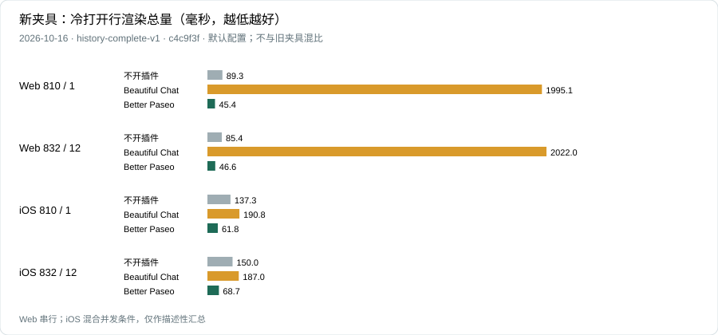

#### Web

| 场景 / 阶段 | 不开插件 | Beautiful Chat | Better Paseo |
| --- | ---: | ---: | ---: |
| 810 条 / 1 轮 — 冷打开行渲染 | 98.4 | 1,808.8 | 137.7 |
| 810 条 / 1 轮 — 首次上翻行渲染 | 11.9 | 531.2 | 10.7 |
| 810 条 / 1 轮 — 整体会话返回行渲染 | 160.9 | 2,155.7 | 63.8 |
| 832 条 / 12 轮 — 冷打开行渲染 | 111.4 | 1,841.7 | 129.7 |
| 832 条 / 12 轮 — 首次上翻行渲染 | 12.4 | 526.3 | 15.0 |
| 832 条 / 12 轮 — 整体会话返回行渲染 | 156.1 | 2,167.2 | 63.2 |

#### iOS

| 场景 / 阶段 | 不开插件 | Beautiful Chat | Better Paseo |
| --- | ---: | ---: | ---: |
| 810 条 / 1 轮 — 冷打开行渲染 | 173.6 | 212.9 | N/A |
| 810 条 / 1 轮 — 首次上翻行渲染 | 182.4 | 13.7 | N/A |
| 810 条 / 1 轮 — 整体会话返回行渲染 | 315.8 | 402.5 | N/A |
| 832 条 / 12 轮 — 冷打开行渲染 | 161.4 | 198.6 | 127.3 |
| 832 条 / 12 轮 — 首次上翻行渲染 | 182.0 | 47.7 | 160.1 |
| 832 条 / 12 轮 — 整体会话返回行渲染 | 295.4 | 356.1 | 106.5 |

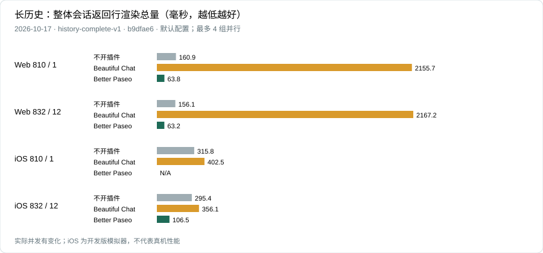

单位为毫秒。Web 上翻从尾部发出覆盖当前总高度的真实滚轮输入，不做未计时的预滚动；iOS 记录准备定位，再计时真实 HID 拖动。整体返回先确认目标时间线真实卸载，再通过宿主标签页返回同一会话；不是滚动导致的独立 Markdown 块重新挂载。只有通过上翻前和返回后完整复制验证的当前版组才发布数值；任一样本失败，该场景／配置的三个阶段整组标 N/A，不以其余成功样本补算。JS 就绪代理不等于首个可用视口；上翻和返回可能渲染不同的行集合，需结合范围和 A/A 波动理解。

[长历史范围、A/A 与原始证据](docs/bench/2026-10-17-readme/parallel-v2/history/RESULTS.md)


### 时间省在哪里

- **跳过没有变化的行。** 按语义比较 theme 和 data，让没有变化的卡片跳过渲染。
- **增量解析回复。** 缓存已完成的 Markdown 块，只修补仍在增长的部分；长回复拆成块供原生宿主虚拟化，复制仍使用完整源码。
- **按需绘制工具正文。** 折叠的行不挂载正文；代码完成后再请求 daemon 高亮，大段代码和终端输出分批显示，并保留“显示全部”。
- **减少持续动画开销。** 网页运行圆点使用 CSS 动画，减少动态效果时静止；移除装饰性的阴影、磨砂和呼吸动画。
- **缩小重连交付。** 品牌图标和 Inter 字体按需下发，客户端源码保持 ASCII，供 Hermes 按单字节保存。


---

## 内存对比

2026-10-17，同批 Web 生产 profiling 测试，每格为强制 GC 后 5 次主组的中位数。统计 JS 堆，不是进程或应用总内存。差值为 Better Paseo 减去对照，单位 MB；不套用 10% 持平规则。


| 场景 | 不开插件 | Beautiful Chat | Better Paseo | 对比不开插件 | 对比 Beautiful Chat |
| --- | ---: | ---: | ---: | :--- | :--- |
| 代码块流式 | 107.5 | 106.5 | **106.1** | -1.4 | -0.4 |
| 大 diff | 98.8 | 204.8 | **103.4** | +4.6 | -101.4 |
| 历史回放 | 105.0 | 232.1 | **109.8** | +4.9 | -122.3 |
| 长回复 | 148.9 | 108.1 | **115.7** | -33.2 | +7.6 |
| 混合一轮 | 103.9 | 113.8 | **106.2** | +2.4 | -7.5 |
| 读 20 个文件 | 102.6 | 231.7 | **108.2** | +5.5 | -123.5 |
| 思考散文 | 98.6 | 102.0 | **102.5** | +3.9 | +0.5 |
| 思考分节 | 100.2 | 103.0 | **104.0** | +3.7 | +0.9 |
| 大段终端 | 100.4 | 116.5 | **103.9** | +3.6 | -12.6 |
| 表格流式 | 103.6 | 104.4 | **105.1** | +1.5 | +0.7 |
| 工具日志增长（默认状态） | 100.6 | 111.6 | **106.2** | +5.7 | -5.3 |

[原始 Web 样本](docs/bench/2026-10-17-readme/parallel-v2/raw/web)

---

## 功能

截图于 2026-10-17 基于 `b9dfae6` 的离线 Web showcase 重拍。全部产品截图默认浅色，并随阅读器主题自动切换深色；手机外框为示意。性能版本及条件见上文。[截图清单](docs/images/screenshots.json)。

以下功能都建立在 Beautiful Chat 已有的能力之上：按类型区分的工具卡片、Shiki 高亮、读图、在文件管理器中显示，以及插件自己的查找栏。

<picture><source media="(prefers-color-scheme: dark)" srcset="images/thread-dark.png">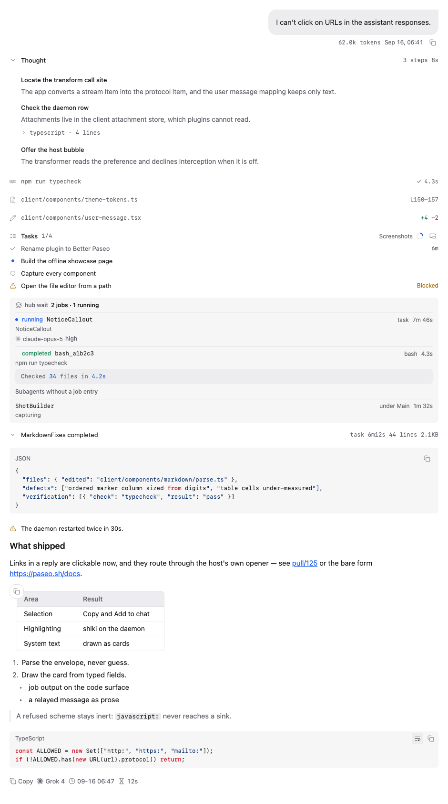</picture>

### 工具行

大部分卡片读取的是 Paseo 交给每个插件的工具明细，所以不论调用来自哪个 agent 都能使用：读、写、编辑、Shell 和 Git 命令、搜索、抓取网页、子 agent、计划、MCP 调用（兼容 Claude 的 `mcp__server__tool`、Codex 的 `server.tool` 和 Oh My Pi 的 `server / tool` 三种写法），以及 Paseo 自己的工具。Paseo 以纯文本形式交来的调用，画成「标题 + 正文」的卡片。

Oh My Pi 的 `hub` 工具和它的 GitHub 设备调用按工具名识别，有专门的卡片；其他 agent 不会发出这些调用。在 Paseo 0.11 上，Oh My Pi 的 `eval`、`ask` 以纯文本调用形式交给插件，`task` 则作为子 agent 条目交来。`ask` 带有结构化 `questions` 数据时会显示问答记录；否则仍显示通用文本卡片。

- 每个调用默认是一条无边框的行，桌面 26pt、触控 28pt，摘要按类型生成：命令、路径和行号范围、编辑的 `+4 −2`、退出码和耗时。点一下展开卡片。
- 展开状态按调用（`agentId:callId`）记在组件之外，完成、滚进历史、重新挂载都不会丢。iOS 上展开时行头留在按下的位置，内容向下打开。
- 失败的调用只显示一行错误；打开「自动展开失败的调用」后，没有保存过展开状态的失败调用会自动展开。
- 每一行记住自己首次出现的时间，并行读取时先完成的那一行不会再换位置、改间距。
- 行首可显示图标、名称或两者都显示。长代码和终端输出先折叠到 12 行。
- 「块字号」可调整工具行、思考、待办和提示中的正文；代码、diff 和终端输出仍使用代码字号。
- Paseo 自己的工具带 Paseo 标识；agent 卡片和回复信息栏使用 agent 所属服务商的标识，不随所选模型改变。
- Oh My Pi 的 `hub` 工具每个操作都有对应卡片：进程、消息和任务快照。卡片只做展示，不带按钮，因为插件无法重启或取消任何东西。
- 不同 agent 发出的受支持提问调用，只要带结构化 `questions` 数据，就会显示分页问答记录，包括选项、已记录的回答和状态。「显示原始数据」可查看原始内容；这类卡片只展示记录，回答仍由 Paseo 处理。预览中的问题会自动换行，便于阅读。

<picture><source media="(prefers-color-scheme: dark)" srcset="docs/images/questions-dark.png">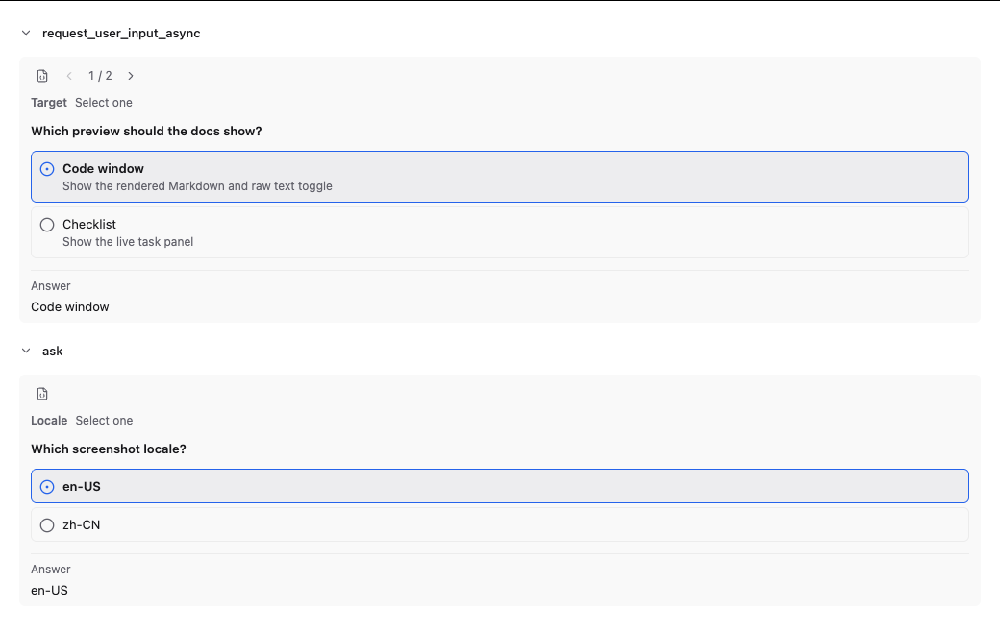</picture>

| Shell 与 Git | Read |
| --- | --- |
| <picture><source media="(prefers-color-scheme: dark)" srcset="docs/images/tool-bash-dark.png"></picture> | <picture><source media="(prefers-color-scheme: dark)" srcset="docs/images/tool-read-dark.png">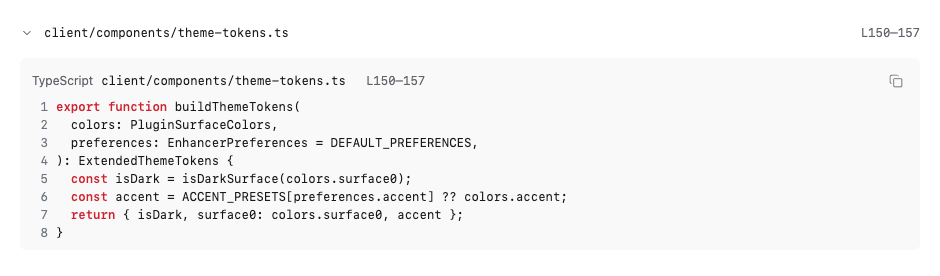</picture> |
| **Edit** | **Hub**（Oh My Pi） |
| <picture><source media="(prefers-color-scheme: dark)" srcset="docs/images/tool-edit-dark.png">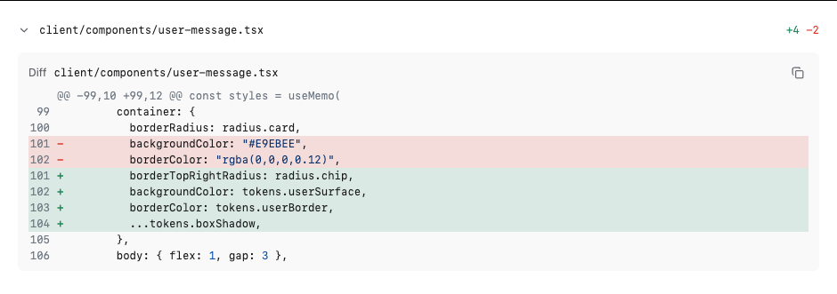</picture> | <picture><source media="(prefers-color-scheme: dark)" srcset="docs/images/hub-dark.png">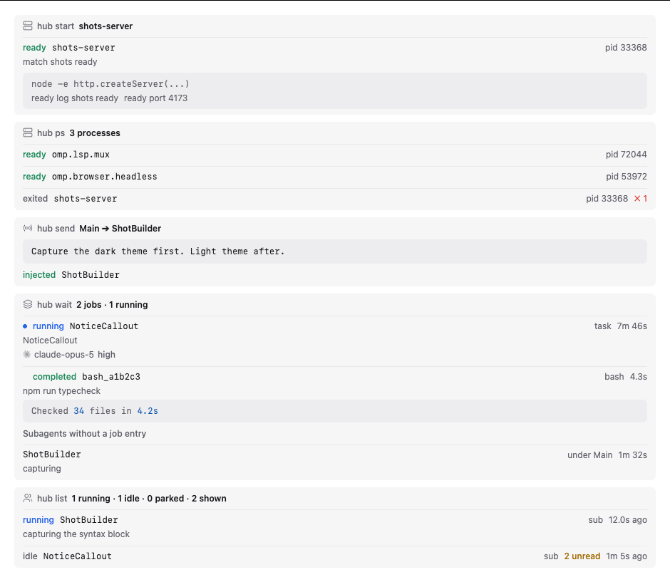</picture> |

<details>
<summary>更多卡片：MCP、Paseo 工具、读图、代码块、<code>thinking</code> 工具</summary>

<picture><source media="(prefers-color-scheme: dark)" srcset="docs/images/tool-mcp-dark.png">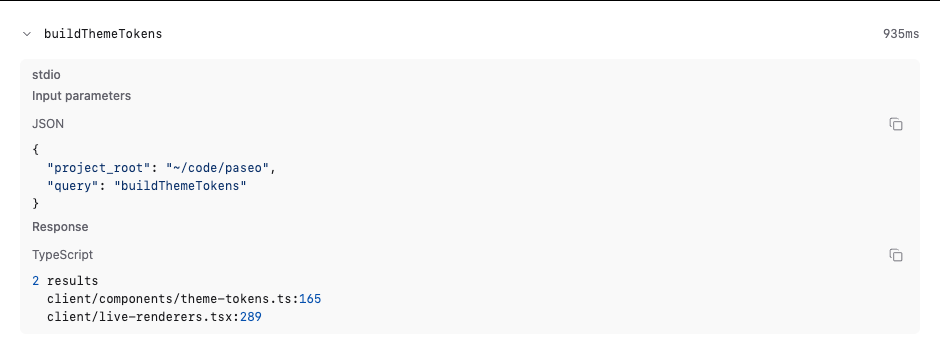</picture>
<picture><source media="(prefers-color-scheme: dark)" srcset="docs/images/paseo-dark.png">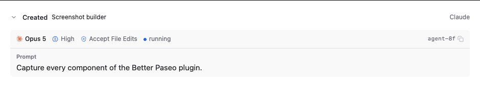</picture>
<picture><source media="(prefers-color-scheme: dark)" srcset="docs/images/tool-thinking-dark.png">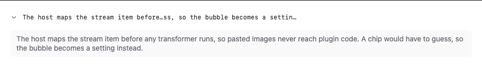</picture>
<picture><source media="(prefers-color-scheme: dark)" srcset="docs/images/tool-image-dark.png">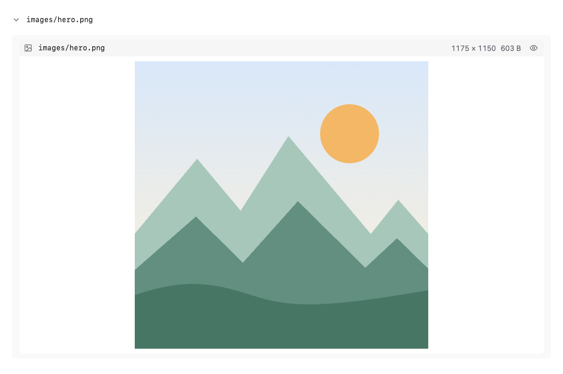</picture>
<picture><source media="(prefers-color-scheme: dark)" srcset="docs/images/syntax-dark.png">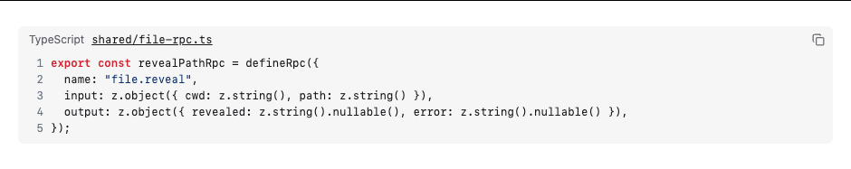</picture>

</details>

### 思考与待办

- 思考只按真实结构（`**标题**` 和各级标题）分段，不再按空行编号。默认折叠，流式时行内实时预览当前标题。
- 只有本机真的看到了思考的流式过程，才显示耗时；不做估算。
- 待办显示阶段名、每项状态、耗时，以及被阻塞的任务和原因。进度环显示已完成项，全部完成后会变为勾选标记。标题栏的窗口按钮会在浮窗中打开实时待办；使用时间线时浮窗保持打开，并始终跟随最新列表，长标题也可换行。

<picture><source media="(prefers-color-scheme: dark)" srcset="docs/images/reasoning-dark.png">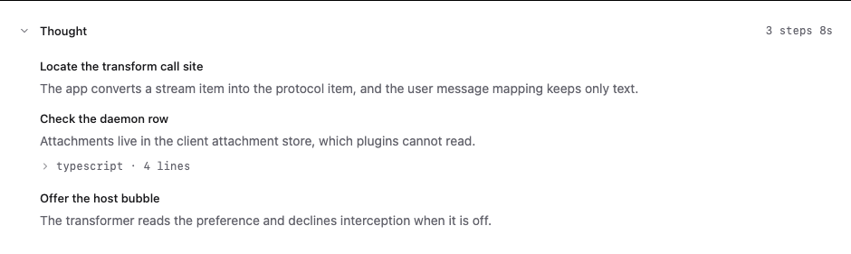</picture>
<picture><source media="(prefers-color-scheme: dark)" srcset="docs/images/tasks-dark.png">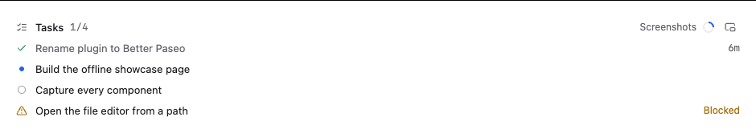</picture>
<picture><source media="(prefers-color-scheme: dark)" srcset="docs/images/checklist-window-dark.png">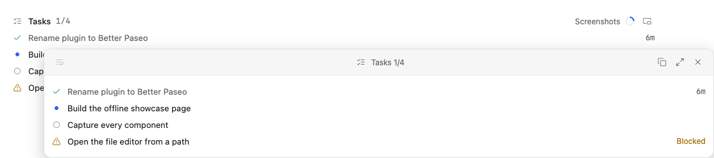</picture>

### 回复

- Markdown 由插件绘制：标题、列表、任务列表、引用、高亮代码块和本地图片。提供「文档」「紧凑」「终端」三种样式。
- 未标语言、标为 Markdown 或纯文本的代码块可在最大化预览窗口中打开，并在渲染后的 Markdown 和原始文本间切换、复制源码；原始文本视图使用「自动换行」设置。
- 表格有列线、表头底色和圆角外框；单元格比正文小一号、行距更紧，列宽按等宽数字和中文字宽估算。
- 每张表格左上角都有复制按钮。网页和桌面上，悬停（触屏上长按）会展开「复制为 Markdown」和「复制为图片」，后者复制表格画出来的样子；直接点按复制 Markdown 源码。iOS 和 Android 上点按复制 Markdown。
- 网页和桌面上双击单元格可选中其中的文字；iOS 和 Android 上对同一单元格连续点按两次即可选中。表格角落菜单始终提供「复制选中」，Paseo 支持向输入框添加文字时也会显示「添加到对话」。
- 每个已完成轮次会在最终回复下方显示独立信息栏，提供复制和时间；有数据时还会显示服务商标识、模型、思考等级和本轮实际耗时。点按模型名称可复制，并会显示提示；后续轮次运行时，已完成轮次的信息栏仍会保留。关闭「回复使用插件 Markdown」可恢复 Paseo 完整的信息栏和 Fork 操作。
- 一段回复里的多张本地图片都会画出来。
- 关闭「回复使用插件 Markdown」即可把回复交回 Paseo，由它绘制 mermaid 图表、宿主图片和文件链接。

| 表格复制菜单 | 选中单元格后的操作 |
| --- | --- |
| <picture><source media="(prefers-color-scheme: dark)" srcset="docs/images/table-copy-menu-dark.png">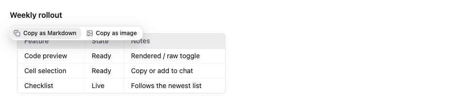</picture> | <picture><source media="(prefers-color-scheme: dark)" srcset="docs/images/table-selection-dark.png">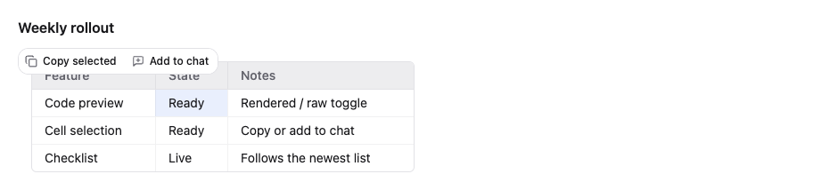</picture> |

<picture><source media="(prefers-color-scheme: dark)" srcset="docs/images/markdown-styles-dark.png">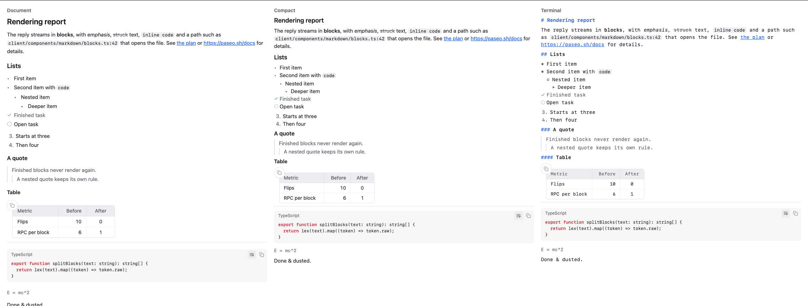</picture>
<picture><source media="(prefers-color-scheme: dark)" srcset="docs/images/markdown-preview-window-dark.png">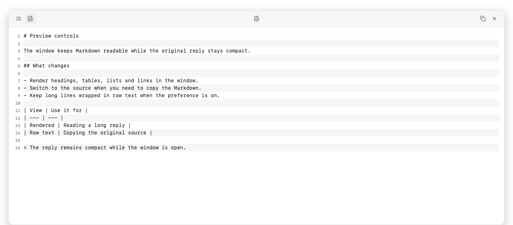</picture>

### 图片

- 读图时画出文件本身：从文件头读出的尺寸和大小、按内容撑满的缩略图，以及一个显示/隐藏开关，切换时行头停在按下的位置。
- 全屏查看器支持按钮、滚轮或双指以指针为中心缩放，拖动平移，双击复位，并可在文件管理器中显示。手机上长按这一行会直接打开查看器。
- 图片数据在第一次展开、预览或长按时从 daemon（`file.image`）读取。支持 PNG、JPEG、GIF、WebP、AVIF、BMP、ICO 和 SVG；超过 3MB 的文件只显示大小，不内联。
- 多个读图卡片引用同一张图片时，每个卡片都会显示它。

<picture><source media="(prefers-color-scheme: dark)" srcset="docs/images/shared-image-cards-dark.png">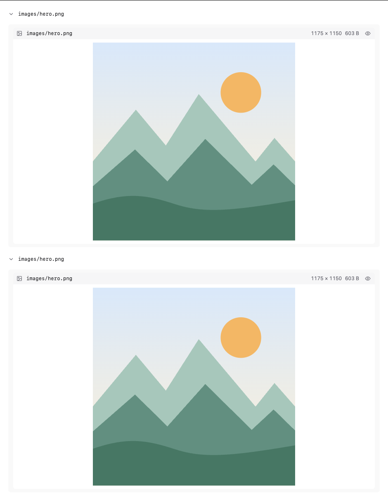</picture>

### 悬停预览

桌面上把鼠标停在折叠的工具行、思考行、图片或路径上，等待设定的延迟（0–10 秒）后弹出可滚动的预览。面板可换行、显示行号和奇偶行底色，也可移动、调整大小或最大化；待办标题栏可以把实时清单打开为浮窗，Markdown 代码块也有自己的最大化预览。若预览正跟随流式输出末尾，内容增长时会平滑跟随。手机上长按折叠的行即可打开同样的预览，不会盖住顶部栏和输入框。

### 路径、复制与选中

- 路径相对工作区显示，过长时在中间省略、保留文件名；worktree 的主仓库以名称显示。复制时总是得到绝对路径。
- 复制统一走宿主的 `copyText`，在 iOS 和 Android 上同样可用：桌面悬停、触控长按，或 `⋯` 菜单。纯文本代码块可换行，并带复制按钮。iOS 上长按回复正文可以放置光标、拖动选区。
- 网页和桌面上，在卡片里选中文字会出现「复制」和「添加到对话」；后者把选中内容作为引用放进输入框，选自代码时放成代码块。页面滚动时工具栏会收起；当前没有可见输入框时，「添加到对话」会改为复制选中内容。

<picture><source media="(prefers-color-scheme: dark)" srcset="docs/images/selection-actions-dark.png"></picture>

### 提问气泡

默认由 Paseo 绘制提问，保留粘贴的图片和回退菜单。打开「增强提问气泡」后，符合条件的提问会改用插件气泡：复制按钮常驻，并显示本轮 token 用量。插件能取得受支持的图片源时也会绘制图片；含无法呈现附件的提问仍交给 Paseo。回退菜单在当前 Paseo 支持时保留。

<picture><source media="(prefers-color-scheme: dark)" srcset="docs/images/user-dark.png"></picture>

### 错误与系统消息

- agent 报错时画成一张提示卡片，显示错误信息。
- Oh My Pi 会把任务结果、转发的消息和提醒包在 `<system-notice>`、`<irc>` 等标签里，作为消息文本发出，Paseo 把它们当成回复。打开「回复使用插件 Markdown」时，插件把这些画成系统卡片（标题，加上 agent、状态、耗时等小标签，以及其余正文），而不是原样显示 XML。

权限请求不会被重画：仍由 Paseo 绘制，同意和拒绝也由 Paseo 负责。

---

## 设置

**设置 → 插件 → Better Paseo。** 一段用时间线组件绘制的示例对话会实时跟随每一项修改：桌面宽窗口下显示在选项旁边，其他情况显示在选项上方；其中 Read 行的悬停预览常驻展开。在网页和桌面上，预览标题栏的「桌面端 / 移动端」切换可以按 iOS 样式、手机宽度绘制同一段对话，并使用你选的行内代码颜色。父选项关闭时，子选项变灰；「恢复全部默认设置」需要再点一次确认。

<picture><source media="(prefers-color-scheme: dark)" srcset="docs/images/settings-zh-dark.png">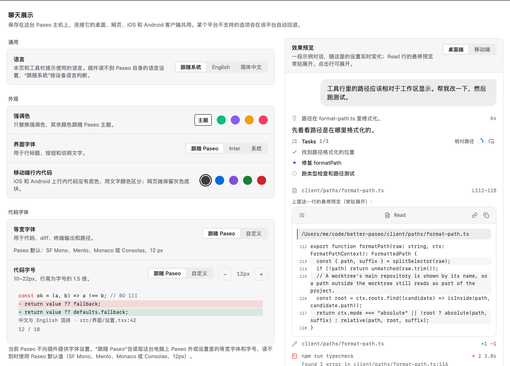</picture>
<picture><source media="(prefers-color-scheme: dark)" srcset="docs/images/settings-tools-zh-dark.png">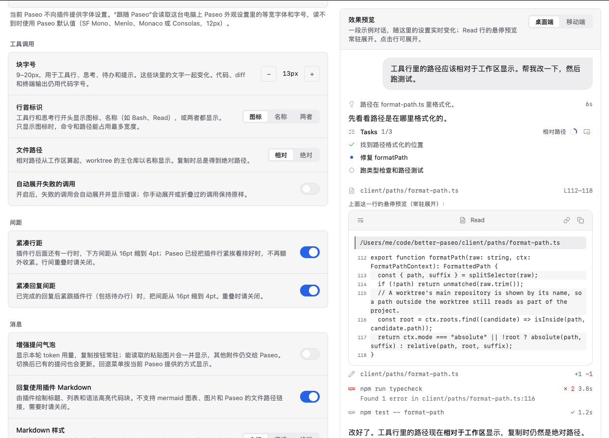</picture>

| 分组 | 设置 | 默认 | 作用 |
| --- | --- | --- | --- |
| 通用 | 语言 | 跟随系统 | 设置页和工具栏提示使用英文或简体中文。插件读不到 Paseo 自身的语言设置。 |
| 外观 | 强调色 | 主题 | 跟随 Paseo 主题，或选翠绿、紫罗兰、琥珀、玫瑰。只替换强调色。 |
| 外观 | 移动端行内代码 | 深灰 | iOS 和 Android 上行内代码的文字颜色：深灰、蓝、紫、绿、珊瑚红。网页端保留灰色底块。 |
| 外观 | 界面字体 | 跟随 Paseo | Paseo 的界面字体、Inter（仅网页，由 daemon 下发）或系统字体。 |
| 代码字体 | 等宽字体 | 跟随 Paseo | 可选跟随 Paseo 或自定义。跟随 Paseo 的顺序是：宿主向插件提供字体设置时用宿主的设置；否则在网页和桌面上读取 Paseo 外观设置里的等宽字体和字号；再否则用 Paseo 默认等宽字体。iOS 和 Android 上「自定义」只列出系统自带的字体。 |
| 代码字体 | 自定义等宽字体 | 空 | 仅「等宽字体」选「自定义」时生效。网页端可填字体族名称（最多 200 字符，不存在时沿等宽字体栈回退）；iOS 和 Android 只能选择平台提供的字体。 |
| 代码字体 | 代码字号 | 跟随 Paseo | 或 10–22px，行高为字号的 1.5 倍。作用于代码、diff、终端和路径。 |
| 工具调用 | 块字号 | 13px | 9–20px，用于工具行、思考、待办和提示。这些块里的文字一起变化。代码、diff 和终端输出仍用代码字号。 |
| 工具调用 | 行首标识 | 图标 | 工具行和思考行开头显示图标、名称（如 Bash、Read）或两者。 |
| 工具调用 | 自动展开失败的调用 | 关 | 开启后，失败的调用会自动展开并显示错误；你手动展开或折叠过的调用保持原样。 |
| 工具调用 | 文件路径 | 相对 | 相对工作区或绝对路径。复制时总是绝对路径。 |
| 间距 | 紧凑行距 | 开 | 插件行后面还有一行时，下方间距从 16pt 缩到 4pt；Paseo 已经把插件行紧挨着排好时，不再额外收紧。行间重叠时请关闭。 |
| 间距 | 紧凑回复间距 | 开 | 已完成的回复后紧跟插件行（包括待办行）时，把间距从 16pt 缩到 4pt。重叠时请关闭。 |
| 消息 | 增强提问气泡 | 关 | 显示本轮 token 用量，复制按钮常驻；能读取的粘贴图片会一并显示，其他附件仍交给 Paseo。切换后已有的提问也会更新。回退菜单按当前 Paseo 提供的方式显示。 |
| 消息 | 回复使用插件 Markdown | 开 | 关闭后回复交给 Paseo，恢复宿主完整信息栏，并可用 mermaid、宿主图片和 Paseo 的文件链接。 |
| 消息 | Markdown 样式 | 文档 | 文档、紧凑或终端（正文使用代码字体）。 |
| 消息 | 选中文字工具栏 | 开 | 网页和桌面：选中文字后显示「复制」和「添加到对话」；滚动时工具栏收起。 |
| 悬停预览 | 悬停预览 | 开 | 桌面悬停折叠行或路径时预览内容；手机长按折叠行可预览。 |
| 悬停预览 | 延迟 | 1 秒 | 桌面上预览弹出前的等待时间，0–10 秒，保存精度为 0.1 秒。 |
| 悬停预览 | 自动换行 | 开 | 预览面板和最大化代码预览的原始文本会自动换行；关闭后可横向滚动。 |
| 悬停预览 | 显示行号 | 关 | 在文件、diff 和命令输出左侧显示行号；diff 显示的是文件中的行号。 |
| 悬停预览 | 奇偶行底色 | 开 | 在预览中隔行添加底色。 |

**设置存在哪里。** 偏好通过 SDK 的主机级设置保存在 daemon 上（`shared/preferences-settings.ts` 里的 `presentation` 记录），所以**连接同一个 daemon 的所有客户端共用一份设置**：在桌面上改，iOS 上也会生效，反之亦然。某个平台画不出来的值会按原样保存，只在绘制时降级（自定义字体在 iOS 和 Android 上变成系统等宽字体，Inter 变成系统字体）。网页端的 `localStorage` 只用作快速启动的缓存。设置到达之前，卡片先用缓存或默认值绘制，到达后切换一次。

**设置立即生效。** 本地偏好状态更新后，已经显示的插件条目也会立即重绘。daemon 会保存设置并同步给其他连接的客户端，无需重新加载聊天。「自动展开失败的调用」会沿用已保存的逐项展开状态；没有记录时才采用设置作为初始状态。

---

## 查找文字

Paseo 自带的聊天查找（Ctrl/Cmd+F）定位不到插件绘制的行，因为转换后的行带的是另一个 id。所以 Better Paseo 在桌面和网页上接管 Ctrl/Cmd+F，在聊天上方打开自己的查找栏。它搜索已经渲染的所有内容，包括工具卡片和结构化问答记录：Enter 下一个，Shift+Enter 上一个，Escape 关闭。它只能搜到已加载的消息，往上滚动即可包含更早的历史。

如果想对回复使用 Paseo 原生查找（它也能搜到未加载的历史），关闭「回复使用插件 Markdown」（以及已开启的「增强提问气泡」）。这样回复和提问由 Paseo 自己绘制，Ctrl/Cmd+F 打开的就是 Paseo 的查找。工具、思考和待办卡片仍由插件绘制。

## 打开文件

读、写、编辑结果和代码块里的文件名都是链接。在桌面上，它调用 daemon 端的 `file.reveal`，按 agent 的工作目录解析路径，并在文件管理器中显示：Windows 用 `explorer.exe /select,`，macOS 用 `open -R`，其他系统用 `xdg-open <目录>`。在触控设备上，同样的点按改为复制绝对路径，因为手机打不开 daemon 那台机器的文件管理器。

## 常见问题

| 现象 | 处理 |
| --- | --- |
| 行与行重叠，或回复盖住了下一行 | 关闭「紧凑行距」或「紧凑回复间距」。 |
| 回复里需要 mermaid 图、宿主图片或 Paseo 的文件链接 | 关闭「回复使用插件 Markdown」。 |
| 手机上选中表格单元格后没有「添加到对话」 | Paseo 暂不支持向输入框添加文字；「复制选中」始终可用。 |
| 含附件的提问需要由 Paseo 绘制 | 关闭「增强提问气泡」。插件无法呈现的附件会自动交给 Paseo。 |
| Ctrl/Cmd+F 搜不到较早的消息 | 先往上滚动加载，或按上文把回复交回 Paseo。 |
| 旧的一轮对话没有 token 数字 | 最新已完成轮次在提问时间匹配时，可以从 daemon 快照恢复用量；更早轮次保留本客户端实时捕获的用量。两处都没有记录的项目仍隐藏。 |
| Grok 和 Cursor 的 Copy 工具栏和轮次详情不显示耗时 | 上游工具问题：Grok 和 Cursor 的历史时间线缺少可靠的逐条时间戳，回放记录可能时间相同或仅相差 1 毫秒，导致误显示为 `0秒`。在上游提供可靠计时前，Better Paseo 隐藏 `grok` 和 `cursor` 服务商的耗时；按服务商判断，不按模型名称判断。 |
| 推送了修复，但界面没变化 | 运行 `paseo plugin update better-paseo`；Paseo 运行的是 GitHub 上的版本。 |

## 兼容性

Better Paseo 以 Paseo 0.11 及以后的版本为目标。在 Paseo 0.8–0.10 上可以安装并绘制时间线，但有以下已知问题：

- 在这些版本上，Oh My Pi 的 `eval` 和 `ask` 调用以原工具名到达插件，而不是经过 Paseo 0.11 的纯文本转换。`eval` 仍显示为通用卡片；`ask` 只有在输入含结构化 `questions` 数组时才显示问答记录，否则也显示为通用卡片。
- 部分功能取决于宿主能力，详见[等待 Paseo 支持的改动](#等待-paseo-支持的改动)；宿主能力探测已在 0.11.2 上验证。

## 等待 Paseo 支持的改动

Better Paseo 在已发布的 Paseo 上就能用，并会探测较新的宿主能力，没有时自动回退。下面几项宿主改动已在 Paseo 的 fork 里验证，尚未发布：

- 插件工具行与原生工具行的间距对齐（约 46pt 收到 30pt，原生是 32pt）。在此之前由「紧凑行距」在适用处把间距从 16pt 缩到 4pt。
- Paseo 向插件提供字体设置，修改外观后插件实时跟上。在此之前，网页和桌面读取 Paseo 保存在本地的外观设置。
- Paseo 向插件提供向输入框添加文字的能力，以便触屏表格选区同时显示「添加到对话」和「复制选中」。在此之前，表格角落菜单仍可复制选中的单元格。
- 插件包在 Hermes 上执行前，先把 `class` 语法降级。
- 当前轮提问吸顶、展开卡片的标题吸顶；插件一侧已经接好。

把多个调用合并成「Read 12 files」一行需要宿主的分组 API；在开发版模拟器上展开 5,000 行的代码块仍需约 30 秒，彻底解决需要宿主的虚拟滚动。

开发过程中遇到的 SDK 限制、证据和对应的绕行方式见 [`docs/plugin-sdk-limitations.md`](docs/plugin-sdk-limitations.md)（英文）。

## 开发

```bash
npm install
npm run typecheck
npm test
npm run check:hermes
paseo plugin reload better-paseo
```

`npm run check:hermes` 会在 Hermes（iOS 和 Android 应用使用的 JS 引擎）里编译并运行客户端包；在网页上能跑的代码，到了 Hermes 仍可能失败，并导致整个插件无法加载。它检查的规则、项目结构，以及如何重新生成截图和图表，见 [`docs/development.md`](docs/development.md)（英文）。

## 许可证

MIT
