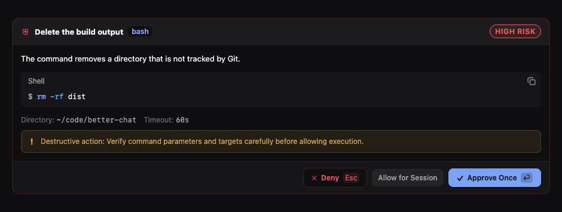

# Beautiful Chat

A Paseo plugin that redraws the Oh My Pi (OMP) chat stream: tool calls, reasoning, prompts, approvals,
and checklists. It replaces the host rendering of OMP timeline items with typed, syntax-aware cards
that follow the active Paseo theme.


Every screenshot here is a capture of the real component, rendered by the harness in `.showcase/`.
[One whole turn, top to bottom](images/thread.png) shows the cards in the order the timeline draws
them.

## Install

```bash
paseo plugin install RoundRedDot/beautiful-chat
```

The manifest requires Paseo `>=0.8.0`. Open **Settings → Plugins → Beautiful Chat** for the
accent, fonts, row layout, and prompt bubble options.

This repository is a fork of [ABorakati/beautiful-chat](https://github.com/ABorakati/beautiful-chat)
at `42b61d8` (2026-09-23). What changed after that, including the measured rendering work, is in
[docs/fork-vs-upstream.md](docs/fork-vs-upstream.md).

---

## Tool calls

A tool call starts as one row: 26pt on desktop, 28pt on touch. Press the row to open the card
described below. Rows are icon-only unless **Row icons and labels** says otherwise. A failed call
can open on its own; see Settings.

### Shell and Git

Terminal frame, Bash syntax, exit code, duration, and the Git brand mark. A command that prints
nothing says so rather than showing an empty panel.


### Read

The file's own language logo, a wrapped path, line numbers, and a copy button. The path is a link:
pressing it shows the file in the machine's file manager.


### Images

A read of a `.png` carries no bytes through the timeline, so the host draws it as an empty code
block with a language badge. This card draws the file instead: a picture mark, the path as a link,
the pixel size and file size read from the header, and an eye that says whether the thumbnail is
shown; pressing anywhere on the header hides or shows it, and the header stays where it was pressed.
Pressing the thumbnail opens the image full screen with the controls of Paseo's own lightbox: zoom
in, zoom out, reset, show in file manager, and close; the wheel or a pinch zooms about the pointer,
a drag pans, and a double press resets. The backdrop, a drag of the picture up or down at its fit,
Escape, or the Android back button close it; on a phone the controls sit below the status bar.
The
bytes come from the plugin's own daemon-side RPC (`file.image`), which is the only side that can
reach the file; PNG, JPEG, GIF, WebP, AVIF, BMP, ICO and SVG are recognised, and anything past
3 MB reports its size rather than inlining a data URI. On desktop, hovering a collapsed image
read, or the image card's header, previews the picture in a panel. On a phone a long press on
either opens the picture in the full-screen viewer, as pressing the thumbnail does. The bytes are
read the first time the row is opened, previewed or long-pressed.


### Edit

Diff rendering where adjacent removed and added rows join into one rounded block, and only the
marker column carries the red or green.


### Reasoning tool

Live thinking text, a token badge, and numbered steps.


### MCP

Server badge, transport, input parameters, and the response payload, each syntax-highlighted.


### Eval

One card per kernel cell: the source that ran, then the text it printed.


### Ask

Option cards with the recommended badge, the chosen answer marked, and a typed reply labelled as
typed rather than shown as a selection.


### Task

Subagent name, type, model, and the delegated instructions.


### Hub

Every `hub` op is mapped: `start`, `stop`, `restart`, `ps`, `logs`, and `describe` render the
process card with its launch line, readiness, and recent output; `send`, `wait`, `inbox`, and
`list` render the message card; `jobs` and `cancel` render the job snapshot. The cards report;
they carry no buttons, because a plugin cannot restart or cancel anything.


### Paseo tools

Paseo's own mark leads the card, and the created agent's provider carries its brand mark.


---

## Stream components

### Reasoning trace

A collapsible trace with a connected step rail, per-step duration, and a token total.


### Checklist

Phase name, per-task status, durations, and a blocked task with its reason.


### Approval card

Risk classification, the exact command, target path, working directory, and the approve or deny
actions the host owns.



### Prompt bubble

Paseo draws the prompt by default, including pasted images and its rewind menu. **Enhanced prompt
bubble** (off by default) switches that turn to the plugin's bubble: a raised theme surface, a
square tail, a copy button that stays visible, and the turn's token usage. The plugin bubble
cannot show pasted images. On a Paseo that exposes its rewind menu, the plugin bubble draws that
menu; Paseo 0.11.2 does not, so rewind stays with the host bubble.


### Syntax block

Shared by every card that shows code: language detection from the path, line numbers, diff tints,
Devicon brand marks, and the file-manager link.


---

## Settings


| Setting                | Effect                                                                                       |
| ---------------------- | -------------------------------------------------------------------------------------------- |
| Language               | English or 简体中文 for this page, or follow the device. Plugins cannot see Paseo's own language. |
| Accent colour          | Follow the Paseo theme, or pick Jade, Violet, Amber, or Rose.                                |
| Monospace font         | Follow Paseo (default), Iosevka, Iosevka Code (ligatures in code blocks; web and desktop), or Custom. Follow Paseo uses, in order: the host's font settings once Paseo shares them with plugins; on web/desktop, the monospace font and code size set in Paseo's Appearance settings (read only, a temporary bridge until then); otherwise Paseo's default monospace (`SFMono-Regular, Menlo, Monaco, Consolas, …` on web/desktop, the system monospace on iOS/Android). The settings page shows which one is in effect. On iOS/Android, Iosevka is not offered and Custom picks from faces the platform ships. |
| Code font size         | Follow Paseo, or 10-22px with a live preview. Applies to code, diffs, terminals and paths.   |
| Interface font         | Follow Paseo's interface font, embedded Inter (web only), or the system face.                |
| Tool details           | Tool calls start collapsed; optionally open failed calls on their own.                       |
| File paths             | Relative to the workspace, or absolute. Copying always gives the absolute path.              |
| Row icons and labels   | Icon only (default), label only, or both, on tool and thought rows.                          |
| Compact row spacing    | On by default. Takes back most of the 16pt Paseo 0.11 leaves under every plugin row.         |
| Compact reply spacing  | On by default. A reply sitting on a tool, thought, or todo row uses 4pt instead of 16pt.     |
| Enhanced prompt bubble | Off by default, so Paseo draws the prompt (pasted images, rewind). On uses the plugin bubble. |
| Selection actions      | Highlighting text in a callout raises Copy and Add to chat.                                  |
| Assistant markdown     | On by default. Draws headings, lists, tables, highlighted code, and local images. Off hands the reply to Paseo, which is what mermaid and the host's own images need. |
| Markdown style         | Document, Compact, or Terminal (the body in the code face).                                  |

Preferences are stored by the daemon, through the SDK's settings (`defineSettings` /
`useSettings`, record `presentation` in `shared/preferences-settings.ts`). Host scope is the only
scope the SDK allows, so **every client connected to one daemon shares them**: a change on the
desktop shows up on iOS, and the other way round. A choice one platform cannot draw is stored as
made and degraded where it renders by `resolveTypography` (Iosevka and a typed custom family become
the platform monospace on iOS/Android; Inter becomes the system face). On web, `localStorage` is
only a fast-start cache, and a record saved there by an older version is copied to the daemon once,
if the daemon has none yet. Until the settings arrive, cards draw with the cached or default
values and switch once; a record the daemon cannot read shows the defaults and a hint on the
settings page.

---

## Finding text

Paseo's own chat find (Ctrl/Cmd+F) cannot reach a prompt or reply this plugin draws (see
[limitation 14](#plugin-sdk-limitations-found-while-building-this)). The plugin therefore takes
Ctrl/Cmd+F on desktop and web and opens its own find bar over the chat. The bar searches
everything the chat has rendered, including tool cards. Enter moves to the next match, Shift+Enter
to the previous one, and Escape closes the bar.

The bar searches only messages the chat has loaded. Scroll up first to include older history.

**Enhanced prompt bubble** is off by default, so prompts already use Paseo's find. To keep
Paseo's native search for replies as well, which also searches unloaded history, turn off
**Assistant markdown** (and **Enhanced prompt bubble**, if you turned it on) in **Settings ->
Plugins -> Beautiful Chat**. Paseo then draws replies and prompts itself, and Ctrl/Cmd+F opens
Paseo's find instead of the plugin's bar.
New messages follow the change.
Tool, reasoning, and checklist cards keep the plugin's styling, so Paseo's find still cannot reveal a
match inside one of them.

## Opening files

A file name in a read, write, edit, or code block is a link. Pressing it calls the plugin's own
daemon-side RPC (`file.reveal`), which resolves the path against the agent's working directory and
asks the platform shell to show it:

| Platform | Behaviour                                              |
| -------- | ------------------------------------------------------ |
| Windows  | `explorer.exe /select,<file>` selects the file.        |
| macOS    | `open -R <file>` selects the file in Finder.           |
| Other    | `xdg-open <directory>` opens the containing directory. |

A directory path opens that directory. A path the daemon cannot stat does nothing.

On a touch device the same press copies the absolute path instead. `file.reveal` runs on the
daemon's machine, so a phone cannot open that machine's file manager.

## Unmapped output

A tool the plugin has no typed card for still shows its output in the terminal frame, and a call
that printed nothing says so. No card renders an empty panel.

The link cannot open Paseo's own file editor: see the first limitation below.

---

## Plugin SDK limitations found while building this

Measured against `@getpaseo/plugin` 0.8.0 and the Paseo 0.8.0 desktop build. Each entry names the
evidence and the workaround this plugin uses.

1. **No file navigation.** Timeline renderer props are exactly `{agentId, theme, host, layout,
timestamp, item}`, and plugin navigation offers only `openSettings`, `openSurface`,
   `openWorkspacePanel`, `openAgentPanel`, `openAgent`, and `openWorkspace`. The host's own file tab
   target (`{kind:"file", path}`, reachable in-app through `?open=file:<path>`) is not exposed, and
   the `paseo://` scheme only carries agent deep links. Workaround: a daemon-side RPC that reveals
   the path in the operating system's file manager.
2. **Transformers see a stripped item.** The app maps its stream item to the plugin item before any
   transformer runs, and a user message keeps only `text`, `messageId`, and `clientMessageId`. Pasted
   images never reach plugin code, and the daemon timeline row stores the same item, so a server RPC
   cannot recover them either. Workaround: **Enhanced prompt bubble** is off by default, so the host
   keeps the prompt and its pasted images. Turning the setting on replaces that bubble.
3. **Interception is all or nothing.** A transformer replaces the host item completely. There is no
   way to decorate an item or keep host affordances that the plugin does not reimplement. Returning
   `undefined` is the only opt-out.
4. **Transform results are cached per item.** Changing a preference does not re-run transformers for
   items already on screen. New items follow the change; existing ones need a reload.
5. **Renderers get no workspace.** Props carry `agentId` only, so `cwd` and `workspaceId` need a
   second lookup through `useAgent`.
6. **Token usage is live-only.** Usage is not persisted on timeline items, so a turn this client did
   not observe live shows no figures.
7. **RPC names are validated late.** The host requires `^[a-z][a-z0-9._-]*$`. A camelCase name such
   as `revealPath` typechecks, then fails the whole plugin at install or reload with
   `Invalid plugin RPC method`.
8. **The React Native runtime module is a stub in the package.** `@getpaseo/plugin/client/react-native`
   ships as `export {}`; the host injects the implementations. Bundling or testing plugin UI outside
   Paseo needs a shim, which is what `.showcase/shims` provides.
9. **The theme carries six colours.** `PluginTheme` exposes `surface0`–`surface2`, `border`,
   `foreground`, `foregroundMuted`, `accent`, `accentForeground`, and three status colours. Every
   other surface, including code backgrounds and diff tints, must be derived with alpha; that is what
   `client/components/theme-tokens.ts` exists for.
10. **No CSS escape hatch.** React Native styles drop unknown keys, so `backdrop-filter` cannot be
    set through the style API. The plugin does not draw frosted glass.
11. **No font registration.** Faces are embedded as data URIs in an injected `@font-face` rule
    (web only). The bytes stay on the daemon and arrive through the `fonts.embedded` RPC the first
    time a reader picks Iosevka or Inter, because the host sends the whole client bundle again on
    every reconnect. Paseo forces its UI font on every node not under `data-pmono`; the plugin marks
    only monospace regions with it, so interface text follows the host font, and leaves the
    interface `fontFamily` unset for "Follow Paseo", since React Native Web writes non-StyleSheet
    styles inline and an inline family would beat the host rule.
12. **A closed module allowlist, and no SVG renderer.** Plugin client code may import only
    `react`, `react/jsx-runtime`, `react-native`, `@tanstack/react-query`, `zod`,
    `@getpaseo/plugin`, `@getpaseo/plugin/client`, `@getpaseo/plugin/client/react-native`, and
    `@getpaseo/plugin/client/ui`. Anything else throws
    `Module "x" is not available in plugin client code` when the bundle loads, so
    `react-native-svg` and `lucide-react-native` are out of reach. Lucide icons still work,
    because the host renders them: `Icon` from `@getpaseo/plugin/client/react-native` takes any
    Lucide name. Brand marks are not in Lucide, and React Native's `<Image>` decodes PNG, JPEG,
    GIF, and WebP but never SVG, so a data-URI SVG renders on web and stays blank on iOS and
    Android. Those marks are PNG rasters in `server/mark-bitmaps.ts`, which the `marks.bitmaps`
    RPC hands out by id as rows draw them; the client keeps only the ids.
13. **Settings are host-scoped only.** `defineSettings` rejects any scope other than `host`, so
    per-workspace, per-agent or per-client presentation settings are impossible. This plugin stores
    its preferences in that host scope (shared by all clients of the daemon); only the hidden
    `debugPerf` probe flag stays per client.
14. **Paseo's chat find cannot reach replaced rows.** Paseo 0.9.1 finds a match by its original
    message id, then waits for a row carrying that id. A transformed row always carries
    `<pluginId>/<itemId>` instead, so Ctrl+F on a styled prompt or reply never reveals the match.
    Workaround: the plugin's own find bar, described in [Finding text](#finding-text).

---

## Project structure

```text
beautiful-chat/
  paseo-plugin.json          # Manifest: id and Paseo requirement
  index.client.tsx           # Timeline transformers, renderers, settings screen
  index.server.ts            # Daemon-side RPCs (file.reveal, file.image, highlight.tokens, fonts.embedded, marks.bitmaps)
  shared/
    contracts.ts             # Data contracts shared by client and server
    file-rpc.ts              # file.reveal contract
    font-rpc.ts              # fonts.embedded contract
    mark-rpc.ts              # marks.bitmaps contract
  server/
    font-data.ts             # GENERATED subset woff2 faces, served by fonts.embedded
    mark-bitmaps.ts          # GENERATED PNG rasters of every brand mark, served by marks.bitmaps
  client/
    live-renderers.tsx       # Timeline item to component mapping
    settings-page.tsx        # Settings screen
    preferences.ts           # Client-side presentation preferences
    components/              # Cards, syntax block, glyphs, motion, theme tokens
      marks.ts               # Brand mark ids, and the client cache marks.bitmaps fills
      lobe-marks.ts          # Vendor SVG sources, read only by the generator
  .showcase/                 # Offline harness used to capture the screenshots
  docs/images/               # Screenshots in this README
```

## Development

```bash
npm install
npm run typecheck
npm test
npm run check:hermes
paseo plugin reload beautiful-chat
```

### Hermes check

On iOS and Android the client bundle runs on Hermes without Metro or Babel:
the daemon bundles `index.client.tsx` with esbuild (target `es2020`, async
functions lowered, nothing else), and the app evaluates the result as source.
Code that works on web can still fail to load there, and when it fails the
whole plugin is dropped, so web testing will not catch it.

`npm run check:hermes` (`scripts/check-hermes.mjs`) bundles the client with
the host's options and compiles it with `hermesc` from the `react-native`
devDependency. Any error is mapped back to its source file and line. The
script then evaluates the bundle in the bundled `hermes` VM against stub
modules, calls `contribute`, and checks the host's registration rules. Pass
`--no-run` to compile only. esbuild is a root devDependency, pinned to the
same release vitest resolves, so the check does not hang on a transitive
install.

What must not reach client code, including client dependencies:

- **No `class` in any form**: declarations, expressions, fields, private
  members, or static blocks. Use closures and plain objects. This is why
  `marked` cannot be imported on the client.
- No regular-expression `v` flag (a compile error, so the check catches it).
- No `Array.prototype.toSorted` and no `Intl.Segmenter`. Both are missing at
  runtime rather than at compile time, so the check only catches them when
  they run while the plugin loads. Code reached later, from a render, is not
  covered.
- Timeline renderers are registered as **plain functions**. Paseo checks
  `typeof Component === "function"`, so the object `React.memo` returns is
  rejected. Wrap a memoised body in a function component instead.

Rebuild the screenshots after a visual change:

```bash
esbuild .showcase/showcase.tsx --bundle --outfile=.showcase/showcase.js --jsx=automatic \
  --alias:react-native=react-native-web \
  --alias:@getpaseo/plugin/client/react-native=./.showcase/shims/plugin-react-native.tsx
```

Then serve `.showcase/` and capture each `#shot-*` element.

## License

MIT
