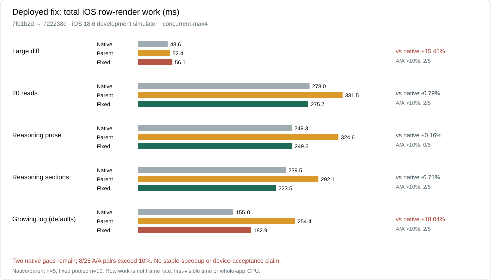
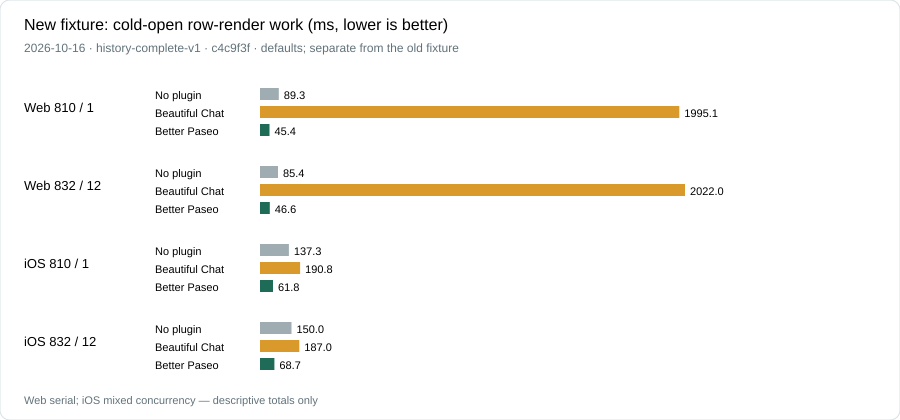
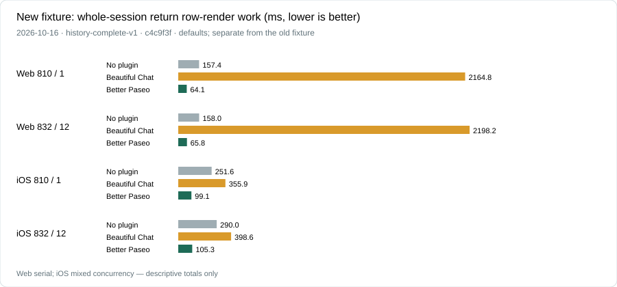
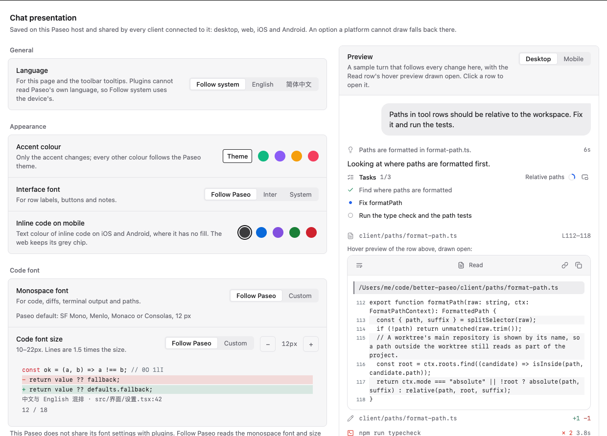
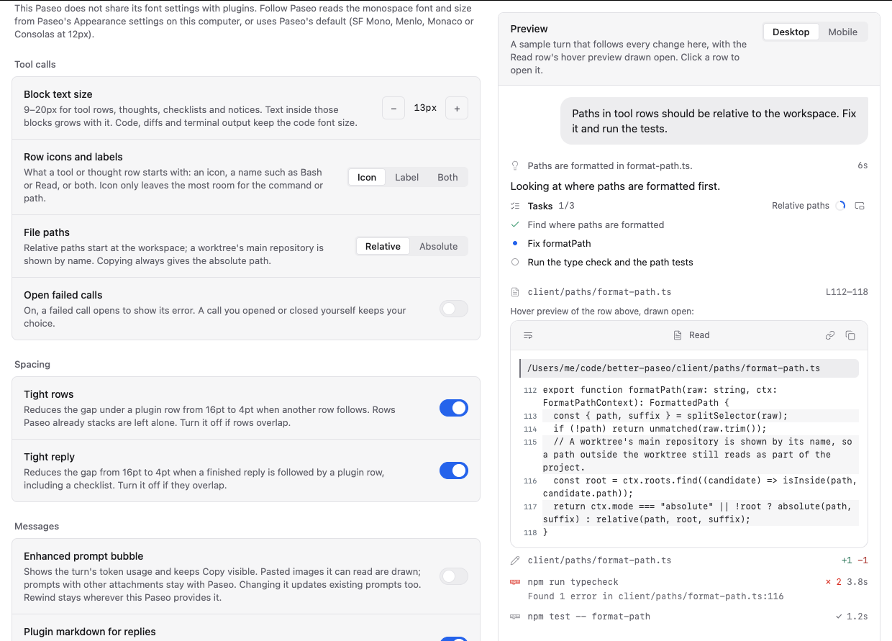

# Better Paseo

**English** | [简体中文](README-zh.md)

A [Paseo](https://paseo.sh) plugin that redraws the chat timeline of every agent Paseo runs,
whichever provider is behind it (Claude Code, Codex, Oh My Pi and the rest): tool calls, reasoning,
replies, prompts, checklists and errors become compact, typed, syntax-aware rows that follow the
active Paseo theme. The performance section compares it with Paseo’s own timeline.

<picture>
  <source media="(prefers-color-scheme: dark)" srcset="images/hero-devices-dark.png">
  
</picture>

> Better Paseo is a fork of [ABorakati/beautiful-chat](https://github.com/ABorakati/beautiful-chat),
> continued from `42b61d8` (2026-09-23). It keeps Beautiful Chat's cards except the Eval, Ask,
> Task and approval cards, which current Paseo never feeds a plugin (see
> [Compatibility](#compatibility)). This README describes what the fork adds and how it performs.

## Highlights

- **Measured performance.** The deployed revision has 220 independent validation runs; remaining gaps, sample variability and historical revisions are disclosed in [Performance](#performance).
- **Measured memory.** The same round records post-GC JS heap and signed MB differences against no plugin. [Memory comparison](#memory-comparison).
- **One row per tool call.** Calls start collapsed to a 26pt row with a typed summary, open on a
  press, and stay open or closed across completion, history and remounts.
- **Block-by-block streaming replies.** Finished Markdown blocks are cached while growing code and tables are repaired. This round’s layout-shift readings are in the [performance comparison](#performance).
- **Previews without opening.** Hover a collapsed row or a path on desktop, or long-press a
  collapsed row on a phone, to read its content in a scrollable panel. Images open in a full-screen viewer.
- **Follows Paseo.** Fonts, sizes and colours follow the host by default; settings are stored on
  the daemon and shared by desktop, web, iOS and Android. The settings page is in English and
  Simplified Chinese.

## Install

```bash
paseo plugin install RoundRedDot/better-paseo
```

Paseo `>=0.8.0` is required; the plugin is developed and measured against Paseo 0.11.2. On Paseo
0.8–0.10 it works with some compatibility issues, listed under [Compatibility](#compatibility).
Open **Settings → Plugins → Better Paseo** to configure it. Paseo installs plugins from GitHub, so pull a
new version with:

```bash
paseo plugin update better-paseo
```

---

## Performance

<!-- deployed-fix:start -->
### Latest deployed revision: 220 independent runs

Deployed `722238d`, compared directly with parent `7f01b2d`. This independent batch has **220 runs**: 100 core, 60 remaining iOS regressions and 60 Web regressions, with zero collection/audit failures or exclusions. Mac Studio, iPhone 16 Pro / iOS 18.6 development simulator, up to four groups with varying actual overlap. Keep it separate from the historical `48a6646` full matrix and `c4c9f3f` history runs below.



| Scenario | Native ms | Parent ms | Fixed ms | vs native | A/A over 10% |
| --- | ---: | ---: | ---: | ---: | ---: |
| Large diff | 48.6 | 52.4 | 56.1 | +15.45% | 2/5 |
| 20 reads | 278.0 | 331.5 | 275.7 | -0.79% | 2/5 |
| Reasoning prose | 249.3 | 324.6 | 249.6 | +0.16% | 0/5 |
| Reasoning sections | 239.5 | 292.1 | 223.5 | -6.71% | 2/5 |
| Growing log (defaults) | 155.0 | 254.4 | 182.9 | +18.04% | 2/5 |

**All-five parity has not been achieved.** Large diff and the default growing log remain 15.45% and 18.04% above native; the other three observed medians are within 10%. Eight of 25 A/A pairs exceed 10% (maximum 31.31%), so lower medians do not prove stable improvements. The remaining iOS/Web checks observed no new median regression above 10%.

#### Remaining iOS regressions (60 runs)

Five runs per revision, showing median total row-render work. This phase compares parent and fixed only; do not splice in native or Beautiful Chat values from older rounds.

| Scenario | Parent ms | Fixed ms | vs parent |
| --- | ---: | ---: | ---: |
| Mixed turn | 256.8 | 226.4 | -11.84% |
| History replay | 213.3 | 194.7 | -8.69% |
| Large shell log | 52.7 | 49.1 | -6.72% |
| Table streaming | 563.2 | 531.9 | -5.55% |
| Code block streaming | 747.5 | 759.0 | +1.53% |
| Long reply | 1463.5 | 1471.5 | +0.55% |

#### Web regressions (60 runs)

Five runs per revision, showing median total row-render work. This phase compares parent and fixed only; do not splice in native or Beautiful Chat values from older rounds.

| Scenario | Parent ms | Fixed ms | vs parent |
| --- | ---: | ---: | ---: |
| Large diff | 5.2 | 5.0 | -3.85% |
| 20 reads | 17.5 | 13.7 | -21.71% |
| Reasoning prose | 5.6 | 5.0 | -10.71% |
| Reasoning sections | 4.9 | 4.3 | -12.24% |
| Growing log (defaults) | 6.2 | 5.2 | -16.13% |
| Mixed turn | 14.8 | 14.6 | -1.35% |

The metric is host Profiler `allRows.sum`, not whole-app CPU or first-visible time. Core native/parent have five runs each and fixed pools ten; risk phases have five per revision. The Web process filter missed absolute-path Node runners; actual overlap was reconstructed separately from intervals. Empty process lists do not mean no concurrency. **This is not iPhone 15 Pro Release acceptance.**

[Full results, ranges, diagnosis and evidence](docs/bench/2026-10-16-ios-five/parallel/README.md)

### Historical three-mode full matrix (48a6646)

<!-- deployed-fix:end -->

Three configurations: **no plugin** (Paseo 0.11.2), **Beautiful Chat** `42b61d8`, and **Better Paseo** `48a6646`. Rerun on 2026-10-16 on Mac Studio (Apple M5 Max, 18 cores, 64 GB, macOS 27.0.1): 11 scenarios × 3 modes × 5 runs on each of Web and iOS, **330 replay runs**. Modes rotate and measurements run serially; every cell is a median. Only this round is comparable. Groups with display errors are N/A. [Raw data, ranges and validation](docs/bench/2026-10-16-readme/README.md).


Whole-replay main-thread Task time: vs no plugin, 9 lower, 1 even and 1 higher; vs Beautiful Chat, 10 lower, 1 even and 0 higher. A difference under 10%, or both whole Web Task replays below 0.5 seconds, is even.

The table measures total row-render work (allRows.sum, milliseconds), using the same host React.Profiler boundary. Per-commit p95 is not total work. Vs no plugin: 9 lower, 0 even and 2 higher.

| Scenario | No plugin | Beautiful Chat | Better Paseo | vs no plugin | vs Beautiful Chat |
| --- | ---: | ---: | ---: | :--- | :--- |
| Code block streaming | 1,274.8 | 1,295.5 | **297.1** | &ensp;77% | &ensp;77% |
| Large diff | 36.0 | 581.7 | **21.4** | &ensp;41% | &ensp;96% |
| History replay | 157.8 | 4,468.5 | **214.9** | &ensp;36% | &ensp;95% |
| Long reply | 2,040.9 | 3,239.6 | **499.8** | &ensp;76% | &ensp;85% |
| Mixed turn | 210.3 | 571.8 | **97.0** | &ensp;54% | &ensp;83% |
| 20 file reads | 140.8 | 966.1 | **110.1** | &ensp;22% | &ensp;89% |
| Reasoning, prose | 532.6 | 1,016.2 | **157.9** | &ensp;70% | &ensp;84% |
| Reasoning, sections | 487.4 | 1,309.9 | **138.8** | &ensp;72% | &ensp;89% |
| Large shell log | 36.2 | 263.0 | **20.7** | &ensp;43% | &ensp;92% |
| Table streaming | 1,129.7 | 413.6 | **256.3** | &ensp;77% | &ensp;38% |
| Growing tool log (defaults) | 58.7 | 920.3 | **108.8** | &ensp;85% | &ensp;88% |

Modes retain their default disclosure behaviour: Beautiful Chat opens running tools, while Better Paseo keeps them collapsed. Despite its historical name, `tool-expanded-streaming` performs no expand action; “Growing tool log (defaults)” does not establish expanded-body performance.

### Streaming layout shift

Cumulative layout shift (CLS, lower is better), from the same Web runs. The Task-time 0.5-second rule does not apply. Six decimals keep tiny baselines visible; percentages can magnify small absolute differences.

| Scenario | No plugin | Beautiful Chat | Better Paseo | vs no plugin | vs Beautiful Chat |
| --- | ---: | ---: | ---: | :--- | :--- |
| Code block streaming | 0.047734 | 0.133573 | **0.011550** | &ensp;76% | &ensp;91% |
| Large diff | 0.000015 | 0.024003 | **0.000015** | even | &ensp;100% |
| History replay | 0.000015 | 0.309520 | **0.000015** | even | &ensp;100% |
| Long reply | 0.171551 | 0.646352 | **0.000015** | &ensp;100% | &ensp;100% |
| Mixed turn | 0.004936 | 0.092814 | **0.026648** | &ensp;440% | &ensp;71% |
| 20 file reads | 0.001963 | 0.299145 | **0.000777** | &ensp;60% | &ensp;100% |
| Reasoning, prose | 0.000015 | 0.098468 | **0.000777** | &ensp;5230% | &ensp;99% |
| Reasoning, sections | 0.000015 | 0.145948 | **0.000777** | &ensp;5230% | &ensp;99% |
| Large shell log | 0.000015 | 0.005080 | **0.000015** | even | &ensp;100% |
| Table streaming | 0.047770 | 0.039745 | **0.010534** | &ensp;78% | &ensp;73% |
| Growing tool log (defaults) | 0.000015 | 0.014097 | **0.000015** | even | &ensp;100% |

### iOS


iPhone 16 Pro / iOS 18.6 simulator, Paseo 0.11.2 development Hermes build, cold-launched per run. One benchmark simulator; Web and iOS measurements do not overlap. Total row-render work is in milliseconds; under 10% is even. Vs no plugin: 3 lower, 3 even and 5 higher; vs Beautiful Chat: 10 lower, 1 even and 0 higher. These are not hardware frame-rate or Release measurements.

| Scenario | No plugin | Beautiful Chat | Better Paseo | vs no plugin | vs Beautiful Chat |
| --- | ---: | ---: | ---: | :--- | :--- |
| Code block streaming | 2,227.5 | 4,536.3 | **753.5** | &ensp;66% | &ensp;83% |
| Large diff | 52.9 | 2,878.8 | **62.8** | &ensp;19% | &ensp;98% |
| History replay | 207.1 | 226.3 | **213.0** | even | even |
| Long reply | 4,971.2 | 13,421.2 | **1,537.8** | &ensp;69% | &ensp;89% |
| Mixed turn | 329.6 | 664.8 | **308.0** | even | &ensp;54% |
| 20 file reads | 286.0 | 2,722.9 | **341.8** | &ensp;20% | &ensp;87% |
| Reasoning, prose | 286.6 | 1,504.2 | **386.7** | &ensp;35% | &ensp;74% |
| Reasoning, sections | 263.5 | 2,419.4 | **327.7** | &ensp;24% | &ensp;86% |
| Large shell log | 53.8 | 349.5 | **57.0** | even | &ensp;84% |
| Table streaming | 968.1 | 1,128.4 | **584.6** | &ensp;40% | &ensp;48% |
| Growing tool log (defaults) | 194.5 | 3,051.3 | **310.9** | &ensp;60% | &ensp;90% |

Green ⬆ is lower; red ⬇ is higher. Percentages use medians before rounding. `history-100` is a fixture name, not 100 actual provider turns; it is labelled “History replay” here.

**Method.** Fixed host `759532509`, identical host row probes for native/plugin renderers. Web uses a newly exported production profiling build (main JS SHA256 prefix `c38ec6413ace0974`), Chrome 155.0.8059.40 at 1280×900; CDP reads main-thread time and forces GC before heap/DOM readings. iOS uses a development simulator build, not Release. Private daemon 6871, asserted mode per run, default feature settings with measurement counters enabled on the candidate. [Scripts, host patch and source verification](docs/bench/2026-10-16-readme/README.md). Generate charts with `node docs/perf/readme-charts.mjs`.

### Long-history loading

This is an **independent Mac Studio rerun** using `history-complete-v1`, Better Paseo `c4c9f3f` and Beautiful Chat `42b61d8`, with default settings. Web and iOS have 40 runs each, **80 total**: five candidate A/A pairs and five runs per control for each scenario/platform. iOS uses an iPhone 16 Pro / iOS 18.6 development simulator, not iPhone 15 Pro Release acceptance.

**Execution changed:** Web finished serially; during iOS collection the user requested up to four parallel groups. Some earlier-gate samples may also overlap environment preparation; see the report for intervals. These tables descriptively summarize the captured round, **not a controlled speedup under uniform serial or fixed-concurrency conditions**. Later samples record CPU idle and memory pressure; the separate five-fix concurrent matrix is not merged here.

The new fixture retains 810 entries / one actual provider turn, the exact 59,427-character tail reply and overlapping tool lifecycles. Its 260 reasoning items receive distinct equal-length synthetic tags to avoid identical text ID seeds across page boundaries. A second scenario has 832 entries / 12 actual turns. **This is a new input, not a fix or acceptance of the original duplicate-key case; do not mix the rounds.**



#### Web

| Scenario / phase | No plugin | Beautiful Chat | Better Paseo |
| --- | ---: | ---: | ---: |
| 810 entries / 1 turn — Cold-open row work | 89.3 | 1,995.1 | 45.4 |
| 810 entries / 1 turn — First older reveal row work | 15.9 | 527.8 | 12.5 |
| 810 entries / 1 turn — Whole-session return row work | 157.4 | 2,164.8 | 64.1 |
| 832 entries / 12 turns — Cold-open row work | 85.4 | 2,022.0 | 46.6 |
| 832 entries / 12 turns — First older reveal row work | 21.4 | 540.0 | 12.7 |
| 832 entries / 12 turns — Whole-session return row work | 158.0 | 2,198.2 | 65.8 |

#### iOS

| Scenario / phase | No plugin | Beautiful Chat | Better Paseo |
| --- | ---: | ---: | ---: |
| 810 entries / 1 turn — Cold-open row work | 137.3 | 190.8 | 61.8 |
| 810 entries / 1 turn — First older reveal row work | 183.3 | 11.9 | 174.1 |
| 810 entries / 1 turn — Whole-session return row work | 251.6 | 355.9 | 99.1 |
| 832 entries / 12 turns — Cold-open row work | 150.0 | 187.0 | 68.7 |
| 832 entries / 12 turns — First older reveal row work | 191.1 | 49.4 | 182.5 |
| 832 entries / 12 turns — Whole-session return row work | 290.0 | 398.6 | 105.3 |



Values are milliseconds. The third phase switches the host pane away from the session, proves the target timeline actually unmounted, then returns to the same agent without archiving it. It measures whole-view remount, **not independent Markdown-block remount during scrolling**. All 36 cells must have valid measurements before publication; old errors and inapplicable phases remain in the historical report.

Row-render work excludes native layout and whole-app CPU; JS-ready proxies are not proven first-usable viewport times. Reveal and return can render different row sets; interpret totals with ranges, A/A spread, RPCs and content-integrity gates.

[Full follow-up report and raw evidence](docs/bench/2026-10-16-history-complete/README.md) · [Historical fixture report](docs/bench/2026-10-16-readme/README.md)

### Where the time goes

- **Skip unchanged rows.** Semantic theme/data comparisons let unchanged cards skip rendering.
- **Parse replies incrementally.** Finished Markdown blocks are cached; only the growing tail is repaired. Long replies split into blocks that the native host can virtualize; Copy retains the full source.
- **Draw tool bodies on demand.** Collapsed rows do not mount their bodies. Completed code requests daemon highlighting; large code and terminal output render in batches with a Show all control.
- **Reduce continuous animation work.** The Web running dot uses CSS and stops for Reduced Motion; decorative shadows, blur and breathing loops are removed.
- **Send less on reconnect.** Brand marks and Inter are delivered on demand; the client source stays ASCII for Hermes one-byte strings.


---

## Memory comparison

<!-- historical-memory:start -->
**Historical memory baseline: `48a6646`.** The latest `722238d` Web regression phase did not remeasure JS heap; this table is not memory acceptance for that deployed revision.
<!-- historical-memory:end -->

Web production profiling build, 2026-10-16, same runs as the CPU chart, median of 5 readings after forced GC. This is JS heap, not total process/app memory. Differences are Better Paseo minus the control, in MB with signs; the 10% even rule does not apply.


| Scenario | No plugin | Beautiful Chat | Better Paseo | vs no plugin | vs Beautiful Chat |
| --- | ---: | ---: | ---: | :--- | :--- |
| Code block streaming | 117.4 | 116.8 | **116.1** | -1.3 | -0.7 |
| Large diff | 111.1 | 215.8 | **114.1** | +3.0 | -101.7 |
| History replay | 117.9 | 241.5 | **122.3** | +4.4 | -119.3 |
| Long reply | 159.3 | 118.2 | **125.2** | -34.0 | +7.0 |
| Mixed turn | 114.8 | 124.5 | **117.7** | +3.0 | -6.8 |
| 20 file reads | 114.1 | 244.3 | **119.3** | +5.3 | -124.9 |
| Reasoning, prose | 112.3 | 115.6 | **115.4** | +3.1 | -0.2 |
| Reasoning, sections | 111.3 | 115.8 | **115.4** | +4.0 | -0.4 |
| Large shell log | 111.5 | 128.3 | **115.8** | +4.3 | -12.5 |
| Table streaming | 114.9 | 116.2 | **117.2** | +2.3 | +1.0 |
| Growing tool log (defaults) | 113.9 | 125.4 | **120.0** | +6.1 | -5.4 |

Raw samples: [Web](docs/bench/2026-10-16-readme/raw/web).

---

## Features

Screenshots refreshed on 2026-10-16 from `722238d` using the offline Web showcase. All product screenshots default to light and automatically switch to dark with the reader’s theme; the phone frame is illustrative. Performance versions are identified separately above. [Capture manifest](docs/images/screenshots.json).

Everything below is on top of what Beautiful Chat already drew: typed tool cards, Shiki
highlighting, image reads, file reveal and the plugin's own find bar.

<picture><source media="(prefers-color-scheme: dark)" srcset="images/thread-dark.png"></picture>

### Tool rows

Most cards read the tool detail Paseo hands every plugin, so they work whichever agent made the
call: reads, writes, edits, shell and Git commands, searches, fetches, sub-agents, plans, MCP calls
(in Claude's `mcp__server__tool`, Codex's `server.tool` and Oh My Pi's `server / tool` forms) and
Paseo's own tools. Calls Paseo passes as plain text get a label-and-text card.

Oh My Pi's `hub` tool and its GitHub device calls are matched by name and have cards of their
own; no other agent sends them. On Paseo 0.11, Oh My Pi's `eval` and `ask` calls reach plugins as
plain text and `task` arrives as a sub-agent item. If `ask` also carries structured `questions`
data, it gets a question transcript; otherwise it stays a generic text card.

- Every call starts as one borderless row, 26pt on desktop and 28pt on touch, with a summary built
  for its type: the command, the path and line range, `+4 −2` for an edit, the exit code and
  duration. A press opens the card.
- The open or closed state is kept per call (`agentId:callId`) outside the component, so it
  survives completion, scrolling into history and remounts. On iOS the header stays where it was
  pressed and the content opens below it.
- A failed call shows a one-line error; with **Open failed calls** on, it starts expanded unless
  the reader has already chosen its open or closed state.
- Rows keep the time they first appeared, so parallel reads no longer reorder or change spacing
  when one finishes first.
- Row heads show an icon, a label or both. Long code and terminal output fold to 12 lines.
- **Block text size** changes prose in tool, thought, checklist and notice rows; code, diffs and
  terminal output keep their code font size.
- Paseo's own tools carry the Paseo mark; agent cards and reply footers use the agent's provider
  mark, independently of the selected model.
- Every op of Oh My Pi's `hub` tool has a card: processes, messages and job snapshots. The cards
  report; they carry no buttons, since a plugin cannot restart or cancel anything.
- Across agents, recognized question calls with structured `questions` data render as paginated
  transcripts with choices, recorded answers and status. **Show raw data** reveals the payload;
  the transcript is read-only, and Paseo still handles answers. Questions stay wrapped in previews
  for readability.

<picture><source media="(prefers-color-scheme: dark)" srcset="docs/images/questions-dark.png"></picture>

| Shell and Git | Read |
| --- | --- |
| <picture><source media="(prefers-color-scheme: dark)" srcset="docs/images/tool-bash-dark.png"></picture> | <picture><source media="(prefers-color-scheme: dark)" srcset="docs/images/tool-read-dark.png"></picture> |
| **Edit** | **Hub** (Oh My Pi) |
| <picture><source media="(prefers-color-scheme: dark)" srcset="docs/images/tool-edit-dark.png"></picture> | <picture><source media="(prefers-color-scheme: dark)" srcset="docs/images/hub-dark.png"></picture> |

<details>
<summary>More cards: MCP, Paseo tools, image read, syntax block, a <code>thinking</code> tool</summary>

<picture><source media="(prefers-color-scheme: dark)" srcset="docs/images/tool-mcp-dark.png"></picture>
<picture><source media="(prefers-color-scheme: dark)" srcset="docs/images/paseo-dark.png"></picture>
<picture><source media="(prefers-color-scheme: dark)" srcset="docs/images/tool-thinking-dark.png"></picture>
<picture><source media="(prefers-color-scheme: dark)" srcset="docs/images/tool-image-dark.png"></picture>
<picture><source media="(prefers-color-scheme: dark)" srcset="docs/images/syntax-dark.png"></picture>

</details>

### Reasoning and checklists

- Reasoning is split only on real structure (`**Title**` and headings), not on blank lines. It is
  collapsed by default, and while it streams the row previews the current heading.
- Durations are shown only when this client actually watched the reasoning stream; nothing is
  estimated.
- Checklists show the phase, per-task status, durations, and a blocked task with its reason. A
  progress ring tracks completed tasks and becomes a check when all are done. The header's window
  button opens the live checklist in a panel that stays open as you use the timeline and follows the
  newest list; long titles can wrap there.

<picture><source media="(prefers-color-scheme: dark)" srcset="docs/images/reasoning-dark.png"></picture>
<picture><source media="(prefers-color-scheme: dark)" srcset="docs/images/tasks-dark.png"></picture>
<picture><source media="(prefers-color-scheme: dark)" srcset="docs/images/checklist-window-dark.png"></picture>

### Replies

- Markdown is drawn by the plugin with headings, lists, task lists, quotes, highlighted code blocks
  and local images. Three styles: **Document**, **Compact** and **Terminal**.
- Unlabelled, Markdown and plain-text code fences can open a maximized preview window. Switch
  between rendered Markdown and raw text, copy the source, and use **Wrap lines** in raw-text mode.
  The window stays separate from the compact reply.
- Tables have column rules, a header fill and a rounded frame; cells are a size smaller with tighter
  lines, and column widths account for tabular digits and CJK width.
- Every table has a copy control at its top-left corner. On web and desktop, hovering it (or a
  long press on a touch screen) opens **Copy as Markdown** and **Copy as image**, a picture of the
  table as drawn; a plain press copies the Markdown. On iOS and Android it copies the Markdown.
- On web and desktop, double-click a cell to select its text. On iOS and Android, double-tap a cell;
  the corner menu always offers **Copy selected** and offers **Add to chat** when Paseo provides its
  composer capability.
- Each completed turn has a separate footer under its final reply with Copy and its time, plus the
  provider mark, model, thinking level and observed duration when available. The model name copies
  when pressed and confirms with a toast; completed-turn footers remain during a later run. Turn
  **Plugin markdown for replies** off to restore Paseo's full footer, including its Fork action.
- Every local image in a reply is drawn, not only the first.
- Turn **Plugin markdown for replies** off to hand replies back to Paseo, which draws mermaid
  diagrams and its own images and file links.

| Table copy menu | Selected cell actions |
| --- | --- |
| <picture><source media="(prefers-color-scheme: dark)" srcset="docs/images/table-copy-menu-dark.png"></picture> | <picture><source media="(prefers-color-scheme: dark)" srcset="docs/images/table-selection-dark.png"></picture> |

<picture><source media="(prefers-color-scheme: dark)" srcset="docs/images/markdown-styles-dark.png"></picture>
<picture><source media="(prefers-color-scheme: dark)" srcset="docs/images/markdown-preview-window-dark.png"></picture>

### Images

- An image read draws the file: dimensions and size from its header, a thumbnail sized to its
  content, and an eye toggle that keeps the header where it was pressed.
- The full-screen viewer zooms with buttons, the wheel or a pinch about the pointer, pans by drag,
  resets on double press, and reveals the file in the file manager. On a phone, a long press on the
  row opens it directly.
- Bytes come from the daemon (`file.image`) the first time a row is opened, previewed or
  long-pressed. PNG, JPEG, GIF, WebP, AVIF, BMP, ICO and SVG are recognised; files over 3 MB report
  their size instead of inlining.
- When multiple read cards point to the same image, each card displays it.

<picture><source media="(prefers-color-scheme: dark)" srcset="docs/images/shared-image-cards-dark.png"></picture>

### Hover previews

On desktop, resting the pointer on a collapsed tool row, thought row, image or path opens a
scrollable preview after a delay you set (0–10 s). It can wrap lines, show line numbers and
alternating shading, and can be moved, resized or maximized. A checklist can open its live list in a
floating window, and a Markdown code block can open its own maximized preview. When a preview is
following live output, it glides along as the content grows. On a phone, long-press a collapsed row
to open the same preview without covering the top bar or composer.

### Paths, copying and selection

- Paths are relative to the workspace and shortened in the middle, keeping the file name; a
  worktree's main repository is shown by name. Copying always gives the absolute path.
- Copy goes through the host's `copyText` everywhere, so it works on iOS and Android too: hover on
  desktop, long press on touch, or the `⋯` menu. Plain-text code blocks can wrap and have a copy
  button. On iOS a long press in a reply places a cursor and lets you drag a selection.
- Selecting text in a card on web or desktop raises **Copy** and **Add to chat**, which quotes the
  selection in the composer, fenced when it came from code. The bar closes on scroll; if no composer
  is visible, **Add to chat** copies the selection instead.

<picture><source media="(prefers-color-scheme: dark)" srcset="docs/images/selection-actions-dark.png"></picture>

### Prompt bubble

Paseo draws the prompt by default, keeping pasted images and its rewind menu. **Enhanced prompt
bubble** switches eligible prompts to the plugin's bubble: an always-visible copy button and the
turn's token usage. It draws images when it can extract a supported image source; a prompt with an
unrenderable attachment stays with Paseo. Rewind stays wherever the running Paseo provides it.

<picture><source media="(prefers-color-scheme: dark)" srcset="docs/images/user-dark.png"></picture>

### Errors and system messages

- An agent error is drawn as a notice card carrying its message.
- Oh My Pi sends job results, relayed messages and reminders as message text wrapped in tags such
  as `<system-notice>` or `<irc>`, and Paseo files them as replies. With **Plugin markdown for
  replies** on, they are drawn as system cards (a title, chips for agent, status and duration, and
  the rest of the body) instead of raw XML.

Permission requests are not redrawn: Paseo draws them and owns the approve and deny actions.

---

## Settings

**Settings → Plugins → Better Paseo.** A sample turn drawn with the timeline's own components follows
every change: beside the options on a wide desktop window, above them elsewhere. The Read row's
hover preview is drawn open in it. On web and desktop a **Desktop / Mobile** switch draws the same
turn at phone width with iOS styling and the inline-code colour you picked.
Options whose parent is off are dimmed, and **Reset** asks for a second press.

<picture><source media="(prefers-color-scheme: dark)" srcset="docs/images/settings-dark.png"></picture>
<picture><source media="(prefers-color-scheme: dark)" srcset="docs/images/settings-tools-dark.png"></picture>

| Group | Setting | Default | Effect |
| --- | --- | --- | --- |
| General | Language | Follow system | English or 简体中文 for the settings page and toolbar tooltips. Plugins cannot read Paseo's own language. |
| Appearance | Accent colour | Theme | Follow the Paseo theme, or Jade, Violet, Amber or Rose. Only the accent changes. |
| Appearance | Inline code on mobile | Dark grey | Text colour of inline code on iOS and Android: Dark grey, Blue, Violet, Green or Coral. Web keeps its grey chip. |
| Appearance | Interface font | Follow Paseo | Paseo's interface font, Inter (web only, fetched from the daemon) or the system face. |
| Code font | Monospace font | Follow Paseo | Choose Follow Paseo or Custom. Follow Paseo uses, in order: the host's font settings once Paseo shares them; on web and desktop, the monospace font and size from Paseo's Appearance settings; otherwise Paseo's default monospace. On iOS and Android, Custom lists faces the platform ships. |
| Code font | Custom monospace family | Empty | Only used when Monospace font is Custom. Web accepts a family name up to 200 characters and falls back through the monospace stack if unavailable; iOS and Android offer only platform families. |
| Code font | Code font size | Follow Paseo | Or 10–22px; lines are 1.5× the size. Applies to code, diffs, terminals and paths. |
| Tool calls | Block text size | 13px | 9–20px for tool rows, thoughts, checklists and notices. Text inside those blocks grows with it. Code, diffs and terminal output keep the code font size. |
| Tool calls | Row icons and labels | Icon | Icon, label (Bash, Read…) or both at the start of tool and thought rows. |
| Tool calls | Open failed calls | Off | On, a failed call opens to show its error. A call you opened or closed yourself keeps your choice. |
| Tool calls | File paths | Relative | Relative to the workspace, or absolute. Copying always gives the absolute path. |
| Spacing | Tight rows | On | Reduces the gap under a plugin row from 16pt to 4pt when another row follows. Rows Paseo already stacks are left alone. Turn off if rows overlap. |
| Spacing | Tight reply | On | Reduces the gap from 16pt to 4pt when a finished reply is followed by a plugin row, including a checklist. Turn off if they overlap. |
| Messages | Enhanced prompt bubble | Off | Shows the turn's token usage and keeps Copy visible. Readable pasted images are drawn; prompts with other attachments stay with Paseo. Changing it updates existing prompts too. Rewind stays wherever Paseo provides it. |
| Messages | Plugin markdown for replies | On | Off hands replies to Paseo, restoring its full footer and enabling mermaid, host images and Paseo's file links. |
| Messages | Markdown style | Document | Document, Compact or Terminal (body in the code font). |
| Messages | Selection toolbar | On | Web and desktop: Copy and Add to chat on selected text; the bar closes on scroll. |
| Hover previews | Hover previews | On | Preview collapsed rows and paths on desktop hover; long-press a collapsed row on a phone. |
| Hover previews | Delay | 1 s | 0–10 s, saved to tenths of a second, before the desktop preview opens. |
| Hover previews | Wrap lines | On | Wrap long lines in preview panels, including raw text in maximized code previews; turn off to scroll horizontally. |
| Hover previews | Line numbers | Off | Show line numbers beside files, diffs and command output; diffs use the file's own line numbers. |
| Hover previews | Alternating line shading | On | Shade every other line in preview panels. |

**Where settings live.** Preferences are stored by the daemon through the SDK's host-scoped settings
(record `presentation` in `shared/preferences-settings.ts`), so **every client connected to one
daemon shares them**: a change on the desktop shows up on iOS and the other way round. A value one
platform cannot draw is stored as chosen and degraded where it renders (a custom family becomes the
platform monospace on iOS and Android; Inter becomes the system face). On web, `localStorage` is
only a fast-start cache. Until the settings arrive, cards draw with cached or default values and
switch once.

**Settings apply immediately.** Already displayed plugin items re-render as soon as local preference
state changes. The daemon stores the value and syncs it to other connected clients; reloading the chat
is not needed. **Open failed calls** uses the saved per-call choice when there is one, and otherwise
sets the call's initial state.

---

## Finding text

Paseo's chat find (Ctrl/Cmd+F) cannot reveal a row a plugin draws, because the transformed row
carries a different id. Better Paseo therefore takes Ctrl/Cmd+F on desktop and web and opens its own
find bar over the chat. It searches everything rendered, including tool cards and structured
question transcripts: Enter for the next
match, Shift+Enter for the previous, Escape to close. It only sees loaded messages; scroll up to
include older history.

To use Paseo's native find for replies, which also searches unloaded history, turn off **Plugin
markdown for replies** (and **Enhanced prompt bubble** if it is on). Paseo then draws replies and
prompts itself and Ctrl/Cmd+F opens its own find. Tool, reasoning and checklist cards stay with the
plugin.

## Opening files

A file name in a read, write, edit or code block is a link. On desktop it calls the daemon-side
`file.reveal`, which resolves the path against the agent's working directory and shows it in the
file manager: `explorer.exe /select,` on Windows, `open -R` on macOS, `xdg-open <directory>`
elsewhere. On a touch device the same press copies the absolute path instead, since a phone cannot
open the daemon machine's file manager.

## Troubleshooting

| Symptom | What to do |
| --- | --- |
| Rows overlap, or a reply overlaps the row below | Turn off **Tight rows** or **Tight reply**. |
| A reply needs a mermaid diagram, a host image or Paseo's file links | Turn off **Plugin markdown for replies**. |
| A selected table cell has no **Add to chat** action on a phone | Paseo must provide its optional composer capability; **Copy selected** is always available. |
| A prompt with an attachment should use Paseo's renderer | Turn off **Enhanced prompt bubble**. Attachments the plugin cannot render stay with Paseo automatically. |
| Ctrl/Cmd+F misses old messages | Scroll up to load them, or hand replies back to Paseo as above. |
| Token figures are missing on an old turn | The latest completed turn can recover usage from the daemon snapshot when its prompt matches. Earlier turns keep usage captured live by this client; usage absent from both sources stays hidden. |
| Grok and Cursor have no elapsed time in the Copy toolbar or turn details | Upstream tool issue: historical timelines from Grok and Cursor lack reliable per-message timestamps. Replayed records can share the same timestamp or differ by only 1 ms, producing a misleading `0s`. Better Paseo hides elapsed time for the `grok` and `cursor` providers until upstream supplies reliable timing. This is based on the provider, not the model name. |
| Nothing changed after pushing a fix | Run `paseo plugin update better-paseo`; Paseo runs the GitHub version. |

## Compatibility

Better Paseo targets Paseo 0.11 and later. It installs and draws the timeline on Paseo 0.8–0.10,
with these known issues:

- Oh My Pi's `eval` and `ask` calls reach plugins under their own names there, not through Paseo
  0.11's plain-text mapping. `eval` stays generic; `ask` gets a question transcript only when its
  input contains a structured `questions` array, and otherwise stays generic too.
- Some features depend on host abilities; see [Waiting on Paseo](#waiting-on-paseo). Host capability
  checks have been verified with 0.11.2.

## Waiting on Paseo

Better Paseo works on released Paseo and probes for newer host abilities, falling back when they are
absent. These host changes are verified in a Paseo fork but not yet released:

- Plugin tool rows spaced like native ones (about 46pt down to 30pt; native is 32pt). Until then
  **Tight rows** reduces the gap from 16pt to 4pt where applicable.
- Paseo sharing its font settings with plugins, so a change in Appearance applies live. Until then
  web and desktop read Paseo's locally stored Appearance settings.
- An optional composer capability for touch table selection, so **Add to chat** can be offered
  beside **Copy selected**. Until then, the corner menu still copies the selected cell.
- Lowering `class` syntax before the bundle runs on Hermes.
- A sticky current prompt and sticky headers on open cards; the plugin side is wired up.

Grouping several calls into one "Read 12 files" row needs a host grouping API, and opening a
5,000-line block on a development-build simulator still takes about 30 s without host-side
virtualised scrolling.

The SDK constraints met while building the plugin, with evidence and workarounds, are listed in
[`docs/plugin-sdk-limitations.md`](docs/plugin-sdk-limitations.md).

## Development

```bash
npm install
npm run typecheck
npm test
npm run check:hermes
paseo plugin reload better-paseo
```

`npm run check:hermes` compiles and runs the client bundle in Hermes, the engine the iOS and Android
apps use; code that works on web can still fail there and drop the whole plugin. The rules it
enforces, the project layout, and how to rebuild the screenshots and charts are in
[`docs/development.md`](docs/development.md).

## License

MIT
