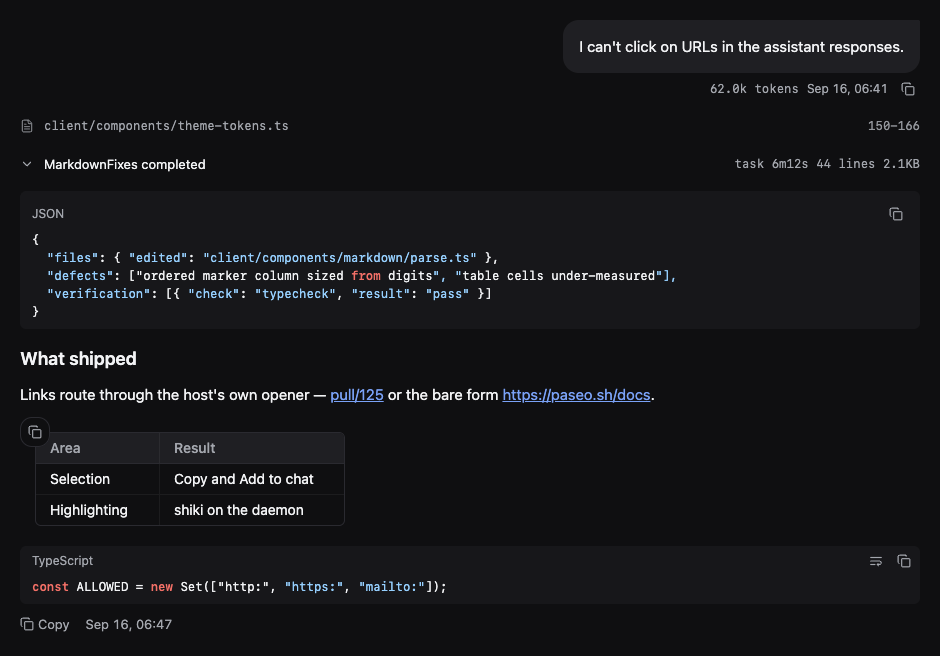
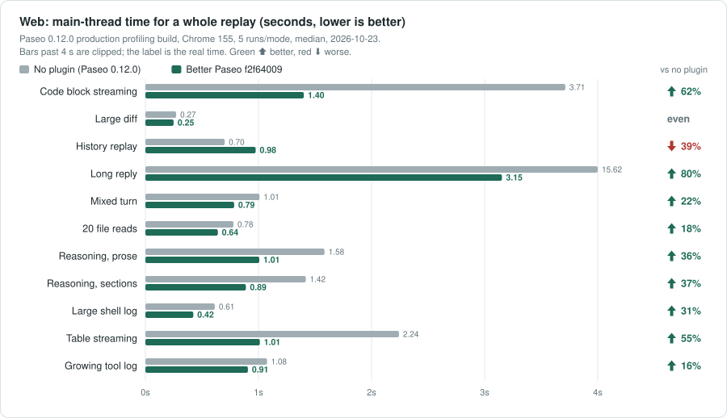
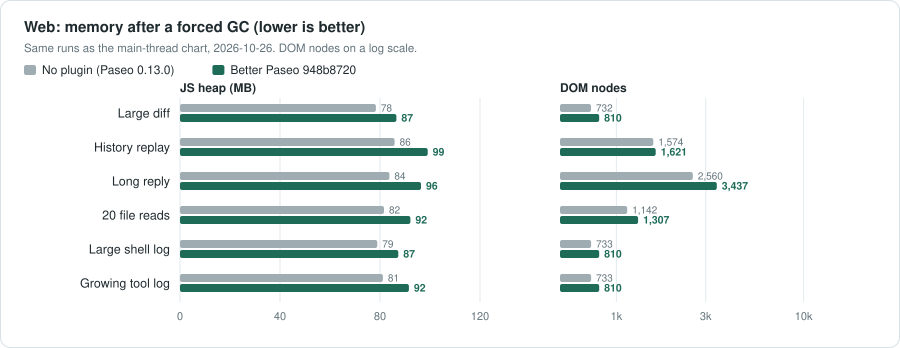
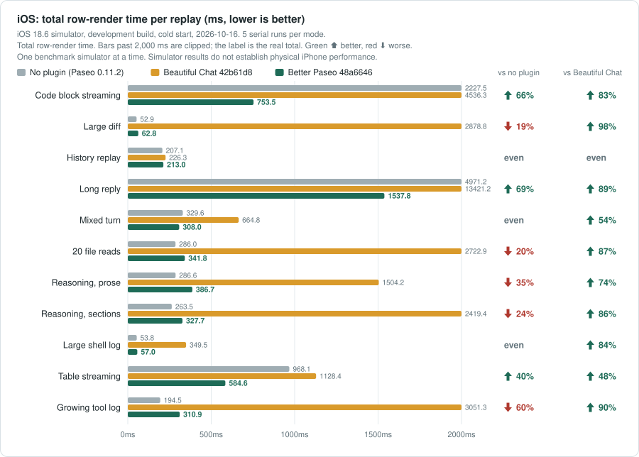
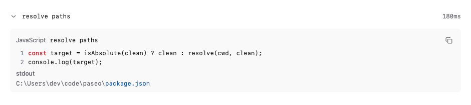
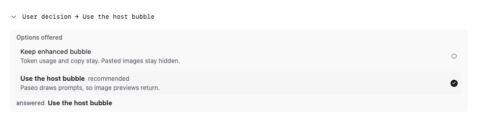
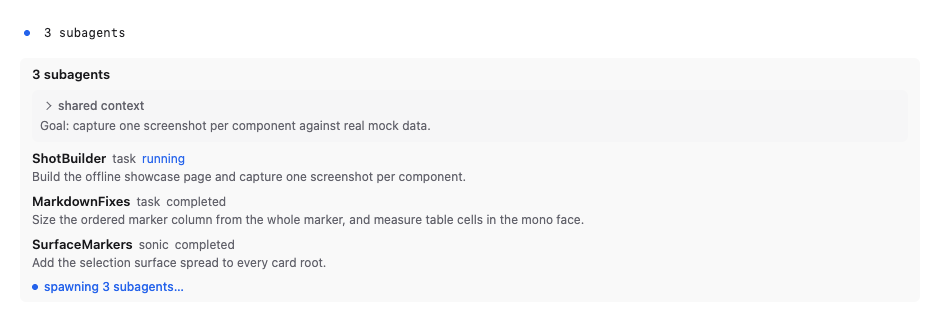
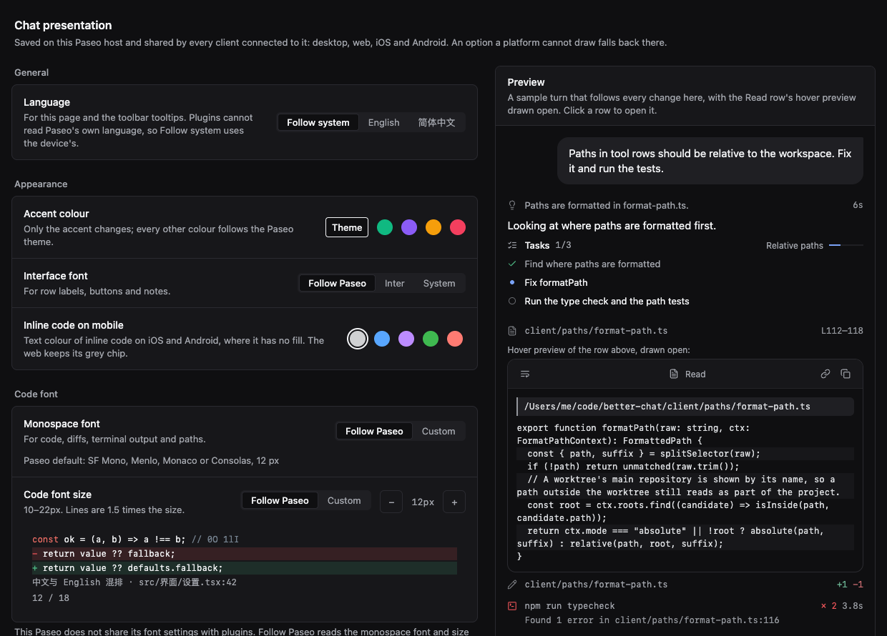

# Better Paseo

**English** | [简体中文](README-zh.md)

A [Paseo](https://paseo.sh) plugin that redraws the chat timeline of every agent Paseo runs,
whichever provider is behind it (Claude Code, Codex, Oh My Pi and the rest): tool calls, reasoning,
replies, prompts, checklists and errors become compact, typed, syntax-aware rows that follow the
active Paseo theme, and the whole timeline renders faster than Paseo does on its own.



> Better Paseo is a fork of [ABorakati/beautiful-chat](https://github.com/ABorakati/beautiful-chat),
> continued from `42b61d8` (2026-09-23). Every card Beautiful Chat had is still here; this README
> describes what the fork adds and how it performs.

## Highlights

- **Faster than no plugin at all.** On the Web production build every one of the 11 replay
  scenarios uses less main-thread time than Paseo's own timeline (one is even), and 34–85% less
  than Beautiful Chat. [Charts below](#performance).
- **One row per tool call.** Calls start collapsed to a 26pt row with a typed summary, open on a
  press, and stay open or closed across completion, history and remounts.
- **Streaming that does not jump.** Replies are parsed block by block; a half-written code fence
  or table never flips format, and the layout shift of a long streaming reply is 0.
- **Previews without opening.** Hover a collapsed row or a path on desktop, or long-press it on a
  phone, to read its content in a scrollable panel. Images open in a full-screen viewer.
- **Follows Paseo.** Fonts, sizes and colours follow the host by default; settings are stored on
  the daemon and shared by desktop, web, iOS and Android. The settings page is in English and
  Simplified Chinese.

## Install

```bash
paseo plugin install RoundRedDot/better-paseo
```

Paseo `>=0.8.0` is required; the plugin is developed and measured against Paseo 0.11.2. Open
**Settings → Plugins → Better Paseo** to configure it. Paseo installs plugins from GitHub, so pull a
new version with:

```bash
paseo plugin update better-paseo
```

---

## Performance

Three modes were replayed in the same session, in rotating order: **no plugin** (Paseo 0.11.2
drawing the timeline itself), **Beautiful Chat** `42b61d8`, and **Better Paseo**. The same probe sits
on the host, around every row, native or plugin, so all three are measured the same way. Each cell is
the median of 3 runs of a Web production build; 11 scripted scenarios cover streaming replies, code,
tables, reasoning, large diffs, shell logs and a 100-turn history.



- **Against no plugin**, Better Paseo is shorter in 10 of 11 scenarios, by 15–61%; the large diff
  is even (0.38 s vs 0.37 s for the whole replay).
- **Against Beautiful Chat**, it is shorter in all 11, by 34–85%. Beautiful Chat opens running tool
  calls by default, so 20 file reads mount 56,158 DOM nodes and take 3.72 s; Better Paseo mounts
  1,488 and takes 0.70 s.
- Streaming text gains the most: a long reply drops from 7.07 s (no plugin) and 8.42 s (Beautiful
  Chat) to 3.67 s.



Memory is read after a forced garbage collection. Better Paseo's JS heap stays within 0–4 MB of no
plugin, about the size of the plugin code, and a long reply needs 41 MB less. Beautiful Chat reaches
239–266 MB where it expands tool output.

Cumulative layout shift while streaming (lower is better):

| Scenario         | No plugin | Beautiful Chat | Better Paseo | vs no plugin | vs Beautiful Chat |
| ---------------- | --------: | -------------: | ----------: | :----------- | :---------------- |
| Long reply       |     0.157 |          0.644 |       **0** | &ensp;100% | &ensp;100% |
| Code block       |     0.039 |          0.127 |   **0.012** | &ensp;69% | &ensp;91% |
| Table            |     0.049 |          0.040 |   **0.011** | &ensp;78% | &ensp;73% |
| 100-turn history |         0 |          0.478 |       **0** | even | &ensp;100% |

### iOS



On the iOS simulator (development build, cold start before every run) the per-commit render time of
all rows is lower in 8 of 11 scenarios, by 15–86%, and even in 2. The large shell log is 23% higher
at p95, but the total render work is the same (23 ms vs 21 ms): Better Paseo does the re-render at
tool completion in one commit where Paseo spreads it over several. Development-build milliseconds
are only comparable with each other.

Against Beautiful Chat on iOS, with the card-level probe of the earlier rounds (`mixed-turn`, same
simulator session, 4 runs each, p95 in ms):

| Card      | Beautiful Chat | Better Paseo | Change |
| --------- | -------------: | ----------: | :----- |
| Prompt    |           25.3 |        13.3 | &ensp;47% |
| Reply     |          108.2 |        21.6 | &ensp;80% |
| Reasoning |           94.4 |        21.5 | &ensp;77% |
| Tool      |          122.6 |        27.0 | &ensp;78% |
| Checklist |          137.9 |        40.8 | &ensp;70% |

 green is better than
the baseline,  red is
worse. A difference under 10%, or a whole replay under half a second on both sides, counts as even.

<details>
<summary>All Web figures (seconds of main-thread time)</summary>

| Scenario            | No plugin | Beautiful Chat | Better Paseo |
| ------------------- | --------: | -------------: | ----------: |
| Code block streaming |     3.81 |           3.45 |    **1.70** |
| Large diff          |      0.38 |           2.41 |    **0.37** |
| 100-turn history    |      2.92 |           8.49 |    **2.14** |
| Long reply          |      7.07 |           8.42 |    **3.67** |
| Mixed turn          |      1.20 |           2.95 |    **1.02** |
| 20 file reads       |      0.96 |           3.72 |    **0.70** |
| Reasoning, prose    |      2.06 |           3.57 |    **1.27** |
| Reasoning, sections |      1.97 |           3.92 |    **1.02** |
| Large shell log     |      0.88 |           1.60 |    **0.64** |
| Table streaming     |      2.77 |           1.64 |    **1.08** |
| Expanded tool       |      1.49 |           3.26 |    **0.97** |

</details>

**How it was measured.** A measurement-only patch to Paseo wraps every timeline row in the same
`React.Profiler`; Playwright reads Chrome DevTools Protocol metrics (task time, heap, DOM nodes)
before and after each replay, with a forced GC before memory is read. The machine was shared with
other work, so modes alternate and medians are reported. Method, tools and all raw runs:
[`docs/bench/native-vs-fork`](docs/bench/native-vs-fork/README.md). Every difference from Beautiful
Chat, with the history of each measurement: [`docs/fork-vs-upstream.md`](docs/fork-vs-upstream.md)
(Chinese). The charts are generated from the raw runs by `node docs/perf/readme-charts.mjs`.

### Where the time goes

- **Cards that did not change stop rendering.** Paseo hands every row new `theme` and `data`
  objects on each streamed chunk. Semantic `React.memo` comparisons let unchanged cards skip the
  render; only the newest prompt follows the agent's status. In the 100-turn replay whole-page
  renders fell from 172,327 to 1,319.
- **Replies are parsed incrementally.** `marked` with `remend` lexes block by block; each reply
  caches its finished blocks and repairs only the block still growing. Format flips and height
  regressions while streaming are 0 offline, on Web and on iOS.
- **Code is highlighted once, and only when it is complete.** An unclosed code block requests no
  highlighting; Shiki runs on the daemon (`highlight.tokens`). Collapsed rows do not mount their
  body, so 20 file reads make 0 highlight requests instead of 48.
- **Large output arrives in batches.** Code and terminal panels draw 400 lines, then add the rest in
  batches with a **Show all** control. A 5,000-line diff on iOS went from 2.2 s to 19.8 ms (tool card
  p50).
- **No decorative loops.** Shadows, frosted glass, glow and breathing animations are gone. Only the
  running dot remains; on Web it is a CSS animation, so it no longer commits its row every frame
  (row commits in a mixed turn: 1,518 → 196). Reduced Motion stills it.
- **No late growth.** A reply that is not revealed word by word draws its text in the same commit
  that delivers it, so Paseo's stick-to-bottom keeps up and the reply does not push the footer
  after the fact.
- **A small client bundle.** Paseo sends the whole client bundle again on every reconnect. Brand
  marks and the Inter face are served by the daemon on demand (`marks.bitmaps`, `fonts.embedded`),
  the embedded Iosevka faces are gone, and the bundle is kept ASCII so Hermes stores it as one-byte
  text.

---

## Features

Everything below is on top of what Beautiful Chat already drew: typed tool cards, Shiki
highlighting, image reads, file reveal and the plugin's own find bar.


### Tool rows

Most cards read the tool detail Paseo hands every plugin, so they work whichever agent made the
call: reads, writes, edits, shell and Git commands, searches, fetches, sub-agents, plans, MCP calls
(in Claude's `mcp__server__tool`, Codex's `server.tool` and Oh My Pi's `server / tool` forms) and
Paseo's own tools. Oh My Pi's own tools `hub`, `eval`, `ask` and `task`, and its GitHub device
calls, have cards of their own; other agents never send them.

- Every call starts as one borderless row, 26pt on desktop and 28pt on touch, with a summary built
  for its type: the command, the path and line range, `+4 −2` for an edit, the exit code and
  duration. A press opens the card.
- The open or closed state is kept per call (`agentId:callId`) outside the component, so it
  survives completion, scrolling into history and remounts. On iOS the header stays where it was
  pressed and the content opens below it.
- A failed call shows a one-line error; **Open failed calls** opens it automatically.
- Rows keep the time they first appeared, so parallel reads no longer reorder or change spacing
  when one finishes first.
- Row heads show an icon, a label or both. Long code and terminal output fold to 12 lines.
- Paseo's own tools carry the Paseo mark, and a created agent its provider's mark.
- Every op of Oh My Pi's `hub` tool has a card: processes, messages and job snapshots. The cards
  report; they carry no buttons, since a plugin cannot restart or cancel anything.

| Shell and Git | Read |
| --- | --- |
|  |  |
| **Edit** | **Hub** (Oh My Pi) |
|  |  |

<details>
<summary>More cards: MCP, Paseo tools, image read, syntax block, a <code>thinking</code> tool, and Oh My Pi's Eval, Ask and Task</summary>







</details>

### Reasoning and checklists

- Reasoning is split only on real structure (`**Title**` and headings), not on blank lines. It is
  collapsed by default, and while it streams the row previews the current heading.
- Durations are shown only when this client actually watched the reasoning stream; nothing is
  estimated.
- Checklists show the phase, per-task status, durations, and a blocked task with its reason.


### Replies

- Markdown is drawn by the plugin with headings, lists, task lists, quotes, highlighted code blocks
  and local images. Three styles: **Document**, **Compact** and **Terminal**.
- Tables have column rules, a header fill and a rounded frame; cells are a size smaller with tighter
  lines, and column widths account for tabular digits and CJK width.
- Every table has a copy control at its top-left corner. On web and desktop, hovering it (or a
  long press on a touch screen) opens **Copy as Markdown** and **Copy as image**, a picture of the
  table as drawn; a plain press copies the Markdown. On iOS and Android it copies the Markdown.
- Every local image in a reply is drawn, not only the first.
- Turn **Plugin markdown for replies** off to hand replies back to Paseo, which draws mermaid
  diagrams and its own images and file links.


### Images

- An image read draws the file: dimensions and size from its header, a thumbnail sized to its
  content, and an eye toggle that keeps the header where it was pressed.
- The full-screen viewer zooms with buttons, the wheel or a pinch about the pointer, pans by drag,
  resets on double press, and reveals the file in the file manager. On a phone, a long press on the
  row opens it directly.
- Bytes come from the daemon (`file.image`) the first time a row is opened, previewed or
  long-pressed. PNG, JPEG, GIF, WebP, AVIF, BMP, ICO and SVG are recognised; files over 3 MB report
  their size instead of inlining.

### Hover previews

On desktop, resting the pointer on a collapsed tool row, thought row, image or path opens a
scrollable preview after a delay you set (0–10 s). It can wrap lines, show line numbers and
alternating shading, and maximise. On a phone a long press opens the same preview without covering
the top bar or the composer.

### Paths, copying and selection

- Paths are relative to the workspace and shortened in the middle, keeping the file name; a
  worktree's main repository is shown by name. Copying always gives the absolute path.
- Copy goes through the host's `copyText` everywhere, so it works on iOS and Android too: hover on
  desktop, long press on touch, or the `⋯` menu. Plain-text code blocks can wrap and have a copy
  button. On iOS a long press in a reply places a cursor and lets you drag a selection.
- Selecting text in a card on web or desktop raises **Copy** and **Add to chat**, which quotes the
  selection in the composer, fenced when it came from code.

### Prompt bubble

Paseo draws the prompt by default, keeping pasted images and its rewind menu. **Enhanced prompt
bubble** switches to the plugin's bubble: an always-visible copy button and the turn's token usage.
It cannot show pasted images; rewind stays wherever the running Paseo provides it.


### Errors and system messages

- An agent error is drawn as a notice card carrying its message.
- Oh My Pi sends job results, relayed messages and reminders as message text wrapped in tags such
  as `<system-notice>` or `<irc>`, and Paseo files them as replies. With **Plugin markdown for
  replies** on, they are drawn as system cards (a title, chips for agent, status and duration, and
  the rest of the body) instead of raw XML.

Permission requests are not redrawn: Paseo draws them and owns the approve and deny actions.

---

## Settings

**Settings → Plugins → Better Paseo.** A sample turn drawn with the timeline's own components follows
every change: beside the options on a wide desktop window, above them elsewhere. The Read row's
hover preview is drawn open in it. On web and desktop a **Desktop / Mobile** switch draws the same
turn as iOS does: a phone's width, the system monospace, and inline code in the colour you picked.
Options whose parent is off are dimmed, and **Reset** asks for a second press.



| Group | Setting | Default | Effect |
| --- | --- | --- | --- |
| General | Language | Follow system | English or 简体中文 for the settings page and toolbar tooltips. Plugins cannot read Paseo's own language. |
| Appearance | Accent colour | Theme | Follow the Paseo theme, or Jade, Violet, Amber or Rose. Only the accent changes. |
| Appearance | Inline code on mobile | Dark grey | Text colour of inline code on iOS and Android: Dark grey, Blue, Violet, Green or Coral. Web keeps its grey chip. |
| Appearance | Interface font | Follow Paseo | Paseo's interface font, Inter (web only, fetched from the daemon) or the system face. |
| Code font | Monospace font | Follow Paseo | Follow Paseo or a custom family. Follow Paseo uses, in order: the host's font settings once Paseo shares them; on web and desktop, the monospace font and size from Paseo's Appearance settings; otherwise Paseo's default monospace. On iOS and Android, Custom lists faces the platform ships. |
| Code font | Code font size | Follow Paseo | Or 10–22px; lines are 1.5× the size. Applies to code, diffs, terminals and paths. |
| Tool calls | Row icons and labels | Icon | Icon, label (Bash, Read…) or both at the start of tool and thought rows. |
| Tool calls | Open failed calls | Off | On, a failed call opens to show its error. |
| Tool calls | File paths | Relative | Relative to the workspace, or absolute. Copying always gives the absolute path. |
| Spacing | Tight rows | On | Closes the 16pt gap Paseo 0.11 leaves under each plugin row to 4pt. Turn off if rows overlap. |
| Spacing | Tight reply | On | A reply sitting on a tool, thought or checklist row uses 4pt instead of 16pt. |
| Messages | Enhanced prompt bubble | Off | The plugin's bubble with token usage and a visible copy button, without pasted images. |
| Messages | Plugin markdown for replies | On | Off hands replies to Paseo, for mermaid, host images and Paseo's file links. |
| Messages | Markdown style | Document | Document, Compact or Terminal (body in the code font). |
| Messages | Selection toolbar | On | Web and desktop: Copy and Add to chat on selected text. |
| Hover previews | Hover previews | On | Preview collapsed rows and paths on hover (desktop) or long press (phone). |
| Hover previews | Delay | 1 s | 0–10 s before the desktop preview opens. |
| Hover previews | Wrap lines / Line numbers / Alternating line shading | On / Off / On | How the preview draws its content. |

**Where settings live.** Preferences are stored by the daemon through the SDK's host-scoped settings
(record `presentation` in `shared/preferences-settings.ts`), so **every client connected to one
daemon shares them**: a change on the desktop shows up on iOS and the other way round. A value one
platform cannot draw is stored as chosen and degraded where it renders (a custom family becomes the
platform monospace on iOS and Android; Inter becomes the system face). On web, `localStorage` is
only a fast-start cache. Until the settings arrive, cards draw with cached or default values and
switch once.

**Settings apply to new items.** Paseo caches each transformed item, so a change reaches messages
that arrive afterwards; reload the chat to redraw existing ones.

---

## Finding text

Paseo's chat find (Ctrl/Cmd+F) cannot reveal a row a plugin draws, because the transformed row
carries a different id. Better Paseo therefore takes Ctrl/Cmd+F on desktop and web and opens its own
find bar over the chat. It searches everything rendered, including tool cards: Enter for the next
match, Shift+Enter for the previous, Escape to close. It only sees loaded messages; scroll up to
include older history.

To use Paseo's native find for replies, which also searches unloaded history, turn off **Plugin
markdown for replies** (and **Enhanced prompt bubble** if it is on). Paseo then draws replies and
prompts itself and Ctrl/Cmd+F opens its own find. Tool, reasoning and checklist cards stay with the
plugin.

## Opening files

A file name in a read, write, edit or code block is a link. On desktop it calls the daemon-side
`file.reveal`, which resolves the path against the agent's working directory and shows it in the
file manager: `explorer.exe /select,` on Windows, `open -R` on macOS, `xdg-open <directory>`
elsewhere. On a touch device the same press copies the absolute path instead, since a phone cannot
open the daemon machine's file manager.

## Troubleshooting

| Symptom | What to do |
| --- | --- |
| Rows overlap, or a reply overlaps the row below | Turn off **Tight rows** or **Tight reply**. |
| A reply needs a mermaid diagram, a host image or Paseo's file links | Turn off **Plugin markdown for replies**. |
| Pasted images are missing from prompts | Turn off **Enhanced prompt bubble**; plugins never receive pasted images. |
| Ctrl/Cmd+F misses old messages | Scroll up to load them, or hand replies back to Paseo as above. |
| A settings change does not affect earlier messages | Reload the chat; transformed items are cached. |
| Token figures are missing on an old turn | Usage is not stored on timeline items, so only turns this client watched live show it. |
| Nothing changed after pushing a fix | Run `paseo plugin update better-paseo`; Paseo runs the GitHub version. |

## Waiting on Paseo

Better Paseo works on released Paseo and probes for newer host abilities, falling back when they are
absent. These host changes are verified in a Paseo fork but not yet released:

- Plugin tool rows spaced like native ones (about 46pt down to 30pt; native is 32pt). Until then
  **Tight rows** takes back the extra 16pt.
- Paseo sharing its font settings with plugins, so a change in Appearance applies live. Until then
  web and desktop read Paseo's locally stored Appearance settings.
- Lowering `class` syntax before the bundle runs on Hermes.
- A sticky current prompt and sticky headers on open cards; the plugin side is wired up.

Grouping several calls into one "Read 12 files" row needs a host grouping API, and opening a
5,000-line block on a development-build simulator still takes about 30 s without host-side
virtualised scrolling.

The SDK constraints met while building the plugin, with evidence and workarounds, are listed in
[`docs/plugin-sdk-limitations.md`](docs/plugin-sdk-limitations.md).

## Development

```bash
npm install
npm run typecheck
npm test
npm run check:hermes
paseo plugin reload better-paseo
```

`npm run check:hermes` compiles and runs the client bundle in Hermes, the engine the iOS and Android
apps use; code that works on web can still fail there and drop the whole plugin. The rules it
enforces, the project layout, and how to rebuild the screenshots and charts are in
[`docs/development.md`](docs/development.md).

## License

MIT
