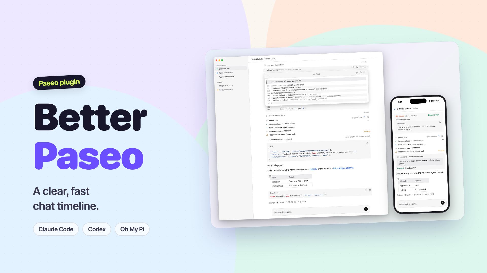
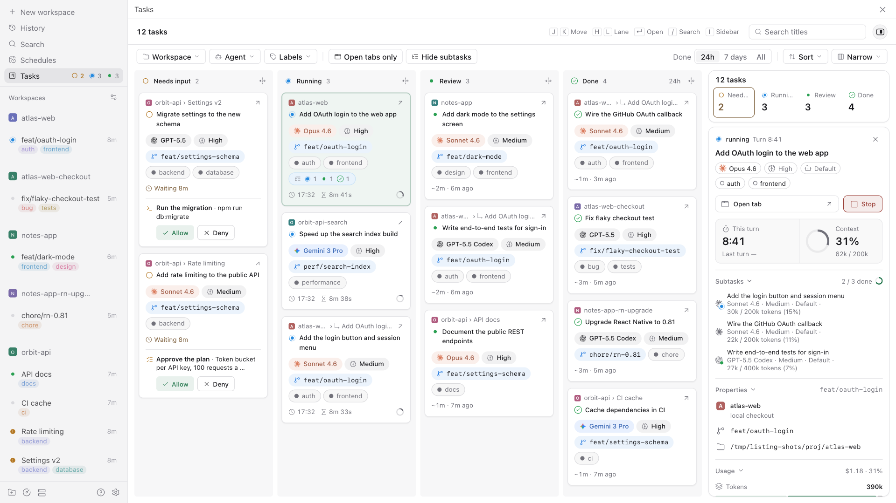
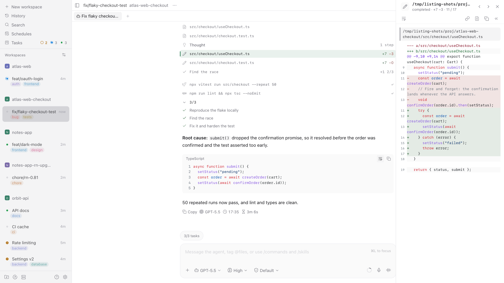
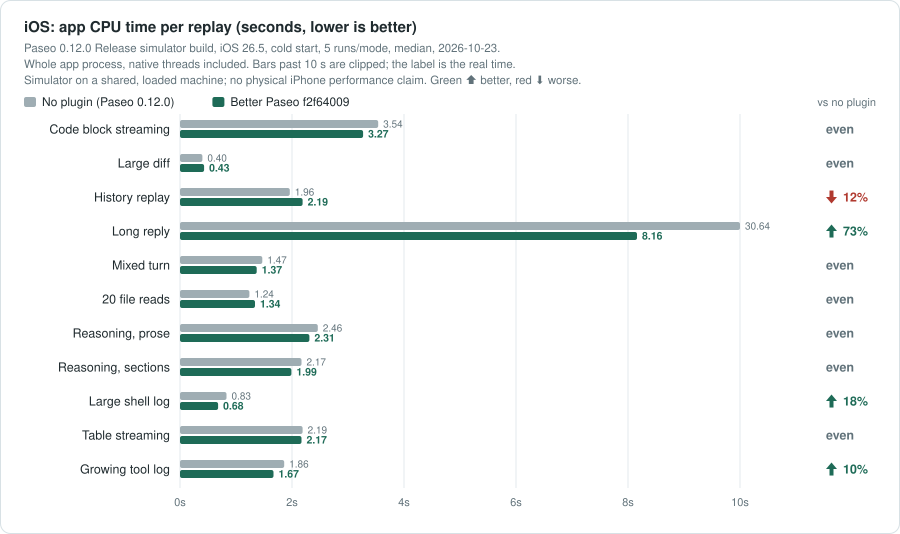

# Better Paseo

**English** | [简体中文](README-zh.md)

A [Paseo](https://paseo.sh) plugin that redraws the chat timeline of every agent Paseo runs,
whichever provider is behind it (Claude Code, Codex, Oh My Pi and the rest): tool calls, reasoning,
replies, prompts, checklists and errors become compact, typed, syntax-aware rows that follow the
active Paseo theme. It also adds a **Tasks** board that lays out every agent on the host in four
lanes. The performance section compares the timeline with Paseo’s own.



<picture><source media="(prefers-color-scheme: dark)" srcset="images/tasks-board-dark.png"></picture>
<picture><source media="(prefers-color-scheme: dark)" srcset="images/timeline-dark.png"></picture>

https://github.com/user-attachments/assets/56d25aed-062c-41ed-8aa8-174e23bd3395

> Better Paseo is a fork of [ABorakati/beautiful-chat](https://github.com/ABorakati/beautiful-chat),
> continued from `42b61d8` (2026-09-23). It keeps Beautiful Chat's cards except the Eval, Ask,
> Task and approval cards, which current Paseo never feeds a plugin (see
> [Compatibility](#compatibility)). This README describes what the fork adds and how it performs.

## Highlights

- **Measured performance.** Against Paseo 0.12.0, 198 Web and iOS replays; the long reply costs a fifth of the host's main-thread time. Details in [Performance](#performance).
- **Measured memory.** The same round records post-GC JS heap and signed MB differences against no plugin. [Memory comparison](#memory-comparison).
- **One row per tool call.** Calls start collapsed to a 26pt row with a typed summary and stay
  open or closed across completion, history and remounts.
- **Block details.** Tap a row, or pick **Open in panel** in a desktop hover preview, to read it in
  a drawer on a phone, a floating panel on a tablet or a side panel beside a wide chat, and step through the turn's blocks from its header. See
  [Block details](#block-details).
- **Block-by-block streaming replies.** Finished Markdown blocks are cached while growing code and tables are repaired. This round’s layout-shift readings are in the [performance comparison](#performance).
- **Previews without opening.** Hover a collapsed row or a path on desktop to read its content in
  a scrollable panel. Images open in a full-screen viewer.
- **Tasks board.** One sidebar entry shows every agent by state (needs input, running, to review,
  done), with the parent/child links, model and thinking level, and Stop and permission buttons on
  the card. A click opens the card's properties, usage, activity and subtasks in a sidebar beside
  the lanes. See [Tasks board](#tasks-board).
- **Follows Paseo.** Fonts, sizes and colours follow the host by default; settings are stored on
  the daemon and shared by desktop, web, iOS and Android. The settings page is in English and
  Simplified Chinese.

## Install

```bash
paseo plugin install RoundRedDot/better-paseo
```

Paseo `>=0.8.0` is required; the plugin is developed and measured against Paseo 0.12.0. On Paseo
0.8–0.10 it works with some compatibility issues, listed under [Compatibility](#compatibility).
Open **Settings → Plugins → Better Paseo** to configure it. Paseo installs plugins from GitHub, so pull a
new version with:

```bash
paseo plugin update better-paseo
```

---

## Performance

### Paseo 0.12: 198 replays

Measured on Mac Studio (Apple M5 Max, 18 cores, 64 GB, macOS 27.0.1) on 2026-10-21 against Paseo 0.12.0, which draws replies with its new Markdown engine (react-native-enriched-markdown). Better Paseo is `6a76c56`. Web and iOS each run 11 scenarios × 2 configurations (no plugin, Better Paseo) × 3 repetitions, **198 replays** in all, with the configuration order rotated per scenario. The machine was shared and loaded (1-minute load average 21–104, median about 50), so the main metrics are CPU time; frame counts are not tabulated. Raw runs stay in the local `docs/bench/2026-10-21-paseo-012` archive and are not stored in git.


Whole-replay main-thread Task time (seconds) vs no plugin: 9 lower, 1 even, 1 higher. Under 10%, or both whole replays below 0.5 seconds, is even. The long reply is where Paseo 0.12 spends most: 15.8 seconds of main-thread time against 3.1, and the host's cost grows faster than the reply (2.1 s at a quarter of its length, 5.5 s at half).

| Scenario | No plugin | Better Paseo | vs no plugin |
| --- | ---: | ---: | :--- |
| Code block streaming | 3.430 | **1.359** | &ensp;60% |
| Large diff | 0.275 | **0.238** | even |
| History replay | 0.715 | **0.860** | &ensp;20% |
| Long reply | 15.759 | **3.122** | &ensp;80% |
| Mixed turn | 1.029 | **0.772** | &ensp;25% |
| 20 file reads | 0.735 | **0.589** | &ensp;20% |
| Reasoning, prose | 1.867 | **1.090** | &ensp;42% |
| Reasoning, sections | 1.575 | **0.927** | &ensp;41% |
| Large shell log | 0.661 | **0.458** | &ensp;31% |
| Table streaming | 2.185 | **1.089** | &ensp;50% |
| Growing tool log | 1.152 | **0.906** | &ensp;21% |

Cumulative row-render work (host Profiler allRows.sum, milliseconds) from the same runs, vs no plugin: 9 lower, 0 even, 2 higher.

| Scenario | No plugin | Better Paseo | vs no plugin |
| --- | ---: | ---: | :--- |
| Code block streaming | 1,325.6 | **113.4** | &ensp;91% |
| Large diff | 15.7 | **11.2** | &ensp;29% |
| History replay | 155.7 | **224.6** | &ensp;44% |
| Long reply | 9,792.1 | **231.7** | &ensp;98% |
| Mixed turn | 113.8 | **47.9** | &ensp;58% |
| 20 file reads | 67.7 | **43.4** | &ensp;36% |
| Reasoning, prose | 362.2 | **65.7** | &ensp;82% |
| Reasoning, sections | 300.8 | **60.7** | &ensp;80% |
| Large shell log | 17.6 | **12.7** | &ensp;28% |
| Table streaming | 760.9 | **118.7** | &ensp;84% |
| Growing tool log | 33.7 | **47.2** | &ensp;40% |

### Streaming layout shift

Cumulative layout shift (CLS, lower is better) from the same Web runs, with six decimals. The 0.5-second rule does not apply, and percentages magnify tiny absolute differences: every reading under 0.002 is invisible in practice.

| Scenario | No plugin | Better Paseo | vs no plugin |
| --- | ---: | ---: | :--- |
| Code block streaming | 0.001388 | **0.031453** | &ensp;2166% |
| Large diff | 0.000015 | **0.000015** | even |
| History replay | 0.107329 | **0.000349** | &ensp;100% |
| Long reply | 0.044279 | **0.000019** | &ensp;100% |
| Mixed turn | 0.002791 | **0.026655** | &ensp;855% |
| 20 file reads | 0.000015 | **0.000793** | &ensp;5335% |
| Reasoning, prose | 0.000015 | **0.000778** | &ensp;5235% |
| Reasoning, sections | 0.000015 | **0.001142** | &ensp;7733% |
| Large shell log | 0.000015 | **0.000015** | even |
| Table streaming | 0.045737 | **0.010534** | &ensp;77% |
| Growing tool log | 0.000015 | **0.000015** | even |

### iOS



Paseo 0.12.0 Release build on an iPhone 17 Pro / iOS 26.5 simulator, cold-launched per sample, with React's profiling renderer for the row probe. Paseo 0.12 lays out Markdown on native threads, so the main metric is the CPU time of the whole app process over the replay; JS row-render work alone would undercount the host. App CPU time (seconds) vs no plugin: 6 lower, 5 even, 0 higher. On the long reply the host also dropped about 1,260 frames (longest frame 378 ms) against 8 for Better Paseo.

| Scenario | No plugin | Better Paseo | vs no plugin |
| --- | ---: | ---: | :--- |
| Code block streaming | 3.71 | **3.27** | &ensp;12% |
| Large diff | 0.43 | **0.44** | even |
| History replay | 1.74 | **1.89** | even |
| Long reply | 30.94 | **8.08** | &ensp;74% |
| Mixed turn | 1.54 | **1.39** | even |
| 20 file reads | 1.29 | **1.30** | even |
| Reasoning, prose | 2.60 | **2.31** | &ensp;11% |
| Reasoning, sections | 2.33 | **1.95** | &ensp;16% |
| Large shell log | 0.91 | **0.66** | &ensp;27% |
| Table streaming | 2.33 | **2.20** | even |
| Growing tool log | 1.98 | **1.72** | &ensp;13% |

JS row-render work alone (milliseconds) vs no plugin: 2 lower, 3 even, 6 higher. Where the plugin's row work is higher but app CPU is even, the host spends that time in native Markdown layout instead.

| Scenario | No plugin | Better Paseo | vs no plugin |
| --- | ---: | ---: | :--- |
| Code block streaming | 605.4 | **316.1** | &ensp;48% |
| Large diff | 10.8 | **45.7** | &ensp;325% |
| History replay | 46.7 | **136.2** | &ensp;192% |
| Long reply | 19,959.3 | **722.5** | &ensp;96% |
| Mixed turn | 86.5 | **138.4** | &ensp;60% |
| 20 file reads | 101.8 | **155.9** | &ensp;53% |
| Reasoning, prose | 137.7 | **144.1** | even |
| Reasoning, sections | 121.6 | **126.8** | even |
| Large shell log | 10.6 | **40.8** | &ensp;286% |
| Table streaming | 302.6 | **291.3** | even |
| Growing tool log | 75.2 | **115.6** | &ensp;54% |

Green ⬆ is lower; red ⬇ is higher. Percentages use unrounded medians. `history-100` is a fixture name, not 100 actual provider turns; it is labelled “History replay”. `tool-expanded-streaming` performs no expand action and is labelled “Growing tool log”.

**Method and limits.** Paseo 0.12.0 with an identical host row probe (a React Profiler around every timeline row). Web uses a production profiling export in Chrome 155.0.8059.85 at 1280×900; CDP measures main-thread time, with forced-GC heap and DOM readings after timing. iOS uses a Release simulator build with optimised native code. Default feature settings. Three runs per cell on a loaded, shared machine, so read differences under about 15% with care. The comparison with Beautiful Chat `42b61d8` was measured on Paseo 0.11.2 and is not repeated on 0.12.

### Where the time goes

- **Skip unchanged rows.** Semantic theme/data comparisons let unchanged cards skip rendering.
- **Parse replies incrementally.** Finished Markdown blocks are cached; only the growing tail is repaired. Long replies split into blocks that the native host can virtualize; Copy retains the full source.
- **Draw tool bodies on demand.** Collapsed rows do not mount their bodies. Completed code requests daemon highlighting; large code and terminal output render in batches with a Show all control.
- **Reduce continuous animation work.** The Web running dot uses CSS and stops for Reduced Motion; decorative shadows, blur and breathing loops are removed.
- **Send less on reconnect.** Brand marks and Inter are delivered on demand; the client source stays ASCII for Hermes one-byte strings.


---

## Memory comparison

2026-10-21, the same Web production profiling runs, median of three post-GC readings. This is JS heap, not total process or app memory. Differences are Better Paseo minus no plugin, in MB; the 10% even rule does not apply. Better Paseo holds 4–13 MB more heap in every scenario.


| Scenario | No plugin | Better Paseo | Difference |
| --- | ---: | ---: | ---: |
| Code block streaming | 85.5 | **89.4** | +3.9 |
| Large diff | 80.5 | **87.5** | +7.0 |
| History replay | 86.5 | **96.2** | +9.7 |
| Long reply | 86.5 | **99.2** | +12.8 |
| Mixed turn | 83.3 | **91.2** | +7.9 |
| 20 file reads | 84.5 | **92.7** | +8.2 |
| Reasoning, prose | 81.7 | **88.2** | +6.5 |
| Reasoning, sections | 81.3 | **88.3** | +7.1 |
| Large shell log | 81.0 | **88.2** | +7.2 |
| Table streaming | 82.3 | **90.9** | +8.6 |
| Growing tool log | 84.0 | **93.1** | +9.1 |

Raw Web samples from this round stay in the local `docs/bench` archive and are not stored in git.

---

## Features

Screenshots refreshed on 2026-10-17 from b9dfae6 using the offline Web showcase. All product screenshots default to light and switch to dark with the reader’s theme; the phone frame is illustrative. Performance versions and conditions are identified above. [Capture manifest](docs/images/screenshots.json).

Everything below is on top of what Beautiful Chat already drew: typed tool cards, Shiki
highlighting, image reads, file reveal and the plugin's own find bar.

<picture><source media="(prefers-color-scheme: dark)" srcset="images/thread-dark.png"></picture>

### Tool rows

Most cards read the tool detail Paseo hands every plugin, so they work whichever agent made the
call: reads, writes, edits, shell and Git commands, searches, fetches, sub-agents, plans, MCP calls
(in Claude's `mcp__server__tool`, Codex's `server.tool` and Oh My Pi's `server / tool` forms) and
Paseo's own tools. Calls Paseo passes as plain text get a label-and-text card.

Oh My Pi's `hub` tool and its GitHub device calls are matched by name and have cards of their
own; no other agent sends them. On Paseo 0.11, Oh My Pi's `eval` and `ask` calls reach plugins as
plain text and `task` arrives as a sub-agent item. If `ask` also carries structured `questions`
data, it gets a question transcript; otherwise it stays a generic text card.

- Every call starts as one borderless row, 26pt on desktop and 28pt on touch, with a summary built
  for its type: the command, the path and line range, `+4 −2` for an edit, the exit code and
  duration. A click expands the card in place. On a touch screen a tap opens its
  [details](#block-details) instead, and a tap on the icon at the row's start expands it.
- The open or closed state is kept per call (`agentId:callId`) outside the component, so it
  survives completion, scrolling into history and remounts. On iOS the header stays where it was
  pressed and the content opens below it.
- A failed call shows a one-line error; with **Open failed calls** on, it starts expanded unless
  the reader has already chosen its open or closed state.
- Rows keep the time they first appeared, so parallel reads no longer reorder or change spacing
  when one finishes first.
- Row heads show an icon, a label or both. Long code and terminal output fold to 12 lines.
- **Block text size** changes prose in tool, thought, checklist and notice rows; code, diffs and
  terminal output keep their code font size.
- Paseo's own tools carry the Paseo mark; agent cards and reply footers use the agent's provider
  mark, independently of the selected model.
- Every op of Oh My Pi's `hub` tool has a card: processes, messages and job snapshots. The cards
  report; they carry no buttons, since a plugin cannot restart or cancel anything.
- Across agents, recognized question calls with structured `questions` data render as paginated
  transcripts with choices, recorded answers and status. **Show raw data** reveals the payload;
  the transcript is read-only, and Paseo still handles answers. Questions stay wrapped in previews
  for readability.

<picture><source media="(prefers-color-scheme: dark)" srcset="docs/images/questions-dark.png"></picture>

| Shell and Git | Read |
| --- | --- |
| <picture><source media="(prefers-color-scheme: dark)" srcset="docs/images/tool-bash-dark.png"></picture> | <picture><source media="(prefers-color-scheme: dark)" srcset="docs/images/tool-read-dark.png"></picture> |
| **Edit** | **Hub** (Oh My Pi) |
| <picture><source media="(prefers-color-scheme: dark)" srcset="docs/images/tool-edit-dark.png"></picture> | <picture><source media="(prefers-color-scheme: dark)" srcset="docs/images/hub-dark.png"></picture> |

<details>
<summary>More cards: MCP, Paseo tools, image read, syntax block, a <code>thinking</code> tool</summary>

<picture><source media="(prefers-color-scheme: dark)" srcset="docs/images/tool-mcp-dark.png"></picture>
<picture><source media="(prefers-color-scheme: dark)" srcset="docs/images/paseo-dark.png"></picture>
<picture><source media="(prefers-color-scheme: dark)" srcset="docs/images/tool-thinking-dark.png"></picture>
<picture><source media="(prefers-color-scheme: dark)" srcset="docs/images/tool-image-dark.png"></picture>
<picture><source media="(prefers-color-scheme: dark)" srcset="docs/images/syntax-dark.png"></picture>

</details>

### Reasoning and checklists

- Reasoning is split only on real structure (`**Title**` and headings), not on blank lines. It is
  collapsed by default, and while it streams the row previews the current heading.
- Durations are shown only when this client actually watched the reasoning stream; nothing is
  estimated.
- Checklists show the phase, per-task status, durations, and a blocked task with its reason. A
  progress ring tracks completed tasks and becomes a check when all are done. The header's window
  button opens the live checklist in a panel that stays open as you use the timeline and follows the
  newest list; long titles can wrap there.

<picture><source media="(prefers-color-scheme: dark)" srcset="docs/images/reasoning-dark.png"></picture>
<picture><source media="(prefers-color-scheme: dark)" srcset="docs/images/tasks-dark.png"></picture>
<picture><source media="(prefers-color-scheme: dark)" srcset="docs/images/checklist-window-dark.png"></picture>

### Replies

- Markdown is drawn by the plugin with headings, lists, task lists, quotes, highlighted code blocks
  and local images. Three styles: **Document**, **Compact** and **Terminal**.
- Unlabelled, Markdown and plain-text code fences can open a maximized preview window. Switch
  between rendered Markdown and raw text, copy the source, and use **Wrap lines** in raw-text mode.
  The window stays separate from the compact reply.
- Tables have column rules, a header fill and a rounded frame; cells are a size smaller with tighter
  lines, and column widths account for tabular digits and CJK width.
- Every table has a copy control at its top-left corner. On web and desktop, hovering it (or a
  long press on a touch screen) opens **Copy as Markdown** and **Copy as image**, a picture of the
  table as drawn; a plain press copies the Markdown. On iOS and Android it copies the Markdown.
- On web and desktop, double-click a cell to select its text. On iOS and Android, double-tap a cell.
  To select a block of cells, hold a cell and drag right or down; with a mouse, dragging from one
  cell into another works too. The menu appears on release: one cell copies its text, several copy
  a Markdown table of those rows and columns under their header. The corner menu always offers
  **Copy selected** and offers **Add to chat** when Paseo provides its composer capability.
- Each completed turn has a separate footer under its final reply with Copy and its time, plus the
  provider mark, model, thinking level and observed duration when available. The model name copies
  when pressed and confirms with a toast; completed-turn footers remain during a later run. Turn
  **Plugin markdown for replies** off to restore Paseo's full footer, including its Fork action.
- Every local image in a reply is drawn, not only the first.
- Turn **Plugin markdown for replies** off to hand replies back to Paseo, which draws mermaid
  diagrams and its own images and file links.

| Table copy menu | Selected cell actions |
| --- | --- |
| <picture><source media="(prefers-color-scheme: dark)" srcset="docs/images/table-copy-menu-dark.png"></picture> | <picture><source media="(prefers-color-scheme: dark)" srcset="docs/images/table-selection-dark.png"></picture> |

<picture><source media="(prefers-color-scheme: dark)" srcset="docs/images/markdown-styles-dark.png"></picture>
<picture><source media="(prefers-color-scheme: dark)" srcset="docs/images/markdown-preview-window-dark.png"></picture>

### Images

- An image read draws the file: dimensions and size from its header, a thumbnail sized to its
  content, and an eye toggle that keeps the header where it was pressed.
- The full-screen viewer zooms with buttons, the wheel or a pinch about the pointer, pans by drag,
  resets on double press, and opens the file in its default app. On a phone, a long press on the
  row opens it directly.
- Bytes come from the daemon (`file.image`) the first time a row is opened, previewed or
  long-pressed. PNG, JPEG, GIF, WebP, AVIF, BMP, ICO and SVG are recognised; files over 3 MB report
  their size instead of inlining.
- When multiple read cards point to the same image, each card displays it.

<picture><source media="(prefers-color-scheme: dark)" srcset="docs/images/shared-image-cards-dark.png"></picture>

### Hover previews

On desktop, resting the pointer on a collapsed tool row, thought row, image or path opens a
scrollable preview after a delay you set (0–10 s). It can wrap lines, show line numbers and
alternating shading, and can be moved, resized or maximized. A checklist can open its live list in a
floating window, and a Markdown code block can open its own maximized preview. When a preview is
following live output, it glides along as the content grows. With block details on, the preview's
header gains **Open in panel**. With block details off, long-press a collapsed row on a phone to
open the same preview without covering the top bar or composer.

### Block details

On a touch screen, a tap on a tool, thought, activity, checklist or code block row opens that
block's details. With a pointer a click still expands the row, so the panel opens from the hover
preview's **Open in panel** or the row menu's **Open details**. The form follows the room the chat has: a bottom drawer with a scrim under 600pt wide, a centred
floating panel up to 760pt wide, or a side panel on the right when the chat keeps at least 400pt
beside it. On web the panel is not modal, so the rows behind it stay clickable; on iOS and Android
it is a sheet that Android's back button closes.

- The header carries the row's icon, a title that grows to four lines, the block's status and its
  place in the turn, and previous, next and close. Swipe the header to step between blocks; the
  timeline scrolls the open row into view and marks it.
- The toolbar holds wrap, the pager and render toggles, full screen and the tool's copy actions,
  folded into **More** when they do not fit. A streaming block follows its tail, with a pill back
  to the latest output once you scroll up.
- The drawer's height follows its content; drag the handle or the header, or pull down once the
  body is at its top.
- A long press, or a right-click, opens the row's menu: the tool's copies first, then view image,
  open details and expand or collapse in the timeline. A tap on an image row still opens the image
  viewer.
- Keys on web while a panel is open: ← and → step blocks, `[` and `]` page a merged row, W wraps,
  R renders, F goes full screen, Cmd/Ctrl+C copies the main content and Esc closes.
- Turn **Block details panel** off to go back to tap-to-expand and the long-press preview on touch
  screens.

### Paths, copying and selection

- Paths are relative to the workspace and shortened in the middle, keeping the file name; a
  worktree's main repository is shown by name. Copying always gives the absolute path.
- Copy goes through the host's `copyText` everywhere, so it works on iOS and Android too: hover on
  desktop, long press on touch, or the `⋯` menu. Plain-text code blocks can wrap and have a copy
  button. On iOS a long press in a reply places a cursor and lets you drag a selection.
- Selecting text in a card on web or desktop raises **Copy** and **Add to chat**, which quotes the
  selection in the composer, fenced when it came from code. The bar closes on scroll; if no composer
  is visible, **Add to chat** copies the selection instead.

<picture><source media="(prefers-color-scheme: dark)" srcset="docs/images/selection-actions-dark.png"></picture>

### Prompt bubble

Paseo draws the prompt by default, keeping pasted images and its rewind menu. **Enhanced prompt
bubble** switches eligible prompts to the plugin's bubble: an always-visible copy button and the
turn's token usage. It draws images when it can extract a supported image source; a prompt with an
unrenderable attachment stays with Paseo. Rewind stays wherever the running Paseo provides it.

<picture><source media="(prefers-color-scheme: dark)" srcset="docs/images/user-dark.png"></picture>

### Errors and system messages

- An agent error is drawn as a notice card carrying its message.
- Oh My Pi sends job results, relayed messages and reminders as message text wrapped in tags such
  as `<system-notice>` or `<irc>`, and Paseo files them as replies. With **Plugin markdown for
  replies** on, they are drawn as system cards (a title, chips for agent, status and duration, and
  the rest of the body) instead of raw XML.

Permission requests are not redrawn: Paseo draws them and owns the approve and deny actions.

### Tasks board

**Tasks** sits in the sidebar's top group (counting needs input · running · to review) and in the
Command Center. It opens a board of every agent on the host in four lanes, sorted the way the sidebar's
workspace status sorts them: **needs input** (oldest wait first), **running** (longest first),
**to review** (finished unread or failed) and **done** (last 24 hours by default, 50 at a time).
An optional fifth lane, **archived**, lists archived tasks and those of archived workspaces in the
done lane's window, with Unarchive in an archived task's details.

- Cards are grouped: title and "agent · model · thinking", then "project › workspace" and
  "branch · folder", then labels and the timer. The status icons are Paseo's own sidebar marks.
  The timer of a finished turn comes from the turn's recorded end, so opening an old agent's tab
  does not stretch it.
- Filter by workspace, agent, label, open tabs or hidden subtasks, and search titles. Sort by
  workspace, project, branch, folder, title, created, updated, context or duration; the sort covers
  the cards already loaded. A lane width menu beside the sort draws narrow, default or wide lanes.
  Keyboard on desktop: J/K, H/L, Enter, /, I for the sidebar and Esc.
- The arrow on every card opens the agent's tab. A child card links back to its parent. A parent
  carries a subtask pill with a count per status; pressing it lists the children on the card, each
  led by its agent mark with the status on the corner and ending in its start and run time.
- **Stop** (hover on desktop, always on phones) asks for a second press, and a parent can stop
  with its running children. Tool, plan and mode permission requests can be allowed or denied on the
  card; questions jump to the tab.

**Card details.** A click or tap on a card opens it in the details sidebar; with no card chosen the
sidebar groups the board by agent, project and label, and a click on a group filters by it. The
details card leads with what the card needs first (the running turn and its clock, the pending
permission, the error of a failed run, or a summary), then:

- **Subtasks**, drawn like Paseo 0.12's subagent rows (the provider's mark, the title over model,
  thinking, mode and context) under a progress ring like the timeline checklist's. Ten show until
  the count line opens the rest.
- **Properties**: project, workspace, branch with ahead and behind, folder or path, PR, labels,
  parent and mode. Branch names and paths copy from their row; long paths fold their middle.
- **Usage**: a token mix chart, cost and context.
- **Activity**: created, turn started, waiting and ended.

Where the sidebar goes depends on the board's width:

- On a wide board the sidebar sits beside the lanes and its width is dragged from a split line.
- A narrower board floats it over the lanes only for a clicked card or the sidebar switch; a click
  on blank lane space puts it away.
- Under 760pt (a foldable, or a small tablet with the host's sidebar open) the board's header
  shrinks to one row, with the filters, done window, sort and lane width in a sheet, and the lanes
  keep their width and scroll sideways. The details rise from the bottom as a non-modal sheet:
  half height by default, full from its handle, closed by a drag down, a click on blank lanes, the
  close button or Esc. From 640pt wide the sheet lays the card out in two columns.
- On a phone one lane shows at a time behind a strip of lane counts; swipe or tap to switch. A card
  opens a details sheet that steps to the previous and next card of its lane, with Stop and the
  permission buttons pinned at thumb height.

The board is off until you turn it on: **Tasks board** heads Better Paseo's settings page
(Settings → Plugins → Better Paseo), with a preview of the board beside the switch. Its options are
listed under [Tasks board settings](#tasks-board-settings).

Limits: Stop runs `paseo agent stop` through the CLI that Paseo hands the plugin, because the
plugin API has no cancel; without that CLI the button is hidden. "Open tabs only" relies on a label
Paseo sets only for subagent tabs. Label colours and project icons need
[getpaseo/paseo#7482](https://github.com/getpaseo/paseo/pull/7482); without it labels get a neutral
dot and projects a letter avatar. Subagents a provider runs internally (Claude Code's Task tool,
Codex sub-tasks) are not Paseo agents and do not appear.

---

## Settings

**Settings → Plugins → Better Paseo.** The page has two tabs, **Chat presentation** and **Tasks
board**; the switch that turns the board on sits at the top of both. On the chat tab a sample turn drawn with the timeline's own components follows
every change: beside the options on a wide desktop window, above them elsewhere. The Read row's
hover preview is drawn open in it. On web and desktop a **Desktop / Mobile** switch draws the same
turn at phone width with iOS styling and the inline-code colour you picked.
Options whose parent is off are dimmed, and **Reset** asks for a second press.

<picture><source media="(prefers-color-scheme: dark)" srcset="docs/images/settings-dark.png"></picture>
<picture><source media="(prefers-color-scheme: dark)" srcset="docs/images/settings-tools-dark.png"></picture>

| Group | Setting | Default | Effect |
| --- | --- | --- | --- |
| General | Language | Follow system | English or 简体中文 for the settings page and toolbar tooltips. Plugins cannot read Paseo's own language. |
| Appearance | Accent colour | Theme | Follow the Paseo theme, or Jade, Violet, Amber or Rose. Only the accent changes. |
| Appearance | Inline code on mobile | Dark grey | Text colour of inline code on iOS and Android: Dark grey, Blue, Violet, Green or Coral. Web keeps its grey chip. |
| Appearance | Interface font | Follow Paseo | Paseo's interface font, Inter (web only, fetched from the daemon) or the system face. |
| Code font | Monospace font | Follow Paseo | Choose Follow Paseo or Custom. Follow Paseo uses, in order: the host's font settings once Paseo shares them; on web and desktop, the monospace font and size from Paseo's Appearance settings; otherwise Paseo's default monospace. On iOS and Android, Custom lists faces the platform ships. |
| Code font | Custom monospace family | Empty | Only used when Monospace font is Custom. Web accepts a family name up to 200 characters and falls back through the monospace stack if unavailable; iOS and Android offer only platform families. |
| Code font | Code font size | Follow Paseo | Or 10–22px; lines are 1.5× the size. Applies to code, diffs, terminals and paths. |
| Tool calls | Block text size | 13px | 9–20px for tool rows, thoughts, checklists and notices. Text inside those blocks grows with it. Code, diffs and terminal output keep the code font size. |
| Tool calls | Row icons and labels | Icon | Icon, label (Bash, Read…) or both at the start of tool and thought rows. |
| Tool calls | Open failed calls | Off | On, a failed call opens to show its error. A call you opened or closed yourself keeps your choice. |
| Tool calls | File paths | Relative | Relative to the workspace, or absolute. Copying always gives the absolute path. |
| Spacing | Tight rows | On | Reduces the gap under a plugin row from 16pt to 4pt when another row follows. Rows Paseo already stacks are left alone. Turn off if rows overlap. |
| Spacing | Tight reply | On | Reduces the gap from 16pt to 4pt when a finished reply is followed by a plugin row, including a checklist. Turn off if they overlap. |
| Messages | Enhanced prompt bubble | Off | Shows the turn's token usage and keeps Copy visible. Readable pasted images are drawn; prompts with other attachments stay with Paseo. Changing it updates existing prompts too. Rewind stays wherever Paseo provides it. |
| Messages | Plugin markdown for replies | On | Off hands replies to Paseo, restoring its full footer and enabling mermaid, host images and Paseo's file links. |
| Messages | Markdown style | Document | Document, Compact or Terminal (body in the code font). |
| Messages | Selection toolbar | On | Web and desktop: Copy and Add to chat on selected text; the bar closes on scroll. |
| Hover previews | Hover previews | On | Preview collapsed rows and paths on desktop hover; with block details off, long-press a collapsed row on a phone. |
| Hover previews | Block details panel | On | On a touch screen a tap opens a row's [details](#block-details) in a drawer or panel, and a long press shows the row's actions; on desktop the hover preview and right-click menu open the panel. Off, a tap expands the row and a long press previews it. |
| Hover previews | Delay | 1 s | 0–10 s, saved to tenths of a second, before the desktop preview opens. |
| Hover previews | Wrap lines | On | Wrap long lines in preview panels, including raw text in maximized code previews; turn off to scroll horizontally. |
| Hover previews | Line numbers | On | Show line numbers beside files, diffs and command output; diffs use the file's own line numbers. |
| Hover previews | Alternating line shading | On | Shade every other line in preview panels. |

**Where settings live.** Preferences are stored by the daemon through the SDK's host-scoped settings
(record `presentation` in `shared/preferences-settings.ts`), so **every client connected to one
daemon shares them**: a change on the desktop shows up on iOS and the other way round. A value one
platform cannot draw is stored as chosen and degraded where it renders (a custom family becomes the
platform monospace on iOS and Android; Inter becomes the system face). On web, `localStorage` is
only a fast-start cache. Until the settings arrive, cards draw with cached or default values and
switch once.

**Settings apply immediately.** Already displayed plugin items re-render as soon as local preference
state changes. The daemon stores the value and syncs it to other connected clients; reloading the chat
is not needed. **Open failed calls** uses the saved per-call choice when there is one, and otherwise
sets the call's initial state.

### Tasks board settings

The **Tasks board** tab draws sample agents in all four lanes and redraws them as each option
changes. The record is `tasks` in `shared/tasks-settings.ts`, stored and shared the
same way as the chat settings above.

| Group | Setting | Default | Effect |
| --- | --- | --- | --- |
| Tasks board | Enable the Tasks board | Off | Adds Tasks to the sidebar and the Command Center. Off, there is no entry and no agent subscription. |
| Cards | Card density | Standard | Minimal, Standard or Full sets every field switch at once; editing one switch makes it Custom. |
| Cards | Fields | Standard's set | Agent brand mark, model, thinking level, project, project icon, workspace name, branch, Git status, folder, full path, labels, linked PR, timer, context usage ring and subtask summary. Standard leaves Git status, full path and linked PR off; Minimal keeps model, thinking and the timer. |
| Cards | Labels shown | 2 | 1, 2, 3 or all before the rest fold into +N. |
| Phone | Use minimal cards on phones | Off | On, phones draw the Minimal card whatever the density. |
| Board | Done lane window | Last 24 hours | Last 24 hours, last 7 days or all. |
| Board | Lane width | Default | Narrow, Default or Wide on desktop, web and tablets; a board too narrow for them scrolls the lanes sideways. Phones show one lane at a time and hide this option. |
| Board | Hide subtasks by default | Off | Running, waiting and failed subtasks still show in their lane. |
| Board | Show the archived lane | Off | A lane after Done with archived tasks and those of archived workspaces, in the same window. Off, the board asks for no archived agent. |
| Board | Confirm before stopping | On | Stop asks for a second press. |
| Sidebar | Sidebar entry count | Needs input · Running · Review | Or needs input only, or hidden. |
| Reset | Restore the Tasks defaults | — | Puts every Tasks option back; the board stays on or off. Asks for a second press. |

---

## Finding text

Paseo's chat find (Ctrl/Cmd+F) cannot reveal a row a plugin draws, because the transformed row
carries a different id. Better Paseo therefore takes Ctrl/Cmd+F on desktop and web and opens its own
find bar over the chat. It searches everything rendered, including tool cards and structured
question transcripts: Enter for the next
match, Shift+Enter for the previous, Escape to close. It only sees loaded messages; scroll up to
include older history.

To use Paseo's native find for replies, which also searches unloaded history, turn off **Plugin
markdown for replies** (and **Enhanced prompt bubble** if it is on). Paseo then draws replies and
prompts itself and Ctrl/Cmd+F opens its own find. Tool, reasoning and checklist cards stay with the
plugin.

## Opening files

A file name in a read, write, edit or code block is a link. On desktop it calls the daemon-side
`file.reveal`, which resolves the path against the agent's working directory and opens it on the
daemon's machine. On macOS `open` shows a file in its default app and a folder in Finder; an app,
a script or an executable file is only revealed with `open -R`, so a press never runs it. Windows
selects the file with `explorer.exe /select,`, and other systems open its directory with
`xdg-open`. On a touch device the same press copies the absolute path instead, since a phone cannot
reach the daemon machine's screen.

## Troubleshooting

| Symptom | What to do |
| --- | --- |
| Rows overlap, or a reply overlaps the row below | Turn off **Tight rows** or **Tight reply**. |
| A reply needs a mermaid diagram, a host image or Paseo's file links | Turn off **Plugin markdown for replies**. |
| A selected table cell has no **Add to chat** action on a phone | Paseo must provide its optional composer capability; **Copy selected** is always available. |
| A prompt with an attachment should use Paseo's renderer | Turn off **Enhanced prompt bubble**. Attachments the plugin cannot render stay with Paseo automatically. |
| Ctrl/Cmd+F misses old messages | Scroll up to load them, or hand replies back to Paseo as above. |
| Token figures are missing on an old turn | The latest completed turn can recover usage from the daemon snapshot when its prompt matches. Earlier turns keep usage captured live by this client; usage absent from both sources stays hidden. |
| Grok and Cursor replayed turns have no elapsed time in the Copy toolbar or turn details | Upstream tool issue: when the daemon reloads a Grok or Cursor history, the records carry no per-message timestamps, so every replayed record shares the load time or differs by 1 ms, producing a misleading `0s`. Better Paseo hides an elapsed time under one second for the `grok` and `cursor` providers; turns they run live keep their elapsed time. This is based on the provider, not the model name. |
| Nothing changed after pushing a fix | Run `paseo plugin update better-paseo`; Paseo runs the GitHub version. |

## Compatibility

Better Paseo targets Paseo 0.11 and later. It installs and draws the timeline on Paseo 0.8–0.10,
with these known issues:

- Oh My Pi's `eval` and `ask` calls reach plugins under their own names there, not through Paseo
  0.11's plain-text mapping. `eval` stays generic; `ask` gets a question transcript only when its
  input contains a structured `questions` array, and otherwise stays generic too.
- Some features depend on host abilities; see [Waiting on Paseo](#waiting-on-paseo). Host capability
  checks have been verified with 0.11.2.

## Waiting on Paseo

Better Paseo works on released Paseo and probes for newer host abilities, falling back when they are
absent. These host changes are verified in a Paseo fork but not yet released:

- Plugin tool rows spaced like native ones (about 46pt down to 30pt; native is 32pt). Until then
  **Tight rows** reduces the gap from 16pt to 4pt where applicable.
- Paseo sharing its font settings with plugins, so a change in Appearance applies live. Until then
  web and desktop read Paseo's locally stored Appearance settings.
- An optional composer capability for touch table selection, so **Add to chat** can be offered
  beside **Copy selected**. Until then, the corner menu still copies the selected cell.
- Lowering `class` syntax before the bundle runs on Hermes.
- A sticky current prompt and sticky headers on open cards; the plugin side is wired up.

Grouping several calls into one "Read 12 files" row needs a host grouping API, and opening a
5,000-line block on a development-build simulator still takes about 30 s without host-side
virtualised scrolling.

The SDK constraints met while building the plugin, with evidence and workarounds, are listed in
[`docs/plugin-sdk-limitations.md`](docs/plugin-sdk-limitations.md).

## Development

```bash
npm install
npm run typecheck
npm test
npm run check:hermes
paseo plugin reload better-paseo
```

`npm run check:hermes` compiles and runs the client bundle in Hermes, the engine the iOS and Android
apps use; code that works on web can still fail there and drop the whole plugin. The rules it
enforces, the project layout, and how to rebuild the screenshots and charts are in
[`docs/development.md`](docs/development.md).

## License

MIT
