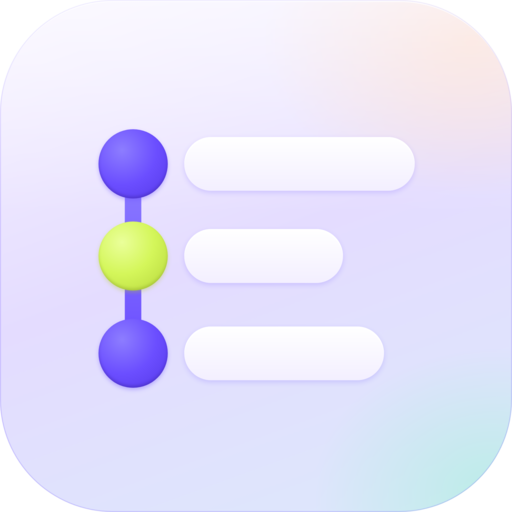
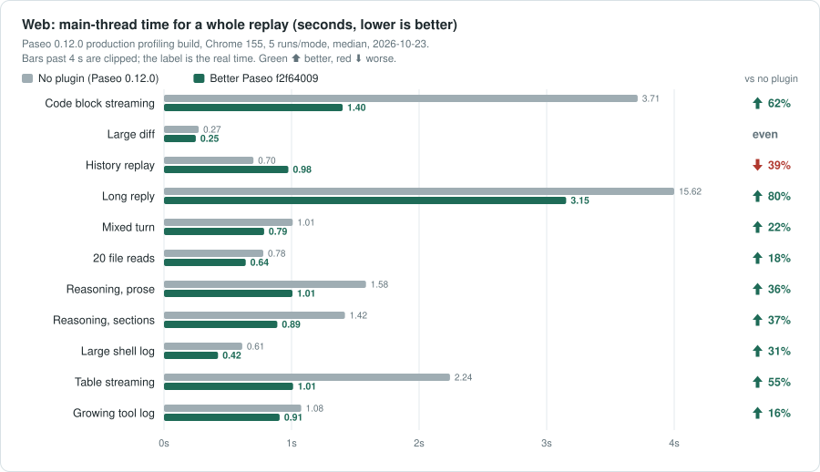

# Better Paseo

**English** | [简体中文](README-zh.md)

A [Paseo](https://paseo.sh) plugin that redraws the chat timeline of every agent Paseo runs,
whichever provider is behind it (Claude Code, Codex, Oh My Pi and the rest): tool calls, reasoning,
replies, prompts, checklists and errors become compact, typed, syntax-aware rows that follow the
active Paseo theme. It adds a **Tasks** board that lays out every agent on the host in lanes by state,
and it is drawn for the device in your hand: a phone gets a details drawer you can pinch and a
one-lane board you swipe through, an iPad gets floating and side panels and a board with a details
sidebar or sheet. The performance section compares timeline performance against native Paseo, with full measurements in [Performance Benchmarks](docs/performance.md).

https://github.com/user-attachments/assets/493499a2-411f-45bb-9274-d33c92255099

No player in the GitHub app? [Open the timeline video](https://github.com/RoundRedDot/better-paseo/releases/download/media-assets/better-paseo-promo-v14-timeline-web.mp4).

https://github.com/user-attachments/assets/afe5505c-d5da-4418-bd78-3cbcb44ef790

No player in the GitHub app? [Open the tasks video](https://github.com/RoundRedDot/better-paseo/releases/download/media-assets/better-paseo-promo-v14-tasks-web.mp4).

<picture><source media="(prefers-color-scheme: dark)" srcset="https://github.com/RoundRedDot/better-paseo/releases/download/media-assets/media--images--tasks-board-dark.png"></picture>
<picture><source media="(prefers-color-scheme: dark)" srcset="https://github.com/RoundRedDot/better-paseo/releases/download/media-assets/media--images--timeline-dark.png"></picture>

> Better Paseo is a fork of [ABorakati/beautiful-chat](https://github.com/ABorakati/beautiful-chat),
> continued from `42b61d8` (2026-09-23). It keeps Beautiful Chat's cards except the Eval, Ask,
> Task and approval cards, which current Paseo never feeds a plugin (see
> [Known Limitations](docs/limitations.md)). This README describes what the fork adds and how it performs.

> **Requirement:** Requires Paseo `>=0.14.0`. Install via `paseo plugin install roundreddot/better-paseo` (see [Installation Guide](docs/install.md)).

## Highlights

- **Made for phones and iPad.** A tap on a row opens it in a bottom drawer on a phone, where two
  fingers set the text size, and in a floating or side panel on an iPad. The Tasks board shows one
  lane at a time on a phone and lanes with a details sidebar, panel or sheet on a tablet. See
  [Phones and iPad](#phones-and-ipad).

- **Measured performance.** Against Paseo 0.13.0, 220 serial Web and iOS replays (five runs per cell) show 66% less Web main-thread time on the long reply, 16.189 seconds down to 5.520. Details in [Performance](#performance) and [full benchmarks](docs/performance.md).

- **One row per tool call.** Calls start collapsed to a 26pt row with a typed summary and stay
  open or closed across completion, history and remounts.
- **An icon for every tool.** Shell rows draw the program they run (101 icons for 209 programs,
  from `python` to `kubectl`), MCP rows the service they call (75 services, from Linear to Feishu)
  and other calls their kind. See [Tool icons](#tool-icons).
- **Block details.** Read any tool, thought, checklist or code block in a panel, step through the
  turn's blocks from its header, and follow a streaming block's tail. See
  [Block details](#block-details).
- **Block-by-block streaming replies.** Finished Markdown blocks are cached while growing code and
  tables are repaired.
- **Tasks board.** Every agent on the host by state (waiting, running, to review, done and
  archived), with Paseo's label colours and project icons, Stop, Mark as read, Archive and
  permission buttons on the card, and a details view with the running turn's clock and tokens, the
  first prompt, the last reply, subtasks and usage. See [Tasks board](#tasks-board).
- **Follows Paseo.** Fonts, sizes, colours and language follow the host by default; settings are
  stored on the daemon and shared by desktop, web, iOS and Android.
- **Light on reconnect.** The client ships minified and the Tasks board loads only when it is on,
  so the plugin catalog Paseo sends on every reconnect fell from 1,977 KB to 722 KB (measured on a
  Paseo 0.12 daemon when the change landed, 2026-10-23).

---

## Phones and iPad

Paseo runs the same plugin on desktop, web, iOS and Android. Better Paseo does not scale a desktop
layout down; each surface picks its form from the device and the room it has.

**Finger or pointer.** The plugin asks the device, not the platform name, because Electron and
phone Safari both report "web". On web a fine pointer that can hover counts as a pointer and a
coarse one as touch; a laptop with a touch screen counts as both. On iOS and Android every screen
is touch, and the first time a trackpad or mouse hovers a row (an iPad with a Magic Keyboard), the
plugin treats that session as having a pointer as well.

| | Phone | iPad and Android tablets | Desktop and web |
| --- | --- | --- | --- |
| Tool rows | 28pt, 44pt press target | 26pt, 44pt press target | 26pt |
| Press a row | opens its [details](#block-details); the icon at the row's start expands it | same; with a trackpad a click expands it | expands it; details from the hover preview or row menu |
| Long press or right-click | row menu: copies, view image, open details, expand | same | right-click opens the row menu |
| Block details | bottom drawer with pinch-to-size text | floating panel up to 760pt, or a side panel on a wide screen | floating or side panel; a drawer in a narrow window |
| Tasks board | one lane at a time, swiped or picked from tabs with lane counts; a tap opens a details sheet | lanes side by side, each card's buttons always shown; details in a sidebar, floating panel or bottom sheet by board width | as a tablet, with the buttons on hover, a right-click menu, double-click and keyboard |
| Hover previews | long-press preview when block details are off | same | hover any collapsed row or path |

### On a phone

- **Rows that fit a thumb.** Tool rows are 28pt in Paseo's compact layout, with summaries cut for
  the narrower column; each row's press target extends to 44pt. A tap opens the row's details, a
  tap on its icon expands it in place, and the header stays where you pressed it while the body
  opens below.
- **A drawer you can pinch.** Block details rise as a bottom drawer that fits its content (up to
  58% of the screen) and pulls up to full height from its handle. Pinch the body with two fingers
  to make the text smaller or larger, from 4pt below the timeline's body size to 10pt above it;
  prose and code change together, the line under your fingers stays put, and a **Text size**
  badge with **Reset** shows while you pinch. The size is saved on the daemon, so every phone on
  that host reads with it. Swipe the header sideways to step to the previous or next block.
- **Sideways, where the screen turns.** Paseo's iOS and Android apps keep a phone in portrait
  (`orientation: "portrait"` in Paseo 0.13's app config). In a phone browser turned sideways, or any
  window at least 600pt wide and under 500pt tall, the details move to a 400pt side panel so the
  timeline stays readable beside them.
- **Selection by touch.** On iOS a long press in a reply places a cursor and drags a selection.
  In a table, double-tap a cell to select it, or hold a cell and drag across rows and columns to
  select a block of cells; the copy menu appears when you lift.
- **Images.** The full-screen viewer pinches about your fingers from a quarter to eight times,
  pans when zoomed, resets on a double tap and closes on a drag up or down. Its file button reads
  **Copy path** and copies the file's absolute path, since the file lives on the daemon's machine.
- **Tasks in one hand.** The board shows one lane at a time under tabs with each lane's count
  (Input, Running, Review, Done and, while the archived lane is on, Archived); swipe or tap to
  switch. The lanes are native pages, so past the first lane a sideways swipe changes lane instead
  of opening Paseo's agent list. A card ends in its buttons, with Open last at the right. A tap opens
  a details sheet that steps through the lane's cards, with Open or Open to answer and Stop or
  Archive, or Deny and Allow, pinned at the bottom; Stop asks in the system dialog first. The header
  keeps search and the archived-lane switch plus Filters; the filter sheet holds the empty-groups
  and subtasks switches, agents, labels, the done window and the sort, and ends with the workspaces
  under a search field. Reset and "Show N tasks" stay pinned at its foot.

| Timeline | Block details drawer, mid-pinch | Tasks board |
| --- | --- | --- |
| <picture><source media="(prefers-color-scheme: dark)" srcset="https://github.com/RoundRedDot/better-paseo/releases/download/media-assets/media--images--mobile-timeline-dark.png"></picture> | <picture><source media="(prefers-color-scheme: dark)" srcset="https://github.com/RoundRedDot/better-paseo/releases/download/media-assets/media--images--mobile-details-drawer-dark.png"></picture> | <picture><source media="(prefers-color-scheme: dark)" srcset="https://github.com/RoundRedDot/better-paseo/releases/download/media-assets/media--images--mobile-tasks-dark.png"></picture> |
| **A running card's details** | **A waiting card's details** | **Filters** |
| <picture><source media="(prefers-color-scheme: dark)" srcset="https://github.com/RoundRedDot/better-paseo/releases/download/media-assets/media--images--mobile-tasks-sheet-dark.png"></picture> | <picture><source media="(prefers-color-scheme: dark)" srcset="https://github.com/RoundRedDot/better-paseo/releases/download/media-assets/media--images--mobile-tasks-sheet-input-dark.png"></picture> | <picture><source media="(prefers-color-scheme: dark)" srcset="https://github.com/RoundRedDot/better-paseo/releases/download/media-assets/media--images--mobile-tasks-filters-dark.png"></picture> |

### On iPad

- **Panels instead of a drawer.** From 600pt wide the details open as a floating panel centred over
  the chat, up to 760pt wide; from 960pt, when the chat keeps at least 400pt beside it, as a side
  panel 36% of the window wide (420–640pt). On the simulator an 11-inch iPad gets the floating panel
  in portrait and the side panel in landscape, and a 13-inch iPad gets the side panel already in
  portrait; by the same thresholds a Split View window under 600pt falls back to the drawer. Paseo hands plugins only full-screen modals on
  iOS and Android, so a tap outside the panel closes it (see
  [What a plugin cannot do](docs/limitations.md)).
- **Touch sizes, then pointer sizes.** The details header is 52pt with 36pt buttons and the toolbar
  44pt while you use your fingers. Once a trackpad hovers a row, they shrink to the desktop's 44pt
  and 36pt, a click expands a row in place, and the row's hover actions appear; long press still
  works.
- **A board that keeps its lanes.** The Tasks board keeps the desktop layout on a tablet. With no
  hover to reveal them, every card shows its buttons in a row under its timer: Stop, Mark as read or
  Archive, then Open at the right; a subtask with an openable parent also has Open parent; Stop asks
  in the system dialog. A tap chooses a card for the details. Where the details go depends on the
  board's width: a sidebar beside
  the lanes from 1,020pt (a 13-inch iPad in landscape), a floating panel over them from 784pt, and
  under 760pt (an 11- or 13-inch iPad in portrait with Paseo's sidebar open) a bottom sheet that
  leaves the lanes live. The sheet
  opens at half height, pulls to full, and lays the card out in two columns from 640pt. Below 760pt
  the board's header keeps search and the archived-lane switch, and folds the empty-groups switch,
  filters, done window, sort, subtasks switch and lane width into a sheet; the lanes keep their
  width and scroll sideways, from their headers and the gaps between cards as well as from the
  cards.

| 11-inch, portrait: floating panel | 11-inch, landscape: side panel |
| --- | --- |
| <picture><source media="(prefers-color-scheme: dark)" srcset="https://github.com/RoundRedDot/better-paseo/releases/download/media-assets/media--images--ipad-details-floating-dark.png"></picture> | <picture><source media="(prefers-color-scheme: dark)" srcset="https://github.com/RoundRedDot/better-paseo/releases/download/media-assets/media--images--ipad-details-side-dark.png"></picture> |

| 13-inch, landscape: Tasks with the details sidebar | 13-inch, portrait: Tasks with the details sheet |
| --- | --- |
| <picture><source media="(prefers-color-scheme: dark)" srcset="https://github.com/RoundRedDot/better-paseo/releases/download/media-assets/media--images--ipad-tasks-dark.png"></picture> | <picture><source media="(prefers-color-scheme: dark)" srcset="https://github.com/RoundRedDot/better-paseo/releases/download/media-assets/media--images--ipad-tasks-sheet-dark.png"></picture> |

Keyboard shortcuts, the desktop hover preview, Command-click table ranges, and the board's
double-click and right-click menu are web and desktop only; an iPad with a keyboard does not get
them.

---

## Performance

Tested revision `948b8720` against Paseo 0.13.0 on a Mac Studio (Apple M5 Max, 18 cores, 64 GB, macOS 27.0.1) across 220 serial replays in 11 scenarios; measurements have not been repeated on 0.14.0 (iOS tests conducted on simulator and do not establish physical-device performance):

- **66% less Web main-thread task time on long replies:** Whole-replay task duration dropped from 16.189s to 5.520s; across 11 scenarios, 9 improved, 1 was even, and 1 was higher.
- **95% less Web timeline-row render time on long replies:** Host React Profiler row render time dropped from 8,887.4ms to 438.7ms.
- **Web history replay overhead:** Main-thread task time increased by 37% (1.075s vs 0.784s; fresh arrays on host agent updates are [one known source](docs/performance.md#method-and-limits)).
- **Streaming layout shift (CLS):** Long reply CLS dropped 100% (0.000015 vs 0.053955); across 11 scenarios, 2 improved, 3 were even, and 6 had regressions (Better Paseo absolute readings remain at or below 0.031).
- **iOS whole-app CPU time:** Dropped 54% on long replies (11.76s vs 25.56s, with frame drops down from 894 to 15); across 11 scenarios, 4 improved, 6 were even, and 1 was higher.
- **Measured memory:** Across the Web scenarios, Better Paseo uses 5.1–13.2 MB more post-GC JavaScript heap than no plugin.

### Where the time goes

- **Skip unchanged rows.** Semantic theme and data comparisons let unchanged cards skip rendering entirely.
- **Parse replies incrementally.** Finished Markdown blocks are cached; only the growing tail is repaired during streaming. Long replies split into blocks that the native host can virtualize; Copy retains full source.
- **Draw tool bodies on demand.** Collapsed rows do not mount their bodies. Completed code requests daemon highlighting; large code and terminal output render in batches with a Show all control.
- **Reduce continuous animation work.** The Web running dot uses CSS and stops for Reduced Motion; decorative shadows, blur and breathing loops are removed.
- **Send less on reconnect.** The client ships minified and the Tasks board loads only when enabled (cutting reconnect catalog payload from 1,977 KB to 722 KB on a Paseo 0.12 daemon). Brand marks and Inter are delivered on demand, and client source stays ASCII for Hermes one-byte strings.

> [!NOTE]
> For complete measurement methodology, testing conditions, simulator limits, and full 11-scenario comparison tables for Web, iOS, CLS, and JavaScript heap, see the dedicated [Performance Benchmarks](docs/performance.md) documentation.

---

## Timeline

The cover shows `d53fe171`, a development revision after 1.5.5, in the Paseo 0.15.4 web app;
its phone-sized timeline is also the web app, not a native iOS screenshot. Other screenshots were
taken on 2026-10-26 and 27. The desktop board and timeline shots come from `948b8720` on Paseo
0.13.0's web app; the phone and iPad shots were taken or rechecked at
`8802deb8` on Paseo 0.13.0 Release builds on iOS 26.5 simulators (iPhone 17 Pro, 11-inch and
13-inch iPad). `948b8720..8802deb8` changes only the phone search and filter sheet, which the
desktop shots do not show. Card and setting screenshots come from the offline Web showcase and were
rechecked at `948b8720`; where nothing had changed, the earlier capture was kept. All data is
sample fixture data. The other screenshots default to light
and switches to dark with the reader's theme. Performance versions and conditions are identified in [Performance](#performance) (full details in [Performance Benchmarks](docs/performance.md)).

Everything below is on top of what Beautiful Chat already drew: typed tool cards, Shiki
highlighting, image reads, opening files and the plugin's own find bar.

<picture><source media="(prefers-color-scheme: dark)" srcset="https://github.com/RoundRedDot/better-paseo/releases/download/media-assets/media--images--thread-dark.png"></picture>

### Tool rows

Most cards read the tool detail Paseo hands every plugin, so they work whichever agent made the
call: reads, writes, edits, shell and Git commands, searches, fetches, sub-agents, plans, MCP calls
(in Claude's `mcp__server__tool`, Codex's `server.tool` and Oh My Pi's `server / tool` forms) and
Paseo's own tools. Calls Paseo passes as plain text get a label-and-text card.

Oh My Pi's `hub` tool and its GitHub device calls are matched by name and have cards of their
own; no other agent sends them. On Paseo 0.11 and later, Oh My Pi's `eval` and `ask` calls reach
plugins as plain text and `task` arrives as a sub-agent item. If `ask` also carries structured
`questions` data, it gets a question transcript; otherwise it stays a generic text card.

- Every call starts as one borderless row with a summary built for its type: the command, the path
  and line range, `+4 −2` for an edit, the exit code and duration. The row is 26pt, 28pt in
  Paseo's compact phone layout, and grows with **Block text size**. With a pointer a click expands
  the card in place; on a touch screen a tap opens its [details](#block-details), and a tap on the
  icon at the row's start expands it.
- The open or closed state is kept per call (`agentId:callId`) outside the component, so it
  survives completion, scrolling into history and remounts. On iOS and Android the header stays
  where it was pressed and the content opens below it.
- A failed call shows a one-line error; with **Open failed calls** on, it starts expanded unless
  the reader has already chosen its open or closed state.
- Rows keep the time they first appeared, so parallel reads no longer reorder or change spacing
  when one finishes first.
- Row heads show an icon, a label or both. Long code and terminal output fold to 12 lines.
- **Block text size** changes prose in tool, thought, checklist and notice rows; code, diffs and
  terminal output keep their code font size.
- Paseo's own tools carry the Paseo mark; agent cards and reply footers use the agent's provider
  mark, independently of the selected model.
- Every op of Oh My Pi's `hub` tool has a card: processes, messages and job snapshots. The cards
  report; they carry no buttons, since a plugin cannot restart or cancel anything.
- Across agents, recognized question calls with structured `questions` data render as paginated
  transcripts with choices, recorded answers and status. **Show raw data** reveals the payload;
  the transcript is read-only, and Paseo still handles answers. Questions stay wrapped in previews
  for readability.
- When a background sub-agent from an earlier turn keeps reporting, Paseo 0.12 can append a second
  copy of a tool row; the plugin hides such copies (see
  [Paseo issues the plugin works around](docs/limitations.md#paseo-issues-the-plugin-works-around)).

<picture><source media="(prefers-color-scheme: dark)" srcset="https://github.com/RoundRedDot/better-paseo/releases/download/media-assets/media--docs--images--questions-dark.png"></picture>

| Shell and Git | Read |
| --- | --- |
| <picture><source media="(prefers-color-scheme: dark)" srcset="https://github.com/RoundRedDot/better-paseo/releases/download/media-assets/media--docs--images--tool-bash-dark.png"></picture> | <picture><source media="(prefers-color-scheme: dark)" srcset="https://github.com/RoundRedDot/better-paseo/releases/download/media-assets/media--docs--images--tool-read-dark.png"></picture> |
| **Edit** | **Hub** (Oh My Pi) |
| <picture><source media="(prefers-color-scheme: dark)" srcset="https://github.com/RoundRedDot/better-paseo/releases/download/media-assets/media--docs--images--tool-edit-dark.png"></picture> | <picture><source media="(prefers-color-scheme: dark)" srcset="https://github.com/RoundRedDot/better-paseo/releases/download/media-assets/media--docs--images--hub-dark.png"></picture> |

More cards: MCP, Paseo tools, image read, syntax block, a <code>thinking</code> tool

<picture><source media="(prefers-color-scheme: dark)" srcset="https://github.com/RoundRedDot/better-paseo/releases/download/media-assets/media--docs--images--tool-mcp-dark.png"></picture>
<picture><source media="(prefers-color-scheme: dark)" srcset="https://github.com/RoundRedDot/better-paseo/releases/download/media-assets/media--docs--images--paseo-dark.png"></picture>
<picture><source media="(prefers-color-scheme: dark)" srcset="https://github.com/RoundRedDot/better-paseo/releases/download/media-assets/media--docs--images--tool-thinking-dark.png"></picture>
<picture><source media="(prefers-color-scheme: dark)" srcset="https://github.com/RoundRedDot/better-paseo/releases/download/media-assets/media--docs--images--tool-image-dark.png"></picture>
<picture><source media="(prefers-color-scheme: dark)" srcset="https://github.com/RoundRedDot/better-paseo/releases/download/media-assets/media--docs--images--syntax-dark.png"></picture>

### Tool icons

<picture><source media="(prefers-color-scheme: dark)" srcset="https://github.com/RoundRedDot/better-paseo/releases/download/media-assets/media--docs--images--tool-icons-dark.png"></picture>

Captured on 2026-10-25 from `2490d376` in the offline Web showcase, at 2x. Every icon in it comes
from the plugin's own lookups, so a name the plugin does not know would fail the capture.

The icon at the start of a tool row says what the call works on, not only which tool made it:

- **Shell commands draw the program they run**: 101 icons for 209 programs, from `python` and
  `cargo` to `kubectl`, `xcrun simctl` and `ffmpeg`. The plugin reads past shell setup and wrappers
  (`cd app &&`, `sudo`, `env`, `FOO=1`), drops version suffixes and `.exe` (`python3.12` is
  `python`, `pip3` is `pip`), and a runner draws the program it fetches when that one has an icon
  (`npx playwright test` draws Playwright). Coding agents started from the shell (`claude`,
  `codex`, `gemini` and the rest) draw the same provider mark as their agent rows. A program it
  does not know keeps the terminal icon.
- **MCP calls draw the service they call**: 75 services, matched by the server's name with case and
  separators dropped, so Claude's connectors (`claude_ai_Google_Calendar`), local servers
  (`linear-server`, `mcp-server-git`) and the Codex and Oh My Pi forms all match. Atlassian's
  server draws Confluence for its `confluence_*` tools and Jira for the rest. An unknown server
  keeps the plug.
- **Everything else draws its kind**: shell, read, edit and write, search, fetch, Git, GitHub,
  sub-agent, MCP, plan, thinking, question, Oh My Pi's hub, Paseo, plain text and a wrench for the
  rest.
- Brand marks are line drawings in the row's icon colour, matched to the 1.5 stroke of Paseo's own Lucide
  icons, so a turn that mixes tools still reads as one icon set. The daemon serves each mark the
  first time a row needs it, so their image data stays out of the client bundle Paseo resends on
  every reconnect.
- **Row icons and labels** in settings shows the icon, the tool's label or both.

All 209 shell programs and their icons

| Group | Icon | Programs |
| --- | --- | --- |
| Languages and runtimes | Python mark | `python` `pip` `uv` `uvx` `poetry` `pytest` `ipython` `conda` `pipx` `ruff` `mypy` |
|  | Node.js mark | `node` |
|  | Deno mark | `deno` |
|  | Bun mark | `bun` `bunx` |
|  | TypeScript mark | `tsc` `tsx` `ts-node` |
|  | Lucide `Coffee` | `java` `javac` `jar` `mvn` `mvnw` `gradle` `gradlew` |
|  | Kotlin mark | `kotlin` `kotlinc` |
|  | Go mark | `go` `gofmt` |
|  | Rust mark | `cargo` `rustc` `rustup` |
|  | Lucide `Gem` | `ruby` `gem` `bundle` `bundler` `rake` `rails` `irb` |
|  | PHP mark | `php` `composer` |
|  | Swift mark | `swift` `swiftc` |
|  | C++ mark | `gcc` `g++` `clang` `clang++` `cmake` |
|  | C# mark | `dotnet` |
|  | Flutter mark | `flutter` `dart` |
|  | PowerShell mark | `pwsh` `powershell` |
| Packages and build | npm mark | `npm` `npx` |
|  | pnpm mark | `pnpm` `pnpx` |
|  | Yarn mark | `yarn` |
|  | Lucide `Beer` | `brew` |
|  | Lucide `Hammer` | `make` |
|  | Vite mark | `vite` |
|  | webpack mark | `webpack` `webpack-cli` |
|  | Turborepo mark | `turbo` |
| Front end and frameworks | ESLint mark | `eslint` |
|  | Prettier mark | `prettier` |
|  | Next.js mark | `next` |
|  | Nuxt mark | `nuxt` `nuxi` |
|  | Angular mark | `ng` |
|  | Astro mark | `astro` |
|  | Svelte mark | `sv` `svelte-kit` |
|  | Vue mark | `vue` |
|  | Tailwind CSS mark | `tailwindcss` |
|  | React Native mark | `react-native` |
|  | Expo mark | `expo` `eas` |
|  | Lucide `Atom` | `electron` `electron-builder` `electron-forge` |
|  | Django mark | `django-admin` |
|  | Laravel mark | `laravel` |
|  | Jupyter mark | `jupyter` `jupyter-lab` `jupyter-notebook` |
| Tests and browsers | Vitest mark | `vitest` |
|  | Lucide `FlaskConical` | `jest` `mocha` |
|  | Playwright mark | `playwright` |
|  | Puppeteer mark | `puppeteer` |
|  | Cypress mark | `cypress` |
|  | Storybook mark | `storybook` |
|  | Chrome mark | `google-chrome` `google-chrome-stable` `chrome` `chromium` `chromium-browser` |
|  | Postman mark | `postman` `newman` |
| Apple and Android | Apple mark | `xcodebuild` `xcrun` `pod` |
|  | Lucide `Smartphone` | `simctl` `serve-sim` `ios-deploy` |
|  | Android mark | `adb` `emulator` `avdmanager` `sdkmanager` |
| Cloud and deploy | AWS mark | `aws` |
|  | Google Cloud mark | `gcloud` `gsutil` |
|  | Azure mark | `az` |
|  | Vercel mark | `vercel` |
|  | Cloudflare mark | `wrangler` |
|  | Supabase mark | `supabase` |
|  | Firebase mark | `firebase` |
|  | Netlify mark | `netlify` `ntl` |
|  | Heroku mark | `heroku` |
|  | Stripe mark | `stripe` |
| Containers and infrastructure | Docker mark | `docker` `docker-compose` |
|  | Lucide `Container` | `podman` `podman-compose` |
|  | Lucide `ShipWheel` | `kubectl` `helm` `minikube` `kind` `k9s` |
|  | Terraform mark | `terraform` |
|  | Ansible mark | `ansible` `ansible-playbook` `ansible-galaxy` `ansible-vault` `ansible-inventory` |
|  | Nginx mark | `nginx` |
|  | Lucide `Server` | `ssh` `scp` `sftp` `rsync` `mosh` |
| Data | PostgreSQL mark | `psql` `pg_dump` `pg_restore` |
|  | MySQL mark | `mysql` `mysqldump` |
|  | MongoDB mark | `mongosh` `mongo` |
|  | Lucide `Feather` | `sqlite` |
|  | Redis mark | `redis-cli` `redis-server` |
|  | Kafka mark | `kcat` `kafkacat` `kafka-topics.sh` `kafka-console-consumer.sh` `kafka-console-producer.sh` |
|  | Prisma mark | `prisma` |
| CI and monitoring | Jenkins mark | `jenkins` `jenkins-cli` |
|  | CircleCI mark | `circleci` |
|  | SonarQube mark | `sonar-scanner` |
|  | Grafana mark | `grafana` `grafana-cli` |
|  | Prometheus mark | `prometheus` `promtool` |
|  | Lucide `Dog` | `datadog-ci` |
|  | Jira mark | `jira` |
| Code hosting, agents and editors | GitHub mark | `gh` |
|  | GitLab mark | `glab` |
|  | Paseo mark | `paseo` |
|  | Claude provider mark | `claude` |
|  | Codex provider mark | `codex` |
|  | Gemini provider mark | `gemini` |
|  | OpenCode provider mark | `opencode` |
|  | Cursor provider mark | `cursor-agent` |
|  | Copilot provider mark | `copilot` |
|  | Ollama provider mark | `ollama` |
|  | Oh My Pi provider mark | `omp` |
|  | VS Code mark | `code` |
|  | Vim mark | `vim` `vi` `gvim` |
| Utilities | Lucide `Globe` | `curl` `wget` `http` `xh` |
|  | Lucide `Search` | `rg` `grep` `find` `fd` `ag` |
|  | Lucide `Braces` | `jq` `yq` |
|  | Lucide `FileDiff` | `diff` `colordiff` `difft` |
|  | Lucide `Archive` | `tar` `zip` `unzip` `gzip` `gunzip` `7z` `xz` |
|  | Lucide `Clapperboard` | `ffmpeg` `ffprobe` |
|  | Lucide `ExternalLink` | `open` `xdg-open` |

All 75 MCP services and their icons

The name is lower-cased and stripped of everything but letters and digits before it is matched,
so `Google_Calendar`, `google-calendar` and `googlecalendar` are the same name. A name matches
when it contains the listed word; a word with `*` only matches at the start, and Git and Time match
only their whole names, so `github` and `timeline` stay out.

| Group | Service | Icon | Server names it matches |
| --- | --- | --- | --- |
| Code and CI | GitHub | GitHub mark | `github` |
|  | GitLab | GitLab mark | `gitlab` |
|  | Git | Lucide `GitBranch` | `git`, `mcp-server-git`, `git-mcp` |
|  | Gitee | Gitee mark | `gitee` |
|  | Bitbucket | Bitbucket mark | `bitbucket` |
|  | Jenkins | Jenkins mark | `jenkins` |
|  | CircleCI | CircleCI mark | `circleci` |
|  | SonarQube | SonarQube mark | `sonar` |
|  | Ansible | Ansible mark | `ansible` |
| Work and docs | Linear | Linear mark | `linear` |
|  | Jira | Jira mark | `jira`, `atlassian` |
|  | Confluence | Confluence mark | `confluence`; Atlassian tools named `confluence_*` |
|  | Notion | Notion mark | `notion` |
|  | Trello | Trello mark | `trello` |
|  | Asana | Asana mark | `asana` |
|  | Airtable | Airtable mark | `airtable` |
|  | Figma | Figma mark | `figma` |
|  | Sentry | Sentry mark | `sentry` |
| Chat and mail | Slack | Slack mark | `slack` |
|  | Feishu / Lark | Feishu mark | `feishu`, `lark` |
|  | DingTalk | DingTalk mark | `dingtalk`, `dingding` |
|  | WeCom | WeCom mark | `wecom`, `wework`, `wechatwork`, `qywx` |
|  | Microsoft Teams | Teams mark | `teams` |
|  | Discord | Discord mark | `discord` |
|  | Telegram | Telegram mark | `telegram` |
|  | Gmail | Gmail mark | `gmail` |
|  | Zapier | Zapier mark | `zapier` |
| Google | Google Calendar | Google Calendar mark | `googlecalendar`, `gcal` |
|  | Google Drive | Google Drive mark | `googledrive`, `gdrive` |
|  | Google Maps | Google Maps mark | `googlemaps`, `gmaps` |
|  | YouTube | YouTube mark | `youtube` |
| Browsers and devices | Chrome | Chrome mark | `chrome` |
|  | Playwright | Playwright mark | `playwright` |
|  | Puppeteer | Puppeteer mark | `puppeteer` |
|  | Browserbase, browser-use | Lucide `AppWindow` | `browserbase`, `browseruse`, `browsermcp`, `browsertools` |
|  | iOS Simulator | Lucide `Smartphone` | `iossimulator`, `simulator`, `simctl`, `servesim`, `mobile*` |
|  | Xcode | Apple mark | `xcode` |
|  | Android | Android mark | `android`, `adb` |
|  | Computer use | Lucide `MousePointer2` | `computeruse`, `cuadriver` |
|  | Desktop Commander | Lucide `SquareTerminal` | `desktopcommander` |
| Cloud and data | AWS | AWS mark | `aws`, `bedrock` |
|  | Docker | Docker mark | `docker` |
|  | Kubernetes | Lucide `ShipWheel` | `kubernetes`, `k8s`, `kubectl` |
|  | Terraform | Terraform mark | `terraform` |
|  | Vercel | Vercel mark | `vercel` |
|  | Cloudflare | Cloudflare mark | `cloudflare` |
|  | Supabase | Supabase mark | `supabase` |
|  | Firebase | Firebase mark | `firebase` |
|  | Netlify | Netlify mark | `netlify` |
|  | Heroku | Heroku mark | `heroku` |
|  | Stripe | Stripe mark | `stripe` |
|  | PostgreSQL | PostgreSQL mark | `postgres` |
|  | MySQL | MySQL mark | `mysql` |
|  | MongoDB | MongoDB mark | `mongo` |
|  | SQLite | Lucide `Feather` | `sqlite` |
|  | Redis | Redis mark | `redis` |
|  | Kafka | Kafka mark | `kafka` |
|  | Elastic | Elastic mark | `elastic`, `kibana` |
| Monitoring | Grafana | Grafana mark | `grafana` |
|  | Prometheus | Prometheus mark | `prometheus` |
|  | Datadog | Lucide `Dog` | `datadog` |
|  | Postman | Postman mark | `postman` |
| Search and utilities | Brave Search | Brave mark | `brave` |
|  | Perplexity | Perplexity mark | `perplexity` |
|  | Tavily, Serper, SearXNG, Kagi, Exa | Lucide `Search` | `tavily`, `serper`, `searxng`, `kagi`, `exa*` |
|  | Fetch, Firecrawl | Lucide `Globe` | `fetch`, `firecrawl` |
|  | Context7 | Lucide `LibraryBig` | `context7` |
|  | Memory | Lucide `BrainCircuit` | `memory` |
|  | Sequential Thinking | Lucide `Lightbulb` | `sequentialthinking` |
|  | Time | Lucide `Clock` | `time`, `mcp-server-time`, `time-mcp` |
|  | Filesystem | Lucide `FolderOpen` | `filesystem` |
|  | EverArt | Lucide `Palette` | `everart` |
|  | Everything | Lucide `Blocks` | `everything` |
|  | OpenAI | OpenAI mark | `openai` |
|  | Paseo | Paseo mark | `paseo*` |

The 16 tool kinds

| Kind | Icon |
| --- | --- |
| Shell (`bash`, `shell`) | Lucide `SquareTerminal`, or the program's icon |
| Read | Lucide `FileText` |
| Edit, Write | Lucide `Pencil` |
| Search | Lucide `Search` |
| Fetch | Lucide `Globe` |
| Git, worktree setup | Lucide `GitBranch` |
| GitHub | GitHub mark |
| Sub-agent | Lucide `Bot`, or the agent's provider mark on agent rows |
| MCP | Lucide `Plug`, or the service's icon |
| Plan | Lucide `ListChecks` |
| Thinking | Lucide `Lightbulb` |
| Question | Lucide `MessageCircleQuestion` |
| Hub (Oh My Pi) | Lucide `Radio` |
| Paseo | Paseo mark |
| Plain text | Lucide `MessageSquare` |
| Anything else | Lucide `Wrench` |

### Reasoning and checklists

- Reasoning is split only on real structure (`**Title**` and headings), not on blank lines. It is
  collapsed by default, and while it streams the row previews the current heading.
- Durations are shown only when this client actually watched the reasoning stream; nothing is
  estimated.
- Checklists show the phase, per-task status, durations, and a blocked task with its reason. A
  progress ring tracks completed tasks and becomes a check when all are done. The header's window
  button opens the live checklist in a panel that stays open as you use the timeline and follows the
  newest list; long titles can wrap there.

<picture><source media="(prefers-color-scheme: dark)" srcset="https://github.com/RoundRedDot/better-paseo/releases/download/media-assets/media--docs--images--reasoning-dark.png"></picture>
<picture><source media="(prefers-color-scheme: dark)" srcset="https://github.com/RoundRedDot/better-paseo/releases/download/media-assets/media--docs--images--tasks-dark.png"></picture>
<picture><source media="(prefers-color-scheme: dark)" srcset="https://github.com/RoundRedDot/better-paseo/releases/download/media-assets/media--docs--images--checklist-window-dark.png"></picture>

### Replies

- Markdown is drawn by the plugin with headings, lists, task lists, quotes, highlighted code blocks
  and local images. Three styles: **Document**, **Compact** and **Terminal**.
- Unlabelled, Markdown and plain-text code fences can open a maximized preview window. Switch
  between rendered Markdown and raw text, copy the source, and use **Wrap lines** in raw-text mode.
  The window stays separate from the compact reply.
- Tables have column rules, a header fill and a rounded frame; cells are a size smaller with tighter
  lines, and column widths account for tabular digits and CJK width.
- Every table has a copy control at its top-left corner. On web and desktop, hovering it (or a
  long press on a touch screen) opens **Copy as Markdown** and **Copy as image**, a picture of the
  table as drawn; a plain press copies the Markdown. On iOS and Android it copies the Markdown.
- On web and desktop, double-click a cell to select its text. On iOS and Android, double-tap a cell.
  To select a block of cells, hold a cell and drag across rows and columns; with a mouse, dragging
  from one cell into another works too. On web and desktop, hold Command (Ctrl on Windows and
  Linux) and press or drag across cells to add another range without dropping the ones already
  selected; every range then takes the columns of the one drawn last. The menu appears on release:
  one cell copies its text, several copy a Markdown table of the selected rows and columns, in table
  order, under their header. The corner menu always offers
  **Copy selected**, and **Add to chat** where Paseo lets the plugin write into the composer.
- Each completed turn has a footer under its final reply with Copy and its time, plus the provider
  mark, model, thinking level and observed duration when available. Hover or long-press it for a
  **Turn details** table: agent, model, thinking level, start, end, elapsed time and input, cached
  and output tokens. The model name copies when pressed and confirms with a toast; completed-turn
  footers remain during a later run. Turn **Plugin markdown for replies** off to restore Paseo's
  full footer, including its Fork action.
- Every local image in a reply is drawn, not only the first.
- Completed `mermaid` code blocks use Paseo’s diagram renderer, including its source and
  fullscreen controls. The plugin shows source while an unfinished fence is streaming.
- Turn **Plugin markdown for replies** off for Paseo’s own images and file links.

| Table copy menu | Selected cell actions |
| --- | --- |
| <picture><source media="(prefers-color-scheme: dark)" srcset="https://github.com/RoundRedDot/better-paseo/releases/download/media-assets/media--docs--images--table-copy-menu-dark.png"></picture> | <picture><source media="(prefers-color-scheme: dark)" srcset="https://github.com/RoundRedDot/better-paseo/releases/download/media-assets/media--docs--images--table-selection-dark.png"></picture> |

<picture><source media="(prefers-color-scheme: dark)" srcset="https://github.com/RoundRedDot/better-paseo/releases/download/media-assets/media--docs--images--markdown-styles-dark.png"></picture>
<picture><source media="(prefers-color-scheme: dark)" srcset="https://github.com/RoundRedDot/better-paseo/releases/download/media-assets/media--docs--images--markdown-preview-window-dark.png"></picture>

### Images

- An image read draws the file: dimensions and size from its header, a thumbnail sized to its
  content, and an eye toggle that keeps the header where it was pressed.
- The full-screen viewer zooms from 0.25× to 8× with buttons, the wheel or a pinch about the
  pointer, pans by drag, resets on double press, and closes on a drag up or down, the backdrop,
  Esc or Android's back button. The viewer's file button opens the image in its default app on a
  desktop, on the daemon's machine (**Open in default app**, see [Opening files](#opening-files)); on
  a touch device it reads **Copy path** and copies the file's absolute path instead, since the file
  lives on the daemon's machine. The same holds for every image the viewer opens, from a read card
  or from a reply. On desktop and web, hover a toolbar button to see its name; viewer button names
  follow the plugin's language setting.
- On a touch device, a tap on an image row opens the viewer. A long press on the image card's
  header opens it on iOS and Android.
- Bytes come from the daemon (`file.image`) the first time a row is opened, previewed or
  long-pressed. PNG, JPEG, GIF, WebP, AVIF, BMP, ICO and SVG are recognised; files over 3 MB report
  their size instead of inlining.
- When multiple read cards point to the same image, each card displays it.

<picture><source media="(prefers-color-scheme: dark)" srcset="https://github.com/RoundRedDot/better-paseo/releases/download/media-assets/media--docs--images--shared-image-cards-dark.png"></picture>

### Hover previews

On desktop and web, resting the pointer on a collapsed tool row, thought row, image or path opens
a scrollable preview after a delay you set (0–10 s). It can wrap lines, show line numbers and
alternating shading, and can be moved, resized or maximized. A checklist can open its live list in a
floating window, and a Markdown code block can open its own maximized preview. When a preview is
following live output, it glides along as the content grows. With block details on, the preview's
header gains **Open in panel**. With block details off, long-press a collapsed row on a phone or
tablet to open the same preview between Paseo's top bar and composer, where it can be dragged,
resized and its text selected.

### Paths, copying and selection

- Paths are relative to the workspace and shortened in the middle, keeping the file name; a
  worktree's main repository is shown by name. Copying always gives the absolute path.
- Copy goes through the host's `copyText` everywhere, so it works on iOS and Android too: hover on
  desktop, the row menu on touch (long press), or the `⋯` menu. Plain-text code blocks can wrap and
  have a copy button.
- Selecting text in a card on web or desktop raises **Copy** and **Add to chat**, which quotes the
  selection in the composer, fenced when it came from code. The bar closes on scroll; if no composer
  is visible, **Add to chat** copies the selection instead.

<picture><source media="(prefers-color-scheme: dark)" srcset="https://github.com/RoundRedDot/better-paseo/releases/download/media-assets/media--docs--images--selection-actions-dark.png"></picture>

### Prompt bubble

Paseo draws the prompt by default, keeping pasted images and its rewind menu. **Enhanced prompt
bubble** switches eligible prompts to the plugin's bubble: an always-visible copy button and, for
the newest prompt while this client watches its turn, the turn's token usage. It draws images when
it can extract a supported image source; a prompt with an attachment it cannot render stays with
Paseo. Released Paseo does not hand plugins its rewind menu, so the plugin's bubble has none (see
[What a plugin cannot do](docs/limitations.md)).

<picture><source media="(prefers-color-scheme: dark)" srcset="https://github.com/RoundRedDot/better-paseo/releases/download/media-assets/media--docs--images--user-dark.png"></picture>

### Errors and system messages

- An agent error is drawn as a notice card carrying its message.
- Oh My Pi sends job results, relayed messages and reminders as message text wrapped in tags such
  as `<system-notice>` or `<irc>`, and Paseo files them as replies. With **Plugin markdown for
  replies** on, they are drawn as system cards (a title, chips for agent, status and duration, and
  the rest of the body) instead of raw XML.

Paseo still draws native permission prompts and owns their approve and deny actions. Agent-operation
cards can also show a child's pending permission or structured questions read-only; answer them in
that agent's chat.

### Language

With **Language** on **Follow Paseo**, the plugin uses the language set in Paseo, or the device's
when Paseo follows the system; English and Simplified Chinese are drawn. That covers the settings
page, the Tasks board and the timeline's own words: tooltips, copy menus and toasts, the details
panel, the thought row's verb and step count, the reply footer and its turn details, question
transcripts, status words and image-viewer button names. Other accessibility labels and everything
the agent wrote stay as they are.

---

## Block details

A block's details open from its row: a tap on a touch screen; on desktop and web, **Open in
panel** in the hover preview or **Open details** in the row menu (right-click). Tool, thought,
activity, checklist and code block rows open them; an image row opens the image viewer instead.
A second tap on the open row closes the panel.

The form follows the window, and changes once the window has held its new size for a moment,
keeping the block, its scroll position and wrap:

| Window | Form |
| --- | --- |
| under 600pt wide | bottom drawer with a scrim, full width |
| at least 600pt wide and under 500pt tall (a phone browser turned sideways; Paseo's apps keep phones in portrait) | side panel, 400pt |
| 600–960pt, or wider when a side panel does not fit | floating panel centred over the chat, up to 760pt |
| from 960pt, when the chat keeps at least 400pt beside it | side panel on the right, 36% of the window (420–640pt) |

Each change has a 16pt margin, so a window resized around a threshold does not flip back and
forth. On web the floating and side panels are not modal: the rows behind stay live, and the side
panel's left edge drags its width. On iOS and Android every form is a modal; the floating and side
panels close on a tap outside them, and Android's back button closes any form.

- **Header.** The row's icon, a title that grows to four lines, the block's status, duration and
  place in the turn, and previous, next and close. On a touch screen, swipe the header to step
  between blocks; at the oldest loaded block a swipe back asks for older rows. The timeline scrolls
  the open row into view and marks it.
- **Toolbar.** Wrap, the content's own controls (the pager of a merged row or a question, render
  or raw), the tool's copy actions and full screen. Copies that do not fit fold into **More**; the
  first stays visible. A streaming block follows its tail, with a **Back to latest · N new lines**
  pill once you scroll up.
- **Drawer.** Its height fits the content, up to 58% of the screen, and a running block grows it
  up to that cap. Tap the handle to switch between fit and full height; drag the handle or the
  header, or pull down once the body is at its top. A drag down from fit closes it, and a quick
  flick down from full height closes it too.
- **Pinch to size the text (iOS and Android, drawer only).** Two fingers on the body set the text
  size from 4pt smaller to 10pt larger than the timeline's body text; prose and code move by the
  same step and the header and toolbar keep their size. The line under your fingers stays under
  them, and a **Text size** badge with **Reset** shows while you pinch and for two seconds after.
  The size is saved on the daemon when you lift your fingers, so every phone connected to it reads
  with the same size; it has no control on the settings page, and resetting all settings clears
  it. On a very long body the text is laid out once when the fingers lift rather than live.
- **Prose size.** In the drawer, block prose reads at the timeline's body size; rows, previews and
  the other forms keep **Block text size**.
- **Row menu.** A long press, or a right-click, opens the row's menu: the tool's copies first, then
  view image, open details and expand or collapse in the timeline.
- **Keys (web and desktop).** ← and → step blocks, `[` and `]` page a merged row, W wraps, R
  renders, F goes full screen, Cmd/Ctrl+C copies the main content when no text is selected, and Esc
  closes.
- Turn **Block details panel** off to go back to tap-to-expand and the long-press preview on touch
  screens.

---

## Tasks board

**Tasks** sits in the sidebar's top group (counting waiting · running · to review) and in the
Command Center. It opens a board of every agent on the host in lanes, sorted the way the sidebar's
workspace status sorts them: **waiting** (oldest wait first), **running** (longest first),
**to review** (finished unread, or failed), **done** (last 24 hours by default, 50 at a time) and
**archived** (archived agents, and those of archived workspaces, in the same window). A parent
whose own turn has ended stays in running while a subtask still runs or waits, timed by their work;
a failed parent stays in to review.

The board is on by default. Its switch heads both tabs of the settings page, and the Tasks tab
follows it with a live preview of the board. Turned off, there is no sidebar entry or Command Center item, no agent
subscription, and the board's code is not fetched. Its options are listed under
[Tasks board settings](#tasks-board-settings).

### Cards

- A card reads top to bottom: "project › workspace" with Paseo's project icon (its image, or the
  initial on the project's colour) and, on a subtask, a link to its parent, tagged when the parent
  is archived; the status mark and title, with the context ring at the top right while a turn
  runs; then pills: one agent pill (the provider's mark, the model and the thinking level), the
  branch with its ahead count in green, behind in orange and a dot for uncommitted changes, the
  folder or path, labels led by a tag in Paseo's label colour, and the linked PR. Model, branch,
  folder and path copy on a press. The footer holds the timer (a running turn's start, then how
  long it has run) and the card's buttons. Which fields show is set by **Card density**.
- Label colours follow Paseo's label definitions, and project icons are the ones Paseo shows in its
  sidebar. On Paseo 0.12 the plugin's server reads both from the daemon itself; see
  [What a plugin cannot do](docs/limitations.md).
- The status marks are Paseo's own sidebar marks. A failed card is tinted red. The timer of a
  finished turn comes from the turn's recorded end, so opening an old agent's tab does not stretch
  it, and a Claude turn that ended on an error (a session limit, an invalid key) counts as failed.
- **Open** opens the agent's tab; a question request reads **Open to answer**. On desktop and web it
  appears with the card's other buttons when the pointer rests on the card, and a double-click opens
  the tab too; on a tablet the buttons always show in a row under the timer, and on a phone Open ends
  the action bar. A subtask card adds **Open parent** beside Open when Paseo can open the parent tab;
  its parent link remains above. A parent carries a subtask pill with a count per status; pressing
  it lists the children on the card, and a press on
  a child's row reveals and flashes that child's card.
- **Stop**, behind a Power icon, leads the buttons. It asks
  for a second press on web and in the system dialog on iOS and Android. A parent can stop alone or
  with its running children. On a waiting desktop card Stop moves to the menu and the details,
  leaving the footer to the request: tool, plan and mode requests can be allowed or denied on the
  card; a structured question request shows its prompt text in the card summary and opens the tab to
  answer.
- **Mark as read** takes Stop's place on a card in to review, finished or failed, in the unread
  green. It clears the agent's attention in Paseo and moves the card to done until the next
  prompt, unless a turn or sub-agent fails after it.
- **Archive** on a done card archives the agent, as Paseo's own Archive does. An archived task has
  **Unarchive** where Open was, because Paseo cannot keep an archived agent's tab open for a plugin;
  Open returns once the task is back.
- On desktop and web a right-click opens the card's menu: open the tab; copy its session ID,
  title, workspace or project; Stop, Mark as read, Archive or Unarchive as the card allows.
- **Automatically update title** generates a title without adding another card. Configure its
  provider, model and prompt under **Tasks board → Automatic titles**, then choose the action
  from an active card's right-click or long-press menu. The new title streams in on the card
  under a sweep of light as the model writes it; errors keep the original title and can be
  dismissed or retried. A manual title
  change during generation is preserved.
- Sub-agents a provider runs itself (Claude Code's Agent tool) get read-only cards with dashed
  borders: in running while they work and in to review after they fail, with the parent's project
  and labels. They have no Stop, Mark as read or Archive; Open opens the parent's tab, where Paseo
  lists them. A failure since the parent's latest prompt also moves a finished parent to to
  review.
- Cards slide between lanes rather than jump, also when a filter changes; lanes ease as they
  collapse, expand or change width, and a lane's count rolls to its new value. Reduced Motion
  turns these off.

### Asking for a human without a question

An idle agent with the label `paseo.needs-you=<reason>` sits in the Waiting lane with the reason on
its card, with no permission request pending. Another plugin, a script or an approval gate can set it
on a settled agent (`update_agent_request` labels, so the `paseo` SDK or CLI) and remove it when the
human has answered; removing the label clears the card. A running agent, an error and a real
permission request keep their own state, and a blank value is ignored.

### Filters, sort and keys

- Filter by agent, label, project and workspace. The project and workspace menus have a search
  field, each project shows its folder under its name, and picking a project picks all its
  workspaces. The search box matches titles and project, workspace and branch names. Several picks
  of one filter fold into one chip ("2 projects and 1 workspace selected") led by the filter's
  icon. When the filters leave out some of a lane's cards, a line under the lane says how many and
  which filters. While searching, a line beside the field reports how many tasks' first messages
  are loaded ("86 loaded") and disappears when they finish; closed sessions and unavailable
  providers are not counted or retried, and their titles, projects and labels still match. The
  yellow number at the end of the sidebar's Tasks row opens "Hidden tasks"; "Clear filters" at the
  bottom of that dialog (bottom right on desktop) clears the search and filters the same way the
  board toolbar does, and closes the dialog.
- The bar ends with the done window (24h, 7d, ∞), switches for subtasks, the archived lane and
  groups with no tasks, the sort and the lane width; a pointer resting on a control shows
  what it does. With subtasks hidden, a subtask folds into its parent's card, but running, waiting
  and failed ones keep their own card unless the parent's card is in the same lane. Sort by
  workspace, project, branch, folder, title, created, updated, context or duration; the sort covers
  the cards already loaded.
- Keys on desktop and web: J/K or ↑/↓ within a lane, H/L or ←/→ across lanes, Enter opens the
  focused card's tab, / searches, I toggles the sidebar, Esc backs out one layer at a time.

### Card details

A click or tap on a card opens it in the details. With no card chosen, the sidebar shows the lanes'
counts after the filters, with the filters summed up beside the total, and groups the board by
agent, label, project and workspace with their counts; a click on a group filters by it.

The header carries the status, title, model, thinking level, mode and labels, and the actions:
Open (or Open to answer for a question, first on desktop and last on touch), Stop, and Archive or
Unarchive. Then comes what the card needs first: the running turn (its clock ticking each second,
the session's total tokens with
the cached share for Claude Code and Codex, and the context), the pending permission, the error of
a failed run, or a summary of the last turn's time, cost and tokens. Then, with a waiting or failed
card putting Properties first:

- **First prompt** and the agent's **Last reply**, drawn as Markdown, each with Copy; a long
  one folds to four lines until you open it.
- **Subtasks**, drawn like Paseo 0.12's subagent rows: the agent's mark with the status on its
  corner (a green check for a finished child, an archive mark for an archived one), the title over
  model, thinking, mode and context, and counts per status above them. Ten show until the count line
  opens the rest.
- **Properties**: project with its icon, workspace and its kind; branch with ahead, behind and
  uncommitted changes; directory; PR; parent. Branch names and paths copy from their row; long
  paths fold their middle. An archived parent is tagged and offers **Unarchive**.
- **Usage**: context, a token mix chart, total cost and the last turn's time.
- **Activity**: created, last message, turn started or waiting, and the last update or failure.

### By screen size

| Board | Where the details go | Header |
| --- | --- | --- |
| Phone (Paseo's compact layout) | a sheet over the board that steps to the previous and next card of its lane, with Open or Open to answer and Stop or Archive, or the permission buttons, pinned at thumb height | one lane at a time behind tabs with lane counts; search and the archived-lane switch; the empty-groups switch and filters in a sheet |
| From 1,020pt | a sidebar beside the lanes; on desktop and web its edge drags its width, live | full filter bar |
| 784–1,020pt | a floating panel over the lanes, brought in by a card or the sidebar switch and put away by a click on blank lanes or Esc | full filter bar |
| Under 760pt (a foldable, a portrait tablet with Paseo's sidebar open) | a non-modal bottom sheet: half height, full from its handle, closed by a drag down, a click on blank lanes, the close button or Esc; two columns from 640pt | one row: search and the archived-lane switch, plus a sheet with empty-groups, filters, sort, subtasks, done window and lane width |

Each form holds for 24pt past its edge, so a board resized across a threshold does not flip back
and forth. On a tablet or desktop board too narrow for its lanes, the lanes keep their width and
scroll sideways. On a phone a card draws a shorter set of fields (status, title, agent pill, timer
and buttons always; project, workspace, branch, the first label and subtasks as set; the context
ring above 80%; the folder, path, Git status, PR and project icon only in the details), with larger
type and targets, and **Use minimal cards on phones** trims it further.

If the app reconnects while the board is open, it comes back with its cards, lane and filters
instead of starting over.

<picture><source media="(prefers-color-scheme: dark)" srcset="https://github.com/RoundRedDot/better-paseo/releases/download/media-assets/media--images--ipad-tasks-filters-dark.png"></picture>

---

## Settings

The Version tab compares the installed Git revision with the version reviewed in the Paseo plugin directory and displays version numbers from the public revision map. It checks on request and does not install updates. A different revision does not by itself establish which is newer.

**Settings → Plugins → Better Paseo**, page **Settings**. The page has three tabs: **Chat presentation**, **Tasks board**, and **Version**. The board enable switch sits at the top of the chat and Tasks tabs. On the chat tab a sample turn drawn with the timeline's own components follows every change:
beside the options on a wide window, above them elsewhere. The Read row's hover preview is drawn
open in it. On web and desktop a **Desktop / Mobile** switch draws the same turn at phone width
with iOS styling and the inline-code colour you picked. Options whose parent is off are dimmed,
options a platform cannot use are hidden there, and **Reset** asks for a second press.

**General → Enable Better Paseo chat** is on by default. Off leaves the whole chat to Paseo and other plugins,
and hides the Tool calls, Spacing, Messages and Hover previews groups. The Tasks board does not depend on it.

<picture><source media="(prefers-color-scheme: dark)" srcset="https://github.com/RoundRedDot/better-paseo/releases/download/media-assets/media--docs--images--settings-dark.png"></picture>
<picture><source media="(prefers-color-scheme: dark)" srcset="https://github.com/RoundRedDot/better-paseo/releases/download/media-assets/media--docs--images--settings-tools-dark.png"></picture>

| Group | Setting | Default | Effect |
| --- | --- | --- | --- |
| General | Enable Better Paseo chat | On | Draws tool calls, reasoning, checklists, notices, compaction rows, prompts and replies with this plugin. Off leaves the whole chat to Paseo, so its Summary tool call display can fold tool calls. |
| General | Language | Follow Paseo | English or 简体中文 for the settings page, the Tasks board and the timeline's own words. Follow Paseo uses Paseo's language, or the device's when Paseo follows the system. |
| Appearance | Accent colour | Theme | Follow the Paseo theme, or Jade, Violet, Amber or Rose. Only the accent changes. |
| Appearance | Interface font | Follow Paseo | Paseo's interface font, Inter (web only, fetched from the daemon) or the system face. |
| Appearance | Inline code on mobile | Dark grey | Text colour of inline code on iOS and Android: Dark grey, Blue, Violet, Green or Coral. Web keeps its grey chip. |
| Code font | Monospace font | Follow Paseo | Choose Follow Paseo or Custom. Follow Paseo uses, in order: the host's font settings once Paseo shares them; on web and desktop, the monospace font and size from Paseo's Appearance settings; otherwise Paseo's default monospace. On iOS and Android, Custom lists faces the platform ships. |
| Code font | Custom monospace family | Empty | Only used when Monospace font is Custom. Web accepts a family name up to 200 characters and falls back through the monospace stack if unavailable; iOS and Android offer only platform families. |
| Code font | Code font size | Follow Paseo | Or 10–22px; lines are 1.5× the size. Applies to code, diffs, terminals and paths. |
| Tool calls | Block text size | 13px | 9–20px for tool rows, thoughts, checklists and notices. Text inside those blocks grows with it. Code, diffs and terminal output keep the code font size. |
| Tool calls | Row icons and labels | Icon | Icon, label (Bash, Read…) or both at the start of tool and thought rows. |
| Tool calls | File paths | Relative | Relative to the workspace, or absolute. Copying always gives the absolute path. |
| Tool calls | Open failed calls | Off | On, a failed call opens to show its error. A call you opened or closed yourself keeps your choice. |
| Spacing | Tight rows | On | Reduces the gap under a plugin row from 16pt to 4pt when another row follows. Rows Paseo already stacks are left alone. Turn off if rows overlap. |
| Spacing | Tight reply | On | Reduces the gap from 16pt to 4pt when a finished reply is followed by a plugin row, including a checklist. Turn off if they overlap. |
| Messages | Enhanced prompt bubble | Off | Keeps Copy visible and shows the newest turn's token usage. Readable pasted images are drawn; prompts with other attachments stay with Paseo. Changing it updates existing prompts too. |
| Messages | Plugin markdown for replies | On | Off hands replies to Paseo, restoring its full footer and enabling host images and Paseo's file links. Mermaid diagrams work with plugin Markdown on. |
| Messages | Let genui render interactive replies | Off | Hands replies with `ui` or `app` code blocks to another renderer. Without one, Paseo shows ordinary Markdown without the plugin reply footer. |
| Messages | Markdown style | Document | Document, Compact or Terminal (body in the code font). |
| Messages | Selection toolbar | On | Web and desktop: Copy and Add to chat on selected text; the bar closes on scroll. |
| Hover previews | Hover previews | On | Preview collapsed rows and paths on desktop hover; with block details off, long-press a collapsed row on a touch screen. |
| Hover previews | Block details panel (preview) | On | On a touch screen a tap opens a row's [details](#block-details) in a drawer or panel, and a long press shows the row's actions; on desktop the hover preview and right-click menu open the panel. Off, a tap expands the row and a long press previews it. |
| Hover previews | Delay | 1 s | 0–10 s, saved to tenths of a second, before the desktop preview opens. Web and desktop only. |
| Hover previews | Wrap lines | On | Wrap long lines in preview panels, including raw text in maximized code previews; turn off to scroll horizontally. |
| Hover previews | Line numbers | On | Show line numbers beside files, diffs and command output; diffs use the file's own line numbers. |
| Hover previews | Alternating line shading | On | Shade every other line in preview panels. |

The drawer's pinch text size is stored with these settings but has no row here; pinch the drawer
to change it, and **Reset** clears it.

**Where settings live.** Preferences are stored by the daemon through the SDK's host-scoped settings
(record `presentation` in `shared/preferences-settings.ts`), so **every client connected to one
daemon shares them**: a change on the desktop shows up on iOS and the other way round. A value one
platform cannot draw is stored as chosen and degraded where it renders (a custom family becomes the
platform monospace on iOS and Android; Inter becomes the system face). On web, `localStorage` is
only a fast-start cache. The plugin asks the daemon for them as it loads, so the first rows
usually already use them; if they arrive later, rows draw with the cached value on web or the
defaults on iOS and Android, and switch once.

**Settings apply immediately.** Already displayed plugin items re-render as soon as local preference
state changes. The daemon stores the value and syncs it to other connected clients; reloading the chat
is not needed. **Open failed calls** uses the saved per-call choice when there is one, and otherwise
sets the call's initial state.

### Tasks board settings

The **Tasks board** tab draws sample agents in every lane and redraws them as each option changes;
on a wide page a **Desktop / Mobile** switch draws the board as a phone would. The record is
`tasks` in `shared/tasks-settings.ts`, stored and shared the same way as the chat settings above.

Automatic title settings use a separate host-scoped `title-generation` record. Choose a fast model
from that host's configured providers and edit the prompt, then save. The default prompt requests
a short title in the user's language. **Optimize new task titles automatically** is off by default.
When enabled, it generates once as the AI starts the first message, using only its first 1000
characters. Replies and follow-up messages do not delay or change that input. Explicit or manually
edited titles are preserved. Starts missed during plugin downtime are not replayed; CLI/SDK
requests without a canonical first-message turn ID are skipped. Use the menu action to generate
from the conversation instead. Generation runs an ordinary agent in a background workspace,
attached to the original project but in a neutral plugin directory. It does not send a prompt to the original task. Reading a closed task's history can
reopen its provider session. The helper keeps the provider's configured permissions; the no-tools
instruction is not a sandbox. Background history and ordinary hooks/notifications remain, and a
plugin or daemon shutdown can leave an unfinished background task. Normal completion archives
the helper workspace before renaming. The host must support background workspaces; no internal
agent API is required.

| Group | Setting | Default | Effect |
| --- | --- | --- | --- |
| Tasks board | Enable the Tasks board | On | Adds Tasks to the sidebar and the Command Center. Off, there is no entry, no agent subscription, and the board's code is not fetched. |
| Tasks board | Show the archived lane | On | A lane after Done with archived tasks and those of archived workspaces, in the done window. Also a switch on the board's toolbar. Off, the board asks the daemon for no archived agent. |
| Cards | Card density | Standard | Minimal, Standard or Full sets every field switch at once; editing one switch makes it Custom. |
| Cards | Fields | Standard's set | Agent brand mark, model, thinking level, project, project icon, workspace name, branch, Git status, folder, full path, labels, linked PR, timer, context usage ring and subtask summary. Standard leaves Git status, full path and linked PR off; Minimal keeps model, thinking and the timer. |
| Cards | Labels shown | 2 | 1, 2, 3 or all before the rest fold into +N. |
| Board | Done lane window | Last 24 hours | Last 24 hours, last 7 days or all, for Done and Archived. The board's own window control changes only that board. |
| Board | Lane width | Default | Narrow (260–280pt), Default (300–340pt) or Wide (340–400pt) on desktop, web and tablets, the same choice as the board's lane width menu; a board too narrow for them scrolls the lanes sideways. Phones show one lane at a time and hide this option. |
| Board | Show subtasks | On | Off, subtasks fold into their parent's card; running, waiting and failed ones keep their own card unless the parent's card is in the same lane. The toolbar switch changes only that board. |
| Board | Show groups with no tasks | On | The filters and the sidebar list every agent, label, project and workspace in Paseo, with 0 where the board has none, including Done and Archived. Also a switch on the toolbar. |
| Sidebar | Sidebar entry count | Waiting · Running · Review | Or Waiting only, or hidden. |
| Phone | Use minimal cards on phones | Off | On, phones draw the Minimal card whatever the density. |
| Reset | Restore the Tasks defaults | — | Puts every Tasks option back; the board stays on or off. Asks for confirmation. |

---

## Finding text

Paseo's chat find (Ctrl/Cmd+F) cannot reveal a row a plugin draws. Better Paseo therefore takes
Ctrl/Cmd+F on desktop and web and opens its own find bar over the chat. It searches everything
rendered, including tool cards and structured question transcripts: Enter for the next match,
Shift+Enter for the previous, Escape to close. It only sees loaded messages; scroll up to include
older history.

To use Paseo's native find for replies, which also searches unloaded history, turn off **Plugin
markdown for replies** (and **Enhanced prompt bubble** if it is on). Paseo then draws replies and
prompts itself and Ctrl/Cmd+F opens its own find. Tool, reasoning and checklist cards stay with the
plugin.

## Opening files

A file name in a read, write, edit or code block is a link. On desktop it asks the daemon to open
the path, resolved against the agent's working directory, on the daemon's machine:

- **macOS:** `open` shows a file in its default app and a folder in Finder. An app, a script, an
  installer or any file with an execute bit is only revealed in Finder (`open -R`), so a press
  never runs it.
- **Windows:** Explorer selects the file, or opens the folder.
- **Other systems:** `xdg-open` opens the file's directory, or the folder itself.

On a touch device the same press copies the absolute path, with a toast, since a phone cannot reach
the daemon machine's screen. Paseo's own file panel is out of reach for now; see
[What a plugin cannot do](docs/limitations.md).

Better Paseo never reads a path that names a network share or a Windows device. `\\host\share`,
`//host/share`, `\??\`, `\\?\` and `\\.\` are refused before the daemon touches the filesystem, for
image previews and open-file presses alike. Relative image previews still read that share, because
the preview sends the workspace directory separately. An open press is refused once the client has
turned the path into an absolute share path. A refused path stays plain text or an inert link.

---

## Documentation

- **[Installation Guide](docs/install.md):** Marketplace install, updates, Git tracking, and version requirements.
- **[Performance Benchmarks](docs/performance.md):** 220 serial replays across 11 scenarios comparing main-thread time, row render time, CLS, and JS heap.
- **[Known Limitations](docs/limitations.md):** Host constraints, SDK limitations, upstream workarounds, and compatibility.
- **[Troubleshooting](docs/troubleshooting.md):** Solutions for row spacing, search, turn timing, reconnection, and update issues.
- **[Development Guide](docs/development.md):** Project structure, Hermes build verification, and release workflow.

## Follow

Follow along for release updates and news:

- **Xiaohongshu:** [Profile](https://www.xiaohongshu.com/user/profile/63ba8f1d000000002702971c)
- **X (Twitter):** [@tlittlefan](https://x.com/tlittlefan)

## License

MIT
