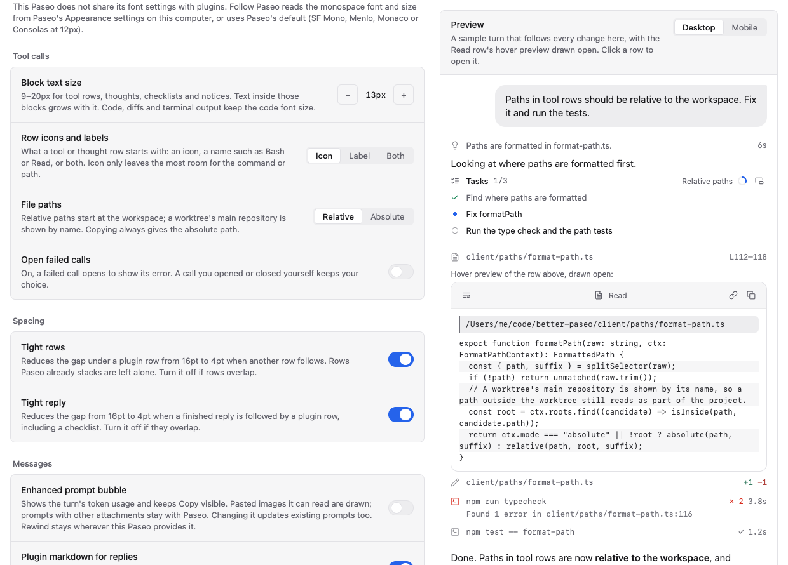

# Better Paseo

**English** | [简体中文](README-zh.md)

A [Paseo](https://paseo.sh) plugin that redraws the chat timeline of every agent Paseo runs,
whichever provider is behind it (Claude Code, Codex, Oh My Pi and the rest): tool calls, reasoning,
replies, prompts, checklists and errors become compact, typed, syntax-aware rows that follow the
active Paseo theme, and on the Web production build the whole timeline renders faster
than Paseo does on its own.

<picture>
  <source media="(prefers-color-scheme: dark)" srcset="images/hero-devices-dark.png">
  
</picture>

> Better Paseo is a fork of [ABorakati/beautiful-chat](https://github.com/ABorakati/beautiful-chat),
> continued from `42b61d8` (2026-09-23). It keeps Beautiful Chat's cards except the Eval, Ask,
> Task and approval cards, which current Paseo never feeds a plugin (see
> [Compatibility](#compatibility)). This README describes what the fork adds and how it performs.

## Highlights

- **Faster than no plugin at all.** On the Web production build, 10 of the 11 replay scenarios
  use less main-thread time than Paseo's own timeline, by 14–38%; the large diff is even. All 11
  use 12–91% less than Beautiful Chat. [Charts below](#performance).
- **Memory close to no plugin.** On the Web production build, after a forced GC, the JS heap
  differs from no plugin by −1.4 to +4.0 MB, and a long reply uses 40.8 MB less. Beautiful Chat
  reaches 213.6–242.6 MB on the large diff, the 100-turn history and 20 file reads.
  [Memory comparison below](#memory-comparison).
- **One row per tool call.** Calls start collapsed to a 26pt row with a typed summary, open on a
  press, and stay open or closed across completion, history and remounts.
- **Streaming that does not jump.** Replies are parsed block by block; a half-written code fence
  or table never flips format, and the layout shift of a long streaming reply is 0.
- **Previews without opening.** Hover a collapsed row or a path on desktop, or long-press a
  collapsed row on a phone, to read its content in a scrollable panel. Images open in a full-screen viewer.
- **Follows Paseo.** Fonts, sizes and colours follow the host by default; settings are stored on
  the daemon and shared by desktop, web, iOS and Android. The settings page is in English and
  Simplified Chinese.

## Install

```bash
paseo plugin install RoundRedDot/better-paseo
```

Paseo `>=0.8.0` is required; the plugin is developed and measured against Paseo 0.11.2. On Paseo
0.8–0.10 it works with some compatibility issues, listed under [Compatibility](#compatibility).
Open **Settings → Plugins → Better Paseo** to configure it. Paseo installs plugins from GitHub, so pull a
new version with:

```bash
paseo plugin update better-paseo
```

---

## Performance

Three modes were replayed in the same session, in rotating order: **no plugin** (Paseo 0.11.2
drawing the timeline itself), **Beautiful Chat** `42b61d8`, and **Better Paseo**. The same
probe sits on the host, around every row, native or plugin, so all three are measured the same way.
Each Web cell is the median of 3 runs of a production build, measured on 2026-10-14. Eleven scripted
scenarios cover streaming replies, code, tables, reasoning, large diffs, shell logs and a 100-turn
history. Only modes inside this round are comparable.


- **Against no plugin**, Better Paseo is shorter in 10 of 11 scenarios, by 14–38%. The large diff is
  even (0.41 s vs 0.31 s for the whole replay; both are under half a second).
- **Against Beautiful Chat**, it is shorter in all 11, by 12–91%. Beautiful Chat opens running tool
  calls by default, so 20 file reads mount 56,471 DOM nodes and take 3.45 s; Better Paseo mounts
  2,026 and takes 0.99 s.
- Against no plugin, streaming text still saves the most: a long reply drops from 8.72 s to 5.62 s
  (Beautiful Chat is 8.62 s). Against Beautiful Chat the widest gap is the 100-turn history, 7.03 s
  to 0.63 s.

Cumulative layout shift while streaming (lower is better):

| Scenario         | No plugin | Beautiful Chat | Better Paseo | vs no plugin | vs Beautiful Chat |
| ---------------- | --------: | -------------: | ----------: | :----------- | :---------------- |
| Long reply       |     0.218 |          0.648 |       **0** | &ensp;100% | &ensp;100% |
| Code block       |     0.042 |          0.129 |   **0.012** | &ensp;72% | &ensp;91% |
| Table            |     0.046 |          0.040 |   **0.011** | &ensp;77% | &ensp;73% |
| 100-turn history |         0 |          0.226 |       **0** | even | &ensp;100% |

### iOS


The same host probe now measures all three modes on the iOS simulator (development build, cold start
before every run). The earlier card-level table is not repeated: that probe does not exist in
Beautiful Chat. Development-build milliseconds are only comparable with each other, and only inside
this round.

The chart is total row-render time for every scenario, the same metric as the table. Bars past
2,000 ms are clipped and the label is the real total. A difference under 10% is even. These are
milliseconds, so the half-second rule on the Web chart does not apply.

Per-commit p95 is not on the chart. At max speed the modes batch rows into very different commits —
no plugin 50 row renders in 5 commits, Beautiful Chat 182 in 125, Better Paseo 90 in 17 — so
Beautiful Chat's per-commit p95 (4.5 ms) on the 100-turn history only looks best because it renders
about one row per commit. The totals there are 200.1 ms, 230.6 ms and 202.9 ms. Against no plugin,
Better Paseo is shorter in 5 of 11 (15–64%), even on the large diff and the 100-turn history, and
longer in 4 (18–63%: 20 file reads, both reasoning replays, and the expanded tool). Those four rest
on 2 runs per mode, and the runs do not overlap: 20 file reads are 274.2 / 287.9 ms with no plugin
and 321.2 / 341.0 ms with Better Paseo, reasoning prose 264.1 / 276.4 and 333.5 / 336.9, reasoning
sections 227.9 / 232.0 and 278.0 / 283.1, and the expanded tool 152.7 / 167.6 and 249.2 / 271.6.
Against Beautiful Chat it is shorter in all 11, by 12–99%.

Per-commit p95 still disagrees with these totals in a few places. The large
shell log's p95 is 21% higher (17.4 ms vs 14.3 ms) while its total is 15% lower (43.0 ms vs 50.8 ms),
and the large diff's p95 is 43% higher (20.0 ms vs 14.0 ms) while its total is even (51.5 ms vs
54.4 ms). On the long reply, native packs about 1.9 rows into each commit and Better Paseo about 1.0,
so the p95 drop (88%) is larger than the total drop (64%); both still favour Better Paseo. No other
scenario has a history-sized gap in rows per commit. Beautiful Chat's large diff records 5541.4 ms of
row-render time and a per-commit p95 of 2877.7 ms; the longest frame the probe kept is 139.3 ms,
because it ignores frame gaps over 1 s.

| Scenario | No plugin | Beautiful Chat | Better Paseo | vs no plugin | vs Beautiful Chat |
| --- | ---: | ---: | ---: | :--- | :--- |
| Code block streaming | 2301.1 | 4532.1 | **965.4** | &ensp;58% | &ensp;79% |
| Large diff | 54.4 | 5541.4 | **51.5** | even | &ensp;99% |
| 100-turn history | 200.1 | 230.6 | **202.9** | even | &ensp;12% |
| Long reply | 5075.3 | 13393.2 | **1833.4** | &ensp;64% | &ensp;86% |
| Mixed turn | 299.7 | 633.5 | **242.2** | &ensp;19% | &ensp;62% |
| 20 file reads | 281.0 | 2652.9 | **331.1** | &ensp;18% | &ensp;88% |
| Reasoning, prose | 270.3 | 1472.6 | **335.2** | &ensp;24% | &ensp;77% |
| Reasoning, sections | 229.9 | 2459.0 | **280.6** | &ensp;22% | &ensp;89% |
| Large shell log | 50.8 | 355.4 | **43.0** | &ensp;15% | &ensp;88% |
| Table streaming | 993.0 | 1169.4 | **549.4** | &ensp;45% | &ensp;53% |
| Expanded tool | 160.1 | 3025.9 | **260.4** | &ensp;63% | &ensp;91% |

 green is better than
the baseline,  red is
worse. A difference under 10%, or a whole replay under half a second on both sides, counts as even.
The half-second clause is for a whole Web replay. The iOS table is row-render time in milliseconds,
so only the 10% clause applies there.

<details>
<summary>All Web figures (seconds of main-thread time)</summary>

| Scenario             | No plugin | Beautiful Chat | Better Paseo |
| -------------------- | --------: | -------------: | -----------: |
| Code block streaming |      3.96 |           3.50 |     **2.51** |
| Large diff           |      0.41 |           1.81 |     **0.31** |
| 100-turn history     |      0.73 |           7.03 |     **0.63** |
| Long reply           |      8.72 |           8.62 |     **5.62** |
| Mixed turn           |      1.61 |           3.68 |     **1.21** |
| 20 file reads        |      1.15 |           3.45 |     **0.99** |
| Reasoning, prose     |      2.75 |           4.01 |     **1.79** |
| Reasoning, sections  |      2.50 |           3.73 |     **1.55** |
| Large shell log      |      1.00 |           2.30 |     **0.66** |
| Table streaming      |      3.01 |           2.12 |     **1.85** |
| Expanded tool        |      1.85 |           4.46 |     **1.41** |

</details>

**How it was measured.** 2026-10-14, on rrd-mac-studio (Apple M5 Max, 18 cores, 64 GB, macOS 27.0.1).
The 1-minute load stayed about 0.8–1.7. Earlier rounds ran on a shared, heavily loaded M5 Pro
laptop; only modes inside this round are comparable.

A measurement-only patch to Paseo 0.11.2 (`759532509`, `tools/paseo-host-probe.patch`) wraps every
timeline row in the same `React.Profiler`. Web used the same instrumented production export as the
12–13 October rounds (main JS sha256 prefix `9dd7eab4521434bc`), headless Chrome 155.0.8059.40 at
1280×900. Playwright reads Chrome DevTools Protocol metrics before and after each replay, with a
forced GC before memory is read. iOS is an iPhone 16 Pro simulator on iOS 18.6, development build
`sh.paseo.debug`, Metro serving the probe, cold launch before every run.

Better Paseo was commit `9f270c6`. The private daemon, default plugin settings, and rotating order were the same for all three modes.
Every run asserted which build was on screen. On Web, Better Paseo exposes `imageRpc`, Beautiful
Chat has `#beautiful-chat-frosted`, and no plugin has neither. On iOS the check is
`tools/ios-identity.mjs`. Web: 11 fixtures × 3 modes × 3 runs = 99, with 0 page errors. iOS: 11 × 3
× 2, and `history-100` and `shell-log-large` at 6 runs per mode, 90 in all.

Method, tools and raw runs: [`docs/bench/native-vs-fork`](docs/bench/native-vs-fork/README.md)
(`raw/web-2026-10-14`, `raw/ios-2026-10-14`). Every difference from Beautiful Chat, with the history
of each measurement: [`docs/fork-vs-upstream.md`](docs/fork-vs-upstream.md) (Chinese). The charts are
generated from these runs by `node docs/perf/readme-charts.mjs`. Percentages are taken from the
medians before rounding.

### Where the time goes

- **Cards that did not change stop rendering.** Paseo hands every row new `theme` and `data`
  objects on each streamed chunk. Semantic `React.memo` comparisons let unchanged cards skip the
  render; only the newest prompt follows the agent's status. In the 100-turn replay whole-page
  renders fell from 172,327 to 1,319.
- **Replies are parsed incrementally.** `marked` with `remend` lexes block by block; each reply
  caches its finished blocks and repairs only the block still growing. Format flips and height
  regressions while streaming are 0 offline, on Web and on iOS.
- **Code is highlighted once, and only when it is complete.** An unclosed code block requests no
  highlighting; Shiki runs on the daemon (`highlight.tokens`). Collapsed rows do not mount their
  body, so 20 file reads make 0 highlight requests instead of 48.
- **Large output arrives in batches.** Code and terminal panels draw 400 lines, then add the rest in
  batches with a **Show all** control. A 5,000-line diff on iOS went from 2.2 s to 19.8 ms (tool card
  p50).
- **No decorative loops.** Shadows, frosted glass, glow and breathing animations are gone. Only the
  running dot remains; on Web it is a CSS animation, so it no longer commits its row every frame
  (row commits in a mixed turn: 1,518 → 196). Reduced Motion stills it.
- **No late growth.** A reply that is not revealed word by word draws its text in the same commit
  that delivers it, so Paseo's stick-to-bottom keeps up and the reply does not push the footer
  after the fact.
- **A small client bundle.** Paseo sends the whole client bundle again on every reconnect. Brand
  marks and the Inter face are served by the daemon on demand (`marks.bitmaps`, `fonts.embedded`),
  the embedded Iosevka faces are gone, and the bundle is kept ASCII so Hermes stores it as one-byte
  text.

---

## Memory comparison

Web production build, measured on 2026-10-14: each value is the median of 3 runs after a forced GC.
The table reports JS heap usage, not total app or process memory. Differences are Better Paseo
minus the baseline, calculated before rounding; negative means less memory. All values are in MB.


Compared with no plugin, a long reply uses 40.8 MB less; the other scenarios differ by −1.4 to
+4.0 MB. Compared with Beautiful Chat, the large diff, the 100-turn history and 20 file reads use
102.9–126.0 MB less, and the other scenarios differ by −13.6 to +1.0 MB. Beautiful Chat expands
running tools by default; Better Paseo keeps them collapsed.

| Scenario | No plugin | Beautiful Chat | Better Paseo | vs no plugin | vs Beautiful Chat |
| --- | ---: | ---: | ---: | ---: | ---: |
| Code block streaming | 113.9 | 113.0 | **112.4** | -1.4 | -0.5 |
| Large diff | 106.9 | 213.6 | **110.8** | +3.9 | -102.9 |
| 100-turn history | 114.7 | 242.6 | **117.7** | +3.0 | -124.9 |
| Long reply | 156.2 | 114.4 | **115.4** | -40.8 | +1.0 |
| Mixed turn | 111.5 | 120.8 | **112.6** | +1.1 | -8.2 |
| 20 file reads | 111.2 | 241.2 | **115.2** | +4.0 | -126.0 |
| Reasoning, prose | 108.5 | 112.2 | **111.8** | +3.2 | -0.4 |
| Reasoning, sections | 108.5 | 112.3 | **111.8** | +3.2 | -0.6 |
| Large shell log | 108.4 | 125.3 | **111.7** | +3.3 | -13.6 |
| Table streaming | 111.9 | 112.7 | **113.3** | +1.4 | +0.6 |
| Expanded tool | 111.0 | 122.7 | **114.0** | +3.0 | -8.7 |

Raw measurements: [`docs/bench/native-vs-fork/raw/web-2026-10-14`](docs/bench/native-vs-fork/raw/web-2026-10-14).

---

## Features

Everything below is on top of what Beautiful Chat already drew: typed tool cards, Shiki
highlighting, image reads, file reveal and the plugin's own find bar.


### Tool rows

Most cards read the tool detail Paseo hands every plugin, so they work whichever agent made the
call: reads, writes, edits, shell and Git commands, searches, fetches, sub-agents, plans, MCP calls
(in Claude's `mcp__server__tool`, Codex's `server.tool` and Oh My Pi's `server / tool` forms) and
Paseo's own tools. Calls Paseo passes as plain text get a label-and-text card.

Oh My Pi's `hub` tool and its GitHub device calls are matched by name and have cards of their
own; no other agent sends them. On Paseo 0.11, Oh My Pi's `eval` and `ask` calls reach plugins as
plain text and `task` arrives as a sub-agent item. If `ask` also carries structured `questions`
data, it gets a question transcript; otherwise it stays a generic text card.

- Every call starts as one borderless row, 26pt on desktop and 28pt on touch, with a summary built
  for its type: the command, the path and line range, `+4 −2` for an edit, the exit code and
  duration. A press opens the card.
- The open or closed state is kept per call (`agentId:callId`) outside the component, so it
  survives completion, scrolling into history and remounts. On iOS the header stays where it was
  pressed and the content opens below it.
- A failed call shows a one-line error; with **Open failed calls** on, it starts expanded unless
  the reader has already chosen its open or closed state.
- Rows keep the time they first appeared, so parallel reads no longer reorder or change spacing
  when one finishes first.
- Row heads show an icon, a label or both. Long code and terminal output fold to 12 lines.
- **Block text size** changes prose in tool, thought, checklist and notice rows; code, diffs and
  terminal output keep their code font size.
- Paseo's own tools carry the Paseo mark; agent cards and reply footers use the agent's provider
  mark, independently of the selected model.
- Every op of Oh My Pi's `hub` tool has a card: processes, messages and job snapshots. The cards
  report; they carry no buttons, since a plugin cannot restart or cancel anything.
- Across agents, recognized question calls with structured `questions` data render as paginated
  transcripts with choices, recorded answers and status. **Show raw data** reveals the payload;
  the transcript is read-only, and Paseo still handles answers. Questions stay wrapped in previews
  for readability.


| Shell and Git | Read |
| --- | --- |
|  |  |
| **Edit** | **Hub** (Oh My Pi) |
|  |  |

<details>
<summary>More cards: MCP, Paseo tools, image read, syntax block, a <code>thinking</code> tool</summary>


</details>

### Reasoning and checklists

- Reasoning is split only on real structure (`**Title**` and headings), not on blank lines. It is
  collapsed by default, and while it streams the row previews the current heading.
- Durations are shown only when this client actually watched the reasoning stream; nothing is
  estimated.
- Checklists show the phase, per-task status, durations, and a blocked task with its reason. A
  progress ring tracks completed tasks and becomes a check when all are done. The header's window
  button opens the live checklist in a panel that stays open as you use the timeline and follows the
  newest list; long titles can wrap there.


### Replies

- Markdown is drawn by the plugin with headings, lists, task lists, quotes, highlighted code blocks
  and local images. Three styles: **Document**, **Compact** and **Terminal**.
- Unlabelled, Markdown and plain-text code fences can open a maximized preview window. Switch
  between rendered Markdown and raw text, copy the source, and use **Wrap lines** in raw-text mode.
  The window stays separate from the compact reply.
- Tables have column rules, a header fill and a rounded frame; cells are a size smaller with tighter
  lines, and column widths account for tabular digits and CJK width.
- Every table has a copy control at its top-left corner. On web and desktop, hovering it (or a
  long press on a touch screen) opens **Copy as Markdown** and **Copy as image**, a picture of the
  table as drawn; a plain press copies the Markdown. On iOS and Android it copies the Markdown.
- On web and desktop, double-click a cell to select its text. On iOS and Android, double-tap a cell;
  the corner menu always offers **Copy selected** and offers **Add to chat** when Paseo provides its
  composer capability.
- Each completed turn has a separate footer under its final reply with Copy and its time, plus the
  provider mark, model, thinking level and observed duration when available. The model name copies
  when pressed and confirms with a toast; completed-turn footers remain during a later run. Turn
  **Plugin markdown for replies** off to restore Paseo's full footer, including its Fork action.
- Every local image in a reply is drawn, not only the first.
- Turn **Plugin markdown for replies** off to hand replies back to Paseo, which draws mermaid
  diagrams and its own images and file links.

| Table copy menu | Selected cell actions |
| --- | --- |
|  |  |


### Images

- An image read draws the file: dimensions and size from its header, a thumbnail sized to its
  content, and an eye toggle that keeps the header where it was pressed.
- The full-screen viewer zooms with buttons, the wheel or a pinch about the pointer, pans by drag,
  resets on double press, and reveals the file in the file manager. On a phone, a long press on the
  row opens it directly.
- Bytes come from the daemon (`file.image`) the first time a row is opened, previewed or
  long-pressed. PNG, JPEG, GIF, WebP, AVIF, BMP, ICO and SVG are recognised; files over 3 MB report
  their size instead of inlining.
- When multiple read cards point to the same image, each card displays it.


### Hover previews

On desktop, resting the pointer on a collapsed tool row, thought row, image or path opens a
scrollable preview after a delay you set (0–10 s). It can wrap lines, show line numbers and
alternating shading, and can be moved, resized or maximized. A checklist can open its live list in a
floating window, and a Markdown code block can open its own maximized preview. When a preview is
following live output, it glides along as the content grows. On a phone, long-press a collapsed row
to open the same preview without covering the top bar or composer.

### Paths, copying and selection

- Paths are relative to the workspace and shortened in the middle, keeping the file name; a
  worktree's main repository is shown by name. Copying always gives the absolute path.
- Copy goes through the host's `copyText` everywhere, so it works on iOS and Android too: hover on
  desktop, long press on touch, or the `⋯` menu. Plain-text code blocks can wrap and have a copy
  button. On iOS a long press in a reply places a cursor and lets you drag a selection.
- Selecting text in a card on web or desktop raises **Copy** and **Add to chat**, which quotes the
  selection in the composer, fenced when it came from code. The bar closes on scroll; if no composer
  is visible, **Add to chat** copies the selection instead.


### Prompt bubble

Paseo draws the prompt by default, keeping pasted images and its rewind menu. **Enhanced prompt
bubble** switches eligible prompts to the plugin's bubble: an always-visible copy button and the
turn's token usage. It draws images when it can extract a supported image source; a prompt with an
unrenderable attachment stays with Paseo. Rewind stays wherever the running Paseo provides it.


### Errors and system messages

- An agent error is drawn as a notice card carrying its message.
- Oh My Pi sends job results, relayed messages and reminders as message text wrapped in tags such
  as `<system-notice>` or `<irc>`, and Paseo files them as replies. With **Plugin markdown for
  replies** on, they are drawn as system cards (a title, chips for agent, status and duration, and
  the rest of the body) instead of raw XML.

Permission requests are not redrawn: Paseo draws them and owns the approve and deny actions.

---

## Settings

**Settings → Plugins → Better Paseo.** A sample turn drawn with the timeline's own components follows
every change: beside the options on a wide desktop window, above them elsewhere. The Read row's
hover preview is drawn open in it. On web and desktop a **Desktop / Mobile** switch draws the same
turn at phone width with iOS styling and the inline-code colour you picked.
Options whose parent is off are dimmed, and **Reset** asks for a second press.




| Group | Setting | Default | Effect |
| --- | --- | --- | --- |
| General | Language | Follow system | English or 简体中文 for the settings page and toolbar tooltips. Plugins cannot read Paseo's own language. |
| Appearance | Accent colour | Theme | Follow the Paseo theme, or Jade, Violet, Amber or Rose. Only the accent changes. |
| Appearance | Inline code on mobile | Dark grey | Text colour of inline code on iOS and Android: Dark grey, Blue, Violet, Green or Coral. Web keeps its grey chip. |
| Appearance | Interface font | Follow Paseo | Paseo's interface font, Inter (web only, fetched from the daemon) or the system face. |
| Code font | Monospace font | Follow Paseo | Choose Follow Paseo or Custom. Follow Paseo uses, in order: the host's font settings once Paseo shares them; on web and desktop, the monospace font and size from Paseo's Appearance settings; otherwise Paseo's default monospace. On iOS and Android, Custom lists faces the platform ships. |
| Code font | Custom monospace family | Empty | Only used when Monospace font is Custom. Web accepts a family name up to 200 characters and falls back through the monospace stack if unavailable; iOS and Android offer only platform families. |
| Code font | Code font size | Follow Paseo | Or 10–22px; lines are 1.5× the size. Applies to code, diffs, terminals and paths. |
| Tool calls | Block text size | 13px | 9–20px for tool rows, thoughts, checklists and notices. Text inside those blocks grows with it. Code, diffs and terminal output keep the code font size. |
| Tool calls | Row icons and labels | Icon | Icon, label (Bash, Read…) or both at the start of tool and thought rows. |
| Tool calls | Open failed calls | Off | On, a failed call opens to show its error. A call you opened or closed yourself keeps your choice. |
| Tool calls | File paths | Relative | Relative to the workspace, or absolute. Copying always gives the absolute path. |
| Spacing | Tight rows | On | Reduces the gap under a plugin row from 16pt to 4pt when another row follows. Rows Paseo already stacks are left alone. Turn off if rows overlap. |
| Spacing | Tight reply | On | Reduces the gap from 16pt to 4pt when a finished reply is followed by a plugin row, including a checklist. Turn off if they overlap. |
| Messages | Enhanced prompt bubble | Off | Shows the turn's token usage and keeps Copy visible. Readable pasted images are drawn; prompts with other attachments stay with Paseo. Changing it updates existing prompts too. Rewind stays wherever Paseo provides it. |
| Messages | Plugin markdown for replies | On | Off hands replies to Paseo, restoring its full footer and enabling mermaid, host images and Paseo's file links. |
| Messages | Markdown style | Document | Document, Compact or Terminal (body in the code font). |
| Messages | Selection toolbar | On | Web and desktop: Copy and Add to chat on selected text; the bar closes on scroll. |
| Hover previews | Hover previews | On | Preview collapsed rows and paths on desktop hover; long-press a collapsed row on a phone. |
| Hover previews | Delay | 1 s | 0–10 s, saved to tenths of a second, before the desktop preview opens. |
| Hover previews | Wrap lines | On | Wrap long lines in preview panels, including raw text in maximized code previews; turn off to scroll horizontally. |
| Hover previews | Line numbers | Off | Show line numbers beside files, diffs and command output; diffs use the file's own line numbers. |
| Hover previews | Alternating line shading | On | Shade every other line in preview panels. |

**Where settings live.** Preferences are stored by the daemon through the SDK's host-scoped settings
(record `presentation` in `shared/preferences-settings.ts`), so **every client connected to one
daemon shares them**: a change on the desktop shows up on iOS and the other way round. A value one
platform cannot draw is stored as chosen and degraded where it renders (a custom family becomes the
platform monospace on iOS and Android; Inter becomes the system face). On web, `localStorage` is
only a fast-start cache. Until the settings arrive, cards draw with cached or default values and
switch once.

**Settings apply immediately.** Already displayed plugin items re-render as soon as local preference
state changes. The daemon stores the value and syncs it to other connected clients; reloading the chat
is not needed. **Open failed calls** uses the saved per-call choice when there is one, and otherwise
sets the call's initial state.

---

## Finding text

Paseo's chat find (Ctrl/Cmd+F) cannot reveal a row a plugin draws, because the transformed row
carries a different id. Better Paseo therefore takes Ctrl/Cmd+F on desktop and web and opens its own
find bar over the chat. It searches everything rendered, including tool cards and structured
question transcripts: Enter for the next
match, Shift+Enter for the previous, Escape to close. It only sees loaded messages; scroll up to
include older history.

To use Paseo's native find for replies, which also searches unloaded history, turn off **Plugin
markdown for replies** (and **Enhanced prompt bubble** if it is on). Paseo then draws replies and
prompts itself and Ctrl/Cmd+F opens its own find. Tool, reasoning and checklist cards stay with the
plugin.

## Opening files

A file name in a read, write, edit or code block is a link. On desktop it calls the daemon-side
`file.reveal`, which resolves the path against the agent's working directory and shows it in the
file manager: `explorer.exe /select,` on Windows, `open -R` on macOS, `xdg-open <directory>`
elsewhere. On a touch device the same press copies the absolute path instead, since a phone cannot
open the daemon machine's file manager.

## Troubleshooting

| Symptom | What to do |
| --- | --- |
| Rows overlap, or a reply overlaps the row below | Turn off **Tight rows** or **Tight reply**. |
| A reply needs a mermaid diagram, a host image or Paseo's file links | Turn off **Plugin markdown for replies**. |
| A selected table cell has no **Add to chat** action on a phone | Paseo must provide its optional composer capability; **Copy selected** is always available. |
| A prompt with an attachment should use Paseo's renderer | Turn off **Enhanced prompt bubble**. Attachments the plugin cannot render stay with Paseo automatically. |
| Ctrl/Cmd+F misses old messages | Scroll up to load them, or hand replies back to Paseo as above. |
| Token figures are missing on an old turn | Usage is not stored on timeline items, so only turns this client watched live show it. |
| Nothing changed after pushing a fix | Run `paseo plugin update better-paseo`; Paseo runs the GitHub version. |

## Compatibility

Better Paseo targets Paseo 0.11 and later. It installs and draws the timeline on Paseo 0.8–0.10,
with these known issues:

- Oh My Pi's `eval` and `ask` calls reach plugins under their own names there, not through Paseo
  0.11's plain-text mapping. `eval` stays generic; `ask` gets a question transcript only when its
  input contains a structured `questions` array, and otherwise stays generic too.
- Some features depend on host abilities; see [Waiting on Paseo](#waiting-on-paseo). Host capability
  checks have been verified with 0.11.2.

## Waiting on Paseo

Better Paseo works on released Paseo and probes for newer host abilities, falling back when they are
absent. These host changes are verified in a Paseo fork but not yet released:

- Plugin tool rows spaced like native ones (about 46pt down to 30pt; native is 32pt). Until then
  **Tight rows** reduces the gap from 16pt to 4pt where applicable.
- Paseo sharing its font settings with plugins, so a change in Appearance applies live. Until then
  web and desktop read Paseo's locally stored Appearance settings.
- An optional composer capability for touch table selection, so **Add to chat** can be offered
  beside **Copy selected**. Until then, the corner menu still copies the selected cell.
- Lowering `class` syntax before the bundle runs on Hermes.
- A sticky current prompt and sticky headers on open cards; the plugin side is wired up.

Grouping several calls into one "Read 12 files" row needs a host grouping API, and opening a
5,000-line block on a development-build simulator still takes about 30 s without host-side
virtualised scrolling.

The SDK constraints met while building the plugin, with evidence and workarounds, are listed in
[`docs/plugin-sdk-limitations.md`](docs/plugin-sdk-limitations.md).

## Development

```bash
npm install
npm run typecheck
npm test
npm run check:hermes
paseo plugin reload better-paseo
```

`npm run check:hermes` compiles and runs the client bundle in Hermes, the engine the iOS and Android
apps use; code that works on web can still fail there and drop the whole plugin. The rules it
enforces, the project layout, and how to rebuild the screenshots and charts are in
[`docs/development.md`](docs/development.md).

## License

MIT
