# 相对官方 Beautiful Chat 的差异

官方插件是 [ABorakati/beautiful-chat](https://github.com/ABorakati/beautiful-chat)，停在 `42b61d8`（2026-09-23）。本仓库从这一版接着改。截至 2026-10-13，`main` 为 `2146289`：相对基线 253 个提交（其中 175 个非合并提交）。插件源码（`client/`、`index.client.tsx`、`index.server.ts`、`shared/`）126 个文件，+18,144 / −6,159。

对照有两列基线。一列是不开插件、由 Paseo 0.11.2 自己画时间线。另一列是官方插件。官方已有的卡片、Shiki 高亮、图片读取、文件定位和 Ctrl+F 都还在。下面是这一版多出来的行为，以及渲染升级的实测结果。

交付当天的实施记录和原始数据仍在 `docs/delivery/2026-10-11-delivery-report.md` 与 `docs/bench/`。那些文件是当时的快照；和当前行为不一致的地方，以本文为准。

## 界面和交互

不开插件时，时间线就是 Paseo 自己的：工具默认逐条展开明细（外观里可以改成一组摘要），思考可以自动展开，回复里的 mermaid 和宿主图片由宿主画，等宽字体跟随外观设置，Ctrl/Cmd+F 能搜到这些正文。官方插件换成带阴影、磨砂和光晕的卡片。工具在运行时默认展开，思考按空行编成「Step N」，等宽字体写死成内嵌 Iosevka（iOS / Android 上实际变成比例字体）。本仓库再收成 Ledger 行。

| 方面 | 不开插件 | 官方 `42b61d8` | 本仓库 |
|---|---|---|---|
| 工具行 | 默认逐条展开明细。外观里改成「概览」后，同一次运行收成一行摘要（读了几个文件、跑了几条命令），点开是限高面板 | 每个调用一张卡片。运行中或失败时默认展开。展开状态挂在组件上，滚进历史会丢 | 每个调用默认收成无框单行（桌面 26pt，触控 28pt），摘要按类型生成。展开状态按 `agentId:callId` 记在模块里，完成、进历史、重新挂载都不丢。失败只显示一行错误。iOS 上展开时行头留在按下的位置，内容向下打开 |
| 分组 | 概览模式把连续工具收成一组 | 不分组 | 不分组。收成「Read 12 files」还要宿主的分组 API，发布版没有 |
| 行标签 | 宿主自己的工具名 | 图标加文字 | 仅图标、仅标签、图标+标签，默认仅图标。长代码和终端输出先折到 12 行。退出码是对勾，失败是叉加退出码 |
| 行序 | 按时间线到达顺序 | 用完成时刻排序，并行的 Read 里先完成的一行会排到后面，行距跟着跳 | 记住首次出现的时间，完成时不再把间距让给下一行 |
| 思考 | 宿主的思考块，可自动展开 | 按空行编号，时长和 token 是估出来的 | 只认真实结构（`**标题**`、多级标题）。默认折叠，流式时标题行实时预览。时长只在本机真的看到流式过程时才显示 |
| 预览 | 没有折叠行的悬停或长按预览 | 没有 | 桌面悬停折叠的工具行、思考行和图片，弹出可滚动的预览，可换行、可最大化。手机长按同样打开预览，不盖住顶部栏和输入框；长按图片则打开全屏查看器 |
| 视觉 | 宿主的时间线样式 | 阴影、磨砂、指针光晕，以及呼吸、发光、弹出等循环动画 | Ledger 行：几乎只用行。磨砂和光晕已删除，不再是设置项。动画只留运行中的圆点，以及展开时的淡入，并尊重系统「减少动态效果」。圆点在 iOS / Android 上走 native driver，在 Web 上是 CSS 动画 |
| Markdown | 宿主渲染，包含 mermaid | 自研解析器，整篇重解析。没闭合的代码围栏会先当成普通文本，闭合时再跳成代码块 | `marked` + `remend`，按块增量解析。表格有列线、表头底色、圆角外框；单元格比正文小一号、行距更紧；列宽按等宽数字和中文宽度估算。关掉「助手 Markdown」就把回复交回宿主，mermaid 和宿主图片走那条路 |
| 大段输出 | 宿主一次画完 | 展开后整段挂上 | 代码和终端先画 400 行，再分批补上，并提供「显示全部」 |
| 图片 | 宿主能画它认识的图片 | 工具读图有缩略图 | 回复里的本地图片也会画出来，一段里多张都画。缩略图按内容撑满，不再上下留空。点开全屏后可缩放、平移，并在文件管理器中显示。手机长按打开同一个查看器。iOS 上显示/隐藏和关闭查看器不再把页面闪走 |
| 路径 | 宿主的路径 | 绝对路径。点一下在 daemon 那台机器上打开 | 相对工作区显示，中间省略但保留文件名。复制始终是绝对路径。桌面点击仍是「在访达中显示」；触控设备改为复制，因为远程手机打不开 daemon 的文件管理器 |
| 复制 | 宿主的复制 | 代码块走浏览器剪贴板，原生端会报成功但没复制 | 统一走宿主的 `copyText`。桌面悬停、触控长按、`⋯` 菜单；复制的是原文。纯文本代码块可换行，并有复制按钮。iOS 上长按回复正文可以放光标、拖动选区 |
| 用户气泡 | Paseo 的气泡：粘贴的图片、回退菜单 | 插件自己画，增强气泡默认开 | 默认交回 Paseo 的气泡。打开「增强的提问气泡」后，复制按钮一直在，并接上宿主有回退菜单时的那一项。对话大纲在 Paseo 0.11 上又能跳到插件画的 prompt |
| 字体 | 跟随外观里的界面字体和等宽字体 | Web 注入 Iosevka，字体打进客户端包；原生端字体名没注册 | 默认跟随 Paseo。顺序是：宿主把字体设置传给插件（需要宿主支持）→ 桌面和 Web 上读取 Paseo 外观里设的等宽字体 → Paseo 官方等宽栈。字号 10–22。Inter 和品牌图标改由 daemon 按需下发；不再内嵌 Iosevka，客户端包小了约三成。Android 阅读文字跟随内容字号，不再乘系统字体缩放 |
| 间距 | 宿主自己的行距 | 宿主在插件行之间多留一截 | 「紧凑行距」和「紧凑回复间距」默认开。回复紧挨工具、思考或待办行时，间距从 Paseo 的 16pt 收到 4pt |
| 查找 | Ctrl/Cmd+F 能搜到宿主画的正文 | 插件接过 Ctrl+F，因为宿主的查找到不了插件画的字 | 同一套查找。关掉助手 Markdown 后，回复交回宿主，查找也交回宿主 |
| 设置 | Paseo 的外观和聊天设置 | 存在浏览器 `localStorage`，手机上留不住 | 存在 daemon，同一台 daemon 上的桌面和手机会同步。设置页中英双语，并铺满 Paseo 的内容列 |

## 性能

当前数字是 2026-10-13 的 Web 生产构建。同一套宿主探针套在每一行外面，同一次会话里交替三种模式：不开插件、官方 `42b61d8`、本仓库 `2146289`。11 个场景，每种模式 3 次，取中位数。开跑时机器负载还在从很高回落，第一轮有几个场景偏慢，中位数落在后面的轮次。iOS 这次没有重跑。方法和原始数据在 [`docs/bench/native-vs-fork`](bench/native-vs-fork/README.md)，图在 [对照页](perf/index.html#native)。

再往下的卡片内部探针表是 10 月 11–12 日的快照，探针口径不同，不能和这张表的毫秒数直接比。

### Web：整段回放的主线程时间

单位是秒。↑ 是本仓库比这一列基线省。相差不到一成、或者整段不到半秒时记为持平。

| 场景 | 不开插件 | 官方 | 本仓库 | 相对不开插件 | 相对官方 |
|---|---:|---:|---:|---:|---:|
| 代码块流式 | 3.81 | 3.45 | 1.70 | ↑ 55% | ↑ 51% |
| 大 diff | 0.38 | 2.41 | 0.37 | 持平 | ↑ 85% |
| 100 轮历史 | 2.92 | 8.49 | 2.14 | ↑ 27% | ↑ 75% |
| 长回复 | 7.07 | 8.42 | 3.67 | ↑ 48% | ↑ 56% |
| 混合一轮 | 1.20 | 2.95 | 1.02 | ↑ 15% | ↑ 65% |
| 读 20 个文件 | 0.96 | 3.72 | 0.70 | ↑ 28% | ↑ 81% |
| 思考散文 | 2.06 | 3.57 | 1.27 | ↑ 38% | ↑ 65% |
| 思考分节 | 1.97 | 3.92 | 1.02 | ↑ 48% | ↑ 74% |
| 大段终端 | 0.88 | 1.60 | 0.64 | ↑ 27% | ↑ 60% |
| 表格流式 | 2.77 | 1.64 | 1.08 | ↑ 61% | ↑ 34% |
| 展开的工具 | 1.49 | 3.26 | 0.97 | ↑ 35% | ↑ 70% |

11 个场景里，本仓库都比不开插件省，大 diff 整段只有 0.37–0.38 秒，算持平。相对官方，11 个场景都更省。官方比不开插件更费的，是默认展开的工具：读 20 个文件的 DOM 节点从 1,524 涨到 56,158，大 diff 从 1,094 涨到 40,362，主线程因此到了数秒。表格流式是例外，官方 1.64 秒，比不开插件的 2.77 秒短，本仓库再收到 1.08 秒。

先强制垃圾回收再读内存。本仓库的 JS 堆和不开插件相差 0–4MB，长回复从 181MB 收到 140MB。官方在展开大段工具的场景里高出一截：读 20 个文件 266MB，100 轮历史 265MB，大 diff 239MB；本仓库分别是 139、142、135MB。

布局偏移上，长回复本仓库是 0，不开插件 0.157，官方 0.644。代码块是 0.012 / 0.039 / 0.127，表格是 0.011 / 0.049 / 0.040。100 轮历史官方累计 0.478，另外两边是 0。

单行渲染 p95，纯文本流式本仓库大约是不开插件的一半到三分之一（长回复 1.5 → 0.8ms，表格 2.7 → 0.8ms，代码块 3.0 → 1.0ms）。官方在这些场景里更慢（长回复 5.4ms，代码块 4.8ms）。大 diff 和展开的工具，单行 p95 都在 0.4–2.1ms，差别落在提交次数：读 20 个文件官方提交 11,015 次，本仓库 286 次，不开插件 277 次。

### 早前的卡片内部探针

下面比的是升级前的官方渲染（`42b61d8` 加上只计数、不改界面的探针）和当时的本仓库。11 个相同回放场景。探针埋在插件卡片里，测的是「开始渲染 → layout effect」，和上面的宿主行外壳不是同一个口径。图会动：淡色横条是官方的长度，绿色从同一长度收回来。原始表在 [`docs/bench/final-report.md`](bench/final-report.md)（代码 `81ce36b`）。

10 月 12 日之后的表格样式、图片查看器和字体下发没有重跑这套卡片内部探针。

### Web：最忙卡片的提交时间 p95

对数刻度。虚线是 4ms。10 个场景收到虚线左边或贴着虚线；100 轮历史仍在右边。

| 场景 | 官方 | 本仓库 | 变化 | 4ms 以内 |
|---|---:|---:|---:|:---:|
| 代码块流式 | 10.5 | 1.7 | ↑ 84% | 是 |
| 大 diff | 208.9 | 1.9 | ↑ 99% | 是 |
| 100 轮历史 | 95.6 | 32.4 | ↑ 66% | 否 |
| 长回复 | 16.3 | 1.7 | ↑ 90% | 是 |
| 混合一轮 | 8.7 | 1.7 | ↑ 80% | 是 |
| 读 20 个文件 | 230.2 | 2.0 | ↑ 99% | 是 |
| 思考散文 | 3.1 | 0.8 | ↑ 74% | 是 |
| 思考分节 | 5.5 | 0.8 | ↑ 85% | 是 |
| 大段终端 | 30.0 | 2.2 | ↑ 93% | 是 |
| 表格流式 | 2.0 | 1.4 | ↑ 30% | 是 |
| 展开的工具 | 16.7 | 1.3 | ↑ 92% | 是 |

单位是毫秒。↑ 是提升（耗时下降），↓ 是倒退（耗时变长）；对照页里前者为绿色、后者为红色。Web 生产构建，每个场景 1 次。100 轮历史是 110 张卡片同时停在正在生成区，按最大速度回放。

同一批 Web 跑次里的掉帧和最长帧：

| 场景 | 掉帧 | 最长帧 |
|---|---:|---:|
| 代码块流式 | ↑ 1.0% → 0.2% | ↑ 133 → 50 |
| 大 diff | ↑ 14.8% → 0.3% | ↑ 517 → 33 |
| 100 轮历史 | ↑ 77.6% → 45.4% | ↑ 833 → 183 |
| 长回复 | ↑ 5.4% → 0.2% | ↑ 200 → 50 |
| 混合一轮 | ↑ 1.1% → 0.2% | ↑ 117 → 50 |
| 读 20 个文件 | ↑ 9.1% → 0.5% | ↑ 567 → 50 |
| 思考散文 | ↑ 0.5% → 0.1% | ↑ 67 → 33 |
| 思考分节 | ↑ 0.4% → 0.2% | ↑ 67 → 33 |
| 大段终端 | ↑ 0.8% → 0.3% | ↑ 133 → 50 |
| 表格流式 | ↑ 0.6% → 0.1% | ↑ 67 → 33 |
| 展开的工具 | ↑ 0.3% → 0.2% | ↑ 50 → 33 |

掉帧是比例，最长帧是毫秒。100 轮历史的掉帧仍有 45%（最大速度回放）。长回复贴底滚动的布局偏移从 0.64 到 0.59，这是流式聊天本身在长高。

### Web：堆内存（10 月 12 日复测）

V1 表里的堆内存读的是 `performance.memory`，Chrome 会把它量化并缓存。同一场景三次读数能差 20MB 以上，而 V1 每个场景只跑 1 次。所以 V1 里代码块流式、100 轮历史、长回复、思考分节这四项「变大」不能作数。10 月 12 日把官方和本仓库放在同一个隔离 daemon 上交替各跑 3 次，用 CDP 读精确值，并且两边都打开「增强的提问气泡」，让用户卡片都由插件绘制：

| 场景 | 跑完（不 GC） | 常驻（GC 后） |
|---|---:|---:|
| 代码块流式 | ↑ 126.4 → 117.5 | ↑ 110.1 → 109.1 |
| 100 轮历史 | ↑ 523.8 → 206.0 | ↑ 178.4 → 153.3 |
| 长回复 | ↑ 120.7 → 111.7 | 110.4 → 110.7 |
| 思考分节 | ↑ 117.2 → 111.7 | ↑ 107.4 → 106.7 |
| 表格流式 | ↑ 120.5 → 107.5 | ↑ 107.6 → 107.4 |
| 混合一轮 | ↑ 128.8 → 114.2 | ↑ 115.6 → 109.3 |

单位是 MB，3 次中位数。长回复的常驻堆多 0.3MB，在轮次之间的波动以内。

复测时，`c00be20` 的常驻堆在 4 个场景里比官方高 1–2.4MB，原因有两处。一是流式尾块的每个半截版本都存进了 lex 缓存。二是 bundle 里有 18 处非 ASCII 字符（注释和正则里的 `–`、`…`、`✓` 等），整份约 950KB 的源码因此按双字节保存。两处都已修掉，`check:hermes` 也会拦住新的非 ASCII 字符；上表是修复后的结果。大 diff（349 → 203）和读 20 个文件（325 → 148）沿用 V1 的读数，没有复测。细节和原始数据见 [`docs/bench/2026-10-12-regression-recheck.md`](bench/2026-10-12-regression-recheck.md)。

### iOS：同一次会话的提交时间

线性刻度，0 到 160 毫秒，画的是 p95。五类卡片都比官方快，助手、思考、工具、待办收到原来的四分之一左右，用户卡片大约减半。

| 卡片 | 官方 p50 | 本仓库 p50 | p50 | 官方 p95 | 本仓库 p95 | p95 |
|---|---:|---:|---:|---:|---:|---:|
| 用户 | 15.8 | 13.3 | ↑ 16% | 25.3 | 13.3 | ↑ 47% |
| 助手 | 20.2 | 13.1 | ↑ 35% | 108.2 | 21.6 | ↑ 80% |
| 思考 | 22.1 | 9.6 | ↑ 57% | 94.4 | 21.5 | ↑ 77% |
| 工具 | 45.1 | 15.4 | ↑ 66% | 122.6 | 27.0 | ↑ 78% |
| 待办 | 60.5 | 28.0 | ↑ 54% | 137.9 | 40.8 | ↑ 70% |

单位是毫秒。`mixed-turn`，同一模拟器会话里交替各 4 次，取中位数。这是设置同步改成单独 memo（`a2996c5`）之后的配对 A/B，原始数据在 `docs/delivery/reports/S5.md`。V1 时用户卡片 p50 曾从 18.0 变成 26.6ms：设置同步挂在第一张卡片上，卡片每次重渲染都要重跑一遍。修复后，用户卡片每轮只渲染 1 次（原来 4 次），每轮总耗时从 61.8–110.8ms 降到 12.7–14.2ms。iOS 开发版的绝对毫秒数不能和 4ms 预算比。

### 离线回放：渲染次数和循环动画

宿主每次都换新的 theme 和 data 引用（`host current`）。离线每组 3 次取中位数。

| 场景 | 整页渲染次数 | 用户卡片 |
|---|---:|---:|
| 100 轮历史 | ↑ 172,327 → 1,319 | ↑ 43,831 → 110 |
| 读 20 个文件 | ↑ 1,119 → 144 | ↑ 66 → 1 |
| 代码块流式 | ↑ 1,980 → 991 | ↑ 990 → 1 |
| 长回复 | ↑ 1,022 → 512 | ↑ 511 → 1 |
| 混合一轮 | ↑ 635 → 79 | ↑ 60 → 1 |

| 场景 | 结束时还在循环 | 峰值 |
|---|---:|---:|
| 100 轮历史 | ↑ 414 → 0 | ↑ 415 → 1 |
| 读 20 个文件 | ↑ 72 → 0 | ↑ 76 → 4 |
| 混合一轮 | ↑ 21 → 1 | ↑ 22 → 3 |

格式翻转：代码块 10 → 0，表格 6 → 0，100 轮历史 25 → 0。定稿块的再次渲染是 0。`reads-20` 的高亮请求从 48 次降到 0，因为折叠后不画代码。

### 这些缩短从哪来

宿主每个 chunk 都会换新的 theme 和 data 引用。官方组件按引用比较，本轮所有卡片都会重算。语义化 `React.memo` 让没变化的卡片停下来。只有最新一条用户消息跟着 agent 状态走。设置同步从第一张卡片里拆出来单独 memo；这次修正之后，iOS 同一次会话里用户卡片 p95 从 25.3ms 降到 13.3ms。V1 的 Web 表里，100 轮历史的用户卡片仍是 4,332 → 6,144，这条修正记在交付报告里，是 6,156 → 110。

每条回复自己缓存已定稿的块，只修复还在长的那一块。写到一半的闭合围栏、单独一行数字先不画出来。按住之后，格式翻转和流式过程中的高度回退在离线、Web、iOS 都是 0。V1 当时 Web 的 100 轮历史还有 12 次翻转。

没闭合的代码块不去请求高亮，每个代码块只高亮 1 次。折叠时不挂载展开体。代码和终端先画 400 行再分批补上。约 5,000 行 diff 在 iOS 上的工具卡片 p50 从 2.2 秒降到 19.8ms。

逐字揭示按平台分开：iOS 保留，额外开销不到 20%；Web 按 daemon 大约 60ms 一批出字。Web 上如果逐帧揭示，解析次数大约增加 3 倍。

装饰性的循环动画删掉了，只在运行中留一个圆点。Ledger 再收了一轮行高之后，11 个场景的提交耗时再降了一截，表格的布局偏移从 0.041 降到 0.009。这轮没有重跑上面的整表。

### 和不开插件的 Paseo 比（10 月 12 日）

这一节的 Web 表是 10 月 12 日的结果。10 月 13 日把官方插件放进同一次会话重测，Web 以本节前面的三方表为准。iOS 没有重跑，仍是下面这张表。

当时的对照组是不装插件、由 Paseo 0.11.2 自己渲染。探针放在宿主上：原生行和插件行外面套同一个 `React.Profiler`。方法在 [`docs/bench/native-vs-fork`](bench/native-vs-fork/README.md)。

Web 生产构建，整段回放的主线程任务时间。每格 3 次取中位数，代码是 `main` 加上下文的贴底修复：

| 场景 | 原生 | 本仓库 | 变化 |
|---|---:|---:|---:|
| 代码块流式 | 2.87 | 1.69 | ↑ 41% |
| 大 diff | 0.34 | 0.27 | ↑ 20% |
| 100 轮历史 | 0.85 | 0.85 | 持平 |
| 长回复 | 5.68 | 3.60 | ↑ 37% |
| 混合一轮 | 1.14 | 0.91 | ↑ 20% |
| 读 20 个文件 | 0.87 | 1.02 | 持平 |
| 思考散文 | 2.97 | 1.37 | ↑ 54% |
| 思考分节 | 1.92 | 1.08 | ↑ 44% |
| 大段终端 | 0.73 | 0.57 | ↑ 22% |
| 表格流式 | 2.67 | 1.03 | ↑ 62% |
| 展开的工具 | 1.30 | 1.09 | ↑ 16% |

单位是秒，↑ 表示比原生省。9 个场景更省，剩下 2 个算持平。读 20 个文件整段只有 0.7–1.3 秒，每次之间的波动比两边的差值还大：这一轮多 17%，上一轮少 10%，两轮合起来中位数是 0.84 对 0.89。100 轮历史两轮分别是 0% 和 −10%。

同一批跑次结束时，先强制一次垃圾回收再读内存。JS 堆和原生基本一样，多出 0–5MB，大约是插件代码本身的大小；长回复从 170MB 降到 129MB。DOM 节点只有 100 轮历史多 1%，其余都更少或持平：长回复 4,716 → 2,835，代码块 2,559 → 2,139，表格 1,496 → 1,214。不先回收的话，读数会把还没回收的游离节点也算进去，同一场景两次能差出一千多个节点。

修复前，Web 上有两处比原生差，现在都修好了：

- **运行中的圆点。** 它用 `Animated` 做透明度循环，而 Web 上没有 native driver，每一帧都要把所在的整行重新提交一次。有工具或待办在运行的场景因此比原生慢：混合一轮多 38%，展开的工具多 33%，大段终端多 22%。现在 Web 上改成 CSS 动画，React 不再参与。修复后，行提交次数在混合一轮从 1,518 降到 196，在大段终端从 604 降到 38。
- **流式时的布局偏移。** 修前的累计值约为原生的两倍：长回复 0.408 对 0.203，代码块 0.087 对 0.040。回复每长一截，底部「工作了 Ns」那一行都会被往下推，宿主再把列表滚回底部。宿主只在带来新流式数据的那次提交里贴底。插件的回复却要晚一次提交才长高，因为宿主的 `useRevealedText` 是在 passive effect 里才落定全文的，插件在 Web 上虽然不逐帧揭示，仍然把文本交给了它。错过贴底的那一帧，就被算进了布局偏移。现在不揭示的回复和收起的思考在拿到文本的同一次提交里就画出来，长回复降到 0，代码块降到 0.012，表格降到 0.011，混合一轮降到 0.008，都低于原生。

iOS 模拟器开发版，单次提交里所有行之和的 p95：

| 场景 | 原生 | 本仓库 | 变化 |
|---|---:|---:|---:|
| 代码块流式 | 23.6 | 6.6 | ↑ 72% |
| 大 diff | 13.5 | 6.1 | ↑ 55% |
| 100 轮历史 | 82.6 | 82.5 | 持平 |
| 长回复 | 59.4 | 8.4 | ↑ 86% |
| 混合一轮 | 16.0 | 7.5 | ↑ 53% |
| 读 20 个文件 | 16.3 | 8.7 | ↑ 46% |
| 思考散文 | 4.1 | 4.3 | 持平 |
| 思考分节 | 4.6 | 3.9 | ↑ 15% |
| 大段终端 | 14.8 | 18.2 | ↓ 23% |
| 表格流式 | 14.8 | 6.9 | ↑ 54% |
| 展开的工具 | 5.6 | 3.1 | ↑ 44% |

单位是毫秒，每次运行前冷启动 App。100 轮历史和大段终端是当前 `main` 上的 6 次中位数，其余是 `c00be20` 上的 2 次（混合一轮 4 次）。两处 Web 修复都不改变 iOS 的行为：iOS 的圆点本来就走 native driver，回复也仍然逐帧揭示。

100 轮历史在 2 次样本时是多 34%，补到 6 次后与原生持平，各次在 74–191ms 之间波动。大段终端多出的 23% 不是额外工作，两边行渲染的总量相当（中位 23 对 21ms）。区别在于插件把工具完成那一刻的重渲染集中到一次提交里（14–27ms），原生则分在几次里，每次不超过 11ms。这一次重渲染里，插件对 64KB 输出的分类和摘要在 Hermes 里约 0ms，耗时都花在开发版 React 渲染插件这一行的组件上。每个工具只发生一次，这次没有改。掉帧在长回复上从 45.9% 降到 29.0%，代码块从 32.4% 降到 20.9%。

## 尚未进入发布版 Paseo 的宿主改动

插件在现有 Paseo 上就能用。新宿主能力都做了探测，没有就自动退回。下面几项改的是 Paseo 本身，在 `RoundRedDot/paseo` 里验证过，还没进发布版：

- 插件工具行和原生工具行对齐间距（约 46pt 收到 30pt，原生是 32pt）。发布版上由插件的「紧凑行距」收回多出来的 16pt。
- 把宿主的字体设置传给插件，改外观后插件实时跟上。在这之前，桌面和 Web 会读 Paseo 存在本地的外观设置作为过渡。
- 插件包在原生端执行前，把 `class` 降成 Hermes 能跑的语法。这也是能把 `marked` 放进 iOS 的前提。
- 当前轮 prompt 吸顶、展开卡片的标题吸顶：插件已经接上，宿主原型在 fork 分支。发布版上表现和现在一样。

还没做的：跨工具收成「Read 12 files」需要宿主分组 API；展开 5,000 行代码在开发版模拟器上仍要大约 30 秒，彻底解决需要宿主虚拟滚动。
