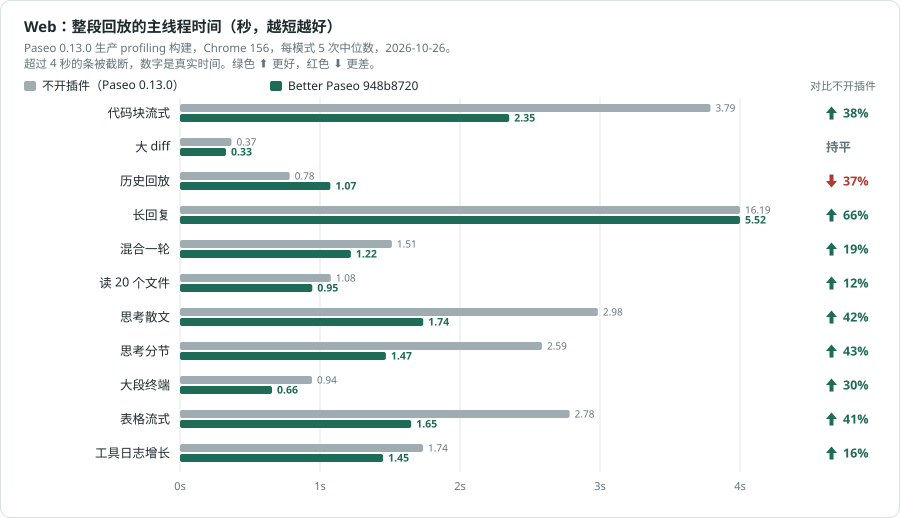
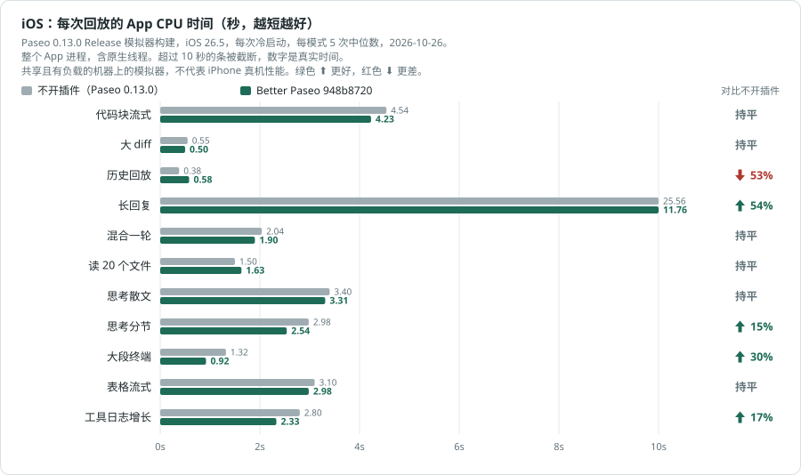
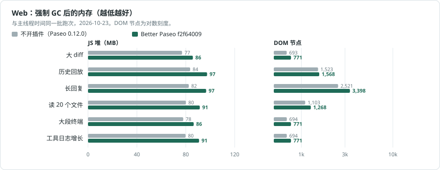

# 性能测试报告

[English](performance.md) | **简体中文**

[← 返回 README](../README-zh.md)

## Web

2026-10-26 至 27 日在 Mac Studio（Apple M5 Max、18 核、64 GB、macOS 27.0.1）上对照 Paseo 0.13.0 测量；Paseo 0.13 基于 React Native 0.86，回复仍由 react-native-enriched-markdown 绘制。Better Paseo 测试版本为 948b8720，通过插件安装流程构建，每次跑次都核实了实际加载的压缩 bundle。Web 和 iOS 各测 11 个场景 × 2 种配置（不开插件、Better Paseo）× 5 次：每个平台 110 次，共 220 次；串行执行，并按场景轮换配置顺序。bench daemon 使用干净的 home，测量期间只有 1 个 workspace 和 1 个 agent。每批只在机器安静时开始：没有其他已启动的模拟器，没有其他构建在跑，一分钟内 CPU 平均空闲不低于 90%；每次跑完时的 1 分钟负载，Web 为 1–7（中位数 2），iOS 为 1.0–8.3（中位数 1.7）。Web 使用 Chrome 156.0.8078.48、1280×900。Tasks 看板和 Block details 均按默认设置开启。之后的提交 948b8720..8802deb8 只改了 Tasks 看板在手机上的搜索、筛选弹层和搜索索引，不涉及时间线。随后的 50143ce1 改了 iOS 时间线：仍在流式输出的回复先用普通文本绘制正文，结束后再换成原生文本视图；在另一组交错的 iOS 长回复 A/B 中（每组 5 次，未经上述安静闸门），App CPU 从 12.35 秒降到 11.01 秒。下表是 948b8720 的 220 次回放结果，没有针对 50143ce1 重测。

整段回放主线程 Task 时间（秒）对比不开插件：9 项更低、1 项持平、1 项更高。差异不到 10% 记为持平；如果两边整段回放都不到 0.5 秒，也记为持平。长回复的 Task 时间是不开插件 16.189 秒、Better Paseo 5.520 秒，减少 66%。

| 场景 | 不开插件 | Better Paseo | 对比不开插件 |
| --- | ---: | ---: | :--- |
| 代码块流式 | 3.789 | **2.351** | &ensp;38% |
| 大 diff | 0.368 | **0.328** | 持平 |
| 历史回放 | 0.784 | **1.075** | &ensp;37% |
| 长回复 | 16.189 | **5.520** | &ensp;66% |
| 混合一轮 | 1.514 | **1.221** | &ensp;19% |
| 读 20 个文件 | 1.077 | **0.945** | &ensp;12% |
| 思考散文 | 2.985 | **1.737** | &ensp;42% |
| 思考分节 | 2.586 | **1.470** | &ensp;43% |
| 大段终端 | 0.943 | **0.657** | &ensp;30% |
| 表格流式 | 2.783 | **1.651** | &ensp;41% |
| 工具日志增长 | 1.736 | **1.450** | &ensp;16% |

同一批跑次的时间线行渲染总量（宿主 Profiler allRows.sum，毫秒），对比不开插件：9 项更低、0 项持平、2 项更高。

| 场景 | 不开插件 | Better Paseo | 对比不开插件 |
| --- | ---: | ---: | :--- |
| 代码块流式 | 1,247.1 | **222.5** | &ensp;82% |
| 大 diff | 27.6 | **19.1** | &ensp;31% |
| 历史回放 | 147.0 | **236.5** | &ensp;61% |
| 长回复 | 8,887.4 | **438.7** | &ensp;95% |
| 混合一轮 | 164.6 | **89.6** | &ensp;46% |
| 读 20 个文件 | 120.7 | **87.7** | &ensp;27% |
| 思考散文 | 493.7 | **132.1** | &ensp;73% |
| 思考分节 | 457.5 | **120.1** | &ensp;74% |
| 大段终端 | 26.2 | **17.0** | &ensp;35% |
| 表格流式 | 886.4 | **147.8** | &ensp;83% |
| 工具日志增长 | 56.8 | **94.3** | &ensp;66% |

## 流式布局偏移

同一批 Web 跑次的累计布局偏移（CLS，越低越好），保留六位小数。0.5 秒规则不适用。基线很小时百分比会显得很大，应同时看绝对值；低于 0.002 的读数通常不易看出来。对比不开插件：2 项更低、3 项持平、6 项更高。

| 场景 | 不开插件 | Better Paseo | 对比不开插件 |
| --- | ---: | ---: | :--- |
| 代码块流式 | 0.001168 | **0.030875** | &ensp;2543% |
| 大 diff | 0.000015 | **0.000015** | 持平 |
| 历史回放 | 0.000015 | **0.000347** | &ensp;2278% |
| 长回复 | 0.053955 | **0.000015** | &ensp;100% |
| 混合一轮 | 0.002791 | **0.026655** | &ensp;855% |
| 读 20 个文件 | 0.000015 | **0.000793** | &ensp;5335% |
| 思考散文 | 0.000015 | **0.000778** | &ensp;5235% |
| 思考分节 | 0.000015 | **0.000778** | &ensp;5235% |
| 大段终端 | 0.000015 | **0.000015** | 持平 |
| 表格流式 | 0.045756 | **0.016243** | &ensp;65% |
| 工具日志增长 | 0.000015 | **0.000015** | 持平 |

## iOS

Paseo 0.13.0 Release 构建，iPhone 17 Pro / iOS 26.5 模拟器；每次样本都冷启动，行探针使用 React profiling renderer。Paseo 0.13 在原生线程上排版 Markdown，因此 iOS 的主要指标是整段回放期间整个 App 进程的 CPU 时间。这些模拟器测量不代表真机性能。iOS 批次进行中，bench 之外的一次模拟器服务重启关掉了所有模拟器；第 1、2 轮因此作废，在同样的安静检查下完整重跑，并检查每个样本期间模拟器都没有重启。有 7 个样本（都是不开插件）以 Paseo App 崩溃结束，已整次重跑，所以每格都是 5 个完整样本。

整个 App 进程的 CPU 时间对比不开插件：4 项更低、6 项持平、1 项更高。长回复中宿主耗时 25.56 秒，Better Paseo 为 11.76 秒（减少 54%）。帧探针记录的掉帧数中位数分别为宿主 894 帧、Better Paseo 15 帧；最长帧分别为 155.1 ms 和 47.9 ms。iOS 的历史回放呈双峰：App CPU 取决于回放画了多少帧。本轮 10 个样本全部落在低峰，之前 Paseo 0.12 那一轮则全部落在高峰。因此 iOS 的秒数不能跨轮比较，只看同一轮内的比例。

| 场景 | 不开插件 | Better Paseo | 对比不开插件 |
| --- | ---: | ---: | :--- |
| 代码块流式 | 4.54 | **4.23** | 持平 |
| 大 diff | 0.55 | **0.50** | 持平 |
| 历史回放 | 0.38 | **0.58** | &ensp;53% |
| 长回复 | 25.56 | **11.76** | &ensp;54% |
| 混合一轮 | 2.04 | **1.90** | 持平 |
| 读 20 个文件 | 1.50 | **1.63** | 持平 |
| 思考散文 | 3.40 | **3.31** | 持平 |
| 思考分节 | 2.98 | **2.54** | &ensp;15% |
| 大段终端 | 1.32 | **0.92** | &ensp;30% |
| 表格流式 | 3.10 | **2.98** | 持平 |
| 工具日志增长 | 2.80 | **2.33** | &ensp;17% |

JavaScript 时间线行渲染总量（宿主 Profiler allRows.sum，毫秒）对比不开插件：3 项更低、0 项持平、8 项更高。Paseo 在原生线程上排版 Markdown，所以这项 JavaScript 探针不能代表整个 App 的 CPU 开销。

| 场景 | 不开插件 | Better Paseo | 对比不开插件 |
| --- | ---: | ---: | :--- |
| 代码块流式 | 647.2 | **407.6** | &ensp;37% |
| 大 diff | 11.9 | **45.9** | &ensp;286% |
| 历史回放 | 34.7 | **82.1** | &ensp;137% |
| 长回复 | 13,968.3 | **798.9** | &ensp;94% |
| 混合一轮 | 107.6 | **168.8** | &ensp;57% |
| 读 20 个文件 | 101.0 | **175.9** | &ensp;74% |
| 思考散文 | 144.5 | **215.1** | &ensp;49% |
| 思考分节 | 133.1 | **179.5** | &ensp;35% |
| 大段终端 | 12.0 | **40.9** | &ensp;241% |
| 表格流式 | 358.6 | **285.2** | &ensp;20% |
| 工具日志增长 | 87.9 | **144.5** | &ensp;64% |

绿色 ⬆ 表示更低，红色 ⬇ 表示更高。百分比按未舍入的中位数计算。`history-100` 是 fixture 名称，不代表 100 个实际 provider turn，此处称“历史回放”。`tool-expanded-streaming` 不执行展开操作，此处称“工具日志增长”。

**方法与边界。** Web 主线程时间是 CDP 记录的整段回放 TaskDuration；行渲染表为宿主 React Profiler 对各时间线行计时的总和。iOS App CPU 覆盖整个进程及原生线程，iOS 行渲染时间只覆盖 JavaScript。表中每格都是 5 次跑次的中位数，百分比按未舍入中位数计算。差异不到 10% 记为持平；Web 整段回放两边都不到 0.5 秒时也记为持平。CLS 不适用 0.5 秒门槛；基线接近零时百分比会放大，应看六位小数的绝对值。与 Beautiful Chat 42b61d8 的对比是在 Paseo 0.11.2 上测得，未在 0.12 和 0.13 重测。Tasks 和 Block details 按默认设置开启。在 Paseo 0.12 上单独做的 A/B（未在 0.13 重做）显示，Tasks 使 Web 历史回放主线程时间从 0.885 秒升至 0.941 秒（+6%），对应样本的 JS 堆增加约 1.3–2.1 MB；iOS 历史回放 App CPU 变化约 2%。关闭 Block details 后，三个 iOS 场景的 JavaScript 行渲染时间减少 12–17%，App CPU 只变化约 2–4%。历史回放开销的一个已知来源是：宿主每次 agent 更新时，即使 `features` 没有变化，也会换成一个新的数组，导致整个 agent 视图和行渲染回调重新渲染；无论 Tasks 看板开或关都一样。已向上游报告（[getpaseo/paseo#7773](https://github.com/getpaseo/paseo/issues/7773)），修复见 [#7774](https://github.com/getpaseo/paseo/pull/7774)，目前仍未合并，所以 Paseo 0.13.0 也是如此。

## 时间省在哪里

- **跳过没有变化的行。** 按语义比较 theme 和 data，让没有变化的卡片跳过渲染。
- **增量解析回复。** 缓存已完成的 Markdown 块，只修补仍在增长的部分；长回复拆成块供原生宿主虚拟化，复制仍使用完整源码。
- **按需绘制工具正文。** 折叠的行不挂载正文；代码完成后再请求 daemon 高亮，大段代码和终端输出分批显示，并保留“显示全部”。
- **减少持续动画开销。** 网页运行圆点使用 CSS 动画，减少动态效果时静止；移除装饰性的阴影、磨砂和呼吸动画。
- **缩小重连交付。** App 每次重连，Paseo 都会把所有插件的客户端包重新发一遍；走中继时，手机还要用 JavaScript 解密。安装时插件会压缩客户端，Tasks 看板、它的侧边栏入口和设置标签拆成一个 304 KB 的独立分块，看板开启时每次启动 App 取一次，关闭时从不下载：Paseo 0.12 daemon 上的插件清单从 1,977 KB 降到 722 KB。品牌图标和 Inter 字体按需下发，客户端源码保持 ASCII，供 Hermes 按单字节保存。

## 内存对比

2026-10-26 的 Web 生产 profiling 跑次；每个数值是同一批回放中强制 GC 后 5 次读数的中位数。这是 JavaScript 堆，不是整个进程或应用的内存。差值为 Better Paseo 减不开插件，单位 MB；不适用 10% 持平规则。所有列出的场景里，Better Paseo 的堆多 5.1–13.2 MB。

| 场景 | 不开插件 | Better Paseo | 差值 |
| --- | ---: | ---: | ---: |
| 代码块流式 | 83.9 | **89.0** | +5.1 |
| 大 diff | 78.3 | **86.6** | +8.2 |
| 历史回放 | 85.8 | **99.1** | +13.2 |
| 长回复 | 83.8 | **96.4** | +12.6 |
| 混合一轮 | 80.6 | **90.2** | +9.6 |
| 读 20 个文件 | 81.6 | **92.1** | +10.6 |
| 思考散文 | 79.4 | **87.4** | +8.0 |
| 思考分节 | 79.3 | **87.0** | +7.7 |
| 大段终端 | 78.9 | **87.3** | +8.4 |
| 表格流式 | 80.4 | **89.0** | +8.6 |
| 工具日志增长 | 81.2 | **91.6** | +10.4 |

本轮 Web 原始样本保存在本地被 git 忽略的 docs/bench/2026-10-26-paseo-013-948b8720 归档中，不进入 git（关于私有媒体仓库与基准样本维护说明见 [development-zh.md](development-zh.md)）。
