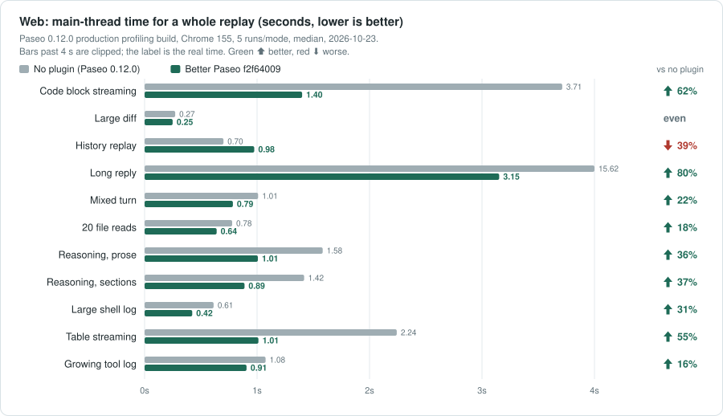
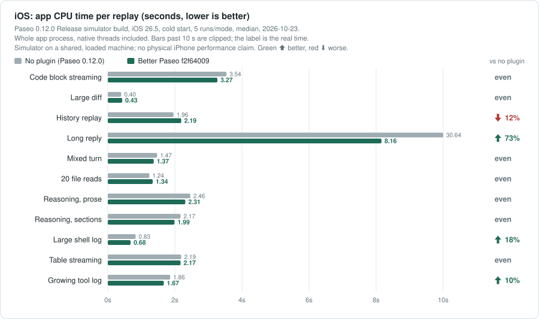
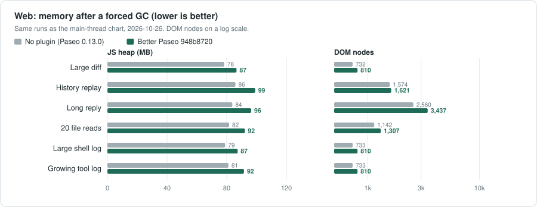

# Performance Benchmarks

**English** | [简体中文](performance-zh.md)

[← Back to README](../README.md)

## Web

Measured on 2026-10-26 and 27 on a Mac Studio with an Apple M5 Max, 18 cores, 64 GB and macOS 27.0.1, against Paseo 0.13.0 (React Native 0.86; replies are still drawn by react-native-enriched-markdown). The tested Better Paseo revision was 948b8720, built through the plugin install flow; the running minified bundle was verified on every run. Web and iOS each covered 11 scenarios × 2 configurations (no plugin and Better Paseo) × 5 runs: 110 per platform, 220 total, serially with configuration order rotated by scenario. The clean bench daemon held one workspace and one agent. A batch started only on a quiet machine: no other simulator booted, no other build running, and at least 90% CPU idle over a minute; one-minute load at run completion ranged from 1 to 7 on Web (median 2) and from 1.0 to 8.3 on iOS (median 1.7). Web used Chrome 156.0.8078.48 at 1280×900. Tasks and Block details were enabled by default. The later commits up to revision 8802deb8 (948b8720..8802deb8) change only the Tasks board's phone search and filter sheet and its search index, not the timeline. 50143ce1 then changes the iOS timeline: a reply that is still streaming draws its prose as plain text and switches to native text views when it settles, which in a separate interleaved iOS long-reply A/B (n=5, not on the quiet gate above) lowered app CPU from 12.35 to 11.01 seconds. The tables are the 220-run results for 948b8720 and were not re-measured for 50143ce1.

Whole-replay main-thread Task time versus no plugin: 9 lower, 1 even and 1 higher. A change under 10% is even; if both whole-replay times are below 0.5 seconds, it is also even. On the long reply, Task time was 16.189 seconds without the plugin and 5.520 seconds with Better Paseo, a 66% reduction.

| Scenario | No plugin | Better Paseo | vs no plugin |
| --- | ---: | ---: | :--- |
| Code block streaming | 3.789 | **2.351** | &ensp;38% |
| Large diff | 0.368 | **0.328** | even |
| History replay | 0.784 | **1.075** | &ensp;37% |
| Long reply | 16.189 | **5.520** | &ensp;66% |
| Mixed turn | 1.514 | **1.221** | &ensp;19% |
| 20 file reads | 1.077 | **0.945** | &ensp;12% |
| Reasoning, prose | 2.985 | **1.737** | &ensp;42% |
| Reasoning, sections | 2.586 | **1.470** | &ensp;43% |
| Large shell log | 0.943 | **0.657** | &ensp;30% |
| Table streaming | 2.783 | **1.651** | &ensp;41% |
| Growing tool log | 1.736 | **1.450** | &ensp;16% |

Total timeline-row render time (host Profiler allRows.sum, milliseconds), versus no plugin: 9 lower, 0 even and 2 higher.

| Scenario | No plugin | Better Paseo | vs no plugin |
| --- | ---: | ---: | :--- |
| Code block streaming | 1,247.1 | **222.5** | &ensp;82% |
| Large diff | 27.6 | **19.1** | &ensp;31% |
| History replay | 147.0 | **236.5** | &ensp;61% |
| Long reply | 8,887.4 | **438.7** | &ensp;95% |
| Mixed turn | 164.6 | **89.6** | &ensp;46% |
| 20 file reads | 120.7 | **87.7** | &ensp;27% |
| Reasoning, prose | 493.7 | **132.1** | &ensp;73% |
| Reasoning, sections | 457.5 | **120.1** | &ensp;74% |
| Large shell log | 26.2 | **17.0** | &ensp;35% |
| Table streaming | 886.4 | **147.8** | &ensp;83% |
| Growing tool log | 56.8 | **94.3** | &ensp;66% |

## Streaming layout shift

Cumulative layout shift (CLS) for the same Web runs; lower is better and values are shown to six decimal places. The 0.5-second rule does not apply. Percentages can magnify tiny baselines, so read the absolute values too; values below 0.002 are generally hard to see. Versus no plugin: 2 lower, 3 even and 6 higher.

| Scenario | No plugin | Better Paseo | vs no plugin |
| --- | ---: | ---: | :--- |
| Code block streaming | 0.001168 | **0.030875** | &ensp;2543% |
| Large diff | 0.000015 | **0.000015** | even |
| History replay | 0.000015 | **0.000347** | &ensp;2278% |
| Long reply | 0.053955 | **0.000015** | &ensp;100% |
| Mixed turn | 0.002791 | **0.026655** | &ensp;855% |
| 20 file reads | 0.000015 | **0.000793** | &ensp;5335% |
| Reasoning, prose | 0.000015 | **0.000778** | &ensp;5235% |
| Reasoning, sections | 0.000015 | **0.000778** | &ensp;5235% |
| Large shell log | 0.000015 | **0.000015** | even |
| Table streaming | 0.045756 | **0.016243** | &ensp;65% |
| Growing tool log | 0.000015 | **0.000015** | even |

## iOS

Paseo 0.13.0 Release simulator build on an iPhone 17 Pro / iOS 26.5 simulator, cold-launched for every sample, with the React profiling renderer for the row probe. Paseo 0.13 lays out Markdown on native threads, so the main iOS metric is whole-app-process CPU time over the replay. These simulator measurements do not establish physical-device performance. During the iOS batch, a restart of the simulator service from outside the bench shut down every simulator; rounds 1 and 2 were set aside and re-run in full under the same quiet checks, with a check that the simulator stayed up through every sample. Seven samples, all without the plugin, ended in a crash of the Paseo app and were run again, so every cell has five complete samples.

Whole-app CPU time versus no plugin: 4 lower, 6 even and 1 higher. On the long reply, the host used 25.56 seconds and Better Paseo 11.76 seconds (54% less). The frame probe recorded medians of 894 dropped frames on the host and 15 with Better Paseo; the longest frames were 155.1 ms and 47.9 ms. History replay is bimodal on iOS, its app CPU depending on how many frames the replay draws: all ten samples of this round fell in the low mode, while those of the earlier Paseo 0.12 round all fell in the high one. iOS seconds are therefore not comparable across rounds; compare the ratios within a round.

| Scenario | No plugin | Better Paseo | vs no plugin |
| --- | ---: | ---: | :--- |
| Code block streaming | 4.54 | **4.23** | even |
| Large diff | 0.55 | **0.50** | even |
| History replay | 0.38 | **0.58** | &ensp;53% |
| Long reply | 25.56 | **11.76** | &ensp;54% |
| Mixed turn | 2.04 | **1.90** | even |
| 20 file reads | 1.50 | **1.63** | even |
| Reasoning, prose | 3.40 | **3.31** | even |
| Reasoning, sections | 2.98 | **2.54** | &ensp;15% |
| Large shell log | 1.32 | **0.92** | &ensp;30% |
| Table streaming | 3.10 | **2.98** | even |
| Growing tool log | 2.80 | **2.33** | &ensp;17% |

JavaScript timeline-row render time (host Profiler allRows.sum, milliseconds), versus no plugin: 3 lower, 0 even and 8 higher. Paseo performs Markdown layout on native threads, so this JavaScript-only probe does not represent total app CPU.

| Scenario | No plugin | Better Paseo | vs no plugin |
| --- | ---: | ---: | :--- |
| Code block streaming | 647.2 | **407.6** | &ensp;37% |
| Large diff | 11.9 | **45.9** | &ensp;286% |
| History replay | 34.7 | **82.1** | &ensp;137% |
| Long reply | 13,968.3 | **798.9** | &ensp;94% |
| Mixed turn | 107.6 | **168.8** | &ensp;57% |
| 20 file reads | 101.0 | **175.9** | &ensp;74% |
| Reasoning, prose | 144.5 | **215.1** | &ensp;49% |
| Reasoning, sections | 133.1 | **179.5** | &ensp;35% |
| Large shell log | 12.0 | **40.9** | &ensp;241% |
| Table streaming | 358.6 | **285.2** | &ensp;20% |
| Growing tool log | 87.9 | **144.5** | &ensp;64% |

Green ⬆ is lower; red ⬇ is higher. Percentages use unrounded medians. `history-100` is a fixture name, not 100 actual provider turns; it is labelled “History replay”. `tool-expanded-streaming` performs no expand action and is labelled “Growing tool log”.

**Method and limits.** Web main-thread time is CDP TaskDuration for a whole replay; the row table is the sum of the host React Profiler row timings. iOS app CPU covers the whole process, including native threads; iOS row timings cover JavaScript work only. Every table uses the median of five runs per cell; percentage changes use unrounded medians. Changes under 10% are even; for whole Web replays, both sides below 0.5 seconds are also even. CLS has no 0.5-second floor; use its six-decimal absolute values because percentages can grow around near-zero baselines. The comparison with Beautiful Chat 42b61d8 was measured on Paseo 0.11.2 and was not repeated on 0.12 or 0.13. Tasks and Block details were on by default. Separate A/B runs on Paseo 0.12, not repeated on 0.13, showed Tasks increased Web history-replay main-thread time from 0.885 to 0.941 seconds (+6%), and increased JS heap by about 1.3–2.1 MB across the paired fixtures; iOS history-replay app CPU changed about 2%. Turning Block details off reduced iOS JavaScript row time by 12–17% in three fixtures, while app CPU changed only about 2–4%. One known source of history-replay overhead is that each host agent update supplies a fresh `features` array even when it is unchanged, making the whole agent view and row-render callbacks render again whether Tasks is on or off; reported upstream as [getpaseo/paseo#7773](https://github.com/getpaseo/paseo/issues/7773) with a fix in [#7774](https://github.com/getpaseo/paseo/pull/7774), which is still open, so Paseo 0.13.0 behaves the same way.

## Where the time goes

- **Skip unchanged rows.** Semantic theme/data comparisons let unchanged cards skip rendering.
- **Parse replies incrementally.** Finished Markdown blocks are cached; only the growing tail is
  repaired. Long replies split into blocks that the native host can virtualize; Copy retains the
  full source.
- **Draw tool bodies on demand.** Collapsed rows do not mount their bodies. Completed code requests
  daemon highlighting; large code and terminal output render in batches with a Show all control.
- **Reduce continuous animation work.** The Web running dot uses CSS and stops for Reduced Motion;
  decorative shadows, blur and breathing loops are removed.
- **Send less on reconnect.** Paseo sends every plugin's client bundle again each time an app
  reconnects, and behind the relay a phone decrypts it in JavaScript. The install step minifies the
  client, and the Tasks board, its sidebar entry and its settings tab are a separate 304 KB chunk
  fetched once per app launch while the board is on and never while it is off: the catalog on a
  Paseo 0.12 daemon fell from 1,977 KB to 722 KB. Brand marks and Inter are delivered on demand,
  and the client source stays ASCII for Hermes one-byte strings.

## Memory comparison

2026-10-26 Web production-profiling runs; each value is the median of five post-GC readings, from the same replay matrix as the main-thread table. This is JavaScript heap, not total process or app memory. Differences are Better Paseo minus no plugin, in MB; the 10% even rule does not apply. Better Paseo used 5.1–13.2 MB more heap across the listed scenarios.

| Scenario | No plugin | Better Paseo | Difference |
| --- | ---: | ---: | ---: |
| Code block streaming | 83.9 | **89.0** | +5.1 |
| Large diff | 78.3 | **86.6** | +8.2 |
| History replay | 85.8 | **99.1** | +13.2 |
| Long reply | 83.8 | **96.4** | +12.6 |
| Mixed turn | 80.6 | **90.2** | +9.6 |
| 20 file reads | 81.6 | **92.1** | +10.6 |
| Reasoning, prose | 79.4 | **87.4** | +8.0 |
| Reasoning, sections | 79.3 | **87.0** | +7.7 |
| Large shell log | 78.9 | **87.3** | +8.4 |
| Table streaming | 80.4 | **89.0** | +8.6 |
| Growing tool log | 81.2 | **91.6** | +10.4 |

Raw Web samples from this round are kept in the local, git-ignored docs/bench/2026-10-26-paseo-013-948b8720 archive (not stored in git; see [development.md](development.md) regarding private repository media and raw measurement maintenance).
