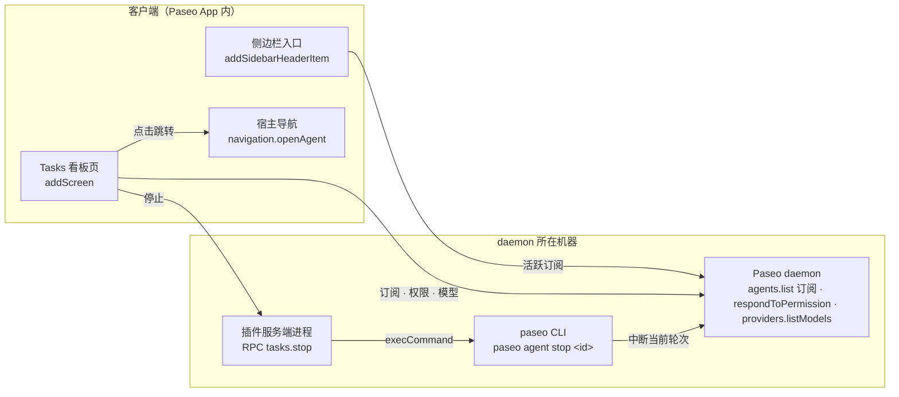

# Paseo Tasks 看板需求方案

- 日期：2026-10-20
- 在线版：[Claude Docs · Paseo Tasks 看板需求方案](https://claude.ai/code/artifact/37c3ac68-e95b-43b9-a638-9ea3c59cfcfb)（含线框与数据流示意图，评论在那里）
- 交互原型：[Claude Design 项目「Paseo Tasks 泳道看板」](https://claude.ai/design/p/5f122bf6-c1af-43e3-9f28-eecb8d286e18)，说明与规格摘要见 [prototypes/tasks-board.md](prototypes/tasks-board.md)。导出的离线 HTML 只留在本地，不进 Git。界面细节以原型为准。

在侧边栏顶部（新建工作区、历史、搜索、计划那一组）加一个「Tasks」入口，用 Linear 式泳道看板把所有 agent 按状态铺开。用户不用逐个 workspace 翻找，就能知道哪些在跑、哪些在等自己、哪些已经跑完。

## 背景与目标

现在的侧边栏按 workspace 组织，任务状态散落在各个 workspace 行里，跨 workspace 的全局视图没有。2026-10-20 本机实测有 340 个未归档 agent，其中 11 个在运行，靠侧边栏逐个找已经不现实。

要解决的问题：

- 看不到全局：哪些任务在跑、哪些在等我输入，要逐个 workspace 点开看。
- 关系看不到：编排出去的子 agent 和父 agent 之间没有可见的关联。
- 操作路径长：停止一个任务或批准一个权限请求，要先找到并切进对应的 tab。

成功标准：

- 打开看板 1 秒内看到全部「运行中」和「待输入」任务。
- 任意卡片一次点击就到达对应 workspace 的对应 tab。
- 「待输入」任务的权限请求可以不跳转直接处理。
- 「运行中」任务可以从看板停止，3 秒内卡片移出运行列。

## 范围

第一版只做「看得见、跳得过去、停得下来、批得了权限」。泳道由 agent 状态推导而来，所以和 Linear 不同，**卡片不能在泳道之间拖动**。

用户故事：

1. 作为同时跑很多 agent 的人，我打开 Tasks，一眼看到所有待输入、运行中、待查看和已完成的任务。
2. 我可以按 workspace（项目）、provider、标签和「只看开着 tab 的」过滤，也可以按标题搜索。卡片上能看到任务所在的项目、workspace、分支、文件夹和标签。
3. 我点卡片上的跳转按钮，就跳到它所在 workspace 的对应 tab。
4. 我在父任务卡片上看到它派出去的子任务及其状态，在子任务卡片上能回到父任务。
5. 我在卡片上直接停止一个跑偏的任务。
6. 我在卡片上直接批准或拒绝权限请求。
7. 我在卡片上看到它跑了多久、用的哪个 agent、什么模型和思考等级、上下文用了多少。
8. 不打开看板，我也能从侧边栏入口上的计数知道有几个在跑、几个在等我。

| 内容 | 第一版 | 后续 |
| --- | --- | --- |
| 侧边栏入口 + 计数 | 做 | |
| 四列泳道看板 + 过滤搜索 | 做 | |
| 跳转到 tab | 做 | |
| Paseo 层父子 agent 关联 | 做 | |
| 停止任务 | 做（走 CLI） | 上游加 `cancel()` 后切换 |
| 卡片上处理权限请求 | 做 | |
| 统计：本轮时长、模型、思考等级、provider、上下文 | 做 | |
| 精确的历史耗时和累计耗时 | | 插件服务端监听轮次事件记账 |
| 归档、追加一条指令 | | 做 |
| 多 host 聚合 | | 做 |
| Claude Code 内部 Task subagent | 不做 | 视成本再定 |
| 在看板上改模型、模式、思考等级 | 不做 | 不做 |

## 泳道定义

看板分四列，归列规则直接沿用协议里的 `deriveAgentStateBucket`。这样看板和侧边栏 workspace 的状态色始终一致。规则自上而下匹配，命中第一条就停。

| 顺序 | 条件 | 协议 bucket | 泳道 | 列内排序 |
| --- | --- | --- | --- | --- |
| 1 | `pendingPermissions` 非空，或 `attentionReason = permission` | needs_input | 待输入 | 等得最久的在上（`attentionTimestamp` 升序） |
| 2 | `status = error`，或 `attentionReason = error` | failed | 待查看（红色失败标） | 最近的在上 |
| 3 | `status = running` 或 `initializing` | running | 运行中 | 跑得最久的在上（`activeTurn.startedAt` 升序），方便发现卡住的 |
| 4 | `requiresAttention = true`（跑完但用户还没看） | attention | 待查看 | 最近的在上（`attentionTimestamp` 降序） |
| 5 | 其余（idle、closed） | done | 已完成 | 最近的在上（`updatedAt` 降序） |

列的顺序是待输入、运行中、待查看、已完成：需要人处理的在最左边。

已完成列必须限量，否则会铺出上百张卡片：

- 默认只显示最近 24 小时内更新过的，可切换为 7 天或全部。
- 每次加载 50 条，滚到底再取下一页。
- 已归档的 agent 不进看板。

待输入、运行中、待查看三列不设时间窗口。它们本来就是「现在要管的事」，数量通常是个位数到十几。

## 界面与交互

入口放在侧边栏顶部那一组，点开是一个整页看板：上面一条过滤栏，下面四列泳道。完整的视觉与交互见[原型说明](prototypes/tasks-board.md)。

### 侧边栏入口

- 标题「Tasks」，图标用 Lucide 的看板类图标（原型用 `square-kanban`）。
- 右侧数字是「运行中 · 待输入」。两者都为 0 时不显示；待输入大于 0 时数字用警示色。
- 当前停在 Tasks 页时高亮该行（读 `currentScreen`）。

### 过滤与搜索

- Workspace 多选（下拉里按项目分组）、Agent（provider）多选、标签多选、只看开着的 tab、隐藏子任务、按标题搜索、已完成列的时间窗口。
- 过滤条件写进 screen params。关掉再打开，或从 Command Center 打开时，条件保留。

### 卡片

每张卡片分四行固定内容：

1. 标题（单行截断），标题行右侧是常驻的跳转按钮；运行中卡片悬停时还有「停止」。
2. provider 图标 + 模型 + 思考等级，独占一行，思考等级永不截断。
3. 位置行：项目头像 + 「项目 / workspace 名」（workspace 名与项目名或任务标题相同时只显示项目名）；右边是计时（运行中、待输入）或完成于多久前（待查看、已完成）。
4. git 行：分支 · 文件夹，写法与侧边栏 workspace 行一致（非 git 项目只显示文件夹，文件夹名与 workspace 名或分支名相同时省略）；右边是 workspace 标签，最多 2 个，其余收成「+N」。

空间不够时先把标签收成 +N，再依次截断文件夹、workspace 名、分支、项目名；模型、思考等级和计时不被挤掉。

其余内容随泳道变化：

| 泳道 | 额外内容 |
| --- | --- |
| 待输入 | 权限请求摘要、允许或拒绝按钮（问题类为「去回答」）、等待时长 |
| 运行中 | 本轮已运行时长、上下文占用条、子任务摘要、停止按钮 |
| 待查看 | 未读标记，或失败原因 |
| 已完成 | 上一轮耗时（约）、完成于多久前 |

悬停卡片（手机上长按）显示详情：cwd、创建时间、模式、token 与费用。

### 交互

- 每张卡片标题行右侧有一个常驻的跳转按钮（Lucide ArrowUpRight，悬停提示「在 workspace 中打开」），点它跳到对应 workspace 的 tab。点卡片主体或聚焦后按 Enter 也跳转；其余按钮区域单独响应，不触发跳转。子任务清单的每一行、悬停详情浮层底部也有同样的跳转入口。
- 状态变化时卡片直接换列，只做淡入，不做跨列飞行动画。多张卡片同时变化时，飞行动画会很乱。
- 窄屏（`layout.compact`）用顶部细线 tab 切换泳道，一次只显示一个泳道，左右滑动也能切换。有待输入任务时默认停在「待输入」，否则停在「运行中」；会话内记住上次选择。过滤收进底部 sheet，详情改为长按弹出底部 sheet。

## 父子 agent 关联

父子关系只覆盖 Paseo 层的子 agent，数据来自每个 agent 快照里的 `parentAgentId`（即 label `paseo.parent-agent-id`）。通过 Paseo 创建并指定了 `parent` 的 agent 有这个字段，比如 MCP `create_agent` 和 paseo-orchestrate 类编排。

展示规则：

- **子找父**：子卡片显示一行「↳ 父任务标题」。点它在看板上滚动到父卡片并高亮，不跳走；手机上父任务在别的泳道时先切 tab。
- **父找子**：客户端用全量列表建 `父 id → 子 id 列表` 的索引。父卡片底部显示「3 个子任务：2 运行中 · 1 已完成」，展开后是子任务列表（状态点 + 标题），每行有跳转按钮。
- **子卡片仍然出现在自己的泳道里**。过滤栏提供「隐藏子任务」开关，默认关；打开后子任务只在父卡片里出现。
- 只展示直接子任务，孙任务在子任务自己的卡片里展开。
- 父 agent 已归档、不在列表里时，子卡片显示「↳ 父任务（已归档）」，标题按需用 `agents.ref(id).refresh()` 补取。
- 子 agent 被 detach 后 `parentAgentId` 清空，订阅推送到达后关联自动消失。

边界：Claude Code 用 Task 工具派出的 subagent、Codex 内部的子任务，都不是 Paseo agent。它们只以工具调用的形式出现在父 agent 的时间线里，列表接口拿不到。要展示它们得逐个订阅时间线去解析，第一版不做。

## 操作

卡片上的操作只保留高频的几种，其余一律通过跳到 tab 完成。

| 操作 | 触发方式 | 实现 | 出现在 | 版本 |
| --- | --- | --- | --- | --- |
| 跳到 tab | 标题行右侧的跳转按钮；点卡片主体或按 Enter 同样跳转 | `navigation.openAgent({ agentId })` | 所有卡片 | 第一版 |
| 停止 | 悬停卡片显示停止按钮（手机常驻），点一下变成「确认停止」，3 秒内再点才执行 | 插件服务端 RPC 调 `paseo agent stop <id>`（见技术方案） | 运行中、待输入 | 第一版 |
| 连同子任务一起停止 | 父卡片停止按钮的下拉项 | 对父和所有运行中的直接子任务逐个调用停止 | 有运行中子任务的父卡片 | 第一版 |
| 批准或拒绝权限 | 卡片内嵌权限请求摘要 + 按钮 | `agents.ref(id).respondToPermission({ requestId, response })` | 待输入 | 第一版 |
| 归档 | 卡片更多菜单 | `agents.ref(id).archive()` | 待查看、已完成 | 后续 |
| 追加一条指令 | 卡片更多菜单里的输入框 | `agents.ref(id).send(text)` | 待查看、已完成 | 后续 |

停止的含义是「中断当前这一轮」，和 CLI 说明一致：agent 回到空闲，会话保留，之后还能继续发消息。它不是删除或归档。

权限请求按 `kind` 分两类处理：

- `tool`、`plan`、`mode`：卡片上显示 `title` 和命令或文件摘要。请求自带 `actions` 时按它们的 `label` 和 `variant` 画按钮，否则画「允许」「拒绝」两个按钮。
- `question`、`other`：需要填写答案或内容太长，卡片只显示问题标题和「去回答」按钮，点了跳到 tab。
- 同一个 agent 有多条挂起请求时，只显示第一条，并标出「还有 N 条」。

## 统计字段

你提的统计都能从 agent 快照里读到，只有「历史耗时」不精确。模型名和思考等级的可读名称复用仓库里已有的 `client/state/footer-model.ts`，保证和输入框里的模型选择器一致。

| 字段 | 来源 | 展示 | 精度 |
| --- | --- | --- | --- |
| 用的哪个 agent | `provider` | 品牌图标 + 名称（复用 `server/mark-bitmaps.ts` 的位图） | 准确 |
| 模型 | `model` → `providers.listModels` 的 `label` | 如「Opus 5.5」 | 准确 |
| 思考等级 | `effectiveThinkingOptionId`，缺省用 `thinkingOptionId`，再缺省用模型的 `defaultThinkingOptionId` | 如「High」 | 准确 |
| 模式 | `currentModeId` → `availableModes` 的名称 | 如「Plan」「Bypass」 | 准确 |
| 本轮已运行 | `now − activeTurn.startedAt`，每秒刷新 | 如「12m 30s」 | 准确 |
| 等待输入多久 | `now − attentionTimestamp` | 如「等待 4m」 | 准确 |
| 上一轮耗时 | `updatedAt − lastUserMessageAt` | 如「约 8m」，带「约」字 | 近似 |
| 创建时间 | `createdAt` | 相对时间 | 准确 |
| 上下文占用 | `lastUsage.contextWindowUsedTokens / contextWindowMaxTokens` | 细进度条，超过 80% 变黄、90% 变红 | 取决于 provider |
| token 与费用 | `lastUsage` 的 input、output、`totalCostUsd` | 卡片详情里显示，不上卡片正面 | 取决于 provider |
| 错误信息 | `lastError` | 失败卡片上的一行红字 | 准确 |
| 项目 | 列表条目的 `project.projectName`；workspace 的 `projectDisplayName`；图标用 `paseo.projects.icon(projectId)` | 项目图标（没有时用首字母头像）+ 名称 | 准确；`projects.icon` 来自上游 PR [#7482](https://github.com/getpaseo/paseo/pull/7482)，合入前只能用首字母头像 |
| workspace 名称 | 列表条目的 `project.workspaceName`；workspace 的 `title ?? name` | 位置行「项目 / workspace」 | 准确 |
| 分支 | 列表条目的 `project.checkout.currentBranch`；workspace 的 `gitRuntime.currentBranch` | git 行，详情里加领先 / 落后和是否有未提交改动（`gitRuntime.aheadBehind`、`isDirty`） | 准确 |
| 文件夹 | `cwd` 的最后一级；完整路径放详情 | git 行 | 准确 |
| 标签 | workspace 的 `labels`（`paseo.workspaces.list`）只有名字；颜色用 `paseo.workspaces.listLabels({ subscribe: {} })` 的定义匹配 | git 行右侧的小 chip | 准确；`listLabels` 来自上游 PR [#7482](https://github.com/getpaseo/paseo/pull/7482)，合入前用中性色点 |
| 关联 PR | workspace 的 `githubRuntime.pullRequest` | 详情里显示「#编号 标题」 | 有 GitHub 集成时准确 |

历史耗时和累计耗时要精确，只能在插件服务端监听 `agent.turn_started` 和 `agent.turn_ended` 自己记账，而且只能从插件装上那一刻开始算。放在后续版本。

## 技术方案

除「停止」外，全部用插件 SDK（`@getpaseo/plugin` 0.11.2，上游 main 相同）已有的接口实现。停止先走插件服务端调 CLI，等上游补上 `cancel()` 再切过去。

看板读数据和处理权限都直接走 daemon；只有停止从插件服务端转到 CLI，再由 daemon 中断。上游给 `PaseoAgentHandle` 加 `cancel()` 后，看板直接调 daemon，CLI 这条路只留给老版本宿主。

### 需求到接口的映射

| 能力 | 接口 | 位置 |
| --- | --- | --- |
| 侧边栏入口 + 计数 | `addSidebarHeaderItem`，用 `SidebarRow` 画，计数放 `trailing`；`currentScreen` 决定高亮 | 客户端 |
| 看板页 | `addScreen({ id: "board", title: "Tasks" })`，过滤条件存在 screen params 里 | 客户端 |
| 快捷入口 | `addCommandCenterItem`（global）「打开 Tasks」 | 客户端 |
| 任务列表 + 实时更新 | `paseo.agents.list({ subscribe: {}, filter, sort, page })`，条目带 `project.workspaceName` | 客户端 |
| 单张卡片的实时状态 | `useAgent(agentId, selector)` 读宿主已有的状态 | 客户端 |
| 跳转 | `props.navigation.openAgent({ agentId })` | 客户端 |
| 权限处理 | `paseo.agents.ref(id).respondToPermission(...)` | 客户端 |
| 模型与思考等级名称 | `paseo.providers.listModels(provider, { cwd })` | 客户端 |
| 停止 | 插件 RPC `tasks.stop` → `execCommand(PASEO_CLI, ["agent", "stop", id, "--json"])` | 服务端 |
| 精确耗时（后续） | `server.on("agent.turn_started" / "agent.turn_ended")` 写入插件自己的文件 | 服务端 |

### 数据订阅

agent 用两路请求，避免一次拉全 340 个 agent 的完整快照；workspace 另走一路订阅：

1. **活跃订阅**（常驻，侧边栏计数也用它）：`filter.statuses = [running, initializing, error]`，再加一路 `filter.requiresAttention = true`。覆盖待输入、运行中、待查看三列，带 `subscribe`。
2. **已完成分页**（只在看板打开时）：`filter.statuses = [idle, closed]`，`sort = updated_at desc`，`page.limit = 50`，客户端再按时间窗口截断。

3. **workspace 订阅**（常驻）：`paseo.workspaces.list({ subscribe: {} })`，按 workspace id 建索引，给卡片补标签、`gitRuntime`（分支、领先落后、是否有改动）和 `githubRuntime.pullRequest`；再订阅 `workspaces.listLabels({ subscribe: {} })` 拿标签颜色，项目图标按 `projectIconRevision` 缓存 `projects.icon()` 的结果。

两路 agent 结果按 agent id 合并去重，再用「泳道定义」里的规则归列。协议包不在插件客户端的模块白名单里，`deriveAgentStateBucket` 约 20 行，照抄一份，并用测试和协议版本对齐。

### 停止任务的两步走

1. **现在**：插件服务端 RPC 调 CLI。已在本机确认插件进程环境里有 `PASEO_CLI=/Applications/Paseo.app/Contents/Resources/bin/paseo` 和 `PASEO_HOME=~/.paseo`。插件服务端跑在 daemon 所在机器上，所以连远程 host 时停的也是那台。`PASEO_CLI` 缺失时退回 PATH 上的 `paseo`，都找不到就隐藏停止按钮。
2. **之后**：给 getpaseo/paseo 提 PR，在 `PaseoAgentHandle` 上加 `cancel()`，内部转调已有的 `DaemonClient.cancelAgent`。合入后客户端直接调用，老版本宿主仍走 RPC。

不用 `send()` 打断当前轮次来冒充停止，那样会在对话里多出一条消息。

### 兼容性

- `navigation` 在老宿主上可能不存在，缺失时隐藏跳转。
- `paseo-plugin.json` 的 `requirements.paseo` 要按 `addSidebarHeaderItem` 和 `addScreen` 首次出现的版本设下限，待查。
- RPC 名必须满足 `^[a-z][a-z0-9._-]*$`，写成 `tasks.stop`。

## 风险与限制

最大的两个风险是「停止」依赖 CLI，以及全量列表带来的重连和渲染成本。其余都有明确的缓解办法。

| 风险 | 影响 | 缓解 |
| --- | --- | --- |
| 停止依赖 CLI：无头 daemon 或 Linux 上可能没有 `PASEO_CLI` | 停止按钮不可用 | 退回 PATH；都找不到就隐藏按钮；尽快推上游 `cancel()` |
| 列表数据量：每条快照带 `availableModes`、`features` 等，全量订阅很重 | 重连和中继解密变慢 | 只常驻订阅活跃任务；已完成列分页且只在看板打开时请求 |
| 客户端包体积：宿主每次重连都重发整个插件包 | 重连变慢 | 看板独立成插件，不加大 Better Paseo 的包 |
| Paseo 层以外的 subagent 看不到 | 用户以为父子关系不全 | 界面上注明「仅显示 Paseo 子 agent」 |
| 历史耗时是估算 | 数字和实际有偏差 | 带「约」字；后续用轮次事件记账 |
| `lastUsage` 在重启后是否保留未验证（时间线上的用量已知不持久化） | 上下文条可能为空 | 拿不到就不显示，不显示「0%」 |
| 「待查看」何时清除由宿主决定 | 卡片可能在用户看过后仍停留 | 上线前实测打开 tab 后 `requiresAttention` 是否清零 |
| 宿主会保留隐藏的页面不卸载 | 看板在后台仍在订阅和每秒计时 | 页面不可见时停掉每秒计时器 |
| 窄屏放不下四列 | 手机上不可用 | `layout.compact` 时改为细线 tab 切换，一次一个泳道 |
| 标签颜色、项目图标依赖上游：`listWorkspaceLabels`、`getProjectIcon` 原本只在底层 `DaemonClient` 上 | PR 合入前，卡片上的标签与侧边栏颜色不一致 | 已提上游 PR [#7482](https://github.com/getpaseo/paseo/pull/7482)（Discussion [#7481](https://github.com/getpaseo/paseo/discussions/7481)），给 `PaseoApi` 加 `workspaces.listLabels()` 和 `projects.icon()`；合入前标签用中性色点、项目用首字母头像，按方法是否存在做特性检测 |

## 里程碑与验收标准

分四步交付，先只读、后操作。每一步都要在桌面端和至少一个窄屏客户端（iOS 模拟器或 Android 真机）上实测。

1. **M0 原型与验证**：用真实数据做一次性看板原型，定下卡片信息密度，并验证前面标为「待查」的假设。
    - [x] 交互原型（[prototypes/tasks-board.md](prototypes/tasks-board.md)）
    - [ ] 打开 tab 后 `requiresAttention` 是否清零
    - [ ] daemon 重启后 `lastUsage` 是否还在
    - [ ] `useAgent` 能否读到不在当前视图里的 agent
    - [ ] `addSidebarHeaderItem` 和 `addScreen` 最低支持的 Paseo 版本
2. **M1 只读看板**：侧边栏入口、四列泳道、过滤搜索、跳转、统计字段、父子关联。
    - [ ] 侧边栏计数和看板各列数量一致，状态变化 2 秒内同步
    - [ ] 任意卡片一次点击到达正确的 workspace 和 tab
    - [ ] 用编排派出 2 个子 agent，父卡片显示 2 个子任务，子卡片能定位回父卡片
    - [ ] 模型名和思考等级与输入框里的显示一致
    - [ ] 340 个 agent 的本机数据下，打开看板 1 秒内出现活跃任务，滚动不掉帧（报告帧数，而不是单行渲染时间）
3. **M2 操作**：停止、连同子任务停止、卡片上处理权限。
    - [ ] 停止后 3 秒内卡片离开运行中列，会话仍可继续发消息
    - [ ] 找不到 CLI 时停止按钮隐藏，不报错
    - [ ] `tool` 类权限在卡片上允许后，agent 继续执行；`question` 类跳到 tab
4. **M3 上游与增强**：上游 `cancel()` PR 合入后切换；归档、追加指令、多 host 聚合、精确耗时记账。
    - [ ] 上游 PR 附 QA 证据并从 RoundRedDot/paseo 发出
    - [ ] 新宿主走 `cancel()`，老宿主仍走 RPC

## 待决问题

下面四个问题要在 M1 开工前定下来，第一个决定代码放在哪个仓库。

- [ ] 放在 Better Paseo 里，还是单独做成 `paseo-tasks` 插件？建议单独做：Better Paseo 的定位是重画聊天时间线，README 写明不提供 surface 和 Command Center 条目，而且重连时会重发整个包。代价是品牌图标和主题工具要复制或抽成共用。
- [ ] 「按 tab 过滤」的含义。本方案暂按「只看开着 tab 的 agent」实现（label `paseo.open-agent-tab.<clientId>` 为 `true`）。备选是按 tab 类型，或指定某一个 agent。
- [ ] 「待查看」要不要单独成列，还是并入「已完成」并用未读圆点标出？本方案暂按单独成列。
- [ ] 已完成列默认的时间窗口取 24 小时还是 7 天？
