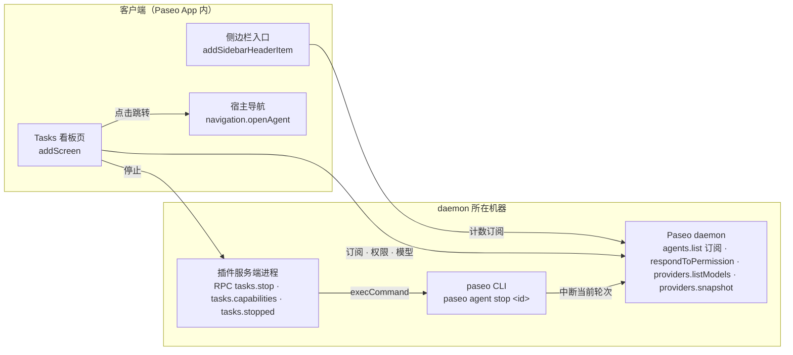

# Paseo Tasks 看板需求方案

- 日期：2026-10-20（方案），2026-10-22 按代码校对
- 状态：已在 Better Paseo 中实现（`client/tasks/`、`server/tasks/`、`shared/tasks-*.ts`），本文按 2026-10-22 的代码校对。已实现的写成现状，没做的标为「未做」，和最初方案不同的地方按代码写。
- 在线版：[Claude Docs · Paseo Tasks 看板需求方案](https://claude.ai/code/artifact/37c3ac68-e95b-43b9-a638-9ea3c59cfcfb)（2026-10-20 的方案原稿，含线框与数据流示意图，评论在那里；没有随本次校对更新）
- 交互原型：[Claude Design 项目「Paseo Tasks 泳道看板」](https://claude.ai/design/p/5f122bf6-c1af-43e3-9f28-eecb8d286e18)，说明与规格摘要见 [prototypes/tasks-board.md](prototypes/tasks-board.md)；卡片详情的后续原型见 [prototypes/task-details-rich.md](prototypes/task-details-rich.md)、[prototypes/task-details-properties.md](prototypes/task-details-properties.md)、[prototypes/task-board-pad.md](prototypes/task-board-pad.md)。导出的离线 HTML 只留在本地，不进 Git。界面细节以代码为准，原型只作设计记录。

Better Paseo 的设置里开启看板后，侧边栏顶部（新建工作区、历史、搜索、计划那一组）多一个「Tasks」入口（中文界面为「任务」），用 Linear 式泳道看板把所有 agent 按状态铺开。用户不用逐个 workspace 翻找，就能知道哪些在跑、哪些在等自己、哪些已经跑完。

## 背景与目标

现在的侧边栏按 workspace 组织，任务状态散落在各个 workspace 行里，跨 workspace 的全局视图没有。2026-10-20 本机实测有 340 个未归档 agent，其中 11 个在运行，靠侧边栏逐个找已经不现实。

要解决的问题：

- 看不到全局：哪些任务在跑、哪些在等我输入，要逐个 workspace 点开看。
- 关系看不到：编排出去的子 agent 和父 agent 之间没有可见的关联。
- 操作路径长：停止一个任务或批准一个权限请求，要先找到并切进对应的 tab。

成功标准：

- 打开看板 1 秒内看到全部「运行中」和「待输入」任务。
- 任意卡片一次点击就到达对应 workspace 的对应 tab。
- 「待输入」任务的权限请求可以不跳转直接处理。
- 「运行中」任务可以从看板停止，3 秒内卡片移出运行列。

## 范围

第一版只做「看得见、跳得过去、停得下来、批得了权限」。泳道由 agent 状态推导而来，所以和 Linear 不同，**卡片不能在泳道之间拖动**。

用户故事：

1. 作为同时跑很多 agent 的人，我打开 Tasks，一眼看到所有待输入、运行中、待查看和已完成的任务。
2. 我可以按 workspace（项目）、provider 和标签过滤，也可以按标题搜索。卡片上能看到任务所在的项目、workspace、分支、文件夹和标签。
3. 我点卡片上的跳转按钮，就跳到它所在 workspace 的对应 tab。
4. 我在父任务卡片上看到它派出去的子任务及其状态，在子任务卡片上能回到父任务。
5. 我在卡片上直接停止一个跑偏的任务。
6. 我在卡片上直接批准或拒绝权限请求。
7. 我在卡片上看到它跑了多久、用的哪个 agent、什么模型和思考等级、上下文用了多少。
8. 不打开看板，我也能从侧边栏入口上的计数知道有几个在等我、几个在跑、几个待查看。

| 内容 | 第一版 | 后续 |
| --- | --- | --- |
| 侧边栏入口 + 计数 | 已做 | |
| 插件设置：总开关、卡片字段开关、信息密度预设、看板默认行为 | 已做（并入 Better Paseo 设置页） | |
| 四列泳道看板 + 过滤搜索 | 已做（另加排序） | |
| 卡片详情：桌面侧栏、窄屏底部 sheet | 已做（代替原型的悬停浮层） | |
| 跳转到 tab | 已做 | |
| Paseo 层父子 agent 关联 | 已做 | |
| 停止任务 | 已做（走 CLI） | 上游加 `cancel()` 后切换（上游 PR 未提） |
| 卡片上处理权限请求 | 已做 | |
| 统计：本轮时长、模型、思考等级、provider、上下文 | 已做 | |
| 精确的历史耗时和累计耗时 | | 未做：插件服务端监听轮次事件记账 |
| 归档、追加一条指令 | | 未做 |
| 多 host 聚合 | | 未做 |
| Claude Code 内部 Task subagent | 不做 | 视成本再定 |
| 在看板上改模型、模式、思考等级 | 不做 | 不做 |

## 泳道定义

看板分四列，归列规则沿用协议里的 `deriveAgentStateBucket`。这样看板和侧边栏 workspace 的状态色基本一致；唯一的例外是 `initializing`：协议的 bucket 把它归为 done，看板按下表第 3 条放进运行中。规则自上而下匹配，命中第一条就停。

| 顺序 | 条件 | 协议 bucket | 泳道 | 列内默认排序 |
| --- | --- | --- | --- | --- |
| 1 | `pendingPermissions` 非空，或 `attentionReason = permission`（只见于老 daemon 的记录） | needs_input | 待输入 | 等得最久的在上（`attentionTimestamp` 升序） |
| 2 | `status = error`，或 `attentionReason = error` | failed | 待查看（红色失败标） | 最近的在上 |
| 3 | `status = running` 或 `initializing` | running | 运行中 | 跑得最久的在上（`activeTurn.startedAt` 升序），方便发现卡住的 |
| 4 | `requiresAttention = true`（跑完但用户还没看） | attention | 待查看 | 最近的在上（`attentionTimestamp` 降序，缺省用 `updatedAt`） |
| 5 | 其余（idle、closed） | done | 已完成 | 最近的在上（`updatedAt` 降序） |

列的顺序是待输入、运行中、待查看、已完成：需要人处理的在最左边。

过滤栏可以另选一种排序，同时作用于四列：workspace、项目、分支、文件夹、标题、创建时间、更新时间、上下文占用、耗时，各有升降两个方向。没有该字段的卡片排在最后；不选时按上表。已完成列分页加载，按更新时间以外的键排序时只排已加载的部分，列底会注明。

已完成列必须限量，否则会铺出上百张卡片：

- 默认只显示最近 24 小时内更新过的，可切换为 7 天或全部。
- 每次加载 50 条，滚到底或点「加载更多」再取下一页。
- 已归档的 agent 不进看板，所在工作区或项目已归档的 agent 也不进。设置 `board.showArchived` 打开后，已完成之后多一列「已归档」，见下节。

待输入、运行中、待查看三列不设时间窗口。它们本来就是「现在要管的事」，数量通常是个位数到十几。

### 已归档列（可选）

默认开启。开关的入口有三处，写的都是同一个设置 `board.showArchived`，各客户端同步：桌面看板筛选栏右侧、已完成时间窗口旁边常驻的归档圆按钮；手机和窄屏看板头部、筛选按钮左侧的同款圆按钮。开关只体现在图标上：关闭时图标带一道斜线，打开时是普通的归档图标，外框不变；设置页任务看板标签页的总开关下方。打开后，已完成之后多出第五列「已归档」，手机的状态条也多一格：

- 收两类卡片：agent 本身已归档的；agent 没归档、但所在工作区或项目已归档的。Paseo 归档工作区时会留下它的 agent，列表接口照样返回，但界面上哪里都不显示。
- Paseo 的 `agents.list` 没有「只列已归档」的过滤，只有 `includeArchived`，返回已归档和未归档混在一起、按更新时间排序的列表。所以打开后，已完成列那条订阅改为带 `includeArchived`，两列共用这一条订阅，也共用分页和时间窗口。归档时 daemon 会把 `updatedAt` 设成归档时间，所以时间窗口按归档时间算。一页可能只带来几张已归档卡片，因此这一列为空时也显示「加载更多」。
- 卡片的状态图标是灰色的 `Archive` 方盒，没有标为已读。本身已归档的卡片，详情头部多一个「取消归档」按钮，和父任务行的取消归档走同一个 RPC；取消后卡片回到已完成列。因工作区归档而进来的卡片没有这个按钮。
- 未归档的父任务卡片不列出已归档的子任务，和关闭这一列时一样；子卡片的父任务行仍能跳到父卡片。
- 关闭时看板不向 daemon 要任何已归档的 agent，行为和加这一列之前完全一样。切换开关会重新读一次已完成列。

## 界面与交互

入口放在侧边栏顶部那一组，点开是一个整页看板。桌面上方是两行工具栏，下面四列泳道，右侧是详情侧栏。最初的视觉与交互见[原型说明](prototypes/tasks-board.md)，实现后有改动的以本文和代码为准。

### 侧边栏入口

- 标题「Tasks」（中文界面「任务」，跟随宿主语言），图标用 Lucide 的 `SquareKanban`。看板没开启时不出现。
- 右侧计数按泳道顺序显示「待输入 · 运行中 · 待查看」，每个数字前带该泳道的状态图标；为 0 的项不显示，全为 0 时不显示计数；待输入的数字用警示色。`sidebar.count` 可改为只显示待输入或不显示。
- 当前停在 Tasks 页时高亮该行（读 `currentScreen`）。
- 同时注册一个全局 Command Center 条目「打开任务」（Open Tasks），同样只在看板开启时存在。

### 过滤与搜索

- 第一行：任务总数、快捷键提示（窄看板上省略）、搜索。搜索匹配标题、项目、workspace 和分支。
- 第二行：Workspace 多选（下拉里按项目分组，同名 workspace 用文件夹名区分）、Agent（provider）多选、标签多选、已选条件的 chip、已完成列的时间窗口、「显示子任务」开关、排序。菜单是 Linear 式的级联菜单。「显示子任务」和已归档泳道一样是圆形开关，只用图标区分开关：关闭时图标加斜杠，不高亮。
- Web 上两行工具栏的每个控件都有悬停提示：指针停 400 ms 后在控件下方显示它的作用（开关类说明点下去会怎样，快捷键附在括号里），按下即消失；菜单打开时不显示该按钮的提示。按钮放不下文字、只剩图标时，提示先写出收起的文字（已选数量、当前排序、泳道宽度）。与卡片的悬停提示共用一套样式和延迟。
- 过滤条件写进 screen params，并按 host 在本次会话内记住；从侧边栏或 Command Center 重开时带上。「显示子任务」和时间窗口默认跟随设置，在看板上改过才覆盖；「清除全部」回到设置值，不清排序。
- 数量为 0 的分组：设置 `board.showEmptyGroups`，默认开。开着时，筛选菜单（项目、Workspace、Agent、标签）、手机和窄屏的筛选 sheet、详情侧栏的分组都列出 Paseo 里能用的全部选项：所有未归档的 workspace 和它们的项目、所有已启用的 provider、`listLabels` 定义的和 workspace 上带的全部标签，没有进行中任务的计数为 0，排在有任务的后面。关掉后只列计数大于 0 的，已选中的始终保留，方便取消；项目按全部 workspace 计算，选一个项目仍会选上它没列出来的 workspace。切换入口和已归档列一样有三处，写的是同一个设置：桌面筛选栏右侧归档按钮旁的圆按钮、手机和窄屏头部归档按钮右侧的圆按钮、设置页「看板」分组。按钮用两个图标区分状态：显示时是 Lucide 的 `List`（完整列表），隐藏时是 `ListFilter`（逐行收窄的列表），描边不变色。

### 卡片

卡片仿 Linear 的 issue 卡片，自上而下：

1. 元信息行（灰色小字）：项目图标 +「项目 › workspace」，子任务再接「↳ 父任务标题」。workspace 与项目名、任务标题或分支名相同时不显示。行尾是跳转按钮；桌面上悬停时停止按钮浮在它左侧，不挤动文字。这一行只占一行，放不下时截断，父任务链接先让位。元信息行没有内容时，跳转按钮放到标题行。
2. 标题行：状态图标 + 标题，标题最多 2 行。
3. 属性行（Linear 式 pill，放不下就折行）：agent pill（品牌标识 + 模型名；模型关掉或未知时显示 agent 名）、思考等级、分支（等宽字体，可接 Git 状态）、文件夹或完整路径、标签（超出上限收成 +N）、关联 PR、子任务 pill。
4. 底部行：左边计时，右边上下文占用环。运行中显示本轮开始时刻和已运行时长，待输入显示等待时长，待查看和已完成显示「约 Xm · N 分钟前」（跨天显示完整日期）。上下文环只在运行中卡片上画。

最初方案里「位置组 + 行首图标」「信息完整显示、不截断」的排法已经改掉：卡片按 Linear 的 issue 卡片重排，项目和 workspace 并进顶部元信息行，分支、文件夹、标签等改成 pill。

桌面上各列平分看板宽度，单列 300 到 340；放不下时看板横向滚动，并尽量让两列同时可见（单列最窄 220）。列头可以折叠成 40px 竖条。

状态图标照搬 Paseo 侧边栏 workspace 行的官方指示器：运行中是转圈的环（中心圆点 + 90° 弧，900ms 一圈，所有环同步），跑完未看是绿点，失败是红点，已完成是 30% 透明的灰点。两处偏离：等待输入按用户要求画成空心的琥珀色圆环，不用宿主的实心 `CircleAlert`；从看板手动停止、还没再跑的卡片画成实心方块。列头、卡片标题、手机泳道切换条、侧边栏计数和子任务清单都用同一组图标。

其余内容随泳道变化：

| 泳道 | 额外内容 |
| --- | --- |
| 待输入 | 权限请求摘要（标题 · 命令或文件）、允许或拒绝按钮（问题类为「去回答」）、「还有 N 条」、等待时长 |
| 运行中 | 本轮开始时刻与已运行时长、上下文占用环、子任务 pill、停止按钮 |
| 待查看 | 失败原因（红字）或「已手动停止」；未读只靠绿点状态图标表示 |
| 已完成 | 上一轮耗时（约）、完成于多久前；手动停止的显示「已手动停止」 |
| 已归档（可选） | 上一轮耗时（约）、归档于多久前 |

### 详情

原型里的悬停浮层没有采用。详情是一张 Linear 式的卡片：头部（状态、标题、agent / 模型 / 思考等级 / 模式 chip、标签、操作按钮），下面是按状态挑选的主块（运行中的本轮计时、累计 token 与上下文、待输入的权限请求、失败原因或摘要），再往下是可折叠的属性（项目、父任务、分支、工作目录、PR、标签）、子任务、用量（token 与费用）和时间线。

- 桌面：单击卡片在看板右侧的详情侧栏里显示。看板宽 1020 以上时侧栏内嵌在泳道右侧，宽度可拖动（340 到 520）；较窄时浮在泳道右侧；再窄（约 760 以下）从底部升起为非模态 sheet，半高或全高。没选卡片时，侧栏显示四列计数和按 Agent、项目、Workspace、标签的分组，点一行即加入过滤；计数为 0 的行是否列出跟随 `board.showEmptyGroups`。`I` 键显示或隐藏侧栏，侧栏的开关和宽度会被记住。
- 手机：点按或长按卡片打开详情 sheet，sheet 顶部可在同一泳道的卡片间切换上一个、下一个。

### 交互

- 每张卡片都有一个常驻的跳转按钮（Lucide ArrowUpRight，悬停提示「在 workspace 中打开」），点它跳到对应 workspace 的 tab。桌面上双击卡片，或用键盘聚焦后按 Enter，也会跳转；单击只是选中并显示详情。手机上点卡片打开详情，跳转只用箭头按钮。其余按钮区域单独响应。子任务清单的每一行、详情卡片头部也有跳转入口。
- 状态变化时卡片直接换列，只做淡入，不做跨列飞行动画。多张卡片同时变化时，飞行动画会很乱。
- 桌面键盘：J/K 或 ↑↓ 列内移动，H/L 或 ←→ 跨列（跳过空列和折叠列），Enter 打开 tab，/ 聚焦搜索，Esc 依次返回上一张、收起浮动侧栏、取消选中，并解除待确认的停止。
- 窄屏的卡片原则：手机上不必要的信息隐藏，挪到详情 sheet。必须显示的是状态、标题、agent · 模型 · 思考等级、计时、操作、权限请求摘要和失败原因，这些不受字段开关影响；项目、workspace、分支、第 1 个标签和子任务摘要跟随开关；文件夹、完整路径、Git 状态、关联 PR、项目图标不上卡片；上下文占用超过 80% 时才在卡片上提醒。
- 宿主是窄屏布局（`layout.compact`），或看板实测宽度放不下两列时，用手机布局：顶部是四格分段的状态条（状态图标 + 泳道名 + 数量）切换泳道，一次只显示一个泳道，左右滑动也能切换（iOS 和 Android 用原生分页）。有待输入任务时默认停在「待输入」，否则停在「运行中」；会话内记住上次选择。过滤收进底部 sheet，操作按钮排在卡片底部的一行里。
- 平板宽度能放下两列时画桌面看板，但没有悬停：停止按钮常驻，点按选中卡片。

## 插件设置

卡片上显示哪些信息由插件设置决定。入口是 Better Paseo 唯一的设置页（Settings → Plugins → Better Paseo，`addSettingsScreen` id `chat-presentation`），页里分「聊天显示」和「任务看板」两个标签页；聊天标签页顶部也有看板的开关和预览，并链到任务看板标签页。最初方案里单独的 Tasks 设置页已经并入这里。设置用 `defineSettings`（id `tasks`）定义，由插件服务端 `registerSettings` 注册，按 host 保存（SDK 只支持 `scope: "host"`），同一个 daemon 下的桌面端和手机共用一份，所以手机单独给一个开关。

任务看板标签页顶部是看板的实时预览：用示例 agent 画出四列，打开「显示已归档泳道」时是五列（窄页面上是一列加泳道切换），改任何开关预览立即变化。宽页面上预览右上角有「桌面端 / 移动端」切换（与聊天标签页的效果预览一致）：移动端在 390pt 宽的手机框里按手机的样子画看板，即泳道切换加 `mobile.compactCards` 卡片；手机上预览本来就是手机样子，不显示这个切换。预览不读真实数据，也不发请求。

### 总开关

| 设置 | 设置键 | 选项 | 默认 |
| --- | --- | --- | --- |
| 启用任务看板 | `enabled` | 开 / 关 | 开 |

看板默认开启。关闭时没有侧边栏入口和 Command Center 条目，也不订阅任何 agent；直接打开看板页会提示未启用，并给出「打开设置」。

「显示已归档泳道」（`board.showArchived`）紧随总开关，位于实时预览上方，默认开启。

### 信息密度

「卡片信息密度」（设置键 `density`）提供四个选项：精简、标准（默认）、完整、自定义。选预设会一次性设置下面的开关，手动改过任何开关后自动变成「自定义」。

| 字段 | 设置键 | 精简 | 标准 | 完整 |
| --- | --- | --- | --- | --- |
| agent 品牌标识 | `card.provider` | 关 | 开 | 开 |
| 模型 | `card.model` | 开 | 开 | 开 |
| 思考等级 | `card.thinking` | 开 | 开 | 开 |
| 项目 | `card.project` | 关 | 开 | 开 |
| 项目图标 | `card.projectIcon` | 关 | 开 | 开 |
| workspace 名称 | `card.workspace` | 关 | 开 | 开 |
| 分支 | `card.branch` | 关 | 开 | 开 |
| Git 状态（未提交改动、领先 / 落后） | `card.gitStatus` | 关 | 关 | 开 |
| 文件夹 | `card.folder` | 关 | 开 | 开 |
| 完整路径（代替文件夹） | `card.path` | 关 | 关 | 开 |
| 标签 | `card.labels` + `card.labelLimit`（1 / 2 / 3 / 全部） | 关 | 开，2 | 开，全部 |
| 关联 PR | `card.pullRequest` | 关 | 关 | 开 |
| 计时 / 完成于 | `card.timer` | 开 | 开 | 开 |
| 上下文占用环 | `card.context` | 关 | 开 | 开 |
| 子任务摘要 | `card.subtasks` | 关 | 开 | 开 |

最初方案里精简密度的「项目」是开，和「精简只留标题和计时」的规则矛盾，代码按后者改为关。

标题和跳转按钮始终显示，不提供开关（宿主没有 `navigation` 时不画跳转按钮）。字段被关掉或没有数据时不画对应的内容：元信息行没有项目、workspace 和父任务时整行收起，属性行一个 pill 都没有时整行收起，计时和上下文环都没有时底部行收起。精简密度只留标题、模型与思考等级和计时。

### 其他设置

| 设置 | 设置键 | 选项 | 默认 |
| --- | --- | --- | --- |
| 手机上使用精简卡片 | `mobile.compactCards` | 开 / 关 | 关（关时手机卡片按「窄屏的卡片原则」跟随上面的开关；开时一律用精简预设） |
| 已完成默认时间窗口 | `board.doneWindow` | 24 小时 / 7 天 / 全部 | 24 小时 |
| 显示子任务 | `board.hideSubtasks`（取反） | 开 / 关 | 开 |
| 显示数量为 0 的分组 | `board.showEmptyGroups` | 开 / 关 | 开（见「过滤与搜索」；看板工具栏上也能切换） |
| 停止前二次确认 | `board.confirmStop` | 开 / 关 | 开 |
| 侧边栏入口计数 | `sidebar.count` | 待输入 · 运行中 · 待查看（`all`）/ 只显示待输入（`input-only`）/ 不显示（`none`） | `all`（旧值 `running-and-input` 读作 `all`） |

页面底部有「恢复默认设置」，看板的开关状态不受影响。设置 schema 带 `version`（目前是 1），以后增删字段用 `migrate` 迁移旧值；每个字段的坏值单独回退到默认，不会让整条记录失效。

## 父子 agent 关联

父子关系只覆盖 Paseo 层的子 agent，数据来自每个 agent 的 label `paseo.parent-agent-id`。通过 Paseo 创建并指定了 `parent` 的 agent 有这个 label，比如 MCP `create_agent` 和 paseo-orchestrate 类编排。

展示规则：

- **子找父**：子卡片的元信息行末尾显示「↳ 父任务标题」。点它在看板上滚动到父卡片并高亮，不跳走；父卡片所在列折叠时先展开，手机上父任务在别的泳道时先切过去，被过滤隐藏时给出提示。
- **父找子**：客户端用全量列表建 `父 id → 子 id 列表` 的索引。父卡片的子任务 pill 显示 ListTree 图标和各状态的图标与数量，点开后是子任务列表（状态图标 + 标题），点一行在看板上定位该子任务，行尾的跳转按钮打开它的 tab。详情里的子任务按 Paseo 0.12 子 agent 行的样式显示 agent 标识、模型、思考等级、模式和上下文。
- **子卡片仍然出现在自己的泳道里**。过滤栏提供「显示子任务」开关，默认开；关闭后待查看和已完成的子任务只在父卡片里出现，运行中、待输入和失败的子任务仍留在泳道里。
- 只展示直接子任务，孙任务在子任务自己的卡片里展开。
- 父 agent 已归档、不在列表里时，子卡片显示「↳ 父任务（已归档）」，标题按需用 `agents.ref(id).refresh()` 补取。
- 子 agent 被 detach 后 label 清空，订阅推送到达后关联自动消失。

边界：Claude Code 用 Task 工具派出的 subagent、Codex 内部的子任务，都不是 Paseo agent。它们只以工具调用的形式出现在父 agent 的时间线里，列表接口拿不到。要展示它们得逐个订阅时间线去解析，第一版不做。

## 操作

卡片上的操作只保留高频的几种，其余一律通过跳到 tab 完成。

| 操作 | 触发方式 | 实现 | 出现在 | 版本 |
| --- | --- | --- | --- | --- |
| 跳到 tab | 跳转按钮；桌面上双击卡片或聚焦后按 Enter；子任务行和详情里的打开按钮 | `navigation.openAgent({ agentId })` | 所有卡片 | 已做 |
| 停止 | 桌面悬停显示停止按钮（触屏常驻），点一下变成「确认停止」，3 秒内再点才执行；`board.confirmStop` 关掉后一次即停 | 插件服务端 RPC `tasks.stop` 调 `paseo agent stop <id>`（见技术方案） | 运行中、待输入 | 已做 |
| 连同子任务一起停止 | 父卡片停止按钮的下拉项（仅停止此任务 / 连同子任务一起停止） | 一次 RPC 传入父和运行中、待输入的直接子任务，服务端逐个停止 | 有运行中或待输入子任务的父卡片 | 已做 |
| 批准或拒绝权限 | 卡片内嵌权限请求摘要 + 按钮 | `agents.ref(id).respondToPermission({ requestId, response })` | 待输入 | 已做 |
| 归档 | 卡片更多菜单 | `agents.ref(id).archive()` | 待查看、已完成 | 未做 |
| 追加一条指令 | 卡片更多菜单里的输入框 | `agents.ref(id).send(text)` | 待查看、已完成 | 未做 |

停止的含义是「中断当前这一轮」，和 CLI 说明一致：agent 回到空闲，会话保留，之后还能继续发消息。它不是删除或归档。

停止发出后，按钮显示「停止中」，直到 agent 离开运行中和待输入；RPC 失败、30 秒没有回应，或 10 秒内 agent 仍在运行，都会弹出错误提示。从看板停止的卡片在再次运行前画成实心方块，并显示「已手动停止」；daemon 停下 agent 时通常不要求关注，所以这类卡片多落在已完成列。服务端把这些记录存在插件数据目录的文件里，通过 RPC `tasks.stopped` 提供给看板；agent 开始新一轮、被归档或记录满 30 天时清除。换一个客户端或重启后，看板仍能显示「已手动停止」。

权限请求按 `kind` 分两类处理：

- `tool`、`plan`、`mode`：卡片上显示 `title` 和命令或文件摘要。请求自带 `actions` 时按它们的 `label` 和 `variant` 画按钮，否则画「允许」「拒绝」两个按钮。
- `question`、`other`：需要填写答案或内容太长，卡片只显示问题标题和「去回答」按钮，点了跳到 tab。
- 同一个 agent 有多条挂起请求时，只显示第一条，并标出「还有 N 条」。

## 统计字段

你提的统计都能从 agent 快照里读到，只有「历史耗时」不精确。模型名和思考等级的可读名称复用仓库里已有的 `client/state/footer-model.ts`，保证和输入框里的模型选择器一致。

| 字段 | 来源 | 展示 | 精度 |
| --- | --- | --- | --- |
| 用的哪个 agent | `provider` | agent pill 里的品牌标识（复用 `server/mark-bitmaps.ts` 的位图）；模型关掉时 pill 显示 agent 名 | 准确 |
| 模型 | `model` → `providers.listModels` 的 `label` | agent pill 里，如「Opus 5.5」 | 准确 |
| 思考等级 | `effectiveThinkingOptionId`，缺省用 `thinkingOptionId`，再缺省用模型的 `defaultThinkingOptionId` | 单独一个 pill，如「High」 | 准确 |
| 模式 | `currentModeId` → `availableModes` 的名称 | 只在详情和子任务行里显示，如「Plan」「Bypass」 | 准确 |
| 本轮已运行 | `now − activeTurn.startedAt`，每秒刷新 | 开始时刻 + 时长，如「12m 30s」 | 准确 |
| 等待输入多久 | `now − attentionTimestamp` | 如「等待 4m」 | 准确 |
| 上一轮耗时 | `updatedAt − lastUserMessageAt` | 如「约 8m」，带「约」字 | 近似 |
| 创建时间 | `createdAt` | 详情的时间线 | 准确 |
| 上下文占用 | `lastUsage.contextWindowUsedTokens / contextWindowMaxTokens` | 宿主输入框同款的上下文环，70% 起变黄、超过 90% 变红；悬停看用量和费用 | 取决于 provider |
| token 与费用 | `lastUsage` 的 input、cached input、output、`totalCostUsd` | 详情的用量部分和上下文环的悬停卡片，不上卡片正面 | 取决于 provider |
| 错误信息 | `lastError` | 失败卡片上的一行红字 | 准确 |
| 项目 | workspace 的 `projectCustomName ?? projectDisplayName`；退回列表条目的 `project.projectName`；图标用 `paseo.projects.icon(projectId)` | 元信息行里的项目图标 + 名称；没有图标时画 Paseo 的生成图标（项目色方块 + 首字母） | 准确；`projects.icon` 来自上游 PR [#7482](https://github.com/getpaseo/paseo/pull/7482)，合入前只能用生成图标 |
| workspace 名称 | workspace 的 `title ?? name`；退回列表条目的 `project.workspaceName` | 元信息行「项目 › workspace」 | 准确 |
| 分支 | workspace 的 `gitRuntime.currentBranch`；退回列表条目的 `project.checkout.currentBranch` | 分支 pill，可接领先 / 落后和是否有未提交改动（`gitRuntime.aheadBehind`、`isDirty`） | 准确 |
| 文件夹 | `cwd` 的最后一级；完整路径放详情 | 文件夹 pill；与项目名、workspace 名或分支名相同时不显示 | 准确 |
| 标签 | workspace 的 `labels`（`paseo.workspaces.list`）只有名字；颜色用 `paseo.workspaces.listLabels({ subscribe: {} })` 的定义匹配 | 带色点的 pill | 准确；`listLabels` 来自上游 PR [#7482](https://github.com/getpaseo/paseo/pull/7482)，合入前用中性色点 |
| 关联 PR | workspace 的 `githubRuntime.pullRequest` | 卡片上的「#编号」pill，详情里显示「#编号 标题」 | 有 GitHub 集成时准确 |

历史耗时和累计耗时要精确，只能在插件服务端监听 `agent.turn_started` 和 `agent.turn_ended` 自己记账，而且只能从插件装上那一刻开始算。放在后续版本，目前未做。

## 技术方案

除「停止」外，全部用插件 SDK（`@getpaseo/plugin` 0.12.0、`@getpaseo/client` 0.12.0）已有的接口实现；标签颜色和项目图标用上游 PR #7482 新增的方法，按方法是否存在做特性检测。停止走插件服务端调 CLI，等上游补上 `cancel()` 再切过去。

看板读数据和处理权限都直接走 daemon；只有停止从插件服务端转到 CLI，再由 daemon 中断。上游给 `PaseoAgentHandle` 加 `cancel()` 后，看板直接调 daemon，CLI 这条路只留给老版本宿主。

### 需求到接口的映射

| 能力 | 接口 | 位置 |
| --- | --- | --- |
| 侧边栏入口 + 计数 | `addSidebarHeaderItem`，用 `SidebarRow` 画，计数放 `trailing`；`currentScreen` 决定高亮；只在看板开启时注册 | 客户端 |
| 看板页 | `addScreen({ id: "tasks", title })`，始终注册（关闭时显示未启用提示）；过滤条件存在 screen params 里 | 客户端 |
| 快捷入口 | `addCommandCenterItem`（global）「打开任务」，只在看板开启时注册 | 客户端 |
| 插件设置 | `defineSettings({ id: "tasks", scope: "host", version: 1, schema })`，服务端 `registerSettings`；界面是 Better Paseo 设置页（`addSettingsScreen`）的任务看板标签页，用 `useSettings` 读写，控件是插件自己的 | 客户端 + 服务端 |
| 任务列表 + 实时更新 | `paseo.agents.list({ subscribe: {}, filter, sort, page })`，条目带 `project.workspaceName` | 客户端 |
| 单张卡片的实时状态 | 不用 `useAgent`，全部来自列表订阅的推送 | 客户端 |
| 跳转 | `props.navigation.openAgent({ agentId })` | 客户端 |
| 权限处理 | `paseo.agents.ref(id).respondToPermission(...)` | 客户端 |
| 模型与思考等级名称 | `paseo.providers.listModels(provider)` | 客户端 |
| Agent 筛选的选项 | `paseo.providers.snapshot()` 加 `providers.subscribe`：列出 Paseo 里所有已启用（`enabled !== false`）的 provider，没有卡片的计数为 0；停用了但还有卡片的 provider 也保留。宿主没有 snapshot 时退回到只列卡片上出现过的 provider | 客户端 |
| 停止 | 插件 RPC `tasks.stop` → `execCommand(PASEO_CLI, ["agent", "stop", id, "--json"])`；`tasks.capabilities` 报告能否停止；`tasks.stopped` 返回手动停止记录 | 服务端 |
| 精确耗时（后续，未做） | `server.on("agent.turn_started" / "agent.turn_ended")` 写入插件自己的文件 | 服务端 |

### 数据订阅

agent 分几路请求，避免一次拉全 340 个 agent 的完整快照；workspace、项目和标签只在看板打开时订阅：

1. **状态订阅**（看板开启后，侧边栏显示计数或看板打开时常驻）：`filter.statuses = [running, initializing, error]`，带 `subscribe`。覆盖运行中、待输入（等权限的 agent 处在轮次中）和失败。
2. **待查看订阅**：`filter.requiresAttention = true`，带 `subscribe`。只在看板打开，或侧边栏计数为 `all`（要显示待查看数）时打开。
3. **已完成分页**（只在看板打开时）：`filter.statuses = [idle, closed]`，`sort = updated_at desc`，`page.limit = 50`，客户端再按时间窗口截断。
4. **workspace、项目与标签**（只在看板打开时）：`paseo.workspaces.list({ subscribe: {} })`，按 workspace id 建索引，给卡片补标签、`gitRuntime`（分支、领先落后、是否有改动）和 `githubRuntime.pullRequest`；`projects.list()` 加 `projects.subscribe()` 拿项目名；有 `workspaces.listLabels` 时订阅它拿标签颜色；项目图标按 `projectIconRevision` 缓存 `projects.icon()` 的结果，只给看得见的卡片请求。

各路 agent 结果按 agent id 合并去重，再用「泳道定义」里的规则归列。协议包不在插件客户端的模块白名单里，`deriveAgentStateBucket` 约 20 行，照抄一份，并用测试和协议版本对齐。

为了让看板一打开就有内容，指针在侧边栏入口上停留 80ms、入口获得焦点或被触摸时，就预先打开看板的订阅；Command Center 条目选中时也一样。看板关闭后这些订阅再保留 30 秒，方便快速重开。

### 停止任务的两步走

1. **现在**（已做）：插件服务端 RPC 调 CLI。已在本机确认插件进程环境里有 `PASEO_CLI=/Applications/Paseo.app/Contents/Resources/bin/paseo` 和 `PASEO_HOME=~/.paseo`。插件服务端跑在 daemon 所在机器上，所以连远程 host 时停的也是那台。`PASEO_CLI` 不可执行时退回 PATH 上的 `paseo`，都找不到时 `tasks.capabilities` 报告不可用，看板隐藏停止按钮。agent id 先校验再传给 CLI，每次调用 10 秒超时。
2. **之后**（未做，上游 PR 还没提）：给 getpaseo/paseo 提 PR，在 `PaseoAgentHandle` 上加 `cancel()`，内部转调已有的 `DaemonClient.cancelAgent`。合入后客户端直接调用，老版本宿主仍走 RPC。

不用 `send()` 打断当前轮次来冒充停止，那样会在对话里多出一条消息。

### 兼容性

- `navigation` 在老宿主上可能不存在，缺失时隐藏跳转。
- `paseo-plugin.json` 的 `requirements.paseo` 要按 `addSidebarHeaderItem` 和 `addScreen` 首次出现的版本设下限，待查；目前仍是 `>=0.8.0`。
- RPC 名必须满足 `^[a-z][a-z0-9._-]*$`，写成 `tasks.stop`、`tasks.capabilities`、`tasks.stopped`。
- `workspaces.listLabels()` 和 `projects.icon()` 按方法是否存在做特性检测，没有时退回中性色点和生成图标。

## 风险与限制

最大的两个风险是「停止」依赖 CLI，以及全量列表带来的重连和渲染成本。其余都有明确的缓解办法。

| 风险 | 影响 | 缓解 |
| --- | --- | --- |
| 停止依赖 CLI：无头 daemon 或 Linux 上可能没有 `PASEO_CLI` | 停止按钮不可用 | 已做：退回 PATH，都找不到就隐藏按钮。上游 `cancel()` 还没提 |
| 列表数据量：每条快照带 `availableModes`、`features` 等，全量订阅很重 | 重连和中继解密变慢 | 看板可以关闭；开启时只常驻状态订阅，待查看订阅只在需要时打开，已完成列分页，workspace、项目和标签只在看板打开时请求 |
| 客户端包体积：宿主每次重连都重发整个插件包 | 重连变慢 | 最初打算独立成插件；实际放进了 Better Paseo。看板关闭时不注册入口、不订阅，但代码仍随包下发，按需加载留作后续 |
| Paseo 层以外的 subagent 看不到 | 用户以为父子关系不全 | README 里注明；看板界面上没有注明 |
| 历史耗时是估算 | 数字和实际有偏差 | 带「约」字；后续用轮次事件记账 |
| `lastUsage` 在重启后是否保留未验证（时间线上的用量已知不持久化） | 上下文环可能为空 | 拿不到就不显示，不显示「0%」 |
| 「待查看」何时清除由宿主决定 | 卡片可能在用户看过后仍停留 | 上线前实测打开 tab 后 `requiresAttention` 是否清零 |
| 宿主会保留隐藏的页面不卸载 | 看板在后台仍在订阅和每秒计时 | 已做：页面不可见时停掉每秒时钟和骨架动画 |
| 窄屏放不下四列 | 手机上不可用 | 已做：宿主是窄屏布局或看板宽度放不下两列时，改为状态条切换，一次一个泳道 |
| 官方状态色拿不到：Paseo 的 statusDot 色带不在插件主题里 | 状态图标无法直接跟随宿主主题 | 状态图标按 surface0 明度内置官方色带的浅深两套值（运行中 `#268ae0` / `#5caaf6` 等）；计时、错误等文字用宿主的 `statusWarning`、`statusDanger`、`statusSuccess` |
| 标签颜色、项目图标依赖上游：`listWorkspaceLabels`、`getProjectIcon` 原本只在底层 `DaemonClient` 上 | PR 合入前，卡片上的标签与侧边栏颜色不一致 | 已提上游 PR [#7482](https://github.com/getpaseo/paseo/pull/7482)（Discussion [#7481](https://github.com/getpaseo/paseo/discussions/7481)），给 `PaseoApi` 加 `workspaces.listLabels()` 和 `projects.icon()`，目前仍未合入；合入前标签用中性色点、项目用生成图标，按方法是否存在做特性检测 |

## 里程碑与验收标准

分四步交付，先只读、后操作。每一步都要在桌面端和至少一个窄屏客户端（iOS 模拟器或 Android 真机）上实测。M1、M2 的功能已经实现；下面的实测验收项没有留下记录的，保持未勾选。

1. **M0 原型与验证**：用真实数据做一次性看板原型，定下卡片信息密度，并验证前面标为「待查」的假设。
    - [x] 交互原型（[prototypes/tasks-board.md](prototypes/tasks-board.md)）
    - [ ] 打开 tab 后 `requiresAttention` 是否清零
    - [ ] daemon 重启后 `lastUsage` 是否还在
    - [x] `useAgent` 能否读到不在当前视图里的 agent：不再需要，卡片状态全部来自列表订阅
    - [ ] `addSidebarHeaderItem` 和 `addScreen` 最低支持的 Paseo 版本
2. **M1 只读看板**（已实现）：侧边栏入口、四列泳道、过滤搜索、跳转、统计字段、父子关联。
    - [ ] 侧边栏计数和看板各列数量一致，状态变化 2 秒内同步
    - [ ] 任意卡片一次点击到达正确的 workspace 和 tab
    - [ ] 用编排派出 2 个子 agent，父卡片显示 2 个子任务，子卡片能定位回父卡片
    - [ ] 模型名和思考等级与输入框里的显示一致
    - [ ] 340 个 agent 的本机数据下，打开看板 1 秒内出现活跃任务，滚动不掉帧（报告帧数，而不是单行渲染时间）
3. **M2 操作**（已实现）：停止、连同子任务停止、卡片上处理权限。
    - [ ] 停止后 3 秒内卡片离开运行中列，会话仍可继续发消息
    - [x] 找不到 CLI 时停止按钮隐藏，不报错（`tasks.capabilities`，有单元测试）
    - [ ] `tool` 类权限在卡片上允许后，agent 继续执行；`question` 类跳到 tab
4. **M3 上游与增强**（未开始）：上游 `cancel()` PR 合入后切换；归档、追加指令、多 host 聚合、精确耗时记账。
    - [ ] 上游 PR 附 QA 证据并从 RoundRedDot/paseo 发出
    - [ ] 新宿主走 `cancel()`，老宿主仍走 RPC

## 待决问题

下面的问题已在实现中定下来。

- [x] 放在 Better Paseo 里，还是单独做成 `paseo-tasks` 插件？最初建议单独做（Better Paseo 的定位是重画聊天时间线，而且重连时会重发整个包）。最终放在 Better Paseo 里（`client/tasks/`），复用了品牌图标和主题工具；看板默认开启，可在设置里关闭，关闭时不注册入口、不订阅。包体积的代价仍在，见「风险与限制」。
- [x] 「按 tab 过滤」的含义：按「只看开着 tab 的 agent」实现，任一客户端的 label `paseo.open-agent-tab.<clientId>` 为 `true` 即算开着。Paseo 只给子 agent 打这个标记，所以对普通 agent 基本不起作用，过滤项上有提示。后来去掉了这个过滤：它对普通 agent 不起作用。
- [x] 「待查看」要不要单独成列：单独成列，跑完未看的和失败的都在这一列。
- [x] 已完成列默认的时间窗口：做成设置项 `board.doneWindow`，默认 24 小时。
