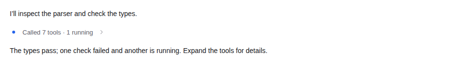
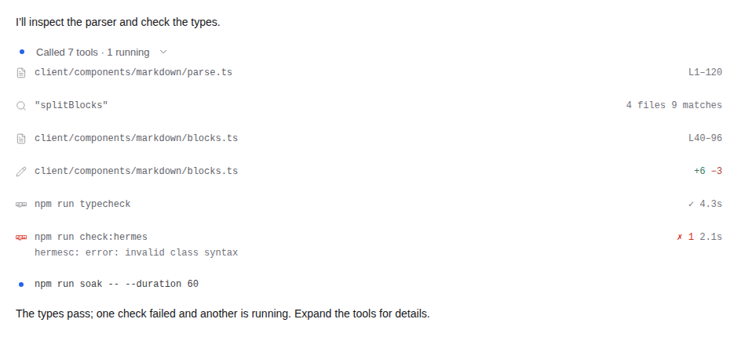

# Tool call rollups

Open Better Paseo settings → **Tool calls** → **Tool call rollups** (「合并工具调用」).
The switch defaults to **Off** and applies to all clients connected to the same
host. Turn it On to collapse consecutive tool calls under **Called N tools**;
a singleton says **Called 1 tool**. Running counts stay visible.
Expand the header to restore the original rich cards in their source slots,
including their copy, preview and detail controls. Turn it Off to restore the
existing file-operation groups. Other presentation switches keep their values.

Assistant updates, user prompts, reasoning and every other source timeline item
end a run, including native items the plugin does not render. All tool types
and outcomes participate: file, shell, search, generic/MCP, Paseo, subagent, hub,
activity, agent-message, questions and plans, including failed/error, rejected
and canceled calls. Waiting for permission does not remove a call from the count.
Native question and permission controls remain host-owned.

Cards that actually own active `PermissionActions` or `PermissionQuestionForm`
controls stay visible and expanded while collapsed. This includes child-agent
permission notifications and pending-permission list cards while the relevant
child waits, or its snapshot is unknown under the controls' existing rule.
They return to the collapsed run once the wait ends. Read-only question
transcripts can stay collapsed.

The persistent field is `toolCallRollups: boolean` in the existing `presentation`
settings document (host scope, schema version 1). Missing or invalid values fall
back to `false`. Disclosure choices survive card remounts in the current client,
but not a client reload. They are keyed to the group head, so a changed head can
select a different saved choice.

## Demo

Offline fixtures, not a user conversation or native-device acceptance. The
failure is deliberate fixture text, not a result of the validation below.

Collapsed, with running counts:

<picture><source media="(prefers-color-scheme: dark)" srcset="images/tool-rollups-dark-collapsed.png"></picture>

Expanded, with the original cards in their source slots:

<picture><source media="(prefers-color-scheme: dark)" srcset="images/tool-rollups-dark-expanded.png"></picture>

[Capture provenance](images/tool-rollups-provenance.json) records the source
commit, fixture hashes, dimensions and image hashes. Counts and spacing have the
limits below.

## Limits

- SDK source order is authoritative. Each read covers the recent 50 entries plus
  at most ten older 200-entry pages (about 2050 entries). Unknown, ambiguous
  duplicate, errored, gapped, stale or deeper data leaves calls standalone.
  Retaining covered pages/cursors, as the sender store does, is the upgrade path
  if deeper history needs it.
- Counts describe **mounted, source-adjacent calls**, not an entire historical
  turn. Virtualization can split a run and change its count/head as cards mount
  or leave. Missing members are never invented or pulled outside that window.
- On Paseo 0.12 web/desktop, the containing `agent-chat-scroll` viewport node
  identifies each mounted window, including stacked panes. Source order remains
  SDK-owned; the DOM marker supplies only window identity. This depends on the
  observed host marker. Without it, grouping uses measured left/width columns;
  asynchronous native measurements are retained and hidden slots keep their last
  positive bounds. Duplicate copies that cannot be assigned to distinct windows
  remain visible as ordinary cards, while unrelated runs still group. Native has
  no public pane ID: equal-column stacked windows with disjoint call IDs cannot
  be fully distinguished by that fallback. This is not full native pane acceptance.
- Web/desktop CSS hides only host wrappers containing explicitly marked empty
  rollup members, including the observed `display:contents` bridge. Grouping does
  not derive call order from the DOM. The spacing depends on the host wrapper shape and browser
  `:has` support. React Native shares grouping and disclosure, but native outer
  16pt slot margins can still leave blank gaps. A host slot-hiding or
  source-preserving grouped projection API would remove this ceiling.
- This path is exercised against Paseo 0.12 contracts/runtime. The existing
  manifest minimum `>=0.8.0` is unchanged; this is not fresh validation of
  0.8–0.11. Hermes compilation covers source and install-built bundles, but
  compile success is not runtime or iOS/Android device acceptance.

## Development checks

From the repository root, with Node and an installed Chrome/Chromium:

```sh
npm run typecheck
npm test
npm run build:client
npm run check:hermes
npm ci --prefix .showcase
CHROME_PATH=/path/to/chrome node .showcase/tools/rollups-smoke.mjs
```

The smoke uses offline fixtures and real summary/card components in light/dark
at desktop and 440px widths. It checks empty wrapper height, expands all seven
cards including a failed call, retains running counts, recollapses, and
checks for browser errors. Captures go to `.showcase/out/rollups`. The simulated
Paseo 0.12 wrapper is not a deployed SDK integration or a native-device test.
Unit tests separately cover source boundaries, inverted mounting, every tool
category/outcome, active permission controls, independent pane windows, async
measurements, ambiguous-copy fallback, remounts, Off/toggle behavior and
incomplete history pages. See [development guidance](development.md) for the
canonical screenshot capture commands and Hermes runtime restrictions.

API references: [plugin reference](https://paseo.sh/docs/plugins/reference.md)
and the installed `@getpaseo/plugin`/`@getpaseo/client` 0.12.0 contracts.

## Validation

Checked on Linux, Node 22.22.2/npm 10.9.7. The capture provenance records the
committed source revision used for the current documentation images.
Repository CI uses Node 24.

| Check | Result |
| --- | --- |
| `npm run typecheck` | Passed |
| `npm test` | 3615 passed, 1 existing macOS-only test skipped on Linux; 192 suites passed, 1 skipped |
| `npm run build:client` | Passed |
| `npm run check:hermes` | Source and install-built client/Tasks chunk compile passed; VM evaluation skipped because no Hermes VM is installed |
| Rollup browser smoke | Passed light/dark × desktop/440px; zero-height empty wrappers, all seven cards restored, counts retained, no browser errors |
| Screenshot scope | Targeted synthetic rollup scene only; unrelated assets retained |
| Rollup documentation images | Four targeted synthetic PNGs; hashes/dimensions and committed source recorded in provenance |
| Existing README screenshot tests | Prior QA recorded baseline failures on unchanged maintainer main `2209968`: hardcoded 23 pictures versus 25 actual; media-selection harness times out. The test, existing assets and README picture blocks are unchanged |

The README harness manifest omits the existing Tasks board/timeline image references.
These unrelated baseline failures were not suppressed or changed.

No iOS/Android device runtime was tested. Synthetic screenshots do not establish
SDK integration, native spacing parity or stable whole-turn counts.
